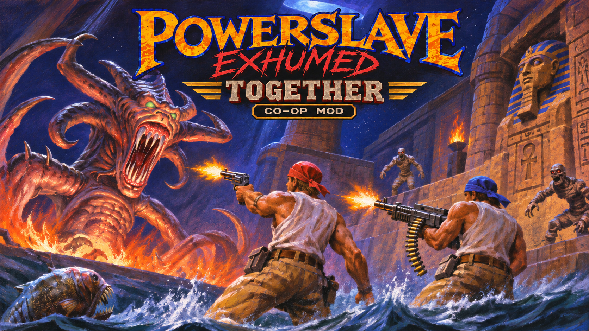
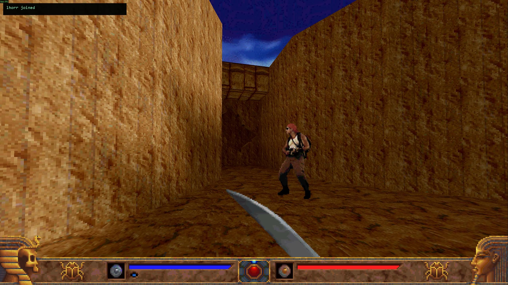
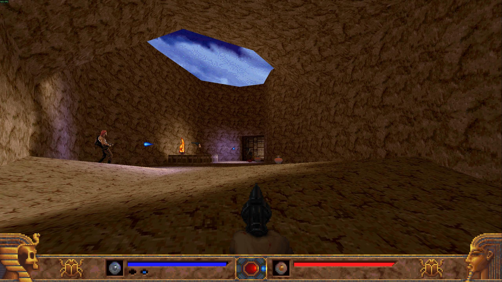

# PowerSlave Exhumed Together



**Explore Karnak together.** An unofficial, experimental campaign co-op mod for
**PowerSlave Exhumed (2022, KEX)** on Windows. One player hosts; friends connect
over LAN, Radmin VPN or a direct internet address.

**[Download the mod](https://github.com/Vadson159/PowerSlave-Exhumed-Together/releases)**
· [Инструкция на русском](docs/INSTALL_RU.md)
· [Report a bug](https://github.com/Vadson159/PowerSlave-Exhumed-Together/issues)

Also available on [ModDB](https://www.moddb.com/mods/powerslave-exhumed-together)
and [Nexus Mods](https://www.nexusmods.com/powerslaveexhumed/mods/6).
The updated ModDB download is available. Nexus Mods has quarantined its archive
pending support review; the same ZIP is available in GitHub Releases.

## Features and status

- Support for 2–8 players, visible teammates and their weapon fire.
- Synchronized enemies, doors, switches and triggers.
- Shared campaign level transitions; respawning and per-player checkpoints.
- In-game lobby browser, manual IPv4 connection and text chat.

**Public test build, 2026-11-13.** Crashes, enemy mismatches and desynchronization
may still occur. Recent automated game checks used multiple instances on one PC;
eight-player play over the internet has not been validated. This is an early
release for testing with friends.

## Requirements

- Windows 10/11 x64, your own **Steam copy of PowerSlave Exhumed**, and Steam running.
- The same mod build on every PC. Connect over LAN, a shared Radmin VPN network,
  or directly to the host's public address. The host attempts UPnP port forwarding;
  manual UDP forwarding may be needed. A host behind carrier-grade NAT needs a VPN.
  Internet play with the new UPnP support has not yet been verified.
- Supported executable: `anubis_Shipping_Steam_x64.exe`, SHA-256:
  `b8f131037187ca8d0a282527fb6f55a2012241d5b9dac8bf2038baf35b71a76d`.
  The installer checks this before copying the game. Other editions are unsupported.

## Install and play

1. Download the ZIP from **Releases** and extract to a short writable path,
   such as `D:\PSE_Together`. Every player needs their own game installation.
2. Run `install.bat`. It finds the Steam installation, checks its version and
   creates a separate `game` copy inside the mod folder. If detection fails,
   paste the folder opened by Steam → Manage → Browse local files.
3. Host: run `host.bat`, start a new game and enter a campaign level.
4. Friends: run `join.bat`, press **F7**, select the host's open lobby and press
   **Enter**. If discovery fails, enter the host's LAN/Radmin IPv4 and port
   **28745**. For direct internet play, use the host's public address shown under
   `Internet:` in F7, or run `join.bat ADDRESS`. `Host IP[:port]` also accepts a
   hostname. Start a new game; the client follows the host's level.
5. Allow the copied game through Windows Firewall on your intended network:
   **UDP 28745** for play, **UDP 28746** for lobby discovery. Radmin's adapter
   may be classified as a public network. Direct internet hosting also needs
   UDP 28745 allowed on the active internet network profile. To disable UPnP,
   run `set PSE_UPNP=0` before starting `host.bat` from that Command Prompt.
   The mod removes its port mapping when it exits.

The Steam installation and normal saves/settings remain separate. Mod profiles
and logs are under `profile` in the extracted mod folder. Steam overlay and
shared achievement forwarding are enabled: **real achievements may unlock**.
To disable the mod's achievement forwarding, run `set PSE_ACH_DRYRUN=1` in
Command Prompt before launching the batch file from that same window.

| Key | Action |
| --- | --- |
| F7 | Lobby / connection menu |
| Backslash (`\`) | Player list |
| T | Chat |
| E | Respawn after death |

To update, close the game, extract the whole new package and rerun `install.bat`.
All players must update together. To uninstall, close the mod and remove its
extracted folder; keep any mod saves you want first.

## Screenshots




## Troubleshooting

- Empty lobby list: check the VPN and UDP 28746, or enter the host IPv4 manually.
  The host must already be inside a level.
- Missing `SDL2_pse_original.dll`: rerun `install.bat` with the Steam game available.
- Build mismatch: verify Steam game files and compare every player's `VERSION.txt`.
- Report crashes or sync bugs in **Issues** with the mod version, player count,
  level, reproduction steps and relevant logs from `profile/host/logs` and
  `profile/client/logs`. Review logs before posting them publicly.

## Build from source

Requires Visual Studio 2022 C++ tools, Windows SDK, CMake 3.24+ and Python 3 for
auxiliary scripts. Use a short build directory to avoid Windows MAX_PATH.

```powershell
git clone --recurse-submodules https://github.com/Vadson159/PowerSlave-Exhumed-Together.git
cd PowerSlave-Exhumed-Together
cmake -S experiments/pse_together -B b99 -G "Visual Studio 17 2022" -A x64
cmake --build b99 --config Release --target pse_all
cmake --build b99 --config Release --target pse_tests
ctest --test-dir b99 -C Release --output-on-failure
.\make_friend_package.bat /nobuild /nopause
```

Existing checkout: `git submodule update --init --recursive`.
The mod sprite KPF is included for packaging. GitHub's automatic source ZIP
omits submodules; use a recursive clone.

Current code: `experiments/pse_together`, one `pse_together.dll`, host/client code
in `src/native`, one protocol in `src/net/include/net_protocol.h`. Older
experiments and numbered reports are development archives.

Release verification: Release targets build; CTest **18/19**. The legacy
`p24_loader_contract` needs an archived frozen P1 DLL outside source control
and fails when it is absent. [CHANGELOG.md](CHANGELOG.md) records gameplay fixes
and the scope of prior checks.

## Credits

Mod by **Vadson159 / Vadson**. Uses [ENet](https://github.com/lsalzman/enet)
and [MinHook](https://github.com/TsudaKageyu/minhook); notices are included in
the download. John player sprites: PC Exhumed sprites ripped by Dunkelschwamm
for The Spriters Resource, from the supplied PowerSlave EX 2015 Co-Op Edition
sprite set ([source mod](https://www.moddb.com/mods/powerslave-ex-co-op-edition));
attribution is retained inside the KPF.

An unofficial fan project, not affiliated with the game's developers or
publishers. The download contains the mod and installer, without the commercial
game. Game names and artwork belong to their respective owners. Third-party
components retain their own licenses; publishing this repository does not
assign a new license to those resources.

## Support

Optional support: **[Buy Me a Coffee](https://buymeacoffee.com/vadson)**.
The mod is free; donations do not unlock files, updates or support services.
