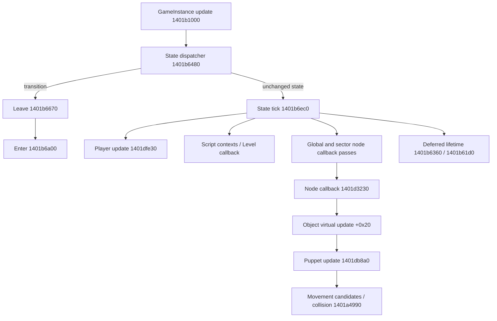

# Архитектура движка и цикл

Идентичность EXE и правила адресов: [01_BINARY_MANIFEST](01_BINARY_MANIFEST.md). Все `G_FUNC_*.json` ниже содержат SHA-256, image base, язык/ABI профиля Ghidra, тело функции, assembly, псевдокод, входящие ссылки и прямые callees. Это **direct Ghidra 12.2**, поскольку REA Ghidra 6.7.0 не поддержал установленную 12.2. Факт успешного fallback и ошибки: [TOOLCHAIN_BLOCKERS](research/TOOLCHAIN_BLOCKERS.md).

VERIFIED: бинарник содержит RTTI классов `kexSlaveGameInstanceLocal`, `kexSlaveObjectFactoryLocal`, `kexSlaveLevelLocal`, `kexSlavePuppet`, `kexSlaveAI`, vftables и AngelScript exports. Имена `FUN_*` — имена анализа; названия ролей в таблицах ниже — INFERRED, если не подкреплены строкой регистрации/диагностикой.

| Адрес, preferred VA | Статическое наблюдение и значение | Evidence |
|---|---|---|
| `0x140454a70` | PE entry, вызывает 0x1404553f0 и 0x1404548fc. Это startup stub, не найденный gameplay loop. | [entry](evidence/ghidra_2022/G_FUNC_140454a70.json) |
| `0x1401b01d0` | xrefs трёх строк `kexSlaveGameInstanceLocal::Start`; movies, definitions, script manager, actor/weapon defs; вызывает reset player с `this+0x40`. | [Start](evidence/ghidra_2022/G_FUNC_1401b01d0.json) |
| `0x1401b1000` | Виртуальный слот game instance +0x28; обновление UI/controller prompt, затем state dispatcher 0x1401b6480; fade. Кандидат общего Update. | [update](evidence/ghidra_2022/G_FUNC_1401b1000.json) |
| `0x1401b1310` | Виртуальный слот +0x20; графические команды/render/fade и present. INFERRED Draw; не выбирать как simulation tick. | [render](evidence/ghidra_2022/G_FUNC_1401b1310.json) |
| `0x1401b6480` | Сравнивает requested/current state, выходит из старого состояния, входит в новое; при совпадении вызывает 0x1401b6ec0. | [dispatcher](evidence/ghidra_2022/G_FUNC_1401b6480.json) |
| `0x1401b6ec0` | Переключатель по state; ветка case 3 содержит player update, скрипты, level/object list passes, HUD/audio и deferred node lifetime. | [state tick](evidence/ghidra_2022/G_FUNC_1401b6ec0.json) |
| `0x1401b6670` / `0x1401b6a00` | Ветвящиеся выход/вход состояний, release handle, scripts, level teardown/load; case 4 вызывает level interface LoadMap и переводит state в 3. | [leave](evidence/ghidra_2022/G_FUNC_1401b6670.json), [enter](evidence/ghidra_2022/G_FUNC_1401b6a00.json) |
| `0x1401b0e20` | Слот +0x18, очистка данных/ресурсов; INFERRED shutdown. Путь от engine quit полностью не прослежен. | [shutdown](evidence/ghidra_2022/G_FUNC_1401b0e20.json) |

Связь virtual slot → function подтверждается [RTTI symbols](evidence/ghidra_2022/G_SLAVE_SYMBOLS.json) и [game instance memory](evidence/ghidra_2022/G_MEMORY_14052ad08.json). Memory-export читает фиксированное окно 32×u64; не каждая строка такого окна является частью vftable. Не расширять таблицы за доказанную границу.

Проверенный порядок в обычной неприостановленной ветке case 3 функции 0x1401b6ec0:

1. Проверки флагов блокировки/перехода/меню; до switch увеличивается `this+0x210` и вызывается RNG Bit.
2. `0x1401dfe30(this+0x40)` — controller/player update; внутри есть сбор ввода, оружие/таймеры и проверки смерти.
3. При `DAT_140aeb11e == 0`: `0x1401ee2f0`, `0x1401bfcc0`; список отложенных script contexts с countdown/resume/free; level vcall +0x18; две группы callbacks `0x1401d58e0(DAT_140aeafa0/98)`; затем callbacks узлов каждого сектора (stride `0x88`, список +0x78).
4. При противоположном значении флага — отдельный вызов puppet update `0x1401db8a0` вместо этой мировой ветки. Значение/назначение флага не подтверждены; нельзя молча назвать его pause/noclip.
5. HUD/interface vcall, `0x1401b6360`, `0x1401b61d0`; расчёт listener transform из **единственного** Player actor.

Имена шагов 0x1401ee2f0/0x1401bfcc0 частично сопоставляются с исходником 2015, но нативные тела здесь ещё не разобраны. Не выдавать предположенный anim/mover порядок за полную идентификацию. Важнее сохранённый фактический call order и guards. Частота вызовов, связь render frame ↔ simulation tick, wall-clock accumulator и threading остаются UNKNOWN: нативная функция не была выполнена.

Граф отражает наблюдённые calls/dispatch slots и интерпретацию ролей. Полный граф сохранённых dossiers строится в [FUNCTION_CATALOG](research/FUNCTION_CATALOG.md); внешние и unresolved indirect edges не считаются отсутствующими.

Система объектов отличается от простого raw-pointer списка 2015. VERIFIED: actor имеет node handle по +0x10; node хранит payload по +0x28, refcount операции по +0x40; ссылки на target/player тоже проходят через node/type checks. `0x1401d3d70` создаёт/переносит actor node в sector list, устанавливает callback 0x1401d3230. Последний сравнивает per-object stamp с `DAT_140aec390` и вызывает virtual +0x20 только при новом stamp. Это INFERRED механизм защиты от повторного update в нескольких списках; полный порядок изменения stamp ещё не установлен. [LinkSector](evidence/ghidra_2022/G_FUNC_1401d3d70.json), [callback](evidence/ghidra_2022/G_FUNC_1401d3230.json), [list pass](evidence/ghidra_2022/G_FUNC_1401d58e0.json).

Удаление многошаговое: script Remove wrapper `0x140172f10` делает virtual +0x30; actor remove `0x1401a02b0` меняет flags/links; deferred sweep `0x1401b6360` проверяет refcounts, вызывает object virtual +0x28 и factory +0x30. Последний `0x1401d5000` кладёт объект в class pool; освобождение C++ памяти и Remove — разные операции. Для кооператива remote ID должен переживать завершение сетевого события, но не разрешать доступ к recycled object. [Remove](evidence/ghidra_2022/G_FUNC_1401a02b0.json), [sweep](evidence/ghidra_2022/G_FUNC_1401b6360.json), [pool](evidence/ghidra_2022/G_FUNC_1401d5000.json).

RNG: зарегистрированные `Bit()`/`UInt8()` сопоставлены с `0x1401e91b0`/`0x1401e9260`. Bit изменяет три глобальных state-слота `0x140aecb78`, `0x14063d148`, `0x14063d0b8`; UInt8 вызывает Bit восемь раз. Seed/lifetime/сериализация всех RNG и `Math::RandByte` не установлены. Даже косметическое выполнение действий может изменить RNG. Host-authoritative предпочтительнее предположения о детерминированности. [Bit](evidence/ghidra_2022/G_FUNC_1401e91b0.json), [UInt8](evidence/ghidra_2022/G_FUNC_1401e9260.json).

Для M0 нужно сохранить реальные очереди/секторные связи/refcounts и ровно один gameplay update каждого puppet, вынести input/player context и локальную презентацию. Для M3 требуется также подавление самостоятельных authoritative effects на клиентах; одной рассылки позиций недостаточно. Общую безопасность/реентерабельность native tick и потоков это исследование не доказало.
