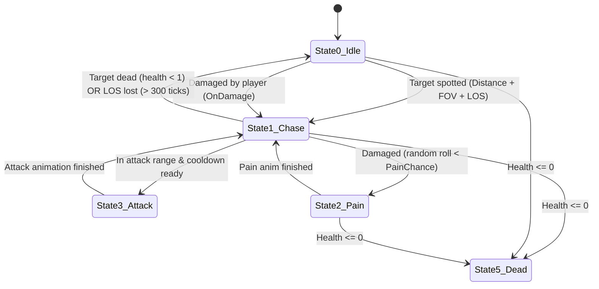
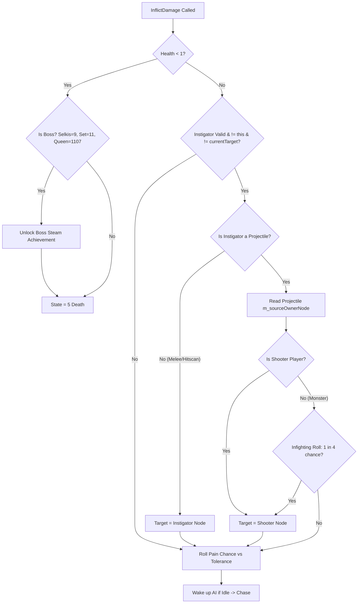

# PowerSlave Exhumed Together — Multiplayer AI Architecture (2–8 Players)

**Document ID:** `DOC-17-MULTIPLAYER-AI`  
**Classification:** Gameplay Compatibility Audit & Technical Specification  
**Target Binary:** `anubis_Shipping_Steam_x64.exe` (SHA-256 `b8f131037187ca8d0a282527fb6f55a2012241d5b9dac8bf2038baf35b71a76d`)  
**Target Package:** `PowerslaveEX.kpf` (SHA-256 `d34b63551713bf46c4215632d9b5f92b452791023937fe7d22a196bff9ff4bbd`)  
**Scope:** AI target acquisition, state machine, chase logic, damage retaliation, projectile source attribution, boss mechanics, and host-authoritative multiplayer AI architecture for 2–8 players.

---

## 1. Executive Summary

In the single-player release of *PowerSlave Exhumed* (2022), the enemy artificial intelligence (`kexSlaveAI`) was designed with the implicit assumption that exactly **one** human player exists in the game world.

Through static reverse-engineering and disassembly/decompilation of `anubis_Shipping_Steam_x64.exe` (via Ghidra 12.2) and inspection of shipped AngelScript scripts (`scripts/p_enemy.txt`, `scripts/p_misc.txt`), this audit establishes that:
1. **Initial Target Acquisition is Hardcoded to Singleton Player 1:** In State 0 (`Idle`), `FUN_140195580` directly queries `GameInstance->GetPlayer()` (`0x140af33a0 + 0xa8`). It performs distance, field of view (FOV), and line-of-sight (LOS) checks *exclusively* against Player 1. Secondary players (Players 2–8) are invisible to idle enemies, regardless of proximity or sight lines, until an external event occurs.
2. **Dynamic Retargeting on Damage Works Across All Instigators:** When an enemy takes damage in `FUN_140195050` (`kexSlaveAI::OnDamage`), it retargets to the instigator. If the damage came from a projectile, it resolves the shooter via `projectile->m_sourceOwnerNode` (`[projectile + 0x28]`). This mechanism *does* support secondary players, meaning an enemy will switch targets to Player 2 if attacked by Player 2.
3. **Dead Target & Respawn Amnesia:** When a target dies (`health < 1`), `ChaseTarget` (`FUN_1401971e0`) and AI tick (`FUN_140194ce0`) clear `m_pTargetNode = 0`, decrement the target's node refcount, and transition back to State 0 (`Idle`). When the fallen player respawns on key 'E', enemies do not automatically re-acquire them unless they pass Player 1's sight check or are damaged again.
4. **Scripted Boss Attacks Hardcode Singleton Player:** While most AngelScript attacks use `actor.GetTarget()`, the boss **Set** has a hardcoded quake attack in `A_SetCheckGround` (`scripts/p_enemy.txt:824`) that calls `Player().GetActor().InflictDamage(ai, 40)` and `puppet.Stun()`. In multiplayer, this damages and stuns *only Player 1*, even if Set leaped at Player 3.

---

## 2. Enemy AI State Machine & Architecture

Enemy actors derive from `kexSlaveAI` (object allocation size `0x1F8` bytes, registered in `FUN_1401f84a0`).
The AI state machine is driven primarily by `kexSlaveAI::Update` (`0x140194ce0` / RVA `0x194ce0`), which executes during the engine world simulation tick.

### 2.1 AI States (`kexSlaveAI + 0x1b8`)

| State ID | Engine Name / Symbolic Role | Implementation Function | Behavior |
|---|---|---|---|
| **0** | `AI_STATE_IDLE` | `FUN_140195580` (RVA `0x195580`) | Searches for targets within sight distance; plays idle animation (`def + 0xb0`). |
| **1** | `AI_STATE_CHASE` | `FUN_1401971e0` (RVA `0x1971e0`) | Chases `m_pTargetNode` (`this + 0x28`); updates rotation/yaw; fires projectiles or executes melee attacks. |
| **2** | `AI_STATE_PAIN` | Transition in `0x140195050` / `0x140194ce0` | Pain flinch animation (`def + 0x180`); checks pain chance against tolerance (`def + 0x1dc`). |
| **3** | `AI_STATE_ATTACK` | Managed by animation triggers | In attack stance / firing sequence (`def + 0x188`). |
| **5** | `AI_STATE_DEAD` | Assigned in `FUN_140195050:34` | Actor is dying / dead; collision cleared; AI update bypassed. |
| **6** | `AI_STATE_ACTION` | Animation-driven state | Custom scripted action or transition sequence. |

*Status:* `VERIFIED static` ([G_FUNC_140194ce0.json](file:///S:/_Vibe_Coding/PowerSlave_Exhumed_Together/PowerSlave_Exhumed_Together_mod/docs/evidence/ghidra_2022/G_FUNC_140194ce0.json)).



---

## 3. Detailed Mechanism Analysis

### 3.1 Initial Target Acquisition (`FUN_140195580`)

When an enemy is in State 0 (`Idle`) and `*(longlong*)(this + 0x28) == 0` (no current target node):
1. **Singleton Lookup:**
   ```c
   lVar5 = (**(code **)(DAT_140af33a0 + 0xa8))(&DAT_140af33a0); // GameInstance->GetPlayer()
   if (*(longlong *)(lVar5 + 0xd8) != 0) {
       lVar5 = FUN_140197ee0(); // Player 1's Puppet actor
   }
   ```
2. **Health & Dead Flag Check:**
   Validates `*(short*)(lVar5 + 0x17a) > 0` (Player 1 is alive) and `(*(uint*)(lVar5 + 0x1c0) & 0x200) == 0` (not dead flag).
3. **Distance Gate:**
   Computes horizontal Euclidean delta:
   $$\Delta x = |x_{\text{enemy}} - x_{\text{player}}| < \text{sightDistance}\ (this + 0x1cc)$$
   $$\Delta y = |y_{\text{enemy}} - y_{\text{player}}| < \text{sightDistance}\ (this + 0x1cc)$$
4. **Field of View (FOV) Gate:**
   If enemy is not in 360-degree awareness mode (`(*(byte*)(this + 0x1d8) & 2) == 0`):
   Computes angle $\theta = \text{atan2}(\Delta x, \Delta y)$ and checks angular divergence against front cone threshold `DAT_14053580c` ($\approx 60^\circ$ half-angle / $120^\circ$ FOV).
5. **Line of Sight (LOS) Raycast:**
   Calls `FUN_140195750(this, lVar5)` (`CanSeeTarget`). Executes spatial raycast across sector geometry.
6. **Acquisition & Alert:**
   If LOS is clear:
   - Sets target node: `*(longlong*)(this + 0x28) = lVar5->m_pNode`.
   - Atomically increments target node refcount: `lock inc dword ptr [targetNode + 0x40]`.
   - Plays alert sound (`def + 0x1b0`).
   - Calls `FUN_140195530(this)` to wake up AI.
   - Transitions to State 1 (`Chase`) with chase timer `*(this + 0x1e8) = 300` ticks (lines 80–88).

> [!CAUTION]
> **Multiplayer Blocker (VERIFIED):**  
> `FUN_140195580` contains zero iterations over secondary players. If Players 2–8 walk directly in front of an idle Anubis or Mummy, the monster will **completely ignore them** unless Player 1 also enters the detection cone, or Player 2 attacks the monster.

---

### 3.2 Chase Target & Fallback Logic (`FUN_1401971e0`)

When in State 1 (`Chase`):
1. **Target Validation:**
   Reads `targetNode = *(longlong*)(this + 0x28)`.
   If `targetNode == NULL` or target payload is NULL:
   - Prints debug diagnostic: `"kexSlaveAI::ChaseTarget - Called without a target\n"`.
   - Falls back to `GameInstance->GetPlayer()` (`0x140af33a0 + 0xa8`).
   - If Player 1's Puppet is valid, rebinds `targetNode = Player1->node` with atomic refcounting.
   - If Player 1 is also invalid, asserts: `"m_pTargetNode.IsValid()", "SlaveAI.cpp", line 0x3e4`!
2. **Dead Target Transition:**
   Reads target health `targetHealth = *(short*)(targetPayload + 0x17a)`.
   If `targetHealth < 1`:
   - Resets state: `*(int*)(this + 0x1b8) = 0` (`AI_STATE_IDLE`).
   - Sets flag `*(uint*)(this + 0x1d8) |= 2`.
   - Clears target node pointer: `*(longlong*)(this + 0x28) = 0`.
   - Atomically decrements previous target's node refcount: `lock xadd [oldTargetNode + 0x40], -1`.
   - Transitions animation to idle: `FUN_1401a1170(this, def + 0xb0)`.
   - Returns immediately.
3. **Sight Lost Timer (Chase Decay):**
   Calls `CanSeeTarget(this, targetPayload)`:
   - If visible: resets chase timer `*(int*)(this + 0x1e8) = 300` ticks.
   - If not visible: decrements chase timer `*(int*)(this + 0x1e8) -= 1`.
   - If chase timer reaches `< 0` (approx. 5 seconds at 60 Hz without LOS):
     Clears target node, decrements refcount, switches state to 0 (`Idle`), and resumes idle wandering.

*Status:* `VERIFIED static` ([G_FUNC_1401971e0.json](file:///S:/_Vibe_Coding/PowerSlave_Exhumed_Together/PowerSlave_Exhumed_Together_mod/docs/evidence/ghidra_2022/G_FUNC_1401971e0.json)).

---

### 3.3 Damage Retaliation & Retargeting (`FUN_140195050`)

When an enemy is damaged via `InflictDamage` (`0x1401a1370`), the virtual callback `victim->vtable[9]` dispatches to `kexSlaveAI::OnDamage` (`0x140195050`):

Signature: `void kexSlaveAI::OnDamage(kexSlaveAI* this, kexSlaveActor* pInstigator)`



1. **Instigator Resolution:**
   - If `pInstigator` is an actor (e.g. melee attack, hitscan):
     Checks `FUN_140198000(pInstigator)` (is valid target / player).
     If true: binds `this->m_pTargetNode = pInstigator->m_pNode`.
     Increments new target node refcount (`lock inc [newTargetNode + 0x40]`).
     Decrements previous target node refcount (`lock xadd [oldTargetNode + 0x40], -1`).
   - If `pInstigator` is a projectile (`FUN_140197fd0(pInstigator) != 0`):
     Reads `pInstigator + 0x148` (pointer to `ObjectNode` of source owner).
     Resolves payload actor `pShooter = FUN_140197f60(...)`.
     If `pShooter` is a player: binds `this->m_pTargetNode = pShooter->m_pNode` with atomic refcounting.
     If `pShooter` is another monster: tests infighting probability (`FUN_1401e9260() & 3 == 0` $\to$ 25% chance to retaliate against the monster, or 100% if already targeted by that monster).
2. **Wake-up Trigger:**
   If AI was in State 0 (`Idle`), `FUN_140195530(this)` immediately wakes the enemy into State 1 (`Chase`).

> [!NOTE]
> **Co-Op Consequence (VERIFIED):**  
> Retargeting on damage operates strictly on the *actual C++ instigator actor*, **not** the singleton `Player()`.
> Therefore, if Player 2 shoots an Anubis that was chasing Player 1, the Anubis **will successfully switch targets to Player 2**.
> This was confirmed in runtime test `C05` where native Anubis switched target to P2 and held `p2.node` refcount!

---

### 3.4 Projectile Ownership & Source Attribution (`FUN_1401d50b0`)

When any projectile is fired (e.g. player weapon, monster fireball, wasp sting):
1. Native `SpawnProjectile` (`0x1401d50b0` / RVA `0x1d50b0`):
   - Arguments: `(factory, shooterActor, type, originVec, rotation, speed)`.
   - Reads shooter node: `shooterNode = *(longlong*)(shooterActor + 0x10)`.
   - Stores into projectile: `*(longlong*)(projectile + 0x28) = shooterNode`.
   - Atomically increments shooter node refcount: `lock inc dword ptr [shooterNode + 0x40]`.
2. When the projectile collides with a victim:
   - `InflictDamage(victim, projectile, damageType, amount)` passes `projectile` as `param_2` (`pInstigator`).
   - `kexSlaveAI::OnDamage` reads `[projectile + 0x148]` / `0x28` to extract `shooterNode`.
   - The victim attributes the damage to the true shooter, preserving kill tracking, infighting, and achievement criteria.
3. Node Lifecycle Hazard:
   Active in-flight projectiles hold a `refcount` on their shooter's `ObjectNode`. If Player 2 disconnects or is removed while their rockets or cobra staff shots are mid-air, Player 2's `ObjectNode` will NOT be swept from memory until all active projectiles detonate or expire.

*Status:* `VERIFIED static` ([G_FUNC_1401d50b0.json](file:///S:/_Vibe_Coding/PowerSlave_Exhumed_Together/PowerSlave_Exhumed_Together_mod/docs/evidence/ghidra_2022/G_FUNC_1401d50b0.json)).

---

### 3.5 Boss Specifics & Scripted Anomalies

#### 1. Boss: Set (`Obj_Monster_Set`, Type `0x0b` / 11)
- **Arena Script:** `scripts/map/SETARENA_script.txt`.
- **Scripted Quake Blocker (VERIFIED):**
  In `scripts/p_enemy.txt:807` (`A_SetCheckGround`), when Set lands from a leap:
  ```angelscript
  kexSlavePuppet@ puppet = Player().GetActor();
  if(puppet.GetOrigin().z <= puppet.GetFloorHeight()+1.0f)
  {
      puppet.InflictDamage(ai.CastToActor(), ADT_GENERIC, 40);
      puppet.Stun();
  }
  ```
  **Flaw:** Uses `Player().GetActor()`. In 2–8 player co-op, ground quakes exclusively damage and stun Player 1. If Player 1 is airborne or far away, Player 1 still takes damage if on the ground, while Players 2–8 standing next to Set take zero damage and are never stunned.
- **Death Achievement:** Unlocks `ACH_DEFEAT_SET` in native `FUN_140195050:22`.

#### 2. Boss: Selkis (`Obj_Monster_Selkis`, Type `0x09` / 9)
- **Arena Script:** `scripts/map/SELBUROW_script.txt`.
- **Behavior:** `A_SelkisThink` (`scripts/p_enemy.txt:854`). Increases speed as health decreases:
  $$\text{speed} = \frac{96 - (\text{health} / 83)}{4}$$
- **Targeting:** Uses standard `actor.GetTarget()`. Tail swipe and burrow attacks follow target.
- **Death Achievement:** Unlocks `ACH_DEFEAT_SELKIS` in native `FUN_140195050:19`.

#### 3. Boss: Kilmaat Queen (`Obj_Monster_Queen`, Type `0x453` / 1107)
- **Arena Script:** `scripts/map/KILARENA_script.txt`.
- **Behavior:**
  - `A_QueenTailAttack` (`scripts/p_enemy.txt:1227`): binds secondary tail actor `tail.SetTarget(actor.GetTarget())`. The tail tracks the Queen's current target.
  - `A_QueenHurl`: spits homing energy spheres.
  - `A_QueenFlap`: wing flap creates shockwave.
- **Targeting:** Follows `actor.GetTarget()` dynamically. Switches targets when damaged.
- **Death Achievement:** Unlocks `ACH_DEFEAT_QUEEN` in native `FUN_140195050:26`.

---

## 4. Host-Authoritative AI Architecture for 2–8 Players

To support 2–8 players seamlessly without modifying engine physics or desynchronizing clients, the **host must remain the sole authority** for all AI logic.

### 4.1 Core Principles
1. **Host-Authoritative AI Simulation:**  
   Clients run **no** local AI simulation. The host evaluates sight, movement, attacks, projectile spawns, damage, and death.
2. **Deterministic Replication:**  
   The host replicates monster transform (`origin`, `rotation`, `velocity`), animation ID (`animID`, `frameID`), health, and state flags to clients via state snapshots.
3. **No Client Side-Effects:**  
   Clients replay animations for visual smoothness, but client-side frame action callbacks (`kexSlaveWeapon::ChangeAnim` / `FUN_14020f760`) must be suppressed so clients do not locally spawn projectiles or inflict damage.

### 4.2 Target Selector Hook Design (`M1/M3 Target Acquisition`)

To resolve the singleton Player 1 bias in `FUN_140195580` (`AI_STATE_IDLE`), install a minimal detour hook at `0x140195580`:

```c
// Proposed Minimal Detour for Idle Target Acquisition (0x140195580)
kexSlaveActor* SelectBestMultiplayerTarget(kexSlaveAI* pAI) {
    kexSlaveActor* pBestTarget = nullptr;
    float bestDistanceSq = pAI->m_sightDistance * pAI->m_sightDistance;
    
    // Iterate over all active, alive player slots (1..8)
    for (int i = 0; i < g_MaxConnectedPlayers; ++i) {
        PlayerContext* pCtx = g_PlayerContexts[i];
        if (!pCtx || !pCtx->pPuppet) continue;
        
        kexSlaveActor* pPuppetActor = pCtx->pPuppet;
        if (pPuppetActor->m_health <= 0) continue;
        if (pPuppetActor->m_flags & PF_DEAD) continue;
        
        // Distance check
        kVec3 delta = pPuppetActor->m_origin - pAI->m_origin;
        float distSq = delta.x * delta.x + delta.y * delta.y;
        if (distSq >= bestDistanceSq) continue;
        
        // Field of View check (if not 360-degree awareness)
        if ((pAI->m_flags & 2) == 0) {
            float yawToTarget = atan2f(delta.x, delta.y);
            float angleDiff = AngleDiff(pAI->m_rotation.yaw, yawToTarget);
            if (angleDiff > FOV_HALF_ANGLE) continue;
        }
        
        // Line of Sight check
        if (!pAI->CanSeeTarget(pPuppetActor)) continue;
        
        // Found closer valid target
        bestDistanceSq = distSq;
        pBestTarget = pPuppetActor;
    }
    
    return pBestTarget; // Returns closest visible player, or nullptr
}
```

### 4.3 Script Patch Design for Set Ground Quake (`p_enemy.txt`)

In `A_SetCheckGround` (`scripts/p_enemy.txt:824`), replace the singleton call with a radial proximity check across all active puppets:

```angelscript
// Replacement for A_SetCheckGround in scripts/p_enemy.txt
void A_SetCheckGround(kexSlaveAI @ai)
{
    if(ai.GetVelocity().z > 0) return;
    
    if((ai.GetOrigin().z + ai.GetVelocity().z) <= ai.GetFloorHeight()+2.0f)
    {
        ai.GetVelocity().Clear();
        ai.GetFlags() &= ~AF_DISABLEFRICTION;
        ai.GetPainChance() = 24;
        ai.ClearIgniteFlames();
        ai.ChangeAnim("monsters/set_leap_land");
        
        // Multiplayer-aware radial ground shockwave
        for(uint i = 0; i < g_PlayerList.length(); ++i)
        {
            kexSlavePuppet@ puppet = g_PlayerList[i].GetActor();
            if(puppet is null) continue;
            if(puppet.GetHealth() <= 0) continue;
            
            // Player must be on or near the floor to be stunned by ground quake
            if(puppet.GetOrigin().z <= puppet.GetFloorHeight() + 2.0f)
            {
                // Optional: add distance falloff (e.g. within 1500 units)
                if(ai.GetOrigin().Distance(puppet.GetOrigin()) < 1500.0f)
                {
                    puppet.InflictDamage(ai.CastToActor(), ADT_GENERIC, 40);
                    puppet.Stun();
                }
            }
        }
    }
}
```

---

## 5. Verification Matrix & Evidence Index

| Subsystem / Feature | Observed Mechanism | Verification Level | Primary Evidence File |
|---|---|---|---|
| Idle Target Selection | Reads `GameInstance->GetPlayer()`; tests sight distance, FOV, and LOS against Player 1 only. | `VERIFIED static` | `docs/evidence/ghidra_2022/G_FUNC_140195580.json` |
| Chase Target Logic | Chases `m_pTargetNode`; falls back to Player 1 if target is null; resets to Idle on target death. | `VERIFIED static` | `docs/evidence/ghidra_2022/G_FUNC_1401971e0.json` |
| Damage Retaliation | Sets `m_pTargetNode` to attacker or projectile source owner; supports P2–P8 instigators. | `VERIFIED static` + `RUNTIME (C05)` | `docs/evidence/ghidra_2022/G_FUNC_140195050.json`, `docs/evidence/m0/C05/RESULT.md` |
| Projectile Attribution | `SpawnProjectile` stores shooter `ObjectNode` at `[proj + 0x28]` with refcount increment. | `VERIFIED static` | `docs/evidence/ghidra_2022/G_FUNC_1401d50b0.json` |
| Set Boss Ground Quake | Hardcoded `Player().GetActor().InflictDamage(ai, 40)` in AngelScript. | `VERIFIED static` | `experiments/kpf_extracted/scripts/p_enemy.txt:824` |
| Boss Death Achievements | Unlocks `ACH_DEFEAT_SELKIS`, `ACH_DEFEAT_SET`, `ACH_DEFEAT_QUEEN` in `OnDamage`. | `VERIFIED static` | `docs/evidence/ghidra_2022/G_FUNC_140195050.json:18-28` |
| Spider / Wasp / Monster Scripts | All other enemy attacks use `actor.GetTarget()` without hardcoding `Player()`. | `VERIFIED static` | `experiments/kpf_extracted/scripts/p_enemy.txt` |
