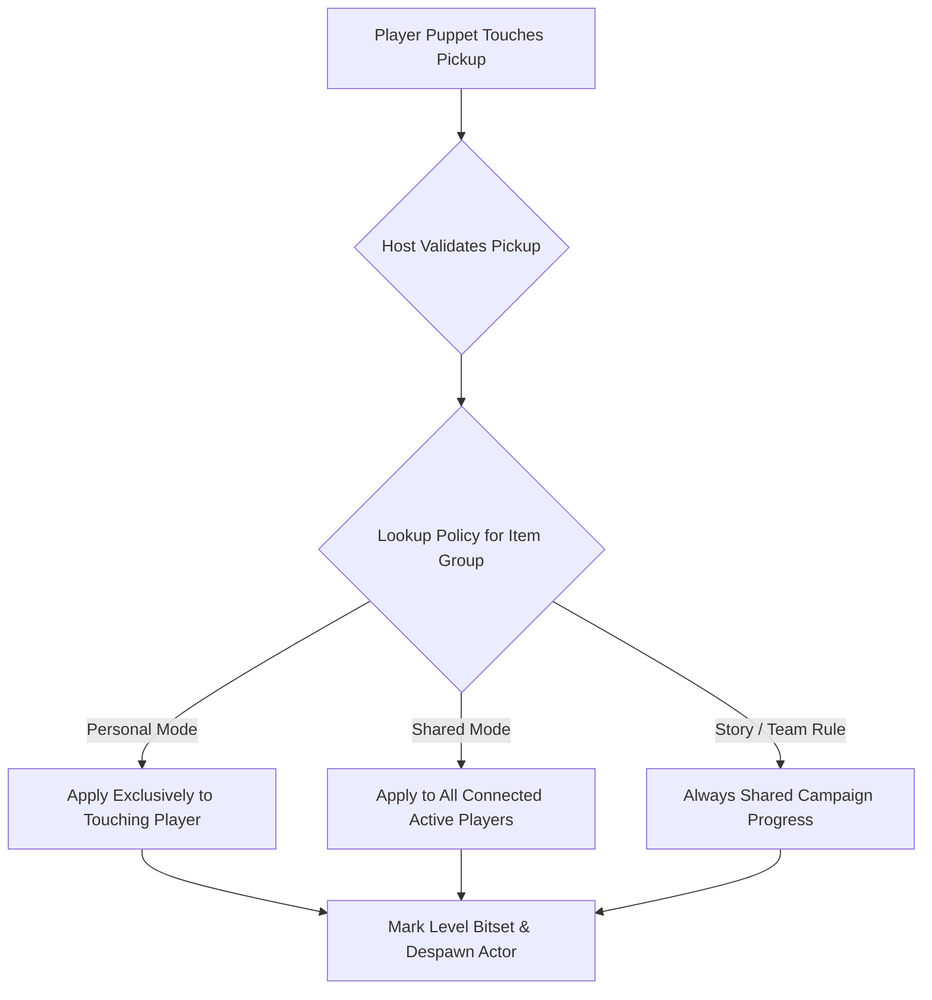

# PowerSlave Exhumed Together — Pickups, Weapons & Inventory Architecture

**Document ID:** `DOC-18-PICKUPS-AND-INVENTORY`  
**Classification:** Systems Architecture, Reverse Engineering Audit & Co-Op Specification  
**Target Binary:** `anubis_Shipping_Steam_x64.exe` (SHA-256 `b8f131037187ca8d0a282527fb6f55a2012241d5b9dac8bf2038baf35b71a76d`)  
**Target Package:** `PowerslaveEX.kpf` (SHA-256 `d34b63551713bf46c4215632d9b5f92b452791023937fe7d22a196bff9ff4bbd`)  
**Scope:** Complete audit of all pickup handlers, inventory storage, owner attribution, global player dependencies, duplicate reward hazards, respawn loadout reset constraints, and flexible shared vs. personal item policies for 2–8 players.

---

## 1. Executive Summary

In *PowerSlave Exhumed* (2022), all interactive world items inherit from the native C++ class `kexSlavePickup` (`vtable` at `0x14052ca70`, type descriptor `.PAVkexSlavePickup@@` at `0x140a51900`).
When an actor enters the bounding cylinder of a pickup with flag `AF_TOUCHABLE` (`0x100`), the engine dispatches a touch callback to the pickup's virtual handler.

A critical discovery of this audit is that **the game does not use a uniform mechanism to identify the player who collected the item**:
- **Owner-Aware Handlers (Touch Attributed):** Weapons, Keys, Story Artifacts, Team Dolls, Transmitter Quest Items, and Power-Ups read `param_2[0x37]` (which is `touchingPuppet + 0x1b8`, the pointer to the `owner Player`). They apply their state directly to the individual player who touched the pickup.
- **Global-Player Handlers (Hardcoded Singleton):** Standard Health Orbs, Ammo Orbs, and Ankh Max-Health upgrades completely ignore `touchingPuppet->ownerPlayer`. Instead, they query `GameInstance->GetPlayer()` (`0x140af33a0 + 0xa8`), applying the health, ammo, or maximum health expansion **exclusively to Player 1 (the host)**, regardless of who collected the item.

Without code adaptation, if Player 2 picks up a Health or Ammo orb, Player 1 is healed or replenished while Player 2 receives nothing. Furthermore, Ankh pickups call a non-idempotent native helper (`FUN_1401e0910`) that increments the health container counter before checking bitmasks, creating dangerous counter corruptions if duplicated over the network.

---

## 2. Comprehensive Inventory of Pickup Classes & Handlers

The binary implements ten specialized pickup classes derived from `kexSlavePickup`. All ten handlers call a common cleanup and persistence routine `FUN_1401d8360` upon successful acquisition.

### 2.1 The Common Acquisition Routine (`FUN_1401d8360`)
When any pickup is successfully collected, `FUN_1401d8360(thisPickup, touchActor)` executes:
1. **Audio & HUD Notification:** Plays pickup sound (`def + 0x100` / `0xf8`) on the touching actor; prints HUD string (`def + 0x118`) via `PTR_vftable_140a43e20 + 0x18`.
2. **Level Persistence Bitset (`DAT_140a45a80`):**
   Reads level item index $u = \text{pickup}[0x30]$ (`*(uint*)(this + 0x180)`).
   Sets bit $(u \pmod 8)$ at byte $(u \gg 3)$ in `DAT_140a45a80`:
   ```c
   byte* pBit = (u >> 3) + DAT_140a45a80;
   *pBit |= (1 << (u & 7));
   ```
   This ensures collected pickups do not respawn during level re-entry or checkpoint loads.
3. **Collision & Visibility Suppression:**
   Clears `AF_TOUCHABLE` (`0x100`) and `AF_SOLID` (`0x2`):
   `*(uint*)(this + 0x16c) &= ~0x102;`
4. **Actor Removal:**
   Calls virtual destructor / pool retire `vtable[6]` (`(*this + 0x30)(this)`), removing the actor from the active sector list.
5. **Checkpoint Trigger:**
   Calls `FUN_1401a1090(this)` to mark world dirty state.

*Status:* `VERIFIED static` ([G_FUNC_1401d8360.json](file:///S:/_Vibe_Coding/PowerSlave_Exhumed_Together/PowerSlave_Exhumed_Together_mod/docs/evidence/ghidra_2022/G_FUNC_1401d8360.json)).

---

### 2.2 Detailed Breakdown of All 10 Pickup Handlers

| Pickup Type | Native Class / Def Anchor | Handler Address / RVA | Player Attribution Source | Target Storage Location | Uses Global Player? | Achievements & Events Triggered |
|---|---|---|---|---|---|---|
| **Weapons** | `kexSlavePickupWeapon`<br>`Item_Weapon_*` | `0x1401d8470`<br>`0x1d8470` | `param_2[0x37]` (`touchingPuppet + 0x1b8`) | `FUN_1401e06d0(owner, slot, 1)` | **NO** | Grants weapon slot (1..7). Resets on respawn. |
| **Health Orbs** | `kexSlavePickupHealth`<br>`Item_Health*` | `0x1401d8770`<br>`0x1d8770` | `GameInstance->GetPlayer()` (`0x140af33a0 + 0xa8`) | `FUN_1401e0850(globalPlayer, amount)` | <span style="color:red">**YES**</span> | Restores up to 20/2000 HP. Ignored touching player! |
| **Ankhs (Max HP)** | `kexSlavePickupMaxHealth`<br>`Item_Health_Ankah*` | `0x1401d8870`<br>`0x1d8870` | `GameInstance->GetPlayer()` (`0x140af33a0 + 0xa8`) | `Player + 0x84` (count)<br>`Player + 0x86` (bitmask) | <span style="color:red">**YES**</span> | `ACH_ALL_ANKAHS` if count > 4. Non-idempotent counter! |
| **Ammo Orbs** | `kexSlavePickupAmmo`<br>`Item_Ammo*` | `0x1401d8590`<br>`0x1d8590` | `GameInstance->GetPlayer()` (`0x140af33a0 + 0xa8`) | `FUN_1401e0770(globalPlayer, slot, amount)` | <span style="color:red">**YES**</span> | Refills active weapon or all slots (if `fullAmmo`). |
| **Keys** | `kexSlavePickupKey`<br>`Key_*` (Power, Time, War, Earth) | `0x1401d8a00`<br>`0x1d8a00` | `param_2[0x37]` (`touchingPuppet + 0x1b8`) | `*(ushort*)(owner + 0x98) \|= (1 << keyType)` | **NO** | Stores keys 0..3 on individual player. Doors check Player 1! |
| **Story Artifacts** | `kexSlavePickupArtifact`<br>`Arti_*` (6 relics) | `0x1401d8ac0`<br>`0x1d8ac0` | `param_2[0x37]` (`touchingPuppet + 0x1b8`) | `*(uint*)(owner + 0x90) \|= (1 << bit)` | **NO** | Fires event `1000 + bit`. Unlocks `ACH_*` for ALL set bits! |
| **Team Dolls** | `kexSlavePickupTeamDoll`<br>`TD_Doll*` (23 dolls) | `0x1401d8f30`<br>`0x1d8f30` | `param_2[0x37]` (`touchingPuppet + 0x1b8`) | `*(uint*)(owner + 0xa4) \|= (1 << dollBit)` | **NO** | Unlocks `ACH_TEAM_DOLL`. Unlocks `ACH_ALL_TEAM_DOLLS` at 23. |
| **Transmitters** | `kexSlavePickupQuest`<br>`Transmitter_*` (8 parts) | `0x1401d8dc0`<br>`0x1d8dc0` | `param_2[0x37]` (`touchingPuppet + 0x1b8`) | `*(ushort*)(owner + 0x9a) \|= (1 << bit)` | **NO** | Updates HUD quest indicators (`PTR + 0x28`). |
| **Power-Ups** | `kexSlavePickupPower`<br>`Item_Power` | `0x1401d91f0`<br>`0x1d91f0` | `param_2[0x37]` (`touchingPuppet + 0x1b8`) | `*(ushort*)(owner + 0xa0) = boostTimer` | **NO** | Unlocks `ACH_WEAPON_BOOST`. Temporarily boosts weapon power. |
| **Automap** | `kexSlavePickupMap`<br>`Item_Map` | `0x1401d9140`<br>`0x1d9140` | Any touching puppet | Global automap service `PTR + 0x10` | **NO** (Global service) | Unveils map geometry for the current level. |

*Status:* `VERIFIED static` ([ghidra_2022/G_FUNC_1401d8*.json](file:///S:/_Vibe_Coding/PowerSlave_Exhumed_Together/PowerSlave_Exhumed_Together_mod/docs/evidence/ghidra_2022/)).

---

## 3. In-Depth Analysis of Critical Handlers

### 3.1 Weapon Pickups (`0x1401d8470`)
```c
void kexSlavePickupWeapon::OnTouch(kexSlavePickup* this, kexSlavePuppet* pTouchingPuppet) {
    if (this->m_pDef == NULL || pTouchingPuppet->m_health <= 0) return;
    
    // Reads touching puppet's owner Player context (offset 0x37 * 8 = 0x1b8)
    kexSlavePlayer* pOwner = pTouchingPuppet->m_pOwnerPlayer;
    int slotToGive = this->m_pDef->m_weaponSlotToGive; // offset 0x128
    
    if (pOwner->GiveWeapon(slotToGive, 1)) {
        this->OnPickup(pTouchingPuppet); // Removes pickup, plays sound
    }
}
```
- **Attribution:** Correctly attributed to the touching player.
- **Remove If Owned:** Actor definition contains `removeIfOwned 1` (lines 158, 176, 194, 212, 230, 248, 266 in `defs/actors/items.txt`). If the player already owns the weapon, `GiveWeapon` gives ammo instead.

### 3.2 Health (`0x1401d8770`) & Ammo (`0x1401d8590`)
```c
// Health Pickup Handler (0x1401d8770)
void kexSlavePickupHealth::OnTouch(kexSlavePickup* this, kexSlavePuppet* pTouchingPuppet) {
    if (this->m_pDef == NULL || pTouchingPuppet->m_health <= 0) return;
    
    // HARDCODED SINGLETON LOOKUP:
    kexSlavePlayer* pGlobalPlayer = GameInstance->GetPlayer(); // 0x140af33a0 + 0xa8
    
    int giveAmount = this->m_pDef->m_giveAmount; // offset 0x134
    if (pGlobalPlayer->GiveHealth(giveAmount)) {
        this->OnPickup(pTouchingPuppet);
    }
}
```
```c
// Ammo Pickup Handler (0x1401d8590)
void kexSlavePickupAmmo::OnTouch(kexSlavePickup* this, kexSlavePuppet* pTouchingPuppet) {
    if (this->m_pDef == NULL || pTouchingPuppet->m_health <= 0) return;
    
    // HARDCODED SINGLETON LOOKUP:
    kexSlavePlayer* pGlobalPlayer = GameInstance->GetPlayer(); // 0x140af33a0 + 0xa8
    
    if (this->m_pDef->m_fullAmmo == 0) {
        int slot = this->m_pDef->m_weaponSlot;
        if (slot > 7) slot = pGlobalPlayer->m_activeWeaponSlot;
        pGlobalPlayer->GiveAmmo(slot, calculatedAmount);
    } else {
        // Refill all 8 slots
        for (int i = 0; i < 8; ++i) pGlobalPlayer->SetAmmoMax(i);
    }
    this->OnPickup(pTouchingPuppet);
}
```
> [!CAUTION]
> **Primary Co-Op Bug:**  
> Both handlers directly dereference `GameInstance->GetPlayer()`. In a multi-client session, any client collecting health or ammunition heals or replenishes **Player 1 (the host)**! The client who took the risk of grabbing the pickup receives nothing.
> **Fix Requirement:** Replace `GameInstance->GetPlayer()` with `pTouchingPuppet->m_pOwnerPlayer` (`param_2[0x37]`).

### 3.3 Ankh Max Health (`0x1401d8870`) & Non-Idempotent Helper (`FUN_1401e0910`)
```c
void kexSlavePickupMaxHealth::OnTouch(kexSlavePickup* this, kexSlavePuppet* pTouchingPuppet) {
    if (this->m_pDef == NULL || pTouchingPuppet->m_health <= 0) return;
    
    // Queries global player:
    kexSlavePlayer* pGlobalPlayer = GameInstance->GetPlayer();
    int bitIndex = this->m_pDef->m_bits; // 0..4 for Ankahs 1..5
    
    // Calls acquisition helper:
    if (FUN_1401e0910(pGlobalPlayer, 1 << bitIndex)) {
        if (pGlobalPlayer->m_ankhCount > 4) { // offset 0x84
            SteamAchievements->SetAchievement("ACH_ALL_ANKAHS", 0);
        }
        this->OnPickup(pTouchingPuppet);
    }
}
```
**The Non-Idempotent Trap in `FUN_1401e0910` (RVA `0x1e0910`):**
Static decompilation of `FUN_1401e0910` reveals:
1. It increments `*(short*)(pPlayer + 0x84)` (Ankh container count) **before** testing if the bit is already present in `*(short*)(pPlayer + 0x86)`!
2. If the function is called twice for the same Ankh (e.g. uncoordinated network packets or duplicate client signals), the counter increases to 2, 3, 4... up to 8!
3. This prematurely unlocks `ACH_ALL_ANKAHS` and permanently distorts player maximum health.

### 3.4 Key Pickups (`0x1401d8a00`) vs. Door Interactions (`FUN_1401bccb0`)
- **Key Pickup:** Stores key bits into `touchingPuppet->m_pOwnerPlayer->m_keys` (`Player + 0x98`):
  `*(ushort*)(owner + 0x98) |= (1 << keyType);`
- **Door Face/Use Trigger (`FUN_1401bccb0:67`):**
  When a player walks up to a locked door and presses 'E' (`BC_USE`), the door interaction code executes:
  ```c
  lVar5 = GameInstance->GetPlayer(); // ALWAYS Player 1!
  if (((*(short*)(lVar5 + 0x98) >> (doorKeyType)) & 1) == 0) {
      // "You need the ... key" message
      return;
  }
  ```
- **Consequence:** If Player 2 collects the Power Key, Player 2's `Player + 0x98` has bit 0 set, but Player 1's `Player + 0x98` is 0. If Player 2 approaches the Power Door and presses 'E', the door checks Player 1, fails the check, and refuses to open!

---

## 4. Respawn Rules & Inventory Constraints

Under the approved project specification (`DOC-16-RESPAWN-DESIGN`):
1. **Manual Respawn via Key 'E' Only:** Automatic respawn is strictly forbidden.
2. **Current Level Spawn:** Respawn occurs at the level start sector.
3. **World State Intact:** Dead monsters, collected items (`DAT_140a45a80`), opened doors, and raised bridges remain in their current state.
4. **Armory Reset on Death:**
   Upon respawning, the fallen player's weapon inventory resets to the baseline starting loadout:
   - **Machete** (`Slot 0` / `PW_MACHETE`) — unlimited.
   - **Pistol** (`Slot 1` / `PW_PISTOL`) — 50 baseline rounds.
   - All other weapons (`M60`, `Bombs`, `Flamethrower`, `Cobra Staff`, `Ring of Ra`, `Manacles`) are **stripped**.
5. **Campaign Progression Preserved:**
   Global story items must **never** be stripped on death or respawn:
   - **Keys** (`Player + 0x98`) — retained.
   - **Story Artifacts** (`Player + 0x90`) — retained.
   - **Transmitter Pieces** (`Player + 0x9a`) — retained.
   - **Team Dolls** (`Player + 0xa4`) — retained.
   - **Ankh Max Health** (`Player + 0x84`) — retained (player spawns at 100 HP, but retains unlocked capacity containers).

> [!WARNING]
> **Pickup Depletion Blocker:**  
> Because level item pickups are recorded in `DAT_140a45a80` and permanently removed upon collection, a player who dies in late-game maps cannot go back and re-collect weapons that were already picked up earlier on that level!
> **Architectural Solution:** Either:
> - Weapon pickups remain in the world but become non-interactive only for players who currently hold them, OR
> - Allow weapon sharing / dropping, OR
> - Provide ammo/weapon respawn pods in co-op mode.

---

## 5. Extensible Policy Architecture: Shared vs. Personal Pickups

To accommodate different cooperative playstyles without rewriting native game logic, the host enforces an item policy matrix via the session ruleset:



### 5.1 Item Policy Matrix

| Item Category | Single-Player Stock Behavior | Co-Op Default Rule | Configurable Policy Options |
|---|---|---|---|
| **Story Artifacts** (Sandals, Mask, etc.) | Attributed to toucher; fires event | **Shared Campaign** | Always Shared. Unlocks for all participants. |
| **Keys** (Power, Time, War, Earth) | Attributed to toucher | **Shared Campaign** | Always Shared. Combined bitmask syncs to all players. |
| **Transmitters** (8 parts) | Attributed to toucher | **Shared Campaign** | Always Shared. Quest items synced to server ledger. |
| **Team Dolls** (23 dolls) | Attributed to toucher | **Shared Campaign** | Always Shared. Collective collection counter. |
| **Weapons** | Attributed to toucher; actor removed | **Personal** | • `PERSONAL_EXCLUSIVE` (Stock: one player takes)<br>• `SHARED_TEAM` (Grants weapon to all active players)<br>• `INDEPENDENT_SPAWN` (Respawnable for other players) |
| **Ammunition** | Hardcoded to Player 1 | **Personal** | • `TOUCHER_ONLY` (Heals/refills touching player)<br>• `TEAM_SPLIT` (Divides ammo evenly across players)<br>• `SHARED_FULL` (Refills all teammates) |
| **Health Orbs** | Hardcoded to Player 1 | **Personal** | • `TOUCHER_ONLY` (Heals touching player)<br>• `SHARED_POOL` (Heals most injured teammate) |
| **Ankhs (Max HP)** | Hardcoded to Player 1 | **Shared Team** | • `SHARED_TEAM` (Increases max HP for all players)<br>• `PERSONAL_ANKH` (Increases max HP for toucher only) |
| **Power-Ups** (Weapon Boost) | Attributed to toucher | **Personal** | • `TOUCHER_ONLY` (Individual 30s boost)<br>• `TEAM_BOOST` (All active players boosted) |
| **Automap** | Global service | **Shared Team** | Always Shared across all players. |

---

## 6. Implementation Specifications for Milestone M1/M3

### 6.1 Native Detour for Health & Ammo Fix
Hook the entry points of `kexSlavePickupHealth::OnTouch` (`0x1401d8770`) and `kexSlavePickupAmmo::OnTouch` (`0x1401d8590`):

```c
// Replacement logic for 0x1401d8770 (kexSlavePickupHealth::OnTouch)
void Hook_PickupHealth_OnTouch(kexSlavePickup* pPickup, kexSlavePuppet* pTouchingPuppet) {
    if (!pPickup->m_pDef || pTouchingPuppet->m_health <= 0) return;
    
    // Extract TRUE owner player context from puppet (+0x1b8)
    kexSlavePlayer* pOwner = pTouchingPuppet->m_pOwnerPlayer;
    if (!pOwner) {
        // Fallback to singleton only if puppet owner is unlinked
        pOwner = GameInstance->GetPlayer();
    }
    
    int giveAmount = pPickup->m_pDef->m_giveAmount;
    if (pOwner->GiveHealth(giveAmount)) {
        pPickup->OnPickup(pTouchingPuppet);
    }
}
```

### 6.2 Idempotent Ankh Acquisition Ledger
Hook `kexSlavePickupMaxHealth::OnTouch` (`0x1401d8870`) to ensure deduplication before invoking native helper `FUN_1401e0910`:

```c
// Replacement logic for 0x1401d8870 (kexSlavePickupMaxHealth::OnTouch)
void Hook_PickupAnkh_OnTouch(kexSlavePickup* pPickup, kexSlavePuppet* pTouchingPuppet) {
    if (!pPickup->m_pDef || pTouchingPuppet->m_health <= 0) return;
    
    int ankhBit = pPickup->m_pDef->m_bits; // 0..4
    uint16_t ankhMask = (1 << ankhBit);
    
    // Check authoritative server campaign ledger
    if (g_ServerCampaignLedger.m_unlockedAnkhMask & ankhMask) {
        // Already collected on this campaign run! Do NOT re-execute helper!
        pPickup->OnPickup(pTouchingPuppet);
        return;
    }
    
    // Mark in server ledger
    g_ServerCampaignLedger.m_unlockedAnkhMask |= ankhMask;
    
    // Apply to all active players (Shared Team Rule)
    for (int i = 0; i < g_MaxConnectedPlayers; ++i) {
        if (g_PlayerContexts[i]) {
            // Apply single idempotent bit
            ApplyAnkhToPlayer(g_PlayerContexts[i]->pPlayer, ankhBit);
        }
    }
    
    // Trigger local steam achievement if threshold reached
    if (PopCount(g_ServerCampaignLedger.m_unlockedAnkhMask) >= 5) {
        QueueSteamAchievement("ACH_ALL_ANKAHS");
    }
    
    pPickup->OnPickup(pTouchingPuppet);
}
```

---

## 7. Verification Matrix & Evidence Index

| Subsystem / Feature | Observed Mechanism | Verification Level | Primary Evidence File |
|---|---|---|---|
| Pickup Common Cleanup | `FUN_1401d8360` writes level bitset `DAT_140a45a80`, clears flags, deletes actor. | `VERIFIED static` | `docs/evidence/ghidra_2022/G_FUNC_1401d8360.json` |
| Weapon Pickup | `0x1401d8470` calls `GiveWeapon` on `pTouchingPuppet->m_pOwnerPlayer` (`param_2[0x37]`). | `VERIFIED static` | `docs/evidence/ghidra_2022/G_FUNC_1401d8470.json` |
| Health Pickup | `0x1401d8770` queries `GameInstance->GetPlayer()` (`0x140af33a0 + 0xa8`), ignoring toucher. | `VERIFIED static` | `docs/evidence/ghidra_2022/G_FUNC_1401d8770.json` |
| Ammo Pickup | `0x1401d8590` queries `GameInstance->GetPlayer()`, ignoring toucher. | `VERIFIED static` | `docs/evidence/ghidra_2022/G_FUNC_1401d8590.json` |
| Ankh Max Health | `0x1401d8870` queries `GameInstance->GetPlayer()`; helper `0x1e0910` is non-idempotent. | `VERIFIED static` | `docs/evidence/ghidra_2022/G_FUNC_1401d8870.json`, `G_FUNC_1401e0910.json` |
| Key Pickup | `0x1401d8a00` writes `owner + 0x98`; but door `FUN_1401bccb0` checks Player 1! | `VERIFIED static` | `docs/evidence/ghidra_2022/G_FUNC_1401d8a00.json`, `G_FUNC_1401bccb0.json` |
| Artifact Pickup | `0x1401d8ac0` writes `owner + 0x90`, triggers event `1000 + bit`, emits achievements. | `VERIFIED static` | `docs/evidence/ghidra_2022/G_FUNC_1401d8ac0.json` |
| Quest Transmitter | `0x1401d8dc0` writes `owner + 0x9a`, triggers HUD quest update `PTR + 0x28`. | `VERIFIED static` | `docs/evidence/ghidra_2022/G_FUNC_1401d8dc0.json` |
| Team Doll Pickup | `0x1401d8f30` writes `owner + 0xa4`, unlocks `ACH_TEAM_DOLL` and `ACH_ALL_TEAM_DOLLS`. | `VERIFIED static` | `docs/evidence/ghidra_2022/G_FUNC_1401d8f30.json` |
| Power-Up (Weapon Boost) | `0x1401d91f0` writes `owner + 0xa0`, unlocks `ACH_WEAPON_BOOST`. | `VERIFIED static` | `docs/evidence/ghidra_2022/G_FUNC_1401d91f0.json` |
| Automap Pickup | `0x1401d9140` calls `PTR_vftable_140a43308 + 0x10` (enables automap). | `VERIFIED static` | `docs/evidence/ghidra_2022/G_FUNC_1401d9140.json` |
