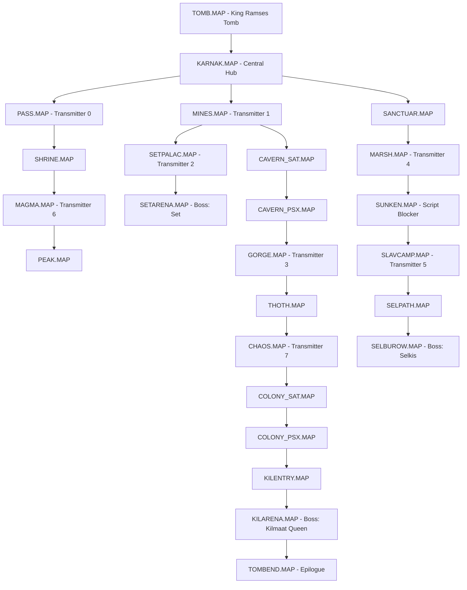
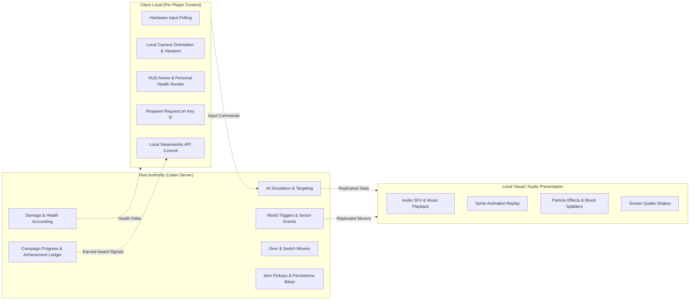

# PowerSlave Exhumed Together — Campaign Compatibility Audit & Script Blockers

**Document ID:** `DOC-19-CAMPAIGN-COMPATIBILITY`  
**Classification:** Campaign Compatibility Audit, Script Analysis & Co-Op Specification  
**Target Binary:** `anubis_Shipping_Steam_x64.exe` (SHA-256 `b8f131037187ca8d0a282527fb6f55a2012241d5b9dac8bf2038baf35b71a76d`)  
**Target Package:** `PowerslaveEX.kpf` (SHA-256 `d34b63551713bf46c4215632d9b5f92b452791023937fe7d22a196bff9ff4bbd`)  
**Scope:** Level graph, all 25 campaign maps, AngelScript triggers, singleton `Player()` calls, locked doors, teleporters, level transitions, boss scripting, environmental damage, and Steam achievement conditions across 2–8 players.

---

## 1. Executive Summary

This audit evaluates the entire single-player campaign of *PowerSlave Exhumed* (2022) for cooperative playability with 2–8 participants. 

Across all 25 campaign maps and the AngelScript game scripts, **33 direct invocations of the global singleton `Player()`** were cataloged and analyzed. In addition, native engine routines governing door unlocking, sector events, teleporters, and level transitions were inspected via Ghidra decompilation.

### Key Blocker Findings:
1. **Locked Doors & Switches Freeze Progression:** Native `FUN_1401bccb0` (Face/Use trigger for doors and switches) queries `GameInstance->GetPlayer()` for key possession (`Player + 0x98`). If Player 2 holds the key, Player 1 cannot open the door, and Player 2 also cannot open the door because the check interrogates Player 1!
2. **`SUNKEN.MAP` Infinite Loop Blocker:** In `scripts/map/SUNKEN_script.txt:31`, Script 1 runs an infinite polling loop checking `Player().GetKeys() & 1`. If a secondary player collected the Power Key, the loop never terminates and the exit gates never open.
3. **Set Boss Quake Target Bias:** In `scripts/p_enemy.txt:824`, the boss Set's ground quake damages and stuns `Player().GetActor()` exclusively, ignoring all secondary players.
4. **Asynchronous Level Transitions:** Stepping into an exit trigger (`FUN_1401bdd00`) or calling `ChangeMap` (`0x1401f1510`) immediately initiates map unload on `GameInstance`. If a single player reaches the exit while teammates are fighting elsewhere, the session transitions abruptly, risking client desynchronization.
5. **Team Achievement Contamination:** Negative conditions such as `ACH_FINISH_NO_ANKAHS` are permanently invalidated if *any* connected teammate collects a single Ankh container during the campaign run.

---

## 2. Campaign Map Graph & Progression Topology

The campaign consists of **25 maps** defined in `defs/mapInfo.txt`. Progression is non-linear and metroidvania-style, requiring players to acquire artifacts to unlock previous barriers:



---

## 3. Comprehensive Inventory of Script & Engine Blockers

### 3.1 Direct `Player()` Singleton Script References (33 Total)

All 33 occurrences of `Player()` across the shipped script repository were traced:

| Script File & Line | Code Snippet | Narrative / Gameplay Purpose | Multiplayer Failure Mode | Required Authority & Execution Domain |
|---|---|---|---|---|
| `p_enemy.txt:824` | `kexSlavePuppet@ puppet = Player().GetActor();` | Boss Set landing ground quake stun & 40 damage. | Damages & stuns **only Player 1**. Secondary players are completely immune. | **Host Authoritative:** Loop over all active puppets within radius. |
| `p_misc.txt:84` | `if(Player().GetHealth() < 50 ...)` | `A_RandomItem`: extra health orb drop if low HP. | Checks only Player 1's health to bias drop RNG. | **Host Authoritative:** Check average team health or closest player. |
| `p_misc.txt:316` | `obj.SetSourceOwner(Player().GetActor().CastToActor());` | `A_SpawnCobraFromVase`: friendly cobra from pot. | Cobra considers only Player 1 friendly; may attack Players 2–8! | **Host Authoritative:** Assign sourceOwner to vase breaker. |
| `p_misc.txt:375-418` | `if((Player().GetArtifacts() & PA_*) != 0)` | `A_RandomVaseItem`: drops items based on relics. | Checks only Player 1's relics. | **Host Authoritative:** Check team campaign relics. |
| `map/SUNKEN_script.txt:31` | `if((Player().GetKeys() & 1) != 0)` | Script 1 loops checking Power Key to open gate. | **FATAL BLOCKER:** If P2 grabs key, loop runs forever; gates remain locked. | **Host Authoritative:** Check shared team keys ledger. |
| `map/SETARENA_script.txt:25` | `EnumPlayerArtifacts arti = Player().GetArtifacts();` | Boss Set arena gate trigger; checks Shawl relic. | If P1 lacks Shawl, Set is not removed on revisit. | **Host Authoritative:** Check shared team relics. |
| `map/SELBUROW_script.txt:25` | `EnumPlayerArtifacts arti = Player().GetArtifacts();` | Boss Selkis burrow gate trigger; checks Scepter relic. | If P1 lacks Scepter, Selkis is not removed on revisit. | **Host Authoritative:** Check shared team relics. |
| `map/KILARENA_script.txt:24` | `Player().GetArtifacts() = PA_ALL;` | Grants all relics before final transition. | Grants relics to Player 1 only. | **Host Authoritative:** Broadcast `PA_ALL` to all players. |
| `map/TOMBEND_script.txt:82` | `if(Player().GetQuestItems() != 0xFF)` | Determines Good vs. Bad ending (8 transmitters). | Checks only Player 1's quest items. | **Host Authoritative:** Check server transmitter ledger. |
| `map/TOMBEND_script.txt:99,163`| `Player().SetShakeTime(...)` | Screen earthquake during tomb collapse. | Quakes screen of Player 1 only. | **Client Visual:** Broadcast screen shake to all clients. |
| `map/TOMBEND_script.txt:140`| `Player().HoldsterWeapon();` | Holsters weapon during cinematic. | Holsters weapon of Player 1 only. | **Client Local:** Enforce weapon holster on all clients. |
| `map/TOMBEND_script.txt:180`| `Player().SetLockTime(8);` | Input lock during dialogue. | Locks input of Player 1 only. | **Client Local:** Lock input on all client viewports. |
| `map/TOMBEND_script.txt:233`| `if((Player().GetButtons() & (BC_USE...)) != 0)` | Skips dialogue on button press. | Only Player 1 can skip dialogue. | **Host / Consensus:** Dialogue skip consensus (see DOC-11). |
| `map/TOMB_script.txt:192-234`| `Player().GetArtifacts()`, `Player().IsWeaponOwned(...)` | Ramses dialogue selection based on player weapons. | Selects dialogue based solely on Player 1's progress. | **Host Authoritative:** Select dialogue from server progress. |
| `map/TOMB_script.txt:291-343`| Holster, LockTime, Button skip | Ramses dialogue presentation controls. | Same as TOMBEND above. | **Client Local / Consensus** (see DOC-11). |

*Status:* `VERIFIED static` (script analysis of extracted `PowerslaveEX.kpf`).

---

### 3.2 Native Door & Switch Interactivity (`FUN_1401bccb0`)

When a player interacts with a switch or door by pressing 'E' (`BC_USE`), the engine executes `FUN_1401bccb0`:
```c
switch(switchType) {
case 3: // Power Key Door
case 4: // Time Key Door
case 5: // War Key Door
case 6: // Earth Key Door
    lVar5 = GameInstance->GetPlayer(); // HARDCODED SINGLETON (0x140af33a0 + 0xa8)
    if (((*(short*)(lVar5 + 0x98) >> (switchType - 3)) & 1) == 0) {
        // Displays "You need the ... key" ($str_116..119)
        return; // DOES NOT OPEN DOOR
    }
}
```
**Execution Domain Specification:**
- **Host Authoritative:** Key verification must occur on the host using the **Shared Team Keys Ledger**.
- **Client Local:** If the team lacks the key, the host notifies the interacting client to display the local HUD message: `"You need the [Key Name] Key"`.
- **World State Mutation:** If key verification succeeds, the door opening mover (`kexSlaveMoverDoor`) is initiated exclusively on the host and replicated to all clients.

---

### 3.3 Teleporters & Sector Exits (`FUN_1401bea70`)

In `kexSlaveLevelLocal::ProcessSectorEvents` (`0x1401bea70` / RVA `0x1bea70`):

#### 1. In-Level Teleporters (Case `0x47` $\to$ `FUN_1401be2f0`)
- **Mechanism:** Searches for matching sector record with type `0x48` (`psVar10[2] == param_2[2]`).
- Warps the touching actor (`param_1`) to the destination sector coordinates and adjusts height.
- **Multiplayer Handling:**
  - **Host Authoritative:** Evaluates touch, teleports the specific puppet actor, calls `LinkSector`, and updates the spatial hash.
  - **Client Local:** The teleported player's camera position snaps immediately (local prediction / position reset). Other clients receive the replicated position snapshot.
  - **No Desync Risk:** In-level teleporters operate on `param_1` (the touching actor), *not* the global player. Secondary players teleport cleanly.

#### 2. Artifact Pedestals (Case `0x35` $\to$ `FUN_1401be600`)
- **Mechanism:** Checks if touching player possesses the required relic:
  `if ((*(uint*)(param_1[0x37] + 0x90) & relicMask) != 0)`
- Consumes the relic from the player: `*(uint*)(param_1[0x37] + 0x90) &= ~relicMask;`
- Spawns the static pedestal relic actor and fires trigger event `relicIndex + 999`.
- **Multiplayer Handling:**
  - **Host Authoritative:** Since artifacts are shared at the campaign level, the host updates the server campaign ledger and broadcasts the pedestal placement to all clients.

#### 3. Sector Level Exits (Case `0x32` $\to$ `FUN_1401bdd00`)
- **Mechanism:** When a player enters an exit sector (e.g. Camel, Helicopter, Warp Pyramid), `FUN_1401bdd00` triggers map change via `ChangeMap` (`0x1401f1510`).
- **Co-Op Hazard:** If one player rushes into the exit sector while other players are alive, the map immediately changes for everyone, abandoning unfinished combat.
- **Architectural Solution (Level Exit Gate):**
  - **Option A (All-Players Exit Trigger):** The exit triggers only when *all alive, connected players* enter the exit sector or stand within a bounding exit zone.
  - **Option B (Countdown Timer):** When the first player enters, a 15-second countdown timer starts, displaying a HUD alert to all players: `"Level ending in 15 seconds..."`. Once elapsed, the host initiates `ChangeMap`.

---

### 3.4 Story Triggers & Multi-Execution Guard

In `FUN_1401bea70`:
- **One-Shot Triggers (Case `0x34`):**
  Calls `FUN_1401f4a60(tag, param_1, 0)` and immediately sets `*(int*)(param_2 + 0x30) = -1;` (clears sector event index) and writes the persistence bit in `DAT_140a45ac0`.
  *Behavior in Co-Op:* Safe. Executes exactly once when the first player steps on it.
- **Repeatable Triggers (Case `0x3f`):**
  Calls `FUN_1401f4a60(tag, param_1, 0)` without clearing the event index.
  *Behavior in Co-Op:* May trigger repeatedly as multiple players walk over the sector.
  *Fix:* Host must track trigger activation debouncing to prevent spamming elevator or trap scripts.

---

### 3.5 Boss Scenarios & Arena Lock-Ins

| Boss Encounter | Map File | Arena Script | Lock-In Mechanism | Co-Op Failure Mode & Solution |
|---|---|---|---|---|
| **Set** | `SETARENA.MAP` | `SETARENA_script.txt` | Script 0 closes entrance sectors (`tag 1010`). | If players are outside when the fight starts, they are locked out! Host must warp all alive teammates inside the arena upon trigger activation. |
| **Selkis** | `SELBUROW.MAP` | `SELBUROW_script.txt` | Entrance gate closes on sector trigger. | Same lockout risk. Host must teleport trailing players into the arena. |
| **Kilmaat Queen** | `KILARENA.MAP` | `KILARENA_script.txt` | Players jump down into the mother pit. | Pit is one-way. Trailing players who don't jump are trapped above. Host initiates arena barrier closure once all alive players are down. |

---

### 3.6 Scripted Damage & Player Deaths

1. **Environmental Lava & Acid:**
   - Sectors with damage flags call `InflictDamage` in `kexSlaveLevelLocal::ProcessSectorEvents`.
   - Deals periodic generic/fire/acid damage to any actor in the sector.
   - **Multiplayer Handling:** Safe. Evaluates per-actor touching the floor height. If health reaches 0, the player enters the manual respawn loop (`DOC-16`).
2. **Falling Rocks / Crushers:**
   - Sector ceiling movers crush actors below them.
   - Evaluated host-authoritatively. Instant kill or crushing damage applies to the specific victim.
3. **Environmental Kill Achievement (`ACH_KILL_ENVIRONMENT`):**
   - Triggered in `FUN_140195050:31` when an enemy dies with flag `0x4000000` and `pInstigator == NULL` (killed by crusher or lava).
   - Unlocked host-side; broadcast to all active participants in the session.

---

## 4. Steam Achievements Compatibility Audit (All 20 Achievements)

All 20 achievements defined in `E018_ACHIEVEMENT_DEFINITIONS.json` were audited for multiplayer integrity under the **Shared Achievement Progress** mandate:

| Ordinal | Key (`string_id`) | Description & Condition | Co-Op Hazard / Challenge | Host Authority & Distribution Rule |
|---|---|---|---|---|
| **0** | `ACH_GOOD_ENDING` | Complete game with all 23 Team Dolls & 8 Transmitters. | Triggered in `TOMBEND_script.txt` epilogue. | Granted to all players present in the epilogue who participated in the campaign. |
| **1** | `ACH_BAD_ENDING` | Complete game without all dolls/transmitters. | Triggered in `TOMBEND_script.txt` epilogue. | Granted to all participating players. |
| **2** | `ACH_TEAM_DOLL` | Collect 1 Team Doll. | Triggered in `0x1401d8f30`. | Granted to all players present in the session when any doll is collected. |
| **3** | `ACH_ALL_TEAM_DOLLS` | Collect all 23 Team Dolls. | Triggered when doll popcount reaches 23. | Granted to all players upon collection of the 23rd doll. |
| **4** | `ACH_SANDALS` | Collect Sandals of Ik-Hnum. | Triggered in `0x1401d8ac0` bit 0. | Granted to all active players when relic is picked up. |
| **5** | `ACH_MASK` | Collect Sobek Mask. | Triggered in `0x1401d8ac0` bit 1. | Granted to all active players. |
| **6** | `ACH_SHAWL` | Collect Shawl of Isis. | Triggered in `0x1401d8ac0` bit 2. | Granted to all active players. |
| **7** | `ACH_ANKLETS` | Collect Anklets of Bes. | Triggered in `0x1401d8ac0` bit 3. | Granted to all active players. |
| **8** | `ACH_SCEPTER` | Collect Scepter of Ra. | Triggered in `0x1401d8ac0` bit 4. | Granted to all active players. |
| **9** | `ACH_FEATHER` | Collect Feather of Ma'at. | Triggered in `0x1401d8ac0` bit 5. | Granted to all active players. |
| **10** | `ACH_DEFEAT_SET` | Defeat Boss Set. | Triggered in `0x140195050` (type 11). | Granted to all players participating in the Set boss fight. |
| **11** | `ACH_DEFEAT_SELKIS` | Defeat Boss Selkis. | Triggered in `0x140195050` (type 9). | Granted to all players participating in the Selkis boss fight. |
| **12** | `ACH_DEFEAT_QUEEN` | Defeat Boss Kilmaat Queen. | Triggered in `0x140195050` (type 1107). | Granted to all players participating in the Queen boss fight. |
| **13** | `ACH_FINISH_HARD` | Complete campaign on Hard difficulty. | Evaluated at game finish `0x1401b5850`. | Granted to players who participated across the qualifying Hard run. |
| **14** | `ACH_FINISH_PHARAOH` | Complete campaign on Pharaoh difficulty. | Evaluated at game finish `0x1401b5850`. | Granted to players who participated across the qualifying Pharaoh run. |
| **15** | `ACH_FINISH_NO_ANKAHS`| Complete campaign without collecting any Ankhs. | Evaluated at game finish: `m_ankhCount == 0`. | **TEAM INTEGRITY RULE:** If *any* player collects an Ankh, team violation flag is permanently set. |
| **16** | `ACH_WEAPON_BOOST` | Collect Weapon Power Boost orb. | Triggered in `0x1401d91f0`. | Granted to the player who touched the orb (or all players if shared boost). |
| **17** | `ACH_KILL_ENVIRONMENT`| Kill an enemy with lava/crushers. | Triggered in `0x140195050:31`. | Granted to all active participants in the current level. |
| **18** | `ACH_KILL_MANTIS_MACHETE`| Kill a Mantis using Machete melee. | Triggered in `0x140199710`. | Granted to the individual killer (or team kill reward). |
| **19** | `ACH_ALL_ANKAHS` | Collect all 5 Ankh containers. | Triggered in `0x1401d8870` when count > 4. | Granted to all players when the 5th unique Ankh is collected. |

---

## 5. Execution Domain Matrix (Host vs. Client vs. Visual)

To maintain absolute simulation consistency across 2–8 participants, all gameplay systems are categorized into strict execution domains:



---

## 6. Verification Matrix & Evidence Index

| Campaign Feature / Script | Observed Mechanism | Verification Level | Primary Evidence File |
|---|---|---|---|
| Map Graph & Links | 25 maps with overworld coordinates and nextmap links in `defs/mapInfo.txt`. | `VERIFIED static` | `experiments/kpf_extracted/defs/mapInfo.txt` |
| Door Interaction Blocker | `FUN_1401bccb0` checks keys exclusively on `GameInstance->GetPlayer()`. | `VERIFIED static` | `docs/evidence/ghidra_2022/G_FUNC_1401bccb0.json` |
| Sunken Gate Blocker | Script 1 in `SUNKEN_script.txt` loops on `Player().GetKeys() & 1`. | `VERIFIED static` | `experiments/kpf_extracted/scripts/map/SUNKEN_script.txt` |
| Set Quake Blocker | `A_SetCheckGround` in `p_enemy.txt:824` damages `Player().GetActor()`. | `VERIFIED static` | `experiments/kpf_extracted/scripts/p_enemy.txt:824` |
| Sector Event Dispatcher | `FUN_1401bea70` handles lifts, floors, teleporters (`0x47`), and exits (`0x32`). | `VERIFIED static` | `docs/evidence/ghidra_2022/G_FUNC_1401bea70.json` |
| In-Level Teleporters | `FUN_1401be2f0` matches sector `0x48`, warps touching actor `param_1`. | `VERIFIED static` | `docs/evidence/ghidra_2022/G_FUNC_1401be2f0.json` |
| Artifact Pedestals | `FUN_1401be600` consumes relic from `param_1[0x37] + 0x90` and spawns actor. | `VERIFIED static` | `docs/evidence/ghidra_2022/G_FUNC_1401be600.json` |
| Level Transition Call | `ChangeMap` in `0x1401f1510` calls `GameInstance vtable + 0x88`. | `VERIFIED static` | `docs/evidence/ghidra_2022/G_INSPECT_1401f1510.json` |
| Achievement Definitions | 20 Steam achievement definitions extracted from binary JSON metadata. | `VERIFIED static` | `docs/evidence/E018_ACHIEVEMENT_DEFINITIONS.json` |
