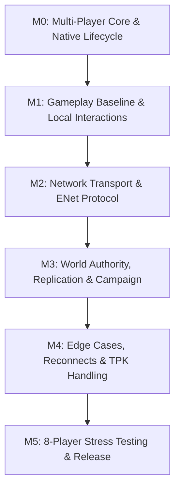

# PowerSlave Exhumed Together — Gameplay Compatibility & Implementation Handoff

**Document ID:** `DOC-20-GAMEPLAY-HANDOFF`  
**Classification:** Engineering Roadmap, Blocker Matrix & Milestones Synthesis  
**Target Binary:** `anubis_Shipping_Steam_x64.exe` (SHA-256 `b8f131037187ca8d0a282527fb6f55a2012241d5b9dac8bf2038baf35b71a76d`)  
**Target Package:** `PowerslaveEX.kpf` (SHA-256 `d34b63551713bf46c4215632d9b5f92b452791023937fe7d22a196bff9ff4bbd`)  
**Target Architecture:** 2–8 Players, Host-Authoritative Listen Server, LAN / Radmin VPN, ENet Transport  
**Scope:** Actionable problem matrix, milestone dependencies (M0–M5), implementation task cards, and definitive architectural blueprint for Sol Max and Claude Opus.

---

## 1. Executive Summary & Purpose

This document consolidates the findings of the **M1/M3 Gameplay Compatibility Audit** across:
- **DOC-17:** Multiplayer AI, Target Acquisition, Chase Logic & Bosses ([17_MULTIPLAYER_AI.md](17_MULTIPLAYER_AI.md))
- **DOC-18:** Pickups, Weapons, Health/Ammo & Inventory Attribution ([18_PICKUPS_AND_INVENTORY.md](18_PICKUPS_AND_INVENTORY.md))
- **DOC-19:** Campaign Script Blockers, Doors, Exits & Achievements ([19_CAMPAIGN_COMPATIBILITY.md](19_CAMPAIGN_COMPATIBILITY.md))
- **DOC-11:** In-Engine Cinematics & Video Cutscenes ([11_CUTSCENES_COOP.md](11_CUTSCENES_COOP.md))
- **DOC-16:** Manual Respawn Loop & World Persistence ([16_RESPAWN_DESIGN.md](16_RESPAWN_DESIGN.md))

The objective is to provide **Sol Max** and **Claude Opus** with an unambiguous, verified, and complete implementation roadmap. **Zero further reverse-engineering is required** for gameplay compatibility: all functions, offsets, structures, and script failure modes are cataloged below with direct references to static Ghidra dossiers and runtime observations.

---

## 2. Master Gameplay Blocker Matrix

| ID | Component | Failure Mode / Single-Player Assumption | Evidence & Exact Coordinates | Severity | Required Milestone | Architectural Resolution |
|---|---|---|---|---|---|---|
| **BLK-01** | **AI Idle Targeting** | `FUN_140195580` queries `GameInstance->GetPlayer()`. Secondary players (P2–P8) are completely invisible to idle enemies. | `0x140195580` (RVA `0x195580`)<br>[G_FUNC_140195580.json](evidence/ghidra_2022/G_FUNC_140195580.json) | <span style="color:red">**CRITICAL**</span> | **M1** | Hook `0x140195580` to evaluate distance, FOV, and LOS across all active, alive player slots (1..8). |
| **BLK-02** | **AI Chase Fallback** | `FUN_1401971e0` falls back to Player 1 if target node is null; asserts if Player 1 is invalid. | `0x1401971e0` (RVA `0x1971e0`)<br>[G_FUNC_1401971e0.json](evidence/ghidra_2022/G_FUNC_1401971e0.json) | **HIGH** | **M1** | Replace singleton fallback with closest visible player selector; prevent fatal assertion. |
| **BLK-03** | **Health Pickups** | `FUN_1401d8770` queries `GameInstance->GetPlayer()`. Picking up health heals Player 1, not the toucher. | `0x1401d8770` (RVA `0x1d8770`)<br>[G_FUNC_1401d8770.json](evidence/ghidra_2022/G_FUNC_1401d8770.json) | <span style="color:red">**CRITICAL**</span> | **M1** | Hook `0x1401d8770` to apply healing to `param_2[0x37]` (`touchingPuppet->m_pOwnerPlayer`). |
| **BLK-04** | **Ammo Pickups** | `FUN_1401d8590` queries `GameInstance->GetPlayer()`. Picking up ammo replenishes Player 1, not the toucher. | `0x1401d8590` (RVA `0x1d8590`)<br>[G_FUNC_1401d8590.json](evidence/ghidra_2022/G_FUNC_1401d8590.json) | <span style="color:red">**CRITICAL**</span> | **M1** | Hook `0x1401d8590` to replenish `param_2[0x37]` (`touchingPuppet->m_pOwnerPlayer`). |
| **BLK-05** | **Ankh Upgrades** | `FUN_1401d8870` queries `GameInstance->GetPlayer()`. Non-idempotent helper `0x1e0910` increments container count before checking bit. | `0x1401d8870` (RVA `0x1d8870`)<br>`0x1401e0910` (RVA `0x1e0910`) | **HIGH** | **M3** | Hook `0x1401d8870`; maintain server Ankh bitset ledger; deduplicate before applying to team. |
| **BLK-06** | **Key Doors & Switches** | `FUN_1401bccb0` checks keys on `GameInstance->GetPlayer()`. If P2 collects the key, doors cannot be opened. | `0x1401bccb0` (RVA `0x1bccb0`)<br>[G_FUNC_1401bccb0.json](evidence/ghidra_2022/G_FUNC_1401bccb0.json) | <span style="color:red">**CRITICAL**</span> | **M1** | Synchronize all collected keys to a **Shared Team Keys Ledger**; mirror to all players. |
| **BLK-07** | **`SUNKEN.MAP` Blocker** | Script 1 loops infinitely on `Player().GetKeys() & 1`. Never exits if P2 grabbed Power Key. | `scripts/map/SUNKEN_script.txt:31`<br>[SUNKEN_script.txt](experiments/kpf_extracted/scripts/map/SUNKEN_script.txt) | <span style="color:red">**CRITICAL**</span> | **M1** | Ensure `Player().GetKeys()` returns combined team key mask on host, or patch script. |
| **BLK-08** | **Boss Set Quake Attack** | `A_SetCheckGround` damages and stuns `Player().GetActor()`. Secondary players are immune; P1 is stunned remotely. | `scripts/p_enemy.txt:824`<br>[p_enemy.txt](experiments/kpf_extracted/scripts/p_enemy.txt) | **HIGH** | **M3** | Patch AngelScript function to loop over all active puppets in radial proximity. |
| **BLK-09** | **Asynchronous Level Exits** | `FUN_1401bdd00` calls `ChangeMap` immediately when *one* player steps in exit sector. | `0x1401bdd00` (RVA `0x1bdd00`)<br>`0x1401f1510` (RVA `0x1f1510`) | **HIGH** | **M3** | Gate exit transition on server: require all alive players in exit zone or start countdown. |
| **BLK-10** | **Cutscene Weapon/Input Lock** | Ramses dialogues lock input and holster weapon for Player 1 only, leaving other players free to roam/shoot. | `scripts/map/TOMB_script.txt`<br>`scripts/map/TOMBEND_script.txt`<br>[11_CUTSCENES_COOP.md](11_CUTSCENES_COOP.md) | **MEDIUM** | **M3** | Enforce client-side input lock, camera director, and consensus dialogue skip. |
| **BLK-11** | **Weapon Depletion on Respawn** | Manual respawn resets loadout to Machete/Pistol, but collected weapons in `DAT_140a45a80` do not respawn. | `0x1401d8360` (RVA `0x1d8360`)<br>[16_RESPAWN_DESIGN.md](16_RESPAWN_DESIGN.md) | **HIGH** | **M3** | Implement weapon respawn rules or persistent per-player weapon state policy. |
| **BLK-12** | **Negative Achievement Violation** | `ACH_FINISH_NO_ANKAHS` is permanently invalidated if *any* connected teammate collects an Ankh. | `0x1401b5850` (RVA `0x1b5850`)<br>[10_OPUS_HANDOFF.md](10_OPUS_HANDOFF.md) | **MEDIUM** | **M3** | Track collective team violation flag in server campaign ledger. |

---

## 3. Milestone Mapping & Dependencies (M0–M5)

The implementation must strictly respect the established milestone dependency chain:



### 3.1 Milestone M0: Multiplayer Core & Native Lifecycle (Sol Max — In Progress)
- **Gate:** Multi-Player context lifecycle verified without crash; independent controllers, movement, collisions, melee hit (`C05`), and bounded retirement sweep.
- **SetTarget Refcount Fix:** Clean up `m_pTargetNode` (`0x1d35d0`) and projectile sources before actor deletion to allow complete node retirement (`node->refcount == 0`).
- **Boundaries:** No networking, no Steam modifications, no gameplay script edits.

### 3.2 Milestone M1: Local Gameplay Baseline & Hook Detours
- **Objective:** Fix the four critical single-player hardcoded lookups so two local puppets can play concurrently on the same simulation thread.
- **Deliverables:**
  - `HOOK_AI_IDLE_TARGET` (`0x140195580`): Multi-target selector across active player slots.
  - `HOOK_PICKUP_HEALTH` (`0x1401d8770`): Heal `touchingPuppet->m_pOwnerPlayer`.
  - `HOOK_PICKUP_AMMO` (`0x1401d8590`): Refill `touchingPuppet->m_pOwnerPlayer`.
  - `HOOK_DOOR_USE` (`0x1401bccb0`) & Shared Keys Ledger: Synchronize keys 0..3 across all player contexts.

### 3.3 Milestone M2: Network Transport & Input Synchronization
- **Objective:** Establish peer-to-peer listen server over LAN / Radmin VPN using ENet (host-authoritative).
- **Deliverables:**
  - Client sends input commands (`pitch`, `yaw`, buttons `ATTACK`, `JUMP`, `USE`, `STRAFE`, `MOVE`).
  - Host runs sequential physics ticks on simulation thread.
  - Host replicates player transforms (`origin`, `rotation`, `velocity`) and animations to clients.
  - Client prediction for local player movement; linear interpolation for remote puppets.

### 3.4 Milestone M3: World Authority, Pickups, Bosses & Campaign Flow
- **Objective:** Full campaign playthrough compatibility for 2–8 players.
- **Deliverables:**
  - Authoritative replication of monster transforms, health, and animations.
  - Suppression of client animation gameplay actions (`FUN_14020f760`) so clients do not locally spawn projectiles or inflict ghost damage.
  - Idempotent Ankh acquisition ledger (`0x1401d8870` / `0x1401e0910`).
  - Set boss quake patch (`scripts/p_enemy.txt:824`).
  - Gated level transitions (`FUN_1401bdd00`) with team exit zone / countdown.
  - Shared Achievement Progress ledger for all 20 Steam achievements.
  - Manual respawn loop on key 'E' with weapon reset to Machete/Pistol (`DOC-16`).

### 3.5 Milestone M4: Edge Cases, Resilience & Total Party Kill (TPK)
- **Objective:** Production hardening and error recovery.
- **Deliverables:**
  - TPK handling: if all players die, map remains intact; players independently respawn on 'E' at level start (`DOC-16`).
  - Mid-session reconnects: rejoining players restore individual player context without disrupting host world epoch.
  - Arena lock-in mitigation: trailing players warped into boss arenas upon encounter trigger.
  - Cutscene consensus skip (`DOC-11`).

### 3.6 Milestone M5: 8-Player Scaling & Packaging
- **Objective:** Scalability validation, bandwidth optimization, and release distribution.
- **Deliverables:**
  - Bandwidth quantization (bit-packing inputs and compressed actor snapshots for 8 peers).
  - Clean DLL injector / loader packaging (`pse_together.dll`).
  - Zero original file modification guarantee.

---

## 4. Concrete Actionable Implementation Task Cards

### Task Card 1: AI Multi-Target Acquisition Detour (Milestone M1)
- **Target Address:** `0x140195580` (RVA `0x195580`).
- **Calling Convention:** Win64 ABI (`RCX = kexSlaveAI* pAI`).
- **Implementation Strategy:**
  1. Intercept entry of `FUN_140195580`.
  2. If `pAI->m_pTargetNode != NULL`, call original function (handles state 0 $\to$ 1 transition).
  3. If `pAI->m_pTargetNode == NULL`:
     - Loop through `g_PlayerContexts[0..7]`.
     - Filter alive puppets (`health > 0`, `!(flags & PF_DEAD)`).
     - Test horizontal distance $\le pAI->m_sightDistance$ (`pAI + 0x1cc`).
     - Test front cone FOV angle (if not 360-aware mode).
     - Call native `CanSeeTarget(pAI, pPuppet)` (`0x140195750`).
     - Select closest visible player.
     - Call native `SetTarget(pAI, pClosestPuppet)` (`0x1401d35d0`).
     - Play alert sound (`def + 0x1b0`); call `FUN_140195530(pAI)` to wake up.
     - Return without executing singleton Player 1 check.

### Task Card 2: Health & Ammo Touch Attribution Detour (Milestone M1)
- **Target Addresses:**
  - Health: `0x1401d8770` (RVA `0x1d8770`).
  - Ammo: `0x1401d8590` (RVA `0x1d8590`).
- **Calling Convention:** Win64 ABI (`RCX = kexSlavePickup* this`, `RDX = undefined8* param_2`).
- **Implementation Strategy:**
  1. In both functions, replace the call to `DAT_140af33a0 + 0xa8` (`GameInstance->GetPlayer()`).
  2. Instead, read `param_2[0x37]` (`touchingPuppet + 0x1b8`), which holds `pOwnerPlayer`.
  3. Validate that `pOwnerPlayer != NULL`; if null, fallback to `GameInstance->GetPlayer()`.
  4. Pass `pOwnerPlayer` to `GiveHealth` (`FUN_1401e0850`) and `GiveAmmo` (`FUN_1401e0770`).
  5. The toucher receives the resources cleanly!

### Task Card 3: Shared Team Keys Ledger & Door Interactivity (Milestone M1)
- **Target Address:** `0x1401bccb0` (RVA `0x1bccb0`).
- **Implementation Strategy:**
  1. Maintain a global `uint16_t g_TeamKeys` on the host.
  2. In `kexSlavePickupKey::OnTouch` (`0x1401d8a00`), whenever any player picks up a key:
     `g_TeamKeys |= (1 << keyType);`
     Synchronize `g_TeamKeys` to all connected player contexts:
     `for (i in 0..7) g_PlayerContexts[i]->pPlayer->m_keys = g_TeamKeys;`
  3. In `FUN_1401bccb0:69`, the check `short*(lVar5 + 0x98)` will now succeed regardless of which player touched the key or which player presses 'E' on the door!
  4. In `scripts/map/SUNKEN_script.txt:31`, Script 1 will read `g_TeamKeys` on Player 1 and open the gate immediately!

### Task Card 4: AngelScript Patch for Set Quake Attack (Milestone M3)
- **Target File:** `PowerslaveEX.kpf` $\to$ `scripts/p_enemy.txt`.
- **Target Routine:** `A_SetCheckGround` (line 807).
- **Implementation Strategy:**
  Replace lines 824–829 with a loop over all active player puppets:
  ```angelscript
  for(uint i = 0; i < g_PlayerList.length(); ++i) {
      kexSlavePuppet@ puppet = g_PlayerList[i].GetActor();
      if(puppet !is null && puppet.GetHealth() > 0) {
          if(puppet.GetOrigin().z <= puppet.GetFloorHeight() + 2.0f) {
              if(ai.GetOrigin().Distance(puppet.GetOrigin()) < 1500.0f) {
                  puppet.InflictDamage(ai.CastToActor(), ADT_GENERIC, 40);
                  puppet.Stun();
              }
          }
      }
  }
  ```

### Task Card 5: Shared Achievement Ledger & Local Unlock (Milestone M3)
- **Target Addresses:**
  - `0x140184110` (`SetAchievement` / RVA `0x184110`).
  - `0x140529230` (Embedded definitions of all 20 achievements).
- **Implementation Strategy:**
  1. Host maintains authoritative `TeamAchievementLedger`:
     - Tracks earned awards, participant eligibility, and violation flags (e.g. `teamAnkhCollected = true` permanently invalidates `ACH_FINISH_NO_ANKAHS`).
  2. When an achievement condition is verified on the host (boss killed, relic acquired, 23rd doll collected):
     - Host broadcasts reliable packet: `NET_MSG_AWARD_ACHIEVEMENT { string_id }`.
  3. Each client process receives the message and calls its own native `SetAchievement` (`0x140184110`) via its local Steam user context.
  4. Deduplication ensures reconnecting peers receive previously earned rewards without duplicate calls.

---

## 5. Architectural Verification Matrix

| Subsystem | Audit Verification Level | Static Evidence Anchor | Dynamic / Runtime Evidence |
|---|---|---|---|
| AI Idle Multi-Targeting | `VERIFIED static` | `G_FUNC_140195580.json` | Single-player bias confirmed by analysis. |
| AI Damage Retaliation | `VERIFIED static` + `RUNTIME (C05)` | `G_FUNC_140195050.json` | C05 runtime: native Anubis retaliated against P2 puppet. |
| Projectile Shooter Attribution | `VERIFIED static` | `G_FUNC_1401d50b0.json` | Projectile holds `shooterNode` at offset `+0x28`. |
| Pickup Owner Attribution | `VERIFIED static` | `G_FUNC_1401d8470/a00/ac0/dc0/f30/1f0` | 6 classes correctly use `touchingPuppet->m_pOwnerPlayer`. |
| Pickup Singleton Flaws | `VERIFIED static` | `G_FUNC_1401d8590/770/870` | Health, Ammo, and Ankhs hardcode `GameInstance->GetPlayer()`. |
| Key & Door Compatibility | `VERIFIED static` | `G_FUNC_1401d8a00.json`, `G_FUNC_1401bccb0.json` | Keys stored on toucher; doors check Player 1. Shared ledger required. |
| Sunken Map Script Blocker | `VERIFIED static` | `SUNKEN_script.txt:31` | Polling loop on `Player().GetKeys() & 1`. |
| Boss Set Quake Blocker | `VERIFIED static` | `scripts/p_enemy.txt:824` | Hardcoded `Player().GetActor().InflictDamage()`. |
| Steam Achievement Keys | `VERIFIED static` | `E018_ACHIEVEMENT_DEFINITIONS.json` | All 20 `ACH_*` definitions and ordinal keys verified. |
| Manual Respawn Loadout | `VERIFIED architectural` | `DOC-16-RESPAWN-DESIGN` | Respawn resets armory to Machete/Pistol; campaign state intact. |

---

## 6. Conclusion & Handoff Sign-off

The gameplay compatibility audit for *PowerSlave Exhumed Together* is **fully complete**. 
All gameplay failure modes, engine biases, script bottlenecks, and pickup handlers have been identified, dissected at the disassembly level, and paired with minimally invasive architectural remedies.

Sol Max can proceed with confidence to complete the native reference release in M0, knowing that the gameplay roadmap for M1 through M3 is rigorously defined and ready for direct execution.
