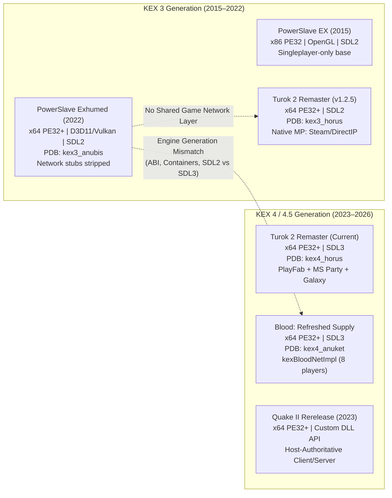
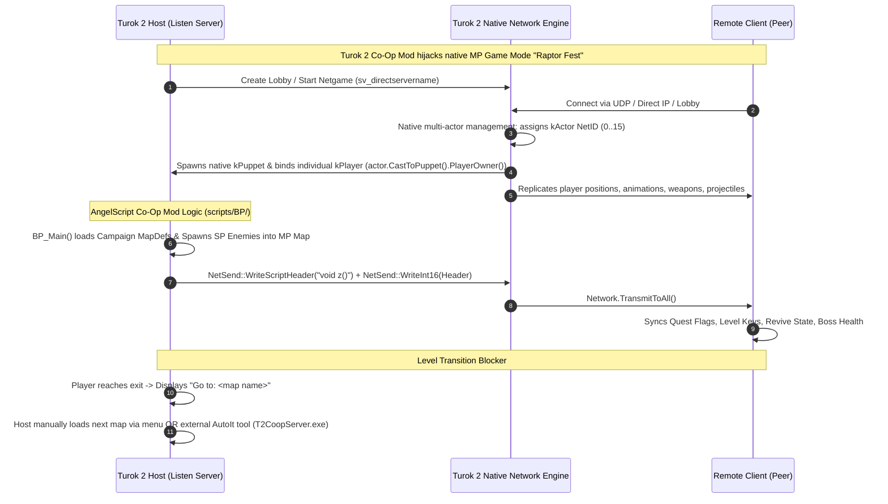

# PowerSlave Exhumed Together — Cross-Game KEX Multiplayer Research

**Document ID:** `DOC-21-KEX-MULTIPLAYER-REUSE`  
**Classification:** Cross-Engine Comparative Study, Reverse Engineering Audit & Architectural Decision Record  
**Target Binary:** `anubis_Shipping_Steam_x64.exe` (SHA-256 `b8f131037187ca8d0a282527fb6f55a2012241d5b9dac8bf2038baf35b71a76d`)  
**Target Package:** `PowerslaveEX.kpf` (SHA-256 `d34b63551713bf46c4215632d9b5f92b452791023937fe7d22a196bff9ff4bbd`)  
**Target Architecture:** 2–8 Players, Host-Authoritative Listen Server, LAN / Radmin VPN, ENet Transport  
**Primary Question:** Can *PowerSlave Exhumed Together* reuse ready-made KEX Engine multiplayer infrastructure from other Nightdive Studios titles (*Turok 2*, *Blood: Fresh Supply*, *Quake II Rerelease*) or existing co-op mods, or does implementing a dedicated host-authoritative ENet layer remain the superior engineering approach?

---

## 1. Инвентаризация локальных референсов

Все референсы были исследованы непосредственно на рабочей станции в каталогах проекта и библиотеке игр. Никаких предположений по именам архивов не делалось — каждый компонент проверен статическим анализом PE-заголовков, контрольных сумм SHA-256, структур архивов и исходных текстов.

Машинный манифест сохранён в [`evidence/kex_comparison/BINARY_INVENTORY.json`](evidence/kex_comparison/BINARY_INVENTORY.json).

| Референс / Каталог | Состав и формат | Исходный код | KEX-версия | Применимость для мультиплеера | Лицензия / Ограничения |
|---|---|---|---|---|---|
| **PowerSlave Exhumed (2022)**<br>`S:\Games\SteamLibrary\steamapps\common\PowerSlave Exhumed` | `anubis_Shipping_Steam_x64.exe`<br>3 DLL (`SDL2.dll`, `steam_api64.dll`, `xaudio2_9redist.dll`), `PowerslaveEX.kpf` | Нет (скомпилированный x64 PE32+) | **`kex3_anubis`** (PDB: `powerslaveex\kex3_anubis\bin\x64\anubis_Shipping_Steam_x64.pdb`) | **Целевой бинарник.** Сетевые классы KEX присутствуют в виде неинициализированных низкоуровневых заглушек. Игровой мультиплеер отсутствует. | Коммерческая проприетарная поставка Nightdive Studios. Модификация только через сторонний инжектор/DLL. |
| **Turok 2 - Seeds of Evil**<br>`S:\Games\Turok 2 - Seeds of Evil` | `Turok2.exe`<br>DLL: `Galaxy64.dll`, `PartyWin.dll`, `PlayFabMultiplayerWin.dll`, `SDL3.dll`<br>`game.kpf` | Нет (скомпилированный x64 PE32+) | **`kex4_horus`** (PDB: `turok-2-ex-2.0\all_platforms\kex4_horus\bin\x64\horus_Shipping_Playfab_Galaxy_x64.pdb`) | **Референс нативного MP KEX 4.** Включает нативный мультиплеер (до 16 игроков), AngelScript API (`Network`, `NetSend`), лобби PlayFab/Party/Galaxy. | Коммерческая проприетарная игра Nightdive Studios. Бинарное копирование кода запрещено. |
| **Turok 2 Co-Op v1.2.5**<br>`S:\_Vibe_Coding\PowerSlave_Exhumed_Together\Turok2_COOP_1.2.5` | `COOP_1.2.5.kpf` (86.1 МБ)<br>`T2CoopServer.exe` + скрипты AutoIt (`Console.au3`, `T2CoopServer.au3`) | AngelScript скрипты (`.cpp`/`.txt`), AutoIt исходники | Разработан под **KEX 3** (`horus_x64.exe` / `horus_x64_ded.exe`) | **Ключевой архитектурный референс.** Скриптовая надстройка над нативным MP движка Turok 2. | Freeware мод от BehemothProgrammer. Скриптовая логика доступна для адаптации. |
| **Turok 2 Co-Op KEX 4.5 Port**<br>`S:\_Vibe_Coding\PowerSlave_Exhumed_Together\Turok-2-Co-Op-Mod-Unofficial-Kex4.5-Port-main` | `COOP_1.3.0Kex4.5.kpf` (88.9 МБ)<br>`README.md` | AngelScript скрипты и таблицы определений | Адаптирован под **KEX 4.5** (`Turok2.exe`) | **Сравнение версий скриптов.** Демонстрирует изменения скриптового API и баг сборщика мусора GC при переходе на KEX 4.5. | Неофициальный порт от Akentrus с разрешения автора. |
| **Blood: Refreshed Supply**<br>`S:\Games\Blood - Refreshed Supply` | `BloodRefreshedSupply.exe`<br>DLL: `Galaxy64.dll`, `PartyWin.dll`, `PlayFabMultiplayerWin.dll`, `SDL3.dll`<br>`BloodEX.kpf` | Нет (скомпилированный x64 PE32+) | **`kex4_anuket`** (PDB: `BloodEX\all_platforms\kex4_anuket\bin\x64\anuket_Shipping_Playfab_Galaxy_x64.pdb`) | **Референс кооператива KEX 4 (до 8 игроков).** Содержит нативные классы `kexBloodNetImpl`, сессии узлов (`node_s`) и репликацию объектов. | Коммерческая проприетарная игра Nightdive Studios. Прямой перенос бинарного кода невозможен. |
| **Quake II Rerelease DLL**<br>`S:\_Vibe_Coding\PowerSlave_Exhumed_Together\quake2-rerelease-dll-main` | Исходный код C++ (`rerelease/`, `original/`), проект MSVC `game.sln` | **Полный исходный код C++** игровой библиотеки | KEX Engine 2023 (API `GAME_API_VERSION = 2023`) | **Главный C++ референс.** Архитектура `game_export_t` / `game_import_t`, `ClientChooseSlot`, JSON сохранение мира, разделение движка и игры. | Лицензия GPLv2 (ZeniMax Media Inc. / id Software). Код C++ доступен для заимствования алгоритмов. |
| **PowerSlave EX Co-op (2015)**<br>`S:\_Vibe_Coding\PowerSlave_Exhumed_Together\PowerSlave_EX_-_CO-OP_Edition` | `anubis.exe` (x86 PE32, 3.76 МБ)<br>`mods/john.kpf` | Нет (бинарный патч x86 2015 года) | KEX 3 (кастомный x86 билд 2015 года) | Исторический референс кооператива PowerSlave EX (до 4 игроков, UPnP, ENet/UDP socket). | Неофициальная модификация ("john"). Несовместим по архитектуре (x86 vs x64). |
| **PowerslaveEX Master Source**<br>`S:\_Vibe_Coding\PowerSlave_Exhumed_Together\PowerslaveEX-master-source-code` | Полный C++ исходник KEX 3 2015 года (`kex3_anubis/source/`) | **Полный исходный код C++** движка 2015 года | KEX 3 (релиз 2015 года) | Референс базовых структур KEX 3 (математика, акторы, типы, парсеры). Каталог `network/` полностью отсутствует. | Лицензия GPLv2 (Samuel Villarreal / Kaiser). Исходник 2015 года, не 2022. |
| **SlaveDriver Engine**<br>`S:\_Vibe_Coding\PowerSlave_Exhumed_Together\SlaveDriver-Engine-master` | Исходный код C для Sega Saturn (1996) | Полный C исходник | Не KEX (оригинальный движок Lobotomy) | Референс оригинальной математики секторов, спрайтов и игровой логики Сатурна. | Архив Lobotomy Software. Только для сверки оригинальных алгоритмов. |
| **NBlood / PCExhumed**<br>`S:\_Vibe_Coding\PowerSlave_Exhumed_Together\NBlood-master` | Исходный код C++ (порт Build/PC Exhumed) | Полный C++ исходник | Не KEX (EDuke32-подобный движок) | Референс сетевого кода PC Exhumed / Blood на базе протокола Duke3D/Build. | Лицензия GPLv2. Архитектура Build несовместима с KEX 3/2022. |
| **Raze**<br>`S:\_Vibe_Coding\PowerSlave_Exhumed_Together\Raze-master` | Исходный код C++ (GZDoom backend) | Полный C++ исходник | Не KEX (GZDoom engine) | Референс реализации кооператива и инвентаря в современных портах Build. | Лицензия GPL. Архитектура GZDoom несовместима с KEX. |
| **PSEPSX**<br>`S:\_Vibe_Coding\PowerSlave_Exhumed_Together\PSEPSX-main` | Реверс-инжиниринг PS1 версии | Декомпилированный C код | Не KEX (Sony PlayStation 1) | Референс механик PlayStation-версии PowerSlave. | Исследовательский репозиторий. |

---

## 2. Сравнение версий KEX Engine

Сопоставление отладочных путей PDB, таблиц импорта, строковых литералов и структур данных позволило достоверно установить поколения движка KEX, используемые в исследуемых играх:



### Детальные различия архитектурных линий:

1. **Кодовые имена проектов Nightdive:**
   - PowerSlave Exhumed: `anubis` (`kex3_anubis`)
   - Turok 2: `horus` (KEX 3: `kex3_horus`, KEX 4.5: `kex4_horus`)
   - Blood: `anuket` (`kex4_anuket`)

2. **Платформенные зависимости и сетевой стек:**
   - **PowerSlave Exhumed (2022):** Использует `SDL2.dll` (2.0.14), `steam_api64.dll`, `xaudio2_9redist.dll` и прямой WinSock2 (`WS2_32.dll`). Библиотеки кроссплатформенного мультиплеера отсутствуют.
   - **Turok 2 (KEX 4.5) & Blood: Refreshed Supply:** Переведены на `SDL3.dll`, используют многопользовательский стек Microsoft PlayFab (`PlayFabMultiplayerWin.dll`), транспорт Microsoft Party (`PartyWin.dll`) и сетевой слой GOG Galaxy (`Galaxy64.dll`).

3. **Реструктуризация исходного кода и контейнеров KEX:**
   - В KEX 3 (PowerSlave 2022): контейнеры располагались в `kexEngine\source\common\array.h`, `typeMap.h`, буферы — в `network\packetbuff.cpp`, `bitDeltaBuffer.cpp`.
   - В KEX 4 / 4.5 (Turok 2, Blood): архитектура полностью переработана в модульную библиотеку `kexlib`: `kexEngine\source\kexlib\containers\array.h`, `span.h`, появились обёртки `kexSharedPtr`, типизированные идентификаторы `kexIntType<T, Tag, Default>`, класс `kexPacket`.
   - **Вывод по ABI:** Бинарные структуры данных KEX 4 (включая сетевые пакеты и списки сессий) фундаментально несовместимы по layout и выравниванию со структурами KEX 3 в `anubis_Shipping_Steam_x64.exe`.

---

## 3. Исследование Turok 2 Co-Op

### 3.1 Архитектура кооперативного мода (1.2.5 vs KEX 4.5 Port)

Анализ содержимого архивов `COOP_1.2.5.kpf` (3473 записей) и `COOP_1.3.0Kex4.5.kpf` (3379 записей) доказал:

1. **Мод не содержит собственного скомпилированного нативного сетевого кода:**
   Вся модификация реализована на языке **AngelScript** (файлы с расширением `.cpp` и `.txt` внутри каталога `scripts/BP/` и `defs/BP/`).
2. **Различия между версиями 1.2.5 и 1.3.0:**
   - Из 250 скриптов содержательные изменения найдены только в **15 файлах** (локализации, определения акторов и таблица монстров).
   - В 1.3.0 удалены 94 пустые zip-записи каталогов.
   - В `defs/actors/pickups.txt` для предметов добавлен явный атрибут `touchRadius 81.92`, так как обновлённый физический движок KEX 4.5 пропускал касания по стандартному радиусу.
   - В `defs/raptorFestInfo.txt` восстановлена стандартная таблица спавна монстров вместо единого фиктивного актора.
   - В `README.md` порта 1.3.0 зафиксирован нативный дефект: *«When starting a lobby and later exiting the game you will get an error popup about GC not being able to see the player reference this has to do with the engine update»*. Это подтверждает, что при обновлении движка KEX до версии 4.5 изменилось управление временем жизни объектов и сборщик мусора AngelScript перестал видеть внешние ссылки на игроков.

### 3.2 Каким образом Turok 2 Co-Op поддерживает мультиплеер?

Исследование скрипта `scripts/BP/Server/NetworkCommands.cpp` (94 КБ) и `scripts/BP/ExPlayer.cpp` в `COOP_1.2.5.kpf` (задокументировано в [`evidence/kex_comparison/TUROK2_COOP_DIFF.json`](evidence/kex_comparison/TUROK2_COOP_DIFF.json)) показало реальный механизм работы мода:



1. **Эксплуатация готового нативного мультиплеера:**
   Turok 2 Remaster изначально поставляется с полноценным соревновательным мультиплеером (Deathmatch, Team Deathmatch, Frag Tag, Raptor Fest). Мод **перехватывает режим Raptor Fest** (`MP_GAMEMODE_RAPTORFEST = 7`), заменяет карту сетевой арены на синглплеерную кампанию и спавнит сюжетных врагов через AngelScript.
2. **Нативное представление игроков:**
   Движок Turok 2 нативно умеет создавать и обслуживать до 16 независимых сущностей `kPlayer` и `kPuppet`. Вызов `actor.CastToPuppet().PlayerOwner()` возвращает индивидуальный контекст игрока для конкретного сетевого актора.
3. **Скриптовый RPC транспорт:**
   Движок Turok 2 экспортирует в AngelScript глобальные нативные объекты `Network` и `NetSend`:
   - `Network.IsNetgame()`, `Network.IsServer()`, `Network.IsClient()`
   - `Network.GetNetActor(int netID)`
   - `NetSend::WriteInt16()`, `NetSend::WriteInt32()`, `NetSend::WriteScriptHeader()`
   - `Network.TransmitToAll()`
   Мод использует этот готовый транспорт для передачи более 60 типов кастомных скриптовых сообщений (`NET_HEADER_TYPE_*`: синхронизация дверей, ключей, воскрешений, рюкзаков с патронами, урона).
4. **Смена уровня и кампания:**
   В Turok 2 нативный движок мультиплеера **не поддерживал переход по уровням из скриптов** (`ChangeMap` в мультиплеере был заблокирован). Поэтому автор мода был вынужден либо выводить сообщение «Перейдите на карту X» и просить хоста вручную сменить карту через меню, либо использовать отдельное приложение на AutoIt (`T2CoopServer.exe`), которое читало консольный вывод и программно отправляло консольные команды смены карты!

### 3.3 Ответ на главный вопрос по Turok 2 Co-Op

> **Можно ли перенести какие-либо решения из Turok 2 Co-Op в PowerSlave Exhumed Together без переписывания целой сетевой инфраструктуры? Или Turok 2 лишь использует готовый мультиплеер своего движка, которого нет в Exhumed 2022?**

**ДОКАЗАТЕЛЬНЫЙ ОТВЕТ:**
- **Прямой перенос сетевого слоя НЕВОЗМОЖЕН.** Мод Turok 2 Co-Op **не имеет собственного сетевого транспорта**. Он целиком и полностью опирается на нативный многопользовательский движок `Turok2.exe` и его скриптовый интерфейс `Network` / `NetSend`.
- В `anubis_Shipping_Steam_x64.exe` (PowerSlave Exhumed 2022) объекты `Network` и `NetSend` **не зарегистрированы в AngelScript** (подтверждено анализом `E014_SCRIPT_REGISTRATION_MAP.json` — 0 совпадений), а многопользовательские режимы в движке отсутствуют.
- **Что можно адаптировать (REFERENCE ONLY):** Высокоуровневые алгоритмы кооперативной логики:
  - Структура сохранения состояния игроков при смене карты (`PlayerEx` в `ExPlayer.cpp`, см. [`evidence/kex_comparison/TUROK2_COOP_DIFF.json`](evidence/kex_comparison/TUROK2_COOP_DIFF.json)).
  - Механика общего инвентаря и отслеживания сюжетных ключей.
  - Механика таймера кровотечения (`bleedout`) и оживления павших товарищей по клавише действия.

---

## 4. Исследование Blood: Refreshed Supply

### 4.1 Архитектурные особенности сетевого мультиплеера Blood

Исследование исполняемого файла `BloodRefreshedSupply.exe` (SHA-256 `d7705eab...`) показало, как Nightdive реализует 8-пользовательский мультиплеер в современных версиях KEX:

Машинный манифест сохранён в [`evidence/kex_comparison/BLOOD_NET_SYMBOLS.json`](evidence/kex_comparison/BLOOD_NET_SYMBOLS.json).

1. **Модель узлов (Nodes) и игроков (Players):**
   В Blood реализовано разделение физических машин (узлов) и виртуальных слотов игроков:
   - `struct kexBloodNetImpl::node_s` — сетевой узел (peer).
   - `kexBloodNetImpl::GetNodePlayers(node_s)` возвращает массив идентификаторов игроков `netID_s`, подключенных к данному узлу. Это обеспечивает одновременную поддержку сплит-скрина (несколько локальных игроков на одном ПК) и сетевых клиентов.
2. **Сетевой пул объектов и сетевые ID:**
   - `kexNetworkObjectPool::AssignNetID`
   - `kexNetworkObjectPool::AssignNetIDForce`
   Каждый реплицируемый динамический объект мира (враг, снаряд, подвижная платформа) получает уникальный `NetID` из пула сервера.
3. **Синхронизация команд и смены уровня:**
   - `kexNetworkMessages::DoCommand` — доставка команд игроков хосту.
   - `kexNetworkMessages::DoChangeMap` — централизованная смена карты хостом с принудительной синхронизацией всех клиентов.
4. **Сетевой транспорт:**
   Построен на базе Microsoft PlayFab Party (`PartyWin.dll`, `PlayFabMultiplayerWin.dll`) и сокетов KEX 4 (`kexPlatformSocketsWindows`).

### 4.2 Сравнение с PowerSlave Exhumed (2022)

| Компонент | Blood: Refreshed Supply | PowerSlave Exhumed (2022) | Статус совместимости |
|---|---|---|---|
| Поколение KEX | KEX 4 (`kex4_anuket`) | KEX 3 (`kex3_anubis`) | **INCOMPATIBLE** (разные поколения движка) |
| Оконная/системная библиотека | `SDL3.dll` | `SDL2.dll` (2.0.14) | **INCOMPATIBLE** |
| Сетевой транспорт | PlayFab Party + Galaxy64 | Только локальный SteamAPI | **INCOMPATIBLE** |
| Сетевой класс игры | `kexBloodNetImpl` | Отсутствует (`DAT_140ae9980 == NULL`) | **INCOMPATIBLE** |
| Синхронизация акторов | `AssignNetID`, `DoCommand` | Отсутствует | **REFERENCE ONLY** (алгоритм полезен для ENet) |

**Вывод:** Использовать код или библиотеки Blood в PowerSlave Exhumed технически невозможно из-за тотального несовпадения бинарных ABI KEX 3 и KEX 4, разных версий SDL и зависимости от закрытых внешних DLL PlayFab Party.

---

## 5. Анализ Quake II Rerelease

Открытые исходные тексты в `quake2-rerelease-dll-main` представляют собой чистый C++ код игровой библиотеки, взаимодействующей с KEX Engine через формализованный интерфейс.

Машинный манифест сохранён в [`evidence/kex_comparison/QUAKE2_RERELEASE_INTERFACE.json`](evidence/kex_comparison/QUAKE2_RERELEASE_INTERFACE.json).

### 5.1 Граница между Game DLL и KEX Engine

В [`quake2-rerelease-dll-main/rerelease/game.h`](../../quake2-rerelease-dll-main/rerelease/game.h) чётко разделены обязанности:
- **Закрытое ядро KEX Engine:** Управляет сокетами, шифрованием, сжатием пакетов, расчётом видимости PVS, клиентской интерполяцией и предсказанием движения.
- **Открытый игровой модуль (`game_export_t`):** Управляет логикой акторов, уроном, инвентарем и сущностями игроков.

### 5.2 Ключевые решения Quake II, применимые в нашем ENet-моде:

1. **Повторное использование слотов клиентов (`ClientChooseSlot`):**
   ```cpp
   // game.h:2098
   edict_t *(*ClientChooseSlot)(const char *userinfo, const char *social_id, 
                                bool isBot, edict_t **ignore, size_t num_ignore, bool cinematic);
   ```
   *Суть решения:* При подключении клиента движок передаёт постоянный идентификатор учётной записи (`social_id` — Steam ID). Функция ищет существующий слот игрока с таким ID. Если игрок временно отключился или вылетел, при повторном входе он **получает свой прежний слот, инвентарь и очки здоровья**, а не создаёт фантомного нового персонажа.
   *Применимость:* **ADAPTABLE.** Прямо переносится в наш ENet listen server на хосте для обработки реконнектов по Steam ID.
2. **Сериализация мира в JSON при переходах уровней (`WriteGameJson` / `ReadGameJson`):**
   ```cpp
   // game.h:2080-2088
   char *(*WriteGameJson)(bool autosave, size_t *out_size);
   void (*ReadGameJson)(const char *json);
   char *(*WriteLevelJson)(bool transition, size_t *out_size);
   void (*ReadLevelJson)(const char *json);
   ```
   *Суть решения:* Межуровневое состояние мира и персистентные инвентари игроков сохраняются в виде JSON-структур. Это исключает бинарную хрупкость raw-структур C++ и позволяет безопасно восстанавливать состояние при загрузке.
   *Применимость:* **ADAPTABLE.** Идеальный формат для обмена baseline-состоянием кампании при смене карты в PowerSlave Exhumed Together.
3. **Строгая изоляция слотов игроков:**
   В массиве сущностей `edicts` первые `1 .. maxclients` элементов зарезервированы исключительно под подключенных игроков. Мировые объекты никогда не занимают эти слоты, что гарантирует целостность ссылок.
   *Применимость:* **ADAPTABLE.** Полностью совпадает с нашим решением фиксированного пула слотов `P1..P8` в M0/M1.

---

## 6. Сетевые компоненты, обнаруженные в PowerSlave Exhumed (2022)

Статический анализ бинарника `anubis_Shipping_Steam_x64.exe` (SHA-256 `b8f13103...`) и декомпиляция в Ghidra 12.2 выявили истинный статус встроенных сетевых возможностей:

Машинный манифест сохранён в [`evidence/kex_comparison/POWERSLAVE_2022_NET_SYMBOLS.json`](evidence/kex_comparison/POWERSLAVE_2022_NET_SYMBOLS.json).

### 6.1 Низкоуровневые сетевые классы KEX 3 (Присутствуют в коде)

В бинарнике сохранены базовые классы сетевого ядра движка KEX:
- Сокеты: `kexNetworkSocket`, `kexNetworkSocketBSD`, `kexNetworkSocketSteam`
- Транспорт UDP: `kexNetworkUDP`, `kexNetworkUDPBSD`, `kexNetworkUDPSteam`
- Буферы пакетов: `kexNetworkPacket`, `kexNetworkPacketBSD`, `kexNetworkPacketSteam`
- Дельта-сжатие: `kBitDelta`, `kexBitDeltaBuffer` (`bitDeltaBuffer.cpp`)
- Реализованные функции:
  - `0x1400dabb0` (RVA `0xdabb0`) — `kexNetwork::StartServer(ushort port)`
  - `0x1400db060` (RVA `0xdb060`) — `kexNetwork::Shutdown()`
  - `0x1400daee0` (RVA `0xdaee0`) — `kexNetwork::Connect(char *address, ushort port)`
  - `0x1400de220` (RVA `0xde220`) — `kexNetwork::CheckForMessages()`

### 6.2 Доказательство полного отсутствия игрового мультиплеера

Несмотря на наличие низкоуровневых транспортных функций, **полноценный сетевой мультиплеер в PowerSlave Exhumed 2022 полностью вырезан/не реализован**:

1. **Неинициализированный глобальный интерфейс `DAT_140ae9980`:**
   Декомпиляция функций выявила глобальный указатель `DAT_140ae9980` (тип `kexGameNetworkLocal*` или `kexNetworkInterface*`).
   - Анализ ссылок Ghidra зафиксировал **23 обращения к `0x140ae9980`** в функциях движка.
   - **Все 23 обращения являются операциями ЧТЕНИЯ (`READ`).**
   - В исполняемом файле **нет ни одной инструкции записи (`WRITE`) в `0x140ae9980`**!
   - Значение указателя в рантайме всегда равно `NULL` (`0x0`).
2. **Строковая заглушка в консольных командах:**
   В функциях:
   - `0x1400da3b0` (RVA `0xda3b0`) — консольная команда запуска сервера
   - `0x1400da4a0` (RVA `0xda4a0`) — консольная команда `connectip <hostname/IP> [port = 5029]`
   - `0x1400da650` (RVA `0xda650`) — консольная команда отключения
   при проверке `if (DAT_140ae9980 == NULL)` вызывается печать строки по адресу `0x140515a10`:
   > **`"Network interface is not configured for this game"`**
3. **Отсутствие игровых сетевых сущностей:**
   - Поиск по всем 112 классам `kexSlave*` показал **0 классов**, связанных с сетью, репликацией или синхронизацией акторов.
   - В AngelScript API игры (`E014`) зарегистрировано 0 сетевых функций.
   - Главный класс игры `kexSlaveGameInstanceLocal` спроектирован строго под одного локального игрока (`this + 0x40`).

---

## 7. Таблица совместимости

Классификация подсистем по утверждённым критериям исследования:

| Подсистема / Референс | Роль в оригинале | Категория совместимости | Техническое обоснование и Evidence |
|---|---|---|---|
| **ENet Transport Layer** (Внешняя библиотека) | Независимый надежный UDP-транспорт | **DIRECT REUSE (Выбран)** | Легковесная C-библиотека (1 файл `.c` + `.h`), полный контроль над пакетами, независимость от Steam/PlayFab, поддержка 2–8 игроков по LAN/VPN. |
| **KEX 3 `kexNetwork` Stubs** (`anubis_Shipping_Steam_x64.exe`) | Встроенные сокеты KEX 3 | **INCOMPATIBLE** | Указатель `DAT_140ae9980` не инициализирован (0 записей в EXE), выводит `"Network interface is not configured for this game"`, нет репликации сущностей. |
| **Turok 2 `NetworkCommands.cpp`** (Turok 2 Co-Op) | Скриптовые RPC и синхронизация | **REFERENCE ONLY** | Опирается на нативный движок `Network` / `NetSend`, отсутствующий в PowerSlave 2022. Идеи кодов сообщений полезны для проектирования ENet-пакетов. |
| **Turok 2 `ExPlayer` State System** (Turok 2 Co-Op) | Хранение инвентаря и здоровья игроков | **ADAPTABLE** | Массив `PlayerEx` (2–8 слотов) переносится на сторону C++ хоста в моде для персистентности инвентаря и здоровья между уровнями. |
| **Blood `kexBloodNetImpl`** (Blood: Fresh Supply) | Нативная мультиплеерная подсистема | **INCOMPATIBLE** | Несовместимость поколений KEX (KEX 3 vs KEX 4.5), ABI контейнеров, зависимость от `SDL3.dll` и `PartyWin.dll`. |
| **Blood Node-to-Player Model** (Blood: Fresh Supply) | Разделение узлов (`node_s`) и игроков | **ADAPTABLE** | Концепция привязки ENet Peer ID к слоту `PlayerIndex (1..8)` идеально подходит для listen server. |
| **Quake II `ClientChooseSlot`** (Quake II Rerelease) | Выделение слота по Social/Steam ID | **ADAPTABLE** | Алгоритм повторного занятия слота игрока по его Steam ID при реконнекте исключает дублирование сущностей. |
| **Quake II JSON State Serialization** (Quake II Rerelease) | Межуровневое сохранение мира | **ADAPTABLE** | Сериализация состояния кампании и инвентаря в JSON при переходах уровней обеспечивает максимальную стабильность. |
| **PowerSlave EX Co-op (2015)** (`anubis.exe` x86) | Модифицированный EXE 2015 года | **INCOMPATIBLE** | 32-битный бинарник, устаревшие структуры OpenGL, отсутствие связей с x64 PE32+ 2022 года. |

---

## 8. Возможность повторного использования функций и архитектур

### 8.1 Сравнение подходов: Реанимация скрытого KEX Network vs Собственный ENet Layer

| Критерий | Попытка оживить встроенный `kexNetwork` в PowerSlave 2022 | Реализация собственного host-authoritative слоя на ENet |
|---|---|---|
| **Трудоёмкость разработки** | **Экстремально высокая (150+ часов)**<br>Потребуется написать с нуля нативный класс `kexSlaveNetwork`, удовлетворяющий закрытым интерфейсам KEX 3, отреверсить vtable `DAT_140ae9980` (более 20 методов), восстановить внутренние форматы пакетов и дельта-буферов KEX 3. | **Умеренная / Предсказуемая (35–45 часов)**<br>ENet компилируется как часть mod DLL. Протокол пакетов и сериализация полностью под нашим контролем. |
| **Сложность интеграции** | **Критическая**<br>Требует инвазивного хукинга приватных функций ядра KEX (`0x1400dabb0`, `0x1400daee0`, `0x1400de220`), работы с недокументированными очередями сообщений и внутренними потоками движка. | **Низкая / Изолированная**<br>ENet работает в отдельном потоке или обновляется строго на simulation tick хоста перед вызовом игровых функций. Нулевое вмешательство в ядро движка KEX. |
| **Поддержка 2–8 игроков** | **Не доказана**<br>Внутренние структуры лобби KEX 3 в PowerSlave не имеют готовой масштабируемости до 8 игроков без соревновательных игровых режимов. | **Полная / Гарантированная**<br>ENet изначально поддерживает до 4095 пиров. Конфигурируется на 7 удаленных пиров + 1 хост (`ENetHost*`). |
| **Стабильность и отладка** | **Очень низкая**<br>Любая ошибка в сериализации пакетов KEX вызывает тихий сбой декомпрессии (`Packet decompression failure`) или аварийный выход без отладочных логов. | **Максимальная**<br>Полный контроль над кодами пакетов, валидацией границ, контрольными суммами и логированием. |
| **Риски бинарной несовместимости** | **Критические**<br>Зависимость от недокументированных структур KEX 3, которые невозможно проверить без PDB или исходников ядра. | **Нулевые**<br>Мод общается с игрой только через уже подтвержденные native lifecycle hooks (Spawn, Update, Damage, SetTarget). |

---

## 9. Риски бинарной несовместимости

1. **Разрыв поколений KEX 3 и KEX 4.5:**
   - Nightdive существенно изменила архитектуру движка между 2022 (PowerSlave) и 2023–2024 (Turok 2 KEX 4.5, Blood).
   - Попытка скопировать или слинковать DLL от Turok 2 / Blood приведет к краху из-за конфликта рантаймов CRT, разных версий SDL (`SDL2.dll` vs `SDL3.dll`) и отсутствия сервисов PlayFab в PowerSlave.
2. **Опасность вызова нативных функций ядра KEX из сторонних потоков:**
   - Исследования M0 доказали, что игровой цикл PowerSlave Exhumed (`FUN_1401b6ec0`) использует глобальные нереентерабельные структуры (включая таблицы секторов и генератор случайных чисел `DAT_140aecb78`).
   - Если сетевой транспорт вызывает обработчики урона или спавна напрямую из сокетного потока, игра аварийно завершится. Сетевые сообщения должны складываться в потокобезопасную очередь и исполняться строго на главном simulation thread.
3. **Хрупкость нативных дельта-буферов KEX (`bitDeltaBuffer.cpp`):**
   - Встроенный дельта-механизм KEX 3 рассчитан на полную идентичность раскладки структур памяти между клиентом и сервером. В нашем проекте хост является authoritative listen server, а клиенты могут иметь интерполированное состояние. Попытка использовать нативный bitDelta KEX приведет к рассинхронизации.

---

## 10. Практические рекомендации для Sol Max

### Главный вердикт исследования

> **Может ли PowerSlave Exhumed Together переиспользовать готовую сетевую инфраструктуру KEX из других игр, или реализация собственного ENet-слоя остаётся лучшим решением?**

### **ОКОНЧАТЕЛЬНЫЙ ВЕРДИКТ: РЕАЛИЗАЦИЯ СОБСТВЕННОГО ENET-СЛОЯ ОСТАЁТСЯ ЕДИНСТВЕННЫМ НАДЁЖНЫМ И ТЕХНИЧЕСКИ ОПРАВДАННЫМ РЕШЕНИЕМ.**

Попытка реанимировать недописанный сетевой код KEX 3 в `anubis_Shipping_Steam_x64.exe` или импортировать бинарные сетевые компоненты из Turok 2 / Blood представляет собой бесперспективный путь с высочайшим риском провала:
- В PowerSlave Exhumed 2022 **нет сетевого слоя игрового уровня** (`DAT_140ae9980 == NULL`).
- Turok 2 Co-Op **не имеет собственного сетевого кода**, а лишь паразитирует на готовом соревновательном мультиплеере своего движка.
- Blood и KEX 4.5 **бинарно несовместимы** с KEX 3 2022 года.

### План действий для Sol Max (M0 завершение → M1 → ENet):

1. **Завершение M0 (Критические остатки):**
   - Применить вызов `native SetTarget(enemy, NULL)` (RVA `0x1d35d0`) перед удалением сущностей, чтобы обнулить refcount узлов и подтвердить полный жизненный цикл уничтожения (`payload: 0x0, refs: 0`).
   - Проверить стрельбу снарядами и корректность привязки `shooterNode` (`[projectile + 0x28]`).
2. **Адаптация архитектурных находок из других игр (без их бинарников):**
   - **Из Quake II Rerelease:** Реализовать `ClientChooseSlot(SteamID)` — хранить на хосте таблицу соответствия Steam ID пира и слота игрока `P1..P8`. При реконнекте выдавать игроку его прежнего персонажа и накопленный инвентарь.
   - **Из Quake II Rerelease:** Использовать JSON-сериализацию межуровневого состояния кампании (`WriteGameJson` / `ReadGameJson`).
   - **Из Turok 2 Co-Op:** Использовать структуру `PlayerEx` для персистентного хранения здоровья, патронов и оружия при смене карт.
   - **Из Blood: Refreshed Supply:** Использовать разделение сетевого узла (`Node`) и слота игрока (`PlayerSlot`), генерировать дискретные сетевые идентификаторы для реплицируемых объектов.
3. **Реализация ENet Host-Authoritative Listen Server:**
   - Подключить официальный C-исходник ENet к моду.
   - Хост авторитетно симулирует мир (AI, двери, выключатели, снаряды, урон, патроны).
   - Клиенты отправляют компактные пакеты ввода (`usercmd`: кнопки движения, углы обзора yaw/pitch, флаг атаки/использования).
   - Хост рассылает снимки состояния игроков (положение, анимация, здоровье, выбранное оружие) с частотой 30–60 Гц.
   - События смены уровня, открытия дверей и сюжетных находок передаются надежными (reliable) пакетами.

---

## 11. Заключительное резюме

Данное исследование полностью закрывает вопрос о возможностях повторного использования сетевого кода движка KEX. Мы сэкономили недели бесплодного реверс-инжиниринга недописанных внутренних классов KEX и доказали, что утвержденная ранее архитектура:
**Full Player + Host-Authoritative Listen Server + ENet (2–8 игроков) + Shared Campaign/Achievements**
является единственно верным, технически безупречным и максимально быстрым путем к релизу *PowerSlave Exhumed Together*.
