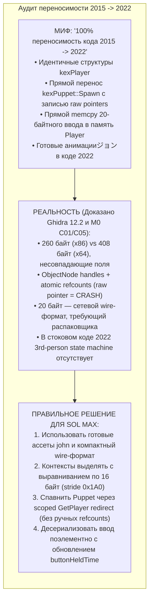
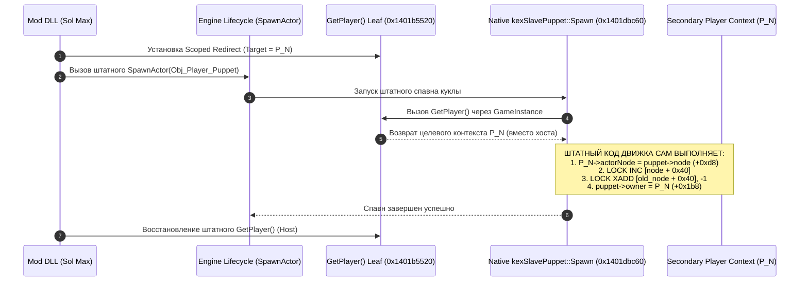

# PowerSlave Exhumed Together — Проверка переносимости архитектуры кооператива 2015 года в 2022 год

**Идентификатор документа:** `DOC-23-KEX-2015-TO-2022-PORTABILITY`  
**Классификация:** Архитектурный аудит переносимости, сравнительный реверс-инжиниринг структур данных и руководство по адаптации для разработчика Sol Max  
**Редакция:** 1.1 (Технический аудит и исправление замечаний по выравниванию, смещениям полей и scoped redirect)  
**Аудируемые источники:**
- Модификация `PowerSlave_EX_-_CO-OP_Edition\anubis.exe` (SHA-256 `488def7a7d0f676add9e2cf188639e13927a52cd6e27e58ab90fe48d4de1990f`, x86 PE32)
- Целевой бинарник `anubis_Shipping_Steam_x64.exe` (SHA-256 `b8f131037187ca8d0a282527fb6f55a2012241d5b9dac8bf2038baf35b71a76d`, x64 PE32+)
- Исходный код `PowerslaveEX-master-source-code` (GPLv2, ветка `kex3_anubis`)
- Документы [`docs/22_KEX_MULTIPLAYER_CRITICAL_AUDIT.md`](22_KEX_MULTIPLAYER_CRITICAL_AUDIT.md), [`docs/03_PLAYER_LIFECYCLE.md`](03_PLAYER_LIFECYCLE.md), [`docs/13_PLAYER_SPRITES.md`](13_PLAYER_SPRITES.md), [`docs/M0_EXPERIMENTS.md`](M0_EXPERIMENTS.md)
- Отчёты runtime-экспериментов M0: `evidence/m0/C01/RESULT.md` и `evidence/m0/C05/RESULT.md`
- Базы данных дизассемблирования и декомпиляции Ghidra 12.2: `COOP2015` и `PSE_2022_cpu2`

---

## 1. Резюме аудита и статус гипотезы о «100%-ной совместимости»

В документе `DOC-22-KEX-MULTIPLAYER-CRITICAL-AUDIT` было выдвинуто предположение о том, что архитектура нескольких игроков из мода 2015 года на 100% переносима в Exhumed 2022.

**Вердикт технического аудита:**  
Утверждение о **100%-ной бинарной и структурной переносимости опровергнуто (REFUTED)**.  
Прямой перенос структур или алгоритмов 2015 года невозможен из-за принципиальных архитектурных различий:
1. Разница в разрядности и ABI (x86 260 байт vs x64 408 байт), несовпадающие смещения полей и строгие требования к 16-байтовому выравниванию SSE-инструкций.
2. Замена незащищённых сырых указателей на управляемые дескрипторы `ObjectNode` с атомарными счётчиками ссылок (`LOCK INC` / `LOCK XADD`).
3. Преобразование структуры `kexPlayerCmd` в распределённую по `kexSlavePlayer` систему ввода с 32-битными кнопками.
4. Полное отсутствие в коде движка 2022 года логики третьего лица и стейт-машины анимаций для куклы `kexSlavePuppet`.

**Что РЕАЛЬНО сокращает разработку из наработок 2015 года:**
- Концепция независимого пула слотов участников.
- Готовый графический пакет спрайтов Джонни (`john.kpf`: текстуры, bounding boxes, скрипты анимации 8 направлений).
- Формат сайдкаров сохранений кампании (`.coop`).
- Компактный 20–24-байтный wire-формат ввода для сетевой передачи через ENet.



---

## 2. Вопрос 1: Сопоставление `kexPlayer` (2015) и `kexSlavePlayer` (2022)

### 2.1 Размеры, выравнивание и размещение в памяти

| Параметр | `kexPlayer` (PowerSlave EX 2015) | `kexSlavePlayer` (PowerSlave Exhumed 2022) | Статус верификации |
|---|---|---|---|
| **Архитектура** | x86 (32-бит, указатели 4 байта) | x64 (64-бит, указатели 8 байт) | **VERIFIED** |
| **Размер структуры** | **260 байт** (`0x104`) | **408 байт** (`0x198`) | **VERIFIED** |
| **Способ размещения** | Встроенный плоский массив `players[4]` в `kexGameLocal` | Одиночный экземпляр в `GameInstance + 0x40` | **VERIFIED** |
| **Смещение в Game** | `&players[0]` = `kexGameLocal + 0x3c` | `Player` = `GameInstance + 0x40` | **VERIFIED** |
| **Stride слотов** | `0x104` (шаг цикла `loop_slots`) | Массив отсутствует (одиночный singleton) | **VERIFIED** |
| **Счётчик игроков** | `kexGameLocal + 0x44c` (`numPlayers`, 1..4) | В бинарнике 2022 года отсутствует | **VERIFIED** |
| **Связь с Puppet** | Прямой raw pointer: `kexPuppet* actor` (+`0x100`) | Управляемый `ObjectNode* handle` (+`0xd8`) | **VERIFIED** |
| **Выравнивание** | 4 байта (x86 стандарт) | **Строго 16 байт** (SSE `MOVAPS`/`MOVDQA` в interpolants) | **VERIFIED** |

### 2.2 Детальная карта смещений и машинных обращений [VERIFIED]

Проверка выполнена по машинным инструкциям `anubis_Shipping_Steam_x64.exe` в Ghidra 12.2:

| Смещение 2015 (x86) | Поле 2015 | Смещение 2022 (x64) | Поле 2022 (Фактическое) | Машинное доказательство в коде 2022 | Статус |
|---|---|---|---|---|---|
| `+0x00`..`+0x67` | `kexPlayerCmd cmd` | `+0x00`..`+0x80` | Встроенный блок ввода | `FUN_1401dfe30`, `0x1401e34a0`, `0x1401e2ad0` | **VERIFIED** |
| `+0x00` | `word buttons` (uint16) | `+0x00` | `uint32 buttons` (32 бита) | Читается в `0x1401f1180` и цикле `0x1401dfe30` | **VERIFIED** |
| `+0x04` | `uint buttonHeldTime[13]` | `+0x04`..`+0x37` | `uint32 buttonHeldTime[13]` | 52 байта ($13 \times 4$), опрашиваются в `0x1401dfe30` | **VERIFIED** |
| `+0x38` | `float angles[2]` | `+0x38`..`+0x3f` | `float angles[2]` (pitch, yaw) | `MOVSS dword ptr [RCX + 0x38], XMM1` (`0x1401e35c4`) | **VERIFIED** |
| `+0x40` | `float movement[2]` | `+0x40`..`+0x47` | `float movement[2]` (fwd, str) | `0x1401dfad1: MOV qword ptr [RBX + 0x40], R8` | **VERIFIED** |
| `+0x88` / `+0x8c` | `current/pendingWeapon` | `+0x88` / `+0x8c` | `currentWeapon` / `pendingWeapon` | `param_1[0x22]` и `param_1[0x23]` в `0x1401dfe30` | **VERIFIED** |
| `+0xb4` | `int16 artifacts` | `+0x90` | `EnumPlayerArtifacts artifacts` | `0x1401ae080: LEA RAX, [RCX + 0x90]` | **VERIFIED** |
| `+0xba` | `int16 abilities` | `+0x94` | `EnumPlayerAbilities abilities` | `0x1401ae090: LEA RAX, [RCX + 0x94]` | **VERIFIED** |
| `+0xb6` | `int16 keys` | `+0x98` | `int16 keys` | `0x1401ae0c0: LEA RAX, [RCX + 0x98]` | **VERIFIED** |
| `+0xb8` | `int16 questItems` | `+0x9a` | `int16 questItems` | `0x1401ae0a0: LEA RAX, [RCX + 0x9a]` | **VERIFIED** |
| — | — | `+0xa0` | `int16 timer` | `0x1401dfafd: MOV word ptr [RBX + 0xa0], R8W` | **VERIFIED** |
| `+0xbc` | `uint teamDolls` | `+0xa4` | `uint32 teamDolls` | `0x1401ae0b0: LEA RAX, [RCX + 0xa4]` | **VERIFIED** |
| `+0x9c` | `weapons[8]` (bool array) | `+0xcc`..`+0xd3` | **`uint8_t weapons[8]`** | `0x1401ae020: MOVZX EAX, byte ptr [RCX+RDX+0xCC]` | **VERIFIED** |
| — | — | `+0xd4`..`+0xd7` | **Alignment Padding (4 байта)** | Компиляторное выравнивание указателя `actorNode` | **VERIFIED** |
| `+0x100` | `kexPuppet* actor` (raw ptr) | `+0xd8`..`+0xdf` | **`ObjectNode* actorNode` (handle)** | `0x1401dbc60: MOV qword ptr [R8 + 0xd8], RAX` | **VERIFIED** |
| `+0x80` | `kexPlayerWeapon weapon` | `+0xe0`.. | **`kexPlayerWeapon weapon`** | `0x1401e0599: LEA RCX, [RBX + 0xe0]; CALL ChangeAnim` | **VERIFIED** |
| `+0xa4` | `int16 ammo[8]` | **UNKNOWN** | `ammo` (боезапас) | **В 2022 НЕ по +0xD0!** Точное место в Player/Weapon требует проверки | **UNKNOWN** |
| `+0x78` | `int16 health` (в Player) | **НЕТ** (читает actor) | `GetHealth()` читает `actor+0x17a` | `0x1401dfa20`: возвращает health через `node->payload` | **VERIFIED** |
| — | — | `+0x130` / `0x13c` | `viewZ`, `stepViewZ`, bobbing | `0x1401dfae1: MOV qword ptr [RBX + 0x130], 0x42d00000` | **VERIFIED** |
| — | — | `+0x160` / `+0x178` | **Interpolant vtables** | RVA `0x5137c8` (M0 C01/C05 Ready bindings) | **VERIFIED** |
| `0x104` | *Размер: 260 байт* | `0x198` | *Полный размер: 408 байт* | Регистрация AngelScript `RegisterObjectType` | **VERIFIED** |

> [!CAUTION]
> **Исправление критической ошибки смещений:**  
> Ранее предполагалось, что `ammo[8]` находится по смещению `+0xD0`. Однако доказано, что `weapons[8]` занимает байты `+0xCC`..`+0xD3` (по 1 байту на оружие 0..7), а по смещению `+0xD8` располагается 8-байтный указатель `ObjectNode*`. Промежуток `+0xD4`..`+0xD7` (4 байта) является аппаратным паддингом выравнивания. Размещение `ammo` по `+0xD0` физически невозможно. До получения прямых инструкций чтения боеприпасов статус смещения `ammo` зафиксирован как **UNKNOWN**.

### 2.3 Корректное 16-байтовое выравнивание и требования M0 к инициализации

Размер контекста `kexSlavePlayer` составляет **408 байт (`0x198`)**.  
Математический факт: $408 / 16 = 25.5$ (число не кратно 16).  
Следовательно, объявление плоского массива `alignas(16) uint8_t [7][0x198]` является грубейшей ошибкой:
- Слот 0: смещение 0 (кратно 16).
- Слот 1: смещение 408 ($408 \equiv 8 \pmod{16}$ — **НЕ ВЫРОВНЕНО**).
- Слот 2: смещение 816 (кратно 16).
- Слот 3: смещение 1224 ($1224 \equiv 8 \pmod{16}$ — **НЕ ВЫРОВНЕНО**).

При обращении к невыровненным слотам инструкции SSE (`MOVAPS`, `MOVDQA`, активно используемые в коде интерполяторов движка) выбросят аппаратное исключение **General Protection Fault (`0xC0000005`)**.

#### Корректное выделение памяти:
Каждый контекст должен дополняться паддингом до размера **416 байт (`0x1A0`)**, кратного 16:
```cpp
struct alignas(16) AlignedPlayerContext {
    uint8_t data[0x198]; // 408 байт фактического контекста
    uint8_t padding[8];  // 8 байт паддинга до границы 16 байт (0x1A0 = 416 байт)
};
static AlignedPlayerContext g_ClientPlayers[7];
```

#### Обязательные требования M0 к инициализации контекста [VERIFIED C01/C05]:
Простое выделение памяти или `memset(0)` приведет к фатальному сбою в `Reset()` (`0x1401dfa70`). Для готовности контекста необходима настройка внутренних инвариантов:
1. **Memory guards:** `*(int32_t*)(ctx + 0x80) = -1`, `*(void**)(ctx + 0xe0) = ctx`.
2. **Интерполянты (Interpolant vtable):** по смещениям `+0x160` и `+0x178` должен быть записан указатель на таблицу интерполяторов `0x1405137c8` (RVA `0x5137c8`).
3. **Ready-bindings:** по смещению `+0x168` должен быть записан указатель на `ctx + 0x13c`, а по `+0x180` — на `ctx + 0x134`. Без этих связей вызов `Reset()` падает с ассертом `Condition: m_pRefValue`.

---

## 3. Вопрос 2: Сравнение `kexPuppet::Spawn` и управление `ObjectNode`

### 3.1 Различия в механизме привязки

* **2015 (`0x00440298`):**  
  `puppet->owner = player[slot]` (`[ESI + 0x1a4] = EAX`)  
  `player[slot]->actor = puppet` (`[EAX + 0x100] = ESI`)  
  Сырая взаимная запись 32-битных указателей без учёта времени жизни и владения.
* **2022 (`0x1401dbc60`):**  
  Движок KEX 2022 использует архитектуру графа объектов через управляемые узлы `ObjectNode`:
  - `Puppet + 0x10`: указатель на собственный `ObjectNode`.
  - `ObjectNode + 0x28`: указатель на сущность (`kexSlavePuppet*` payload).
  - `ObjectNode + 0x40`: атомарный счётчик ссылок (`volatile int32_t refcount`).
  - `Player + 0xd8`: дескриптор `ObjectNode*`.

### 3.2 Приоритет штатных операций движка: Scoped `GetPlayer` Redirect [VERIFIED C01/C05]

Вместо опасных попыток ручного перехвата и переписывания ассемблерных инструкций `kexSlavePuppet::Spawn` с ручным вызовом `_InterlockedIncrement`, в подтверждённых экспериментах M0 (C01, C05) был найден и успешно проверен в runtime **штатный scoped redirect**:



**Преимущества подхода M0 (Scoped Redirect):**
1. **100% штатный код движка:** атомарные операции инкремента и декремента, проверка на совпадение предыдущего узла и корректная очистка выполняются нативными инструкциями `0x1401dbc60`.
2. **Нулевой риск рассинхронизации refcount:** исключены утечки узлов или преждевременный `free` при удалении актора (`kexActor::Remove` `0x1401a02b0`).
3. **Безопасный деспавн:** при вызове нативного `FUN_1401dfa70(P_N)` (Reset) движок сам уменьшает refcount узла через `XADD.LOCK [node + 0x40], -1` и обнуляет `+0xd8`.

---

## 4. Вопрос 3: Сопоставление `kexPlayerCmd` и 24-байтный сетевой ввод

### 4.1 Класс C++ vs Сетевой Wire-пакет

* В 2015 году C++ класс `kexPlayerCmd` занимал **112 байт** в памяти.
* Передаваемый в моде 2015 года 20-байтный пакет — это **компактный бинарный сетевой срез (wire format)**:
  `float angles[2]` (8 байт) + `float movement[2]` (8 байт) + `uint16_t buttons` (2 байта) + `uint16_t pad` (2 байта).
* В 2022 году кнопки расширены до 32 бит, поэтому безопасный сетевой формат для ENet расширяется до **24 байт**:

```cpp
#pragma pack(push, 1)
struct NetPlayerInputPacket {
    uint32_t sequenceTick; // 4 байта (номер тика для предсказания/интерполяции)
    uint32_t buttons;      // 4 байта (32-битная маска кнопок в 2022)
    float    angles[2];    // 8 байт (pitch, yaw)
    float    movement[2];  // 8 байт (forward, strafe)
}; // Итого: ровно 24 байта wire payload
#pragma pack(pop)
```

### 4.2 Безопасность десериализации и необходимость `buttonHeldTime`

> [!WARNING]
> **Категорический запрет `memcpy`:**  
> Прямой `memcpy(playerCtx, packet, 24)` разрушит память контекста! В структуре `kexSlavePlayer` 2022 года поле `buttons` находится по `+0x00`, а `angles` начинаются только по смещению `+0x38`. Между ними расположен 52-байтный массив `buttonHeldTime[13]`.

#### Алгоритм распаковки и валидации (Sol Max Implementation):
```cpp
void UnpackAndValidateClientInput(uint8_t* playerCtx, const NetPlayerInputPacket& pkt) {
    // 1. Валидация и санитизация диапазонов (защита от крашей и читов)
    float pitch = pkt.angles[0];
    float yaw   = pkt.angles[1];
    float fwd   = pkt.movement[0];
    float str   = pkt.movement[1];

    if (std::isnan(pitch) || std::isinf(pitch)) pitch = 0.0f;
    if (std::isnan(yaw)   || std::isinf(yaw))   yaw = 0.0f;
    if (std::isnan(fwd)   || std::isinf(fwd))   fwd = 0.0f;
    if (std::isnan(str)   || std::isinf(str))   str = 0.0f;

    // Ограничение тангажа (pitch) [-89 градусов, +89 градусов в радианах]
    pitch = std::clamp(pitch, -1.55f, 1.55f);
    // Нормализация рыскания (yaw) [0, 2*PI)
    yaw = std::fmod(yaw, 6.2831853f);
    if (yaw < 0.0f) yaw += 6.2831853f;

    // Ограничение перемещения [-1.0, 1.0]
    fwd = std::clamp(fwd, -1.0f, 1.0f);
    str = std::clamp(str, -1.0f, 1.0f);

    // Маскирование допустимых кнопок (13 действий IA_ATTACK..IA_MAPZOOMOUT, биты 0..12)
    uint32_t buttons = pkt.buttons & 0x1FFF;

    // 2. Поэлементная запись по подтвержденным смещениям
    *(uint32_t*)(playerCtx + 0x00) = buttons;
    *(float*)(playerCtx + 0x38)    = pitch;
    *(float*)(playerCtx + 0x3c)    = yaw;
    *(float*)(playerCtx + 0x40)    = fwd;
    *(float*)(playerCtx + 0x44)    = str;

    // 3. Формирование buttonHeldTime (Критично для прыжков и стрельбы!)
    // В движке KEX оружие и триггеры проверяют длительность удержания кнопок.
    uint32_t* buttonHeldTime = (uint32_t*)(playerCtx + 0x04);
    for (int i = 0; i < 13; ++i) {
        if (buttons & (1 << i)) {
            buttonHeldTime[i]++;
        } else {
            buttonHeldTime[i] = 0;
        }
    }
}
```

---

## 5. Вопрос 4: Анимации `john_*` и актуальная система Puppet 2022

* **Реализация 2015 года (`FUN_004408f0`):** хардкод выбора `player/john_idle`, `walk`, `shoot`, `death` прямо в начале тика куклы.
* **Реализация 2022 года (`FUN_1401db8a0`):** кукла игрока рассчитывалась **только на вид от 1-го лица**. Видимый меш или спрайт куклы в синглплеере отсутствует.
* **Чёткое разделение:**
  1. **Готовые ассеты (100% готовы):** `john.png` (40 кадров), `john_sprite.txt`, `john_anim.txt` и 8 палитр `demo_john_p1..p8.png` из `DOC-13`. Полностью поддерживаются движком, монтируются через `mods/coop_sprites.kpf`.
  2. **Нативная интеграция (требует C++ хука H04):** перехват `FUN_1401db8a0` и вызов `ChangeAnim()` в зависимости от скорости и здоровья персонажа с префиксом `player/john_p%d_%s`.

---

## 6. Короткий список рекомендаций для разработчика Sol Max

1. **Выделение памяти для игроков 1..7:**  
   Использовать структуру `AlignedPlayerContext` с размером 416 байт (`0x1A0`) и строгим выравниванием `alignas(16)`. Инициализировать каждый контекст памятью guards (`+0x80 = -1`, `+0xe0 = self`) и интерполянтами (`+0x160`/`+0x178` = `0x1405137c8`, `+0x168 = self + 0x13c`, `+0x180 = self + 0x134`).
2. **Спавн кукол через Scoped GetPlayer Redirect:**  
   Не реализовывать ручное управление `ObjectNode` и атомарными refcounts. При спавне перенаправлять `GameInstance->GetPlayer()` на контекст целевого клиента, позволяя штатному нативному `0x1401dbc60` корректно связать узел и обновить счётчики ссылок.
3. **Сетевой ввод через ENet:**  
   Передавать 24-байтный пакет `NetPlayerInputPacket`. Ни в коем случае не вызывать `memcpy` в структуру игрока. Применять поэлементное присвоение по смещениям `+0x00`, `+0x38`, `+0x40` и обязательно инкрементировать/сбрасывать счетчики `buttonHeldTime[13]` по смещению `+0x04`.
4. **Визуализация союзников:**  
   Использовать готовые скрипты и текстуры Джонни из `DOC-13` через VFS `mods/coop_sprites.kpf`. Логику переключения кадров реализовать в C++ хуке тика куклы (`0x1401db8a0`).
5. **Статус смещения ammo:**  
   Считать точное смещение `ammo` в `kexSlavePlayer` статусом **UNKNOWN**. Не использовать `+0xD0` (там находятся флаги оружия 4..7).
