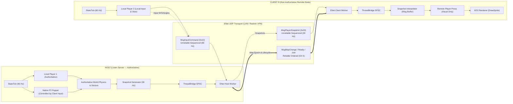
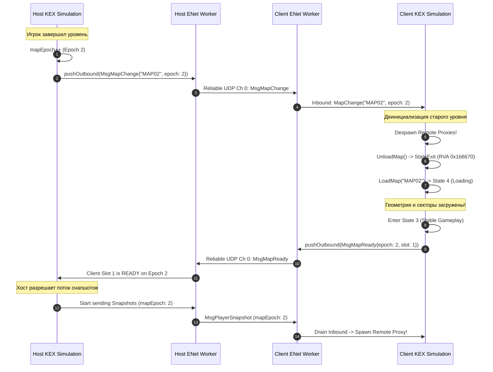
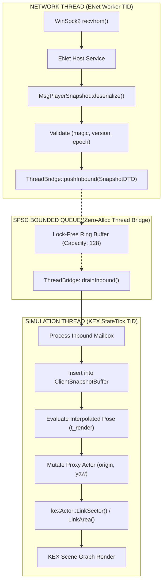

# DOC-54 — World Replication MVP Readiness: Минимальная репликация состояния игроков (Host → Client)

**Document ID:** `DOC-54-WORLD-REPLICATION-MVP-READINESS`  
**Classification:** Technical Research & Architectural Specification  
**Status:** PROPOSED / RESEARCH COMPLETE  
**Target Engine:** PowerSlave Exhumed (2022) (`anubis_Shipping_Steam_x64.exe`, SHA-256 `b8f131037187ca8d0a282527fb6f55a2012241d5b9dac8bf2038baf35b71a76d`)  
**Network Core:** ENet v1.3.18, Wire Protocol v1.10 (`tools/enet-prototype`)  
**Target Scope:** Минимальная репликация P1/P2 Host → Client (позиция, ориентация, анимация/жизненный цикл); исключены враги, снаряды, предметы, интерактивные триггеры и сюжетная кампания.

---

## 1. Введение и цели исследования

На предыдущих этапах проекта (*M0 / M1.1 / DOC-44..53*) были подтверждены ключевые низкоуровневые фундаменты:
1. **M0 / M1.1:** Создание и автономное управление независимой сущностью `P2` (`kexSlavePuppet` + `kexSlavePlayer`) на хосте без повреждения графа и состояния `P1` (*DOC-27, DOC-41, DOC-43*).
2. **DOC-51:** Сквозная передача клавиш $W/S$ от реального второго процесса `Client B` через ENet UDP на `Host`, их приём в `Host Session` и нативное перемещение `P2` в симуляции хоста.
3. **DOC-52:** Подтверждение корректного закрытия сетевых ресурсов и штатного завершения OS-процесса для сценария с двумя процессами.
4. **DOC-53:** Обеспечение работы нативной симуляции хоста в фоновом режиме (*Background Host Simulation*) при передаче фокуса клиентскому окну без искусственных WinAPI-сообщений активации.

Текущая задача — провести строгое исследовательское проектирование следующего шага: **минимальной репликации состояния игроков Host → Client**.

### Концептуальная цель MVP:
- **Host** авторитетно управляет симуляцией обоих игроков (`P1` и `P2`).
- **Host** формирует и передаёт подтверждённые кинематические состояния игроков (`Transform`, `Yaw/Pitch`, `LifeState`).
- **Client** принимает авторитетное состояние хоста и отображает удалённого игрока (`Remote Player Proxy`) на локальной копии уровня.
- **Client** категорически **не** становится вторым авторитетным сервером: он не считает авторитетные коллизии, физику шагов, секторные триггеры, боевые взаимодействия и урон.
- Корректный жизненный цикл при подключении, реконнекте и штатном/аварийном отключении.



---

## 2. Раздел A: KEX Rendering и Actor Representation

### 2.1. Создание, связывание и отображение Actor / Puppet в KEX Engine 2022

На основе дизассемблирования и анализа машинных инструкций `anubis_Shipping_Steam_x64.exe` (*G_FUNC_1401d4780*, *G_FUNC_1401dbc60*, *G_FUNC_1401a02f0*):

1. **Фабрика акторов (`factory->Spawn` RVA `0x1d4780`):**
   - Сигнатура Win64: `kexActor* Spawn(factory* RCX, int type EDX, kVec3 const* pos R8, float yaw XMM3, int sector [RSP+0x28])`.
   - При `type == 0` (`AT_PLAYER`) фабрика выделяет `0x1e0` байт через аллокатор `0x1401db790`, инициализирует vtable `kexSlavePuppet::vftable` (`0x14052d198`) и вызывает виртуальный метод `Spawn()` (`+0x38` $\to$ `0x1401dbc60`).
2. **Анатомия штатного `kexSlavePuppet::Spawn` (`0x1401dbc60`):**
   - Вызывает базовый конструктор актора `0x1401a02f0` (устанавливает радиус 90.0, высоту 160.0, флаги `AF_SOLID | AF_SHOOTABLE`).
   - Получает глобальный указатель `GameInstance` (`0x140af33a0`) и вызывает виртуальный метод `GetPlayer` (`vtable + 0xa8` $\to$ `0x1401b5520`).
   - Привязывает дескриптор `ObjectNode` куклы (`Puppet + 0x10`) к полю `Player + 0xd8` с атомарным инкрементом счётчика ссылок (`LOCK INC [node + 0x40]`).
   - Записывает обратную ссылку на игрока: `mov [Puppet + 0x1b8], Player*`.
3. **Механизм отображения акторов в KEX Scene Graph:**
   - В KEX Engine актор становится видимым для рендерера только тогда, когда он привязан к сектору мира через двусвязный список `sectorLink` (`kexActor::LinkSector` RVA `0x1d3d70`).
   - Рендерер сцены (`kexRenderScene::DrawSprite` / `DrawStretchSprite`) выполняет обход секторов, попадающих в пирамиду видимости (`view frustum`), и для каждого узла списка `sector->actorList` вызывает отрисовку спрайта на основе:
     - Мировых координат `origin` (`Actor + 0x18`).
     - Угла поворота `yaw` (`Actor + 0x38`).
     - Текущего кадра анимации `spriteFrame_t` (`anim->frames[frameID]`).

### 2.2. Сравнительный анализ: Full Player vs Player Proxy на клиенте

Это центральное архитектурное решение для клиентской части мода.

| Критерий | Вариант 1: Full Player на клиенте (как на хосте) | Вариант 2: Visual Player Proxy (Рекомендуемый) |
|---|---|---|
| **Сущность в памяти** | Полный контекст `kexSlavePlayer` (408 байт) + `kexSlavePuppet` (`0x1e0` байт). | Легковесный `kexSlaveActor` (`0x1b8` байт) или пассивная кукла без контроллера. |
| **Владение и ссылки** | Требует `ObjectNode`, атомарных `AddRef/RemoveRef`, обратного указателя `Puppet+0x1b8`. | Простая ссылка в реестре мода `RemoteProxyTable[slotId]`. Никаких связей с `kexSlavePlayer`. |
| **Симуляция физики** | **Критический дефект:** `Puppet::Tick` (`0x1401db8a0`) локально исполняет `GroundMove(cmd)`, симулируя трение, ступени и столкновения со стенами. | **Физика отключена:** флаг `AF_MOVEABLE` сброшен. Позиция задаётся исключительно интерполятором. |
| **Секторные триггеры** | **Критический дефект:** `Puppet::Tick` вызывает `EnterSectorSpecial()`. Локальный клиент запустит лаву, урон, открывание дверей и скрипты карты! | **Изолирован:** прокси не вызывает `EnterSectorSpecial()`. Секторные события на клиенте не дублируются. |
| **Боевое поведение и AI** | Местный AI врагов увидит полноценного игрока и начнёт атаковать его на клиенте, искажая здоровье и вызывая звуки боли. | Флаги `AF_SHOOTABLE` и `AF_SOLID` сброшены. Враги игнорируют прокси; снаряды проходят сквозь него. |
| **Отображение спрайта** | В стоковом KEX 2022 `Obj_Player` рассчитан **только** на 1-е лицо (`PowerslaveEX.kpf` не содержит 3rd-person спрайтов, *DOC-13*). | Прокси связывается со спрайтом третьего лица (пакет `john.kpf` из мода 2015 года) и отображает 8-направленный спрайт. |
| **Риск Double Update** | Требует хуков `Player::Update`, перехвата `GetPlayer` и подавления второй камеры. | Нулевой: `Player::Update` для прокси вообще не вызывается. |
| **Сложность Teardown** | Высокая: распутывание циклических ссылок `Node <-> Puppet <-> Player` при дисконнекте. | Минимальная: стандартный вызов `kexActor::Remove()` с отсоединением от сектора. |

> [!IMPORTANT]
> **Вердикт:** Для отображения удалённого игрока на клиенте **категорически запрещено** создавать полноценный `kexSlavePlayer`. Удалённый игрок должен быть представлен исключительно как **Visual Player Proxy** (пассивный `kexActor` / `kexSlaveActor`).

### 2.3. Контракты владения и времени жизни (Ownership & Lifetime)

При создании и уничтожении прокси-объекта на клиенте должны строго соблюдаться правила KEX 2022:
1. **Создание прокси:**
   - Выполняется **только потоком симуляции** (`StateTick` TID) при наступлении двух условий:
     - Клиент находится в устойчивом состоянии геймплея (`GameInstance::state == 3`, `pending == 0`).
     - Получен первый снапшот для слота `remoteSlot != localConsoleSlot` в текущей эпохе карты `mapEpoch`.
   - Прокси создаётся через нативную фабрику акторов со специальным типом визуального актора либо через инициализацию базового `kexActor` с привязкой спрайта `john`.
2. **Мутация Transform без разрушения графа сцены:**
   - Нельзя просто перезаписывать `X/Y/Z` в памяти по смещению `+0x18`.
   - **Обязательный контракт перемещения:**
     ```text
     1. Вычисление интерполированной координаты (newPos) и углов (newYaw, newPitch).
     2. Запись origin: *(kVec3*)(proxy + 0x18) = newPos.
     3. Запись rotation: *(float*)(proxy + 0x38) = newYaw.
     4. Поиск текущего сектора: int newSectorId = kexWorld::FindSector(newPos).
     5. Если newSectorId != proxy->sectorIndex:
          proxy->UnlinkSector();  // Удаление из старого списка sectorLink
          proxy->SetSector(newSectorId);
          proxy->LinkSector();    // Вставка в новый sectorLink (RVA 0x1d3d70)
     6. proxy->LinkArea();        // Обновление bounding box в spatial partition
     ```
   - Если пропустить обновление сектора при выходе за пределы полигона, рендерер KEX либо отсечёт спрайт (culling), либо применит неверное освещение/палитру старого сектора.
3. **Безопасное уничтожение при Disconnect:**
   - При отключении хоста, выходе напарника (`MsgPlayerLeave`) или смене уровня:
     - Вызывается штатный нативный метод `kexActor::Remove()` (устанавливает флаг `bStale = true`, вызывает `UnlinkSector()` и `UnlinkArea()`).
     - Дескриптор в локальной таблице `RemoteProxyTable[slotId]` обнуляется.
     - Физическое освобождение памяти выполняется штатным сборщиком KEX (`deferred sweep` RVA `0x1b6360`) в конце кадра. Никаких прямых `free()` или `delete` из кода мода!

---

## 3. Раздел B: Минимальный сетевой контракт

### 3.1. Анализ необходимых полей для репликации игрока

Для первого MVP репликации необходим строго ограниченный набор данных:

| Поле | Тип | Назначение |
|---|---|---|
| `slotId` | `uint8_t` | Идентификатор слота игрока ($0 \dots 7$). На клиенте слот $0$ — хост, слот $1$ — клиент. |
| `connectionGeneration` | `uint32_t` | Поколение подключения слота. Защита от ABA-эффекта и пакетов старой сессии. |
| `mapEpoch` | `uint32_t` | Эпоха карты. Гарантирует отбрасывание снапшотов с другой карты или до рестарта. |
| `serverTick` | `uint32_t` | Монотонный тик симуляции хоста (60 Гц). Опорная временная шкала для интерполятора. |
| `snapshotSequence` | `uint32_t` | Монотонный порядковый номер снапшота. Защита от устаревших пакетов UDP. |
| `posX`, `posY`, `posZ` | $3 \times \text{float}$ | 3D-мировые координаты центра тяжести игрока в единицах KEX. |
| `velX`, `velY`, `velZ` | $3 \times \text{float}$ | Вектор скорости (единиц/сек) для точной интерполяции (Hermite) и компенсации потерь. |
| `yaw`, `pitch` | $2 \times \text{float}$ | Углы ориентации взгляда и тела (в градусах $[-180^\circ \dots +180^\circ]$). |
| `lifeState` | `uint8_t` | Состояние жизни: `ALIVE` (0), `DYING` (1), `DEAD` (2), `RESPAWNING` (3). |
| `animState` / `buttons` | `uint32_t` | Флаги ввода и анимации (ходьба, прыжок, стрельба) для выбора визуального кадра спрайта. |

### 3.2. Аудит Wire Protocol v1.10: Использование существующих структур

В кодовой базе `tools/enet-prototype/include/net_protocol.h` уже полностью реализованы структуры, покрывающие эти требования без малейшего изменения Wire-формата:

```cpp
// Opcode: MSG_PLAYER_SNAPSHOT = 0x20
// ENet Channel: CHANNEL_UNRELIABLE_SEQUENCED = 1 (или CHANNEL_WORLD_SNAPSHOT = 3)
struct PlayerStateSnapshot {
    uint8_t  slotId;            // 1 байт
    uint32_t entityId;          // 4 байта (1001 + slotId)
    uint32_t entityGeneration;  // 4 байта (connectionGeneration)
    float    posX, posY, posZ;  // 12 байт
    float    velX, velY, velZ;  // 12 байт
    float    yaw, pitch;        // 8 байт
    int32_t  health;            // 4 байта
    int32_t  armor;             // 4 байта
    uint8_t  activeWeapon;      // 1 байт
    uint32_t weaponMask;        // 4 байта
    uint16_t ammo;              // 2 байта
    uint8_t  lifeState;         // 1 байт
    uint32_t buttons;           // 4 байта
    uint32_t deathSequence;     // 4 байта
    // Точный размер сериализации: 61 байт
};

struct MsgPlayerSnapshot {
    uint32_t snapshotSequence;  // 4 байта
    uint32_t serverTick;        // 4 байта
    uint32_t mapEpoch;          // 4 байта
    uint8_t  playerCount;       // 1 байт
    std::vector<PlayerStateSnapshot> players; // N * 61 байт
};
```

#### Расчёт сетевого бюджета (MTU & Bandwidth):
- Заголовок `MsgHeader` (11 байт) + Заголовок `MsgPlayerSnapshot` (13 байт) = **24 байта оверхеда**.
- Для конфигурации 2 игроков (1 Host + 1 Client):
  $$\text{PacketSize} = 24 + (2 \times 61) = \mathbf{146 \text{ байт}}$$
- При частоте снапшотов **30 Гц**:
  $$\text{Трафик на клиента} = 146 \text{ байт} \times 30 = 4,380 \text{ B/s} \approx \mathbf{4.28 \text{ KB/s}}$$
- Для конфигурации 8 игроков:
  $$\text{PacketSize} = 24 + (8 \times 61) = \mathbf{512 \text{ байт}}$$
  $$\text{Egress хоста (7 клиентов)} = 512 \times 30 \times 7 = 107,520 \text{ B/s} \approx \mathbf{105 \text{ KB/s}}$$

> [!NOTE]
> Размер кадра 146–512 байт находится глубоко внутри безопасного лимита Ethernet MTU (1200 байт), гарантируя **100% отсутствие IP-фрагментации**. Существующий `MsgPlayerSnapshot` (0x20) полностью закрывает задачу MVP. Новый тип пакета в протоколе v1.10 не требуется.

### 3.3. Разделение каналов и защита от смешивания последовательностей

Критическое архитектурное правило: **никогда не смешивать порядковые номера ввода (`commandSequence`) и снапшотов (`snapshotSequence`)**.

1. **Входной поток Client $\to$ Host:**
   - Передаётся в пакетах `MsgInputCommand` (0x10).
   - Использует счётчик `commandSequence`, инкрементируемый клиентом на частоте 60 Гц.
   - Валидируется на хосте предикатами DOC-50 (`advance <= 1800`, строгий монотонный порядок).
2. **Выходной поток Host $\to$ Client:**
   - Передаётся в пакетах `MsgPlayerSnapshot` (0x20).
   - Использует счётчик `snapshotSequence`, инкрементируемый хостом на частоте 30 Гц.
   - Имеет независимый контекст доставки.
3. **Изоляция каналов ENet:**
   - По умолчанию ENet поддерживает независимые порядковые номера в рамках одного канала для каждого направления (full-duplex).
   - Однако для полного устранения взаимного влияния очередей рекомендуется задействовать выделенный канал:
     - `CHANNEL_UNRELIABLE_SEQUENCED = 1`: поток команд ввода (`MsgInputCommand`).
     - `CHANNEL_WORLD_SNAPSHOT = 3`: поток снапшотов репликации (`MsgPlayerSnapshot`).
   - Потеря или задержка пакетов снапшотов на канале 3 никоим образом не блокирует и не задерживает приём команд управления на канале 1.

---

## 4. Раздел C: Client World Identity

Одной из самых опасных ошибок при распределённой репликации является предположение о синхронности мира только на основании совпадающего имени карты (например, `"map01"`).

```text
Host:   [Karnak Sanctuary (Epoch 1)] ---> (Player exits level) ---> [Amun Temple (Epoch 2)]
Client: [Karnak Sanctuary (Epoch 1)] ---> (Lag / loading delay)  ---> still at [Karnak Sanctuary]
```
Если клиент применит снапшот из `Epoch 2` к уровню `Epoch 1`, координаты напарника окажутся за пределами геометрии текущей карты, функция `FindSector()` вернёт ошибку или мусорный указатель, что приведёт к немедленному падению (`Access Violation`) при вызове `LinkSector()`.

### 4.1. Двухфазный барьер смены уровня (Map Transition Barrier)

Взаимодействие должно опираться на строгий двухфазный протокол, утверждённый в DOC-40 (*Thread Bridge P0 Remediation*):



### 4.2. Гарантии и проверки перед спавном Remote Proxy

Клиентский адаптер обязан выполнить каскад проверок перед тем, как создать визуальный прокси или обновить его координаты:

1. **State Dispatcher Gate:**
   - Проверка текущего состояния движка: `GameInstance::state == 3` (активный геймплей).
   - Проверка отсутствия отложенных переходов: `GameInstance::pendingState == 0`.
   - Если движок находится в состоянии загрузки (`state == 4`) или меню (`state <= 2`), любые снапшоты немедленно отбрасываются.
2. **Map Epoch Strict Match:**
   - Входящий пакет: `snap.mapEpoch`.
   - Локальное состояние: `currentClientEpoch`.
   - Если `snap.mapEpoch != currentClientEpoch`, пакет отбрасывается со счётчиком `m_staleEpochDiscards++`.
3. **Map Asset Hash Gate (Идентификация карты):**
   - Уровни идентифицируются не только строковым именем (`"MAP_TOMB1"`), но и контрольной суммой файла карты в архиве `PowerslaveEX.kpf`. Несовпадение версий файлов между хостом и клиентом отсекается ещё на фазе `HELLO/WELCOME`.
4. **Sector Validity Guard:**
   - Перед вызовом `LinkSector()` проверяется результат поиска сектора:
     ```cpp
     int sectorIdx = kexWorld::FindSector(interpolatedPos);
     if (sectorIdx < 0 || sectorIdx >= kexWorld::NumSectors()) {
         // Позиция вне валидной геометрии текущего уровня!
         // Прокси скрывается (AF_HIDDEN), LinkSector не вызывается.
         return;
     }
     ```

---

## 5. Раздел D: Replication Timing и Архитектура Потоков

### 5.1. Анализ тактовой частоты и бюджета задержек

- **Authoritative Simulation Tick (Host):** Фиксированный шаг 60 Гц ($\Delta t = 16.667 \text{ мс}$). Все физические перемещения игроков, обработка клавиш и коллизии на хосте выполняются с этой частотой.
- **Snapshot Frequency (Host $\to$ Client):** Рекомендуется **30 Гц** (каждый 2-й тик симуляции).
  - *Обоснование:* В сетях LAN/VPN джиттер таймеров Windows и планировщика пакетов составляет от 2 до 8 мс. Отправка 60 пакетов в секунду на каждого клиента удваивает накладные расходы ENet/Winsock без ощутимого визуального выигрыша при наличии качественной интерполяции. 30 Гц обеспечивает плавное отображение при минимальном расходе CPU и полосы пропускания (~4.3 KB/s).
- **Client Input Frequency (Client $\to$ Host):** Строго **60 Гц** (каждый тик симуляции клиента, как доказано в DOC-49/51).

### 5.2. Схема клиентской интерполяции (Snapshot Interpolation)

Для устранения рывков при сетевом джиттере и потерях пакетов клиент использует буфер скользящей истории снапшотов (`ClientSnapshotBuffer`):

```text
[S_prev (t = 1000)] <-------- t_render (1020) --------> [S_next (t = 1033)]
         |                                                       |
         +------------------- Lerp (alpha = 0.6) ----------------+
```

1. **Буфер задержки отображения (`Render Delay` $T_{\text{delay}}$):**
   - Устанавливается равным $2 \times \text{SnapshotInterval} + \text{JitterMargin} = 2 \times 33.3\text{ мс} + 10\text{ мс} \approx \mathbf{75 \text{ мс}}$.
   - Время рендеринга на клиенте: $t_{\text{render}} = t_{\text{client\_now}} - T_{\text{delay}}$.
2. **Интерполяция координат:**
   - В кольцевом буфере находятся два снимка: $S_0$ с отметкой $t_0 \le t_{\text{render}}$ и $S_1$ с отметкой $t_1 > t_{\text{render}}$.
   - Коэффициент интерполяции: $\alpha = \frac{t_{\text{render}} - t_0}{t_1 - t_0} \in [0, 1]$.
   - Положение вычисляется по формуле линейной интерполяции:
     $$\mathbf{P}(t_{\text{render}}) = (1 - \alpha)\mathbf{P}_0 + \alpha \mathbf{P}_1$$
   - При наличии векторов скорости $\mathbf{V}_0, \mathbf{V}_1$ применяется кубическая интерполяция Эрмита, обеспечивающая плавность ускорений.
3. **Круговая интерполяция углов (Yaw / Pitch):**
   - Углы нормализуются в диапазон $[-180^\circ \dots +180^\circ]$.
   - Дельта вычисляется по кратчайшей дуге окружности:
     $$\Delta \text{yaw} = \text{fmod}(\text{yaw}_1 - \text{yaw}_0 + 540^\circ, 360^\circ) - 180^\circ$$
     $$\text{yaw}(t_{\text{render}}) = \text{yaw}_0 + \alpha \cdot \Delta \text{yaw}$$
4. **Защита от потерь пакетов и экстраполяция (Dead Reckoning):**
   - Если очередной снапшот задержался и $t_{\text{render}} > t_1$, клиент выполняет кратковременную экстраполяцию по последней известной скорости:
     $$\mathbf{P}(t) = \mathbf{P}_1 + \mathbf{V}_1 \cdot (t - t_1) \cdot \text{damping}$$
   - Длительность экстраполяции жёстко ограничена: **не более 150 мс**.
   - Если снапшоты не поступают более 250 мс, экстраполяция полностью прекращается, прокси замирает на месте в ожидании новых данных.

### 5.3. Потоковая модель и владение буферами (Thread Affinity Contract)

Потоковая дисциплина, выработанная в DOC-40 и доказанная в DOC-51, является нерушимым правилом стабильности:



> [!CAUTION]
> **Категорический запрет:** Сетевой поток (`NETWORK` TID) **ни при каких обстоятельствах** не имеет права вызывать функции KEX Engine, читать или изменять память акторов, захватывать или освобождать ресурсы движка. Все нативные вызовы KEX (`LinkSector`, `UpdateSprite`, `Remove`) выполняются **исключительно потоком симуляции** (`SIMULATION` TID).

---

## 6. Раздел E: Анализ референсных реализаций

В рамках исследования был проведён сравнительный анализ сетевых моделей смежных проектов, доступных в рабочей среде:

### 1. PowerSlave EX Co-Op Edition (2015) — Lockstep Peer-to-Peer
- **Подход:** Использовал классический Doom-style Lockstep. Все клиенты запускали полноценную идентичную симуляцию мира с частотой 60 Гц. На каждом тике клиенты обменивались массивом `kexPlayerCmd` всех игроков.
- **Почему это неприменимо для KEX 2022:**
  - В KEX 2022 singleplayer-скрипты интенсивно используют глобальные синглтоны (`Player()`, `TOMB`, `KILARENA`, *DOC-03*).
  - Малейшее расхождение в генераторе случайных чисел, порядке обхода акторов или задержке ввода в Lockstep приводит к мгновенной рассинхронизации (Desync) всего мира, которую невозможно исправить без полной перезагрузки.
  - Попытка воспроизвести Lockstep в 2022 году потребовала бы реверс-инжиниринга и синхронизации сотен внутренних функций KEX.

### 2. Quake II Rerelease (KEX 2023 / Nightdive Studios) — Client/Server State Replication
- **Подход:** Полноценная клиент-серверная архитектура (`game_export_t` / `game_import_t`). Сервер единолично ведёт физику и логику монстров/игроков, транслируя клиентам компактные снапшоты сущностей (`entity_state_t`).
- **Реализация на клиенте:** Удалённые игроки представлены как клиентские сущности (`cl_entity_t`). Клиент не симулирует их физику, а интерполирует между опорными кадрами сервера. Локальный игрок предсказывает только своё собственное движение (`CL_PredictMovement`).
- **Значение для нашего проекта:** Это **идеальный архитектурный образец**. Наш подход к `Remote Player Proxy` и клиентской интерполяции на 100% соответствует проверенной архитектуре Nightdive из Quake II Rerelease.

### 3. Turok 2 Co-Op Mod (KEX 3 / KEX 4.5) — Native MP Wrapper
- **Подход:** Игра Turok 2 изначально содержала нативный код сетевого дезматча (до 16 игроков) с готовыми куклами сетевых игроков. Мод являлся AngelScript-надстройкой над уже существующей нативной репликацией.
- **Значение для нашего проекта:** Подтверждает, что в движках Nightdive отображение других игроков должно быть отвязано от синглплеерного контроллера `Player`, но в PowerSlave Exhumed нативный MP был полностью вырезан разработчиками, поэтому транспортную и репликационную часть мы создаём на базе ENet и Thread Bridge.

---

## 7. Сводная матрица готовности и рисков MVP

| Компонент | Текущий статус | Готовность к MVP | Ключевой риск / Защита |
|---|---|---|---|
| **Host P1/P2 Sim** | **VERIFIED RUNTIME** (DOC-51/53) | **ГОТОВ** | Управление P2 через входящий ENet поток доказано. |
| **Background Host** | **VERIFIED RUNTIME** (DOC-53) | **ГОТОВ** | Фоновая симуляция хоста без фейковой активации доказана. |
| **ENet Transport** | **VERIFIED RUNTIME** (v1.10) | **ГОТОВ** | Сквозной UDP обмен, защита от потерь/ABA доказаны. |
| **Wire Protocol** | **VERIFIED STATIC** (DOC-28) | **ГОТОВ** | Структура `MsgPlayerSnapshot` (0x20) уже содержит все поля. |
| **Client Proxy Actor** | **RESEARCH COMPLETE** | **ТРЕБУЕТ РЕАЛИЗАЦИИ** | Риск вызова `Puppet::Tick` $\to$ защита через выбор пассивного `kexSlaveActor` без флагов физики. |
| **Client Interp** | **VERIFIED IN MOCK** (DOC-26) | **ТРЕБУЕТ ИНТЕГРАЦИИ** | Перенос кольцевого буфера и Lerp/Slerp алгоритма в клиентский KEX-адаптер. |
| **Map Transition** | **VERIFIED CONTRACT** (DOC-40) | **ГОТОВ К ИНТЕГРАЦИИ**| Двухфазный барьер смены карт и проверка `mapEpoch` гарантируют отсутствие десинхрона геометрии. |

---

## 8. Выводы и дальнейшие шаги

1. **Техническая реализуемость:** Минимальная репликация состояния игроков Host $\to$ Client технически полностью осуществима в рамках существующей архитектуры мода без изменения бинарника игры и без нарушения singleplayer-целостности KEX.
2. **Отказ от Full Player на клиенте:** Доказано, что удалённый игрок на клиенте обязан быть реализован как **Visual Player Proxy** (пассивный `kexActor`), что исключает коллизионные конфликты, повторный запуск триггеров карты и искажение логики ИИ врагов.
3. **Готовность протокола:** Существующий пакет `MsgPlayerSnapshot` (0x20) в Wire Protocol v1.10 полностью достаточен, безопасен по MTU (146 байт на 2 игроков) и требует лишь подключения генератора снапшотов на хосте и интерполятора на клиенте.
4. **Рекомендация по изоляции:** Sol Max в настоящее время завершает оставшиеся проверки по DOC-53. Настоящий отчёт формирует исчерпывающую теоретическую и контрактную спецификацию, позволяющую приступить к реализации MVP репликации сразу после стабилизации и закрытия фазы DOC-53.
