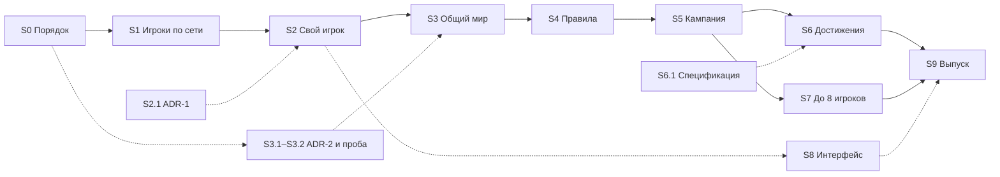

# ROADMAP — план разработки PowerSlave Exhumed Together

> **Статус документа:** план, а не результат. Составлен 2026-11-03 по [PROGRESS](PROGRESS.md) и отчётам DOC-41…58B.2. Не меняет статусы принятых gates; runtime при его составлении не выполнялся. Проценты и сроки — оценки (INFERRED). По мере работы обновлять колонку «Статус».

Цель не меняется (см. [AGENTS.md](../AGENTS.md)): 2–8 игроков включая хоста, host-authoritative listen server, LAN/Radmin VPN, ENet; оригинальная кампания, независимые состояния игроков, общий сюжетный прогресс и Shared Achievement Progress для всех 20 Steam-достижений.

Об именах этапов: «M1.1 / M1.2a / M12b» в журнале — это DLL и сетевой ввод. Геймплейный M1 из [09](09_POC_PLAN.md) и [20](20_GAMEPLAY_HANDOFF.md) (AI-цели, подбор, ключи) в этом плане — сегмент S4.

## 1. Как пользоваться

1. Одна модель берёт одну задачу по ID (S1.1 и т. д.).
2. Перед работой читает [AGENTS.md](../AGENTS.md), [CURRENT_STATE](CURRENT_STATE.md), свою строку здесь и документы из колонки «Опора». Принятые исследования и прогоны не повторяет.
3. Исполнитель и проверяющий — разные модели (колонки «Исполнитель» и «Проверка»).
4. Результат сдаётся так: отчёт `docs/<NN>_<NAME>.md`, evidence в `docs/evidence/…`, записи в [PROGRESS](PROGRESS.md) и [EVIDENCE_INDEX](EVIDENCE_INDEX.md), новый статус задачи здесь.
5. Статусы: `TODO` → `IN PROGRESS` → `REVIEW` (сделано, ждёт проверки другой моделью) → `BOUNDED_PASS` / `PASS`; кроме того `PARTIAL` и `BLOCKED`.

Шаблон задания для модели:

```text
Роль: <исполнитель | проверяющий> задачи <ID> из docs/ROADMAP.md.
Прочитай: AGENTS.md, docs/CURRENT_STATE.md, docs/ROADMAP.md (<ID>) и документы из колонки «Опора».
Объём: только <ID>. EXE SHA-256 b8f131037187ca8d0a282527fb6f55a2012241d5b9dac8bf2038baf35b71a76d. Принятые исследования и runs не повторять.
Готово, когда: <критерий сегмента из ROADMAP>.
Сдать: отчёт docs/<NN>_<NAME>.md, evidence, записи в PROGRESS и EVIDENCE_INDEX, статус <ID> в ROADMAP.
```

## 2. Состояние на 2026-11-03

**Архитектура.** Хост — авторитетный listen server. Игроки P2…P8 на хосте — настоящие нативные Player/Puppet (Full Player), ими управляет ввод клиентов по ENet. У каждого клиента свой экземпляр KEX; удалённые игроки в нём — визуальные прокси (пассивные Actor). Lockstep отвергнут: детерминизм закрытого бинарника не гарантирован ([02](02_ENGINE_ARCHITECTURE.md), [22](22_KEX_MULTIPLAYER_CRITICAL_AUDIT.md)).

**Принято (в узких границах):**

| Что | Где |
|---|---|
| Статика exact EXE: 91 досье функций, 25 точек перехвата, 20 достижений, блокеры BLK-01…12 | [10](10_OPUS_HANDOFF.md), [07](07_HOOK_CANDIDATES.md), [20](20_GAMEPLAY_HANDOFF.md) |
| M0 PASS: второй независимый игрок на хосте — движение, коллизии, оружие, урон, смерть и респаун, снаряды через респаун, выход в меню и Direct Quit без порчи P1 | [27](27_M0_COMPLETION_REPORT.md), [M0→M1](M0_TO_M1_HANDOFF.md) |
| M1.1 PASS: собственная C++ DLL создаёт P2 в нативном тике | [41](41_M1_NATIVE_BOOTSTRAP.md), [43](43_M1_DIRECT_QUIT_FINAL.md) |
| Ввод из второго процесса KEX двигает P2 на хосте | [51](51_NATIVE_SECOND_INSTANCE_INPUT_POC.md) |
| Хост симулирует в фоне | [53](53_HOST_BACKGROUND_SIMULATION.md) |
| Снапшоты игроков хост → клиент приходят бит-в-бит | [55](55_NATIVE_PLAYER_SNAPSHOT_POC.md) |
| Идентичность карты, эпоха, MapReady (trusted client, одна карта) | [56](56_NATIVE_MAP_IDENTITY_READY_GATE.md), [56 D1](56_NATIVE_ACCEPTANCE_ADDENDUM_D1.md) |
| Укрепление: маршрутизация по поколениям, admission/rejoin, каденс и последовательности ввода, закрытие окна, штатный выход | [46](46_M12B_GENERATION_ROUTING_REMEDIATION.md)–[50](50_M12B_INPUT_SEQUENCE_HARDENING.md), [52](52_HOST_TERMINAL_SHUTDOWN_INVESTIGATION.md) |
| Прокси игрока хоста на клиенте: спавн, движение, интерполяция, переход сектора, удаление | [57](57_NATIVE_VISUAL_PROXY_FINAL_ACCEPTANCE.md), [58A](58A_NATIVE_VISUAL_PROXY_COMPLETION.md), [58B](58B_NATIVE_NETWORK_VISUAL_PROXY_INTEGRATION.md) |
| При выходе в титульный экран KEX сам уничтожает живой прокси (G1, bounded) | [58B.2](58B2_NATIVE_ACTOR_OWNERSHIP_UNLOAD.md) |
| Автономный ENet-прототип с репликацией мира на 8 игроков (мок, 42/42); к движку не подключён | [29](29_ENET_FINAL_ACCEPTANCE.md), [tools/enet-prototype](../tools/enet-prototype/README.md) |

**Не сделано:**

- Общего мира нет: у хоста и клиента независимые миры, враги, двери и предметы у каждого свои.
- Свой игрок клиента симулируется локально и не сверяется с P2 на хосте: здоровье, патроны и позиция могут разойтись.
- Удалённый игрок на клиенте — стоковая мумия Actor 1007 как заглушка: один прокси, один тип, белый список секторов. Реконнект с прокси и смена карты с живым прокси не закрыты ([58B.1](58B1_NATIVE_LEVEL_UNLOAD_RECONNECT.md) PARTIAL).
- Прокси управляется Frida-JS (`adapter58b.js`), DLL грузится через диагностический Frida-стенд — production-сборки нет.
- Все нативные прогоны — два процесса на одном ПК. Теста на двух ПК по LAN/Radmin не было: `tools/enet-prototype/field-test/logs` пуст.
- Не начаты: правила для нескольких игроков, кампания и сохранения, достижения, 3–8 игроков, UI, загрузчик.

**Проблемы процесса:**

- [AGENTS.md](../AGENTS.md), [README](README.md) и [00_SCOPE](00_SCOPE.md) были устаревшими («M0 не принят», «не реализовывать сеть / не подключать ENet») — исправлено в S0.1.
- [PROGRESS](PROGRESS.md) — 107 КБ плотного текста; короткая точка входа — [CURRENT_STATE](CURRENT_STATE.md) (S0.1).
- Нет git (с S0.2 есть, см. DOC-59); каждый этап копирует «лабораторную» DLL — единого production-кода нет.
- QA DOC-58C [`TEST_RESULTS.json`](../../TEST_RESULTS.json) (24/32, 7 FAIL, 1 NVR: мультислот, быстрый реконнект в тот же слот, ABA при отложенном sweep, реентерабельность seam) нигде не учтён.
- Всё привязано к одной версии EXE: патч Steam сломает адреса.
- Очень мелкая нарезка и полный аудит целостности на каждом шаге — надёжно, но медленно.

## 3. Роли моделей

Уровни рассуждения: **high → extra → max**.

| Модель | Роль | Уровни |
|---|---|---|
| **Opus** | ADR, прогоны в игре через REA MCP в Claude Code (так выполнены, в частности, DOC-56 D1, 58B и 58B.2), главный рецензент и приёмка | **max** — ADR и gates с риском lifetime/UAF; **extra** — обычные нативные gates; **high** — ревью |
| **GPT 6.1 Sol** | Нативный реверс, детуры и C++ в DLL (вёл M0 и нативную часть M1) | **max** — новая подсистема с неизвестным ABI/lifetime; **extra** — расширение отработанных шаблонов; **high** — точечные правки |
| **Sonnet** | Объёмная работа по готовым шаблонам: консолидация, offline-тесты, AngelScript, UI, упаковка, документация | **high** — код; **medium** — документы и индексы |
| **Gemini** | Прототипы и тестовые стенды (ENet-прототип, QA-клиенты в `tools/`), чтение больших объёмов, ассеты, второе мнение | **high** — стенды, тесты, ассеты; **max** — второе мнение по протоколу и архитектуре |

Правила:

- Исполнитель и проверяющий — разные модели.
- Код и выводы Gemini — только вход для проверки. Его автомат состояний DOC-58D.1 отклонён с 8 блокирующими дефектами, а его тесты эти дефекты закрепляли ([58B §A](58B_NATIVE_NETWORK_VISUAL_PROXY_INTEGRATION.md)); DOC-33 и DOC-53 исправляли его выводы.
- Прогоны в игре — только моделям с рабочим REA MCP (Frida). REA не чинить, новый инжектор не писать ([AGENTS.md](../AGENTS.md)).
- Полная строгость (evidence, integrity, exact restores) обязательна для lifetime, памяти и выгрузки. Для UI, правил и документов — облегчённый режим, если пользователь его утвердит (D7).

## 4. Сегменты

### S0. Порядок и единая база

Сразу, параллельно с S1.

| ID | Задача | Исполнитель | Проверка | Опора | Статус |
|---|---|---|---|---|---|
| S0.1 | Обновить AGENTS.md, README и 00_SCOPE под факт (M0 принят, сеть реализуется, актуальные запреты); создать [CURRENT_STATE](CURRENT_STATE.md) на 1–2 страницы (архитектура, принятое, замороженные DLL и хеши, следующий шаг); сослаться на ROADMAP | Opus 5.5 (выполнено 2026-11-03; прежняя редакция AGENTS.md — `docs/research/AGENTS_before_S0.1.md`) | Sonnet high или Gemini high | верх [PROGRESS](PROGRESS.md), этот документ | PASS (проверка Sonnet 5.5, 2026-11-03) |
| S0.2 | git для исходников (без evidence, профилей и сборок) | Sonnet medium | — | решение D1 | REVIEW (Sonnet 5.5, 2026-11-03; [DOC-59](59_S0_2_GIT_SOURCES.md)); проверяющий не назначен |
| S0.3 | Свести «лабораторные» копии в единый код `pse_together`: роли host/client, флаги, контракты DOC-46/47/49/50/53/55/56 и автомат состояний 58B/58B.2; все offline-сьюты запускаются одной командой | Sonnet high | Sol extra | `experiments/m1/*`, [58B.2 §D](58B2_NATIVE_ACTOR_OWNERSHIP_UNLOAD.md) | TODO |
| S0.4 | Перенести управление прокси из Frida-JS (`adapter58b.js`, контроллер DOC-58A) в C++ внутри DLL; Frida/REA остаются только наблюдателем | Sol max | Opus extra (в игре) | [58A](58A_NATIVE_VISUAL_PROXY_COMPLETION.md), [58B §B](58B_NATIVE_NETWORK_VISUAL_PROXY_INTEGRATION.md) | TODO |
| S0.5 | Двухпроцессный стенд (`runner58b.py`, `input58b.py`) превратить в переиспользуемый инструмент: запуск, фокус, сценарии ввода, экспорт evidence | Gemini high | Opus high | [native_network_visual_proxy_58b](../experiments/m1/native_network_visual_proxy_58b/), приложение A | TODO |

**Готово, когда:** сценарий DOC-58B (run 02) воспроизводится на единой сборке без Frida-адаптера с тем же результатом.

### S1. Закрыть «игроков по сети» (M2)

| ID | Задача | Исполнитель | Проверка | Опора | Статус |
|---|---|---|---|---|---|
| S1.1 | **DOC-58C:** реконнект и повторный Spawn одного прокси поверх ENGINE_RETIRED: teardown-witness в DLL (переживает detach); disconnect-latch и barrier снимаются только по новому native MapReady новой эпохи; второй Spawn с anti-ABA (alloc seq блока как поколение); закрыть hazard «Remove в полёте» (`af3380/af3388`). Разобрать 7 FAIL + 1 NVR из `TEST_RESULTS.json`: относятся ли они к текущему `visual_proxy_58b2.hpp` (цель того QA — `remediated_visual_proxy_state_machine.hpp`) | Opus max | Sol extra; второе мнение — Gemini high | [58B.2 §F](58B2_NATIVE_ACTOR_OWNERSHIP_UNLOAD.md), [58B.1](58B1_NATIVE_LEVEL_UNLOAD_RECONNECT.md), [TEST_RESULTS.json](../../TEST_RESULTS.json) | TODO — следующий |
| S1.2 | Смена карты с живым прокси: 10 переходов подряд (sign-off DOC-58D); другие пути выгрузки — смерть → рестарт, выход с уровня → следующая карта, загрузка сохранения | Opus extra | Sol high | [58B.2 §C](58B2_NATIVE_ACTOR_OWNERSHIP_UNLOAD.md) | TODO |
| S1.3 | Спавн host-P2 не в точке P1 (отложенный патч DOC-58B.1) | Sol high | Opus high | [58B.1](58B1_NATIVE_LEVEL_UNLOAD_RECONNECT.md) | TODO |
| S1.4 | Прокси через любые порталы (сейчас белый список 259 → 123); lerp в движении через портал | Sol extra | Opus extra | [58A](58A_NATIVE_VISUAL_PROXY_COMPLETION.md) | TODO |
| S1.5 | Jitter-буфер и задержка интерполяции; фоновый тик клиента для тестов на одном ПК (аналог DOC-53); решение по wire v1.11 (хост проверяет карту клиента, а не только эхо эпохи) | Sonnet high (offline) + Opus high (в игре) | Sol high | [53](53_HOST_BACKGROUND_SIMULATION.md), [56](56_NATIVE_MAP_IDENTITY_READY_GATE.md), [54](54_WORLD_REPLICATION_MVP_READINESS.md) | TODO |
| S1.6 | Первый тест на двух ПК по LAN/Radmin с DLL | Gemini high (набор, диагностика, инструкция) + пользователь | Opus high (разбор логов) | [field-test](../tools/enet-prototype/field-test/README_FIELD_TEST.md), [25](25_ENET_FIELD_TEST_READINESS.md) | TODO |

**Готово, когда:** два ПК видят друг друга, вместе меняют карты и переподключаются без утечек и порчи памяти.

### S2. Авторитет и собственный игрок клиента

| ID | Задача | Исполнитель | Проверка | Опора | Статус |
|---|---|---|---|---|---|
| S2.1 | **ADR-1** — модель авторитета для своего игрока клиента: (A) хост авторитетен по вводу, клиент предсказывает и исправляется; (B) клиент авторитетен по своему движению (хост ставит P2 в присланную позицию), хост — по урону, здоровью и миру. Для LAN-кооператива B заметно дешевле. Решение — пользователь (D2) | Opus max | Sol extra, Gemini max (оппоненты) | [54](54_WORLD_REPLICATION_MVP_READINESS.md), [08](08_NETWORK_ARCHITECTURE.md) | TODO |
| S2.2 | Здоровье, патроны, оружие, ключи, инвентарь и смерть своего игрока приходят с хоста и применяются только через нативные функции (без memcpy и записи указателей) | Sol max | Opus extra | [03](03_PLAYER_LIFECYCLE.md), [M0→M1](M0_TO_M1_HANDOFF.md) | TODO |
| S2.3 | Урон своему игроку на клиенте — только событиями хоста; локальный урон подавлен | Sol max | Opus extra | [05](05_PHYSICS_WEAPONS_DAMAGE.md) | TODO |
| S2.4 | Спрайты игроков от третьего лица с перекраской по слотам вместо мумии; анимации ходьбы, атаки и смерти | Gemini high (ассеты) + Sonnet high (KPF) + Sol high (привязка к прокси) | Opus high | [13](13_PLAYER_SPRITES.md), [14](14_PRESENTATION_HANDOFF.md) | TODO |

**Готово, когда:** HUD клиента всегда показывает значения хоста, расхождение позиции ограничено и исправляется, удалённые игроки выглядят как игроки.

### S3. Общий мир (M3) — главный риск

ADR-2 и пробу (S3.1–S3.2) начать как можно раньше, параллельно с S1.

| ID | Задача | Исполнитель | Проверка | Опора | Статус |
|---|---|---|---|---|---|
| S3.1 | **ADR-2 «мир клиента»:** клиент рисует мир, но не симулирует его (AI, урон, триггеры и скрипты подавлены); стабильные ID объектов карты (проверить, что порядок спавна при LoadMap совпадает на обоих); ID динамических объектов выдаёт хост. Lockstep пересматривать только при доказанном тупике. Решение — пользователь (D3) | Opus max | Gemini max (второе мнение), Sol extra (реализуемость подавления) | [54](54_WORLD_REPLICATION_MVP_READINESS.md), [26](26_WORLD_REPLICATION_PROTOTYPE.md), [04](04_ACTORS_AI.md), [Q07–Q10](OPEN_QUESTIONS.md) | TODO |
| S3.2 | **Проба:** один тип врага на одной карте — на клиенте его AI выключен, позиция, анимация и смерть приходят с хоста, урон считает только хост | Sol max | Opus max | S3.1 | TODO |
| S3.3 | Все типы врагов и боссы: поведение, особые атаки, арены | Sol extra (шаблон) → Sonnet high (по классам) | Opus extra | [17](17_MULTIPLAYER_AI.md), [04](04_ACTORS_AI.md) | TODO |
| S3.4 | Снаряды, эффекты и звук: визуал на клиенте, авторитет на хосте; на клиенте подавить gameplay-действия анимаций (Weapon ChangeAnim, RVA 0x20f760; Q07) | Sol max | Opus extra | [05](05_PHYSICS_WEAPONS_DAMAGE.md), [02](02_ENGINE_ARCHITECTURE.md) | TODO |
| S3.5 | Двери, лифты, движущиеся полы и потолки, переключатели | Sol extra | Opus extra | [06](06_LEVELS_CAMPAIGN_SAVE.md), [19](19_CAMPAIGN_COMPATIBILITY.md) | TODO |
| S3.6 | Подключить протокол репликации из прототипа (wire заморожен в DOC-29) к нативному адаптеру; baseline мира на барьере карты | Gemini high + Sonnet high | Opus high | [26](26_WORLD_REPLICATION_PROTOTYPE.md), [28](28_WORLD_REPLICATION_PROTOCOL_AUDIT.md), [29](29_ENET_FINAL_ACCEPTANCE.md) | TODO |

**Готово, когда:** двое на одной карте вместе убивают врагов и открывают двери, мир у обоих одинаковый, клиент не дублирует действия. Это первый по-настоящему играбельный срез.

### S4. Правила кооператива (BLK-01…11)

| ID | Задача | Исполнитель | Проверка | Опора | Статус |
|---|---|---|---|---|---|
| S4.1 | AI выбирает ближайшего видимого игрока среди всех слотов, без отката на P1 (BLK-01/02) | Sol extra | Opus high | [20](20_GAMEPLAY_HANDOFF.md), [17](17_MULTIPLAYER_AI.md) | TODO |
| S4.2 | Аптечки и патроны — тому, кто подобрал (BLK-03/04); анкхи без дублей (BLK-05) | Sol extra | Opus high | [18](18_PICKUPS_AND_INVENTORY.md) | TODO |
| S4.3 | Общий реестр ключей команды (BLK-06); скрипты: SUNKEN (BLK-07) и землетрясение босса Set (BLK-08) | Sonnet high (AngelScript) + Sol extra (нативная часть) | Opus high | [20](20_GAMEPLAY_HANDOFF.md) | TODO |
| S4.4 | Выход с уровня — когда все в зоне или по таймеру (BLK-09); кат-сцены и видео синхронно, общий пропуск (BLK-10) | Sonnet high + Sol high | Opus high | [11](11_CUTSCENES_COOP.md) | TODO |
| S4.5 | Возрождение на E, гибель всей команды, оружие после возрождения (BLK-11) | Sonnet high + Sol extra | Opus high | [16](16_RESPAWN_DESIGN.md) | TODO |
| S4.6 | Опции (FF, общие или личные предметы, скейлинг сложности) — только точки расширения | Sonnet high | Opus high | [00_SCOPE](00_SCOPE.md) | TODO |
| S4.7 | Тест-матрица BLK по картам | Gemini high | Opus high | [19](19_CAMPAIGN_COMPATIBILITY.md) | TODO |

**Готово, когда:** BLK-01…11 закрыты и проверены на картах, где они проявляются. BLK-12 (негативное достижение) закрывается в S6.

### S5. Кампания и сохранения (M4a)

| ID | Задача | Исполнитель | Проверка | Опора | Статус |
|---|---|---|---|---|---|
| S5.1 | Общий барьер смены карты для всех игроков, экран путешествия, перенос личных инвентарей между картами | Sol extra (по дизайну Opus extra) | Opus extra | [06](06_LEVELS_CAMPAIGN_SAVE.md), [54 §4.1](54_WORLD_REPLICATION_MVP_READINESS.md) | TODO |
| S5.2 | Кооп-сохранение на хосте (sidecar), продолжение кампании, вход нового игрока на смене карты | Sol extra (нативный save/load) + Sonnet high (формат) | Opus extra | [06](06_LEVELS_CAMPAIGN_SAVE.md), [15](15_COOP_2015_FEATURES.md) | TODO |
| S5.3 | Запуск карт только штатным путём кампании: команда `map` включает читы и отключает достижения (DOC-56 D2) | Sol high | Opus high | [56 D1](56_NATIVE_ACCEPTANCE_ADDENDUM_D1.md) | TODO |
| S5.4 | Пройти вдвоём всю кампанию (≈25 карт в DOC-19); регрессионная матрица карт | Gemini high (план) + пользователь (плейтест) | Opus high (разбор) | [19](19_CAMPAIGN_COMPATIBILITY.md) | TODO |

**Готово, когда:** кампания проходится вдвоём от начала до конца, с сохранением и продолжением.

### S6. Общий прогресс 20 достижений (M4b)

| ID | Задача | Исполнитель | Проверка | Опора | Статус |
|---|---|---|---|---|---|
| S6.1 | Спецификация всех 20 условий: участие в событии, ограничения способа, негативные (no ankhs, BLK-12) и накопительные условия, без выдачи задним числом. Можно начинать сейчас | Opus high | Gemini high (сверка с defs и scripts) | [10 §Shared Achievement Progress](10_OPUS_HANDOFF.md), [Q12–Q15](OPEN_QUESTIONS.md) | TODO |
| S6.2 | Только лог событий (A0) на хосте; реестр; связь «слот ↔ Steam-аккаунт» | Sonnet high | Opus high | S6.1 | TODO |
| S6.3 | Выдача каждому клиенту через штатный Steam-сервис (readiness, SetAchievement, storage), дедуп, повтор после офлайна. Требует D4 | Sol extra | Opus extra | [10](10_OPUS_HANDOFF.md) | TODO |

**Готово, когда:** на разных Steam-аккаунтах достижения выдаются участникам ровно один раз, без выдачи задним числом.

### S7. До 8 игроков (M5a)

| ID | Задача | Исполнитель | Проверка | Опора | Статус |
|---|---|---|---|---|---|
| S7.1 | P3…P8 на хосте, 7 прокси на клиенте, слоты 2–7 в игре; нет жёстких масок на 2 или 4 игрока | Sol extra | Opus extra | [Q16](OPEN_QUESTIONS.md), [58B §D](58B_NATIVE_NETWORK_VISUAL_PROXY_INTEGRATION.md) | TODO |
| S7.2 | Нагрузочный стенд: 4+ процесса на одном ПК плюс несколько ПК или ВМ; вход и выход по кругу, долгие сессии, CPU и трафик | Gemini high | Opus extra | [29](29_ENET_FINAL_ACCEPTANCE.md) | TODO |

**Готово, когда:** хост и 7 клиентов проходят карту и долгую сессию без деградации.

### S8. Интерфейс

Параллельно, после S2.

| ID | Задача | Исполнитель | Проверка | Опора | Статус |
|---|---|---|---|---|---|
| S8.1 | Создание игры и подключение из меню, имена игроков | Sonnet high + Sol high | Opus high | [15](15_COOP_2015_FEATURES.md) | TODO |
| S8.2 | Таблица игроков, текстовый чат, сообщения о подключении и отключении | Sonnet high + Sol high | Opus high | [15](15_COOP_2015_FEATURES.md) | TODO |
| S8.3 | Союзники на автокарте | Sol high | Opus high | [12](12_AUTOMAP_ALLIES.md) | TODO |

### S9. Выпуск

| ID | Задача | Исполнитель | Проверка | Опора | Статус |
|---|---|---|---|---|---|
| S9.1 | Загрузчик без Frida (proxy-DLL рядом с EXE или лаунчер). Требует D5 | Sol high | Opus extra | [41](41_M1_NATIVE_BOOTSTRAP.md) | TODO |
| S9.2 | Проверка версии EXE (SHA) с понятным сообщением; по желанию — сигнатурный поиск адресов, чтобы пережить патч Steam | Sol high | Opus high | [01](01_BINARY_MANIFEST.md) | TODO |
| S9.3 | Логи, краш-дампы, конфиг, инструкция на русском и английском, набор для друзей | Sonnet high + Gemini high | Opus high | [field-test](../tools/enet-prototype/field-test/README_FIELD_TEST.md) | TODO |
| S9.4 | Полевые тесты с друзьями и финальный аудит | пользователь + Opus extra | Sol high | — | TODO |

## 5. Критический путь



Пунктир — то, что можно вести параллельно основному пути.

**Первые задачи (можно одновременно):** проверка S0.1 (Sonnet high или Gemini high), S1.1 / DOC-58C (Opus max), S3.1 / ADR-2 (Opus max, второе мнение — Gemini max), S0.3–S0.5. Спецификацию S6.1 (Opus high) можно делать в любой момент.

## 6. Решения пользователя

| ID | Решение | Когда |
|---|---|---|
| D1 | git для исходников (S0.2) | сейчас |
| D2 | ADR-1: вариант A или B (S2.1) | до S2.2 |
| D3 | ADR-2: подтвердить модель «мир клиента» (S3.1) | до S3.2 |
| D4 | Разрешение трогать достижения и тестовые Steam-аккаунты (S6.3); сейчас AGENTS.md это запрещает | до S6.3 |
| D5 | Тип загрузчика и снятие запрета на новый инжектор (S9.1) | до S9 |
| D6 | Партнёр и время для теста на двух ПК (S1.6) | в S1 |
| D7 | Облегчённый режим проверок для UI, правил и документов | сейчас |

## 7. Оценка готовности (INFERRED)

| Веха | Готово |
|---|---|
| Исследование | ~90% |
| M0: второй игрок на хосте | 100% (в принятых границах) |
| Игроки по сети (M2) | ~60% |
| Правила для нескольких игроков (S4) | ~5% |
| Общий мир (M3) | ~5%, только автономный прототип |
| Кампания и достижения (M4) | ~3% |
| 8 игроков и выпуск (M5) | ~2% |
| **Итого по объёму** | **≈20% (±5)** |

Главный риск снят: KEX 2022 держит второго независимого игрока. Самая большая и рискованная часть — общий мир на клиенте — в нативе ещё не начата. Первый по-настоящему играбельный срез (2 игрока, одна карта, общие враги и двери) появится после S3. При нынешней нарезке впереди примерно 100–150 шагов уровня DOC: при темпе около 10 в день это недели, а с учётом тяжёлой репликации мира и живых плейтестов — скорее 1–2 месяца. Оценку пересчитать после S1.1 и S3.2.

## Приложение A. Ловушки стенда (из прогонов DOC-56…58B.2)

- Нативные прогоны идут через постоянные Frida-сессии REA MCP. Перед прогоном проверить, что инструменты REA загружаются и `list_frida_devices` работает. В `start_frida_session` поле `argv` — только аргументы (начиная с `-B`), без argv[0]; затем resume. Имена прогонов должны быть новыми.
- Крупные наблюдения: `frida_session_status(detail=summary)`, затем `export_evidence_bundle` на диск. Записи в бандле упорядочены канонически, а не по времени: брать статус с наибольшим числом сообщений. Захват сообщений Frida в REA ограничен 16 МиБ на сессию — тяжёлые пробы включать только на нужное окно.
- Принятые socket-пробы декодируют только INPUT и снапшот 0x20, но не MsgMapReady.
- Мир KEX без фокуса не тикает (байт +319). Фоновую аренду (DOC-53) имеет только хост; клиент применяет прокси только на переднем плане, в фоне его DLL лишь копит и схлопывает снапшоты. Примерно через 1,4 с после смены фокуса что-то на рабочем столе забирает его обратно: фокусировать окно непосредственно перед `ui_start` и вводом. Старт уровня требует RETURN на экране карты.
- Хост DOC-56 ставит P2 в текущую позицию P1: первое движение P1 поднимает его на P2, а W от точки спавна уносит P1 через односторонний уступ в сектор 123 (возврат закрыт около y ≈ −6980). До S1.3 ставить P1 короткими нажатиями W (~0,03 с) до подключения клиента, после — двигаться стрейфом и мышью.
- Seam клиента одноразовый: выгружать `adapter58b.js` только после того, как `PSE58B_RequestDetach` сообщил статус 3, иначе DLL вызовет освобождённые NativeCallback.
- Дерево сборки должно быть коротким (`b58` в корне мода): цепочка DOC-56 вкладывает пять каталогов `integration`, и MSBuild упирается в MAX_PATH.
- Пассивный наблюдатель не должен ставить хуки на префиксы Remove, фабрики и LinkSector — адаптер их проверяет. Безопасные дополнительные точки: `1c90e0`, `c58b0`, `c5310`, `19f210`, CRT `free` (DOC-58B.2).
- Владение (DOC-58B.2): Actor фабрики живут в tagged heap `af4490` (заголовок блока = actor − 0x60; +8 — alloc seq, годится как поколение), ObjectNode — в блоках 0x1210 кучи `af4600`. `c58b0` обнуляет заголовок +0x18 прямо перед free — не ждать указателя на кучу в момент освобождения.
- При выходе в титульный экран ClientGate DOC-56 ставит barrier примерно за 60 тиков до StateExit; финальная запись клиента тогда показывает `failed:true` — это fail-closed latch, а не сбой.

## История

- 2026-11-03 — документ создан (Opus 5.5, Claude Code) по запросу пользователя.
- 2026-11-03 — S0.1: обновлены AGENTS.md, README и 00_SCOPE, создан CURRENT_STATE.md (Opus 5.5); статус REVIEW.
- 2026-11-03 — S0.1: проверка Sonnet 5.5 — PASS после трёх правок CURRENT_STATE (хеш адаптера по файлам, область «сетевых прогонов», строка следующих шагов). Открыто к решению пользователя: подтвердить постоянное разрешение на сетевой код (ENet) в AGENTS.md.
- 2026-11-03 — пользователь подтвердил постоянное разрешение на сетевой код (ENet) в рабочей папке; зафиксировано в AGENTS.md.
- 2026-11-03 — S0.2: git в корне мода, 692 файла ([DOC-59](59_S0_2_GIT_SOURCES.md), Sonnet 5.5); статус REVIEW, D1 принят постановкой задачи.
