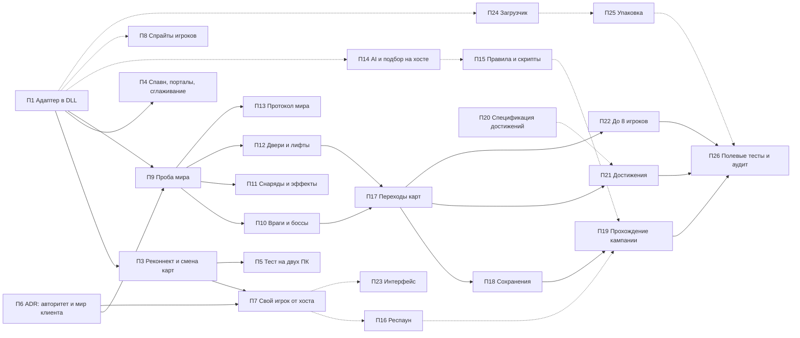

# ROADMAP — план разработки PowerSlave Exhumed Together

> **Статус документа:** план, а не результат. Составлен 2026-11-03 по [PROGRESS](PROGRESS.md) и отчётам DOC-41…58B.2; в тот же день перестроен на пакеты с режимами приёмки. Не меняет статусы принятых gates; runtime при его составлении не выполнялся. Проценты и сроки — оценки (INFERRED). По мере работы обновлять статусы пакетов (§4.1) и задач (§4.2).

Цель не меняется (см. [AGENTS.md](../AGENTS.md)): 2–8 игроков включая хоста, host-authoritative listen server, LAN/Radmin VPN, ENet; оригинальная кампания, независимые состояния игроков, общий сюжетный прогресс и Shared Achievement Progress для всех 20 Steam-достижений.

Об именах этапов: «M1.1 / M1.2a / M12b» в журнале — это DLL и сетевой ввод. Геймплейный M1 из [09](09_POC_PLAN.md) и [20](20_GAMEPLAY_HANDOFF.md) (AI-цели, подбор, ключи) в этом плане — сегмент S4.

## 1. Как пользоваться

1. Работа идёт пакетами (§4.1). Одна модель берёт пакет целиком; ID задач (S1.1 и т. д.) — чек-лист внутри пакета, подробности задач — в §4.2.
2. Перед работой модель читает [AGENTS.md](../AGENTS.md), [CURRENT_STATE](CURRENT_STATE.md), строку своего пакета, его задачи и документы из колонки «Опора». Принятые исследования и прогоны не повторяет.
3. Кто принимает результат — по режиму пакета (§3): А — сам исполнитель; Б — сам исполнитель, а другая модель проверяет позже, не блокируя работу; В — только другая модель.
4. Что сдаётся:
   - режим А — вывод машинных проверок (сборка, тесты, хеши по файлам, ссылки), строка в [PROGRESS](PROGRESS.md), статус здесь; отдельный отчёт DOC не нужен;
   - режимы Б и В — отчёт `docs/<NN>_<NAME>.md`, evidence в `docs/evidence/…`, записи в PROGRESS и [EVIDENCE_INDEX](EVIDENCE_INDEX.md), статус здесь.
5. Статусы: `TODO` → `IN PROGRESS` → дальше по режиму. А — `PASS`. Б — `DONE` (следующие пакеты уже можно начинать), после проверки — `PASS`. В — `REVIEW` (зависимые пакеты ждут), после проверки — `PASS`. Уточнения: `BOUNDED_PASS`, `PARTIAL`, `BLOCKED`.

Шаблон задания для модели:

```text
Роль: <исполнитель | проверяющий> пакета <Пn> из docs/ROADMAP.md, режим <А | Б | В>.
Прочитай: AGENTS.md, docs/CURRENT_STATE.md, строку <Пn> в ROADMAP §4.1, его задачи в §4.2 и документы из колонки «Опора».
Объём: только задачи пакета <Пn>. EXE SHA-256 b8f131037187ca8d0a282527fb6f55a2012241d5b9dac8bf2038baf35b71a76d. Принятые исследования и runs не повторять.
Готово, когда: <критерии «Готово, когда» сегментов этих задач>.
Сдать: по режиму (ROADMAP §1, п. 4); обновить статусы пакета и задач. Если работа задела то, что требует режима В (§3), — поднять режим и поставить REVIEW.
```

## 2. Состояние на 2026-11-03

**Архитектура.** Хост — авторитетный listen server. Игроки P2…P8 на хосте — настоящие нативные Player/Puppet (Full Player), ими управляет ввод клиентов по ENet. У каждого клиента свой экземпляр KEX; удалённые игроки в нём — визуальные прокси (пассивные Actor). Lockstep отвергнут: детерминизм закрытого бинарника не гарантирован ([02](02_ENGINE_ARCHITECTURE.md), [22](22_KEX_MULTIPLAYER_CRITICAL_AUDIT.md)).

**Принято (в узких границах):**

| Что | Где |
|---|---|
| Статика exact EXE: 91 досье функций, 25 точек перехвата, 20 достижений, блокеры BLK-01…12 | [10](10_OPUS_HANDOFF.md), [07](07_HOOK_CANDIDATES.md), [20](20_GAMEPLAY_HANDOFF.md) |
| M0 PASS: второй независимый игрок на хосте — движение, коллизии, оружие, урон, смерть и респаун, снаряды через респаун, выход в меню и Direct Quit без порчи P1 | [27](27_M0_COMPLETION_REPORT.md), [M0→M1](M0_TO_M1_HANDOFF.md) |
| M1.1 PASS: собственная C++ DLL создаёт P2 в нативном тике | [41](41_M1_NATIVE_BOOTSTRAP.md), [43](43_M1_DIRECT_QUIT_FINAL.md) |
| Ввод из второго процесса KEX двигает P2 на хосте | [51](51_NATIVE_SECOND_INSTANCE_INPUT_POC.md) |
| Хост симулирует в фоне | [53](53_HOST_BACKGROUND_SIMULATION.md) |
| Снапшоты игроков хост → клиент приходят бит-в-бит | [55](55_NATIVE_PLAYER_SNAPSHOT_POC.md) |
| Идентичность карты, эпоха, MapReady (trusted client, одна карта) | [56](56_NATIVE_MAP_IDENTITY_READY_GATE.md), [56 D1](56_NATIVE_ACCEPTANCE_ADDENDUM_D1.md) |
| Укрепление: маршрутизация по поколениям, admission/rejoin, каденс и последовательности ввода, закрытие окна, штатный выход | [46](46_M12B_GENERATION_ROUTING_REMEDIATION.md)–[50](50_M12B_INPUT_SEQUENCE_HARDENING.md), [52](52_HOST_TERMINAL_SHUTDOWN_INVESTIGATION.md) |
| Прокси игрока хоста на клиенте: спавн, движение, интерполяция, переход сектора, удаление | [57](57_NATIVE_VISUAL_PROXY_FINAL_ACCEPTANCE.md), [58A](58A_NATIVE_VISUAL_PROXY_COMPLETION.md), [58B](58B_NATIVE_NETWORK_VISUAL_PROXY_INTEGRATION.md) |
| При выходе в титульный экран KEX сам уничтожает живой прокси (G1, bounded) | [58B.2](58B2_NATIVE_ACTOR_OWNERSHIP_UNLOAD.md) |
| Автономный ENet-прототип с репликацией мира на 8 игроков (мок, 42/42); к движку не подключён | [29](29_ENET_FINAL_ACCEPTANCE.md), [tools/enet-prototype](../tools/enet-prototype/README.md) |

**Не сделано:**

- Общего мира нет: у хоста и клиента независимые миры, враги, двери и предметы у каждого свои.
- Свой игрок клиента симулируется локально и не сверяется с P2 на хосте: здоровье, патроны и позиция могут разойтись.
- Удалённый игрок на клиенте — стоковая мумия Actor 1007 как заглушка: один прокси, один тип, белый список секторов. Реконнект с прокси и смена карты с живым прокси не закрыты ([58B.1](58B1_NATIVE_LEVEL_UNLOAD_RECONNECT.md) PARTIAL).
- Прокси управляется Frida-JS (`adapter58b.js`), DLL грузится через диагностический Frida-стенд — production-сборки нет.
- Все нативные прогоны — два процесса на одном ПК. Теста на двух ПК по LAN/Radmin не было: `tools/enet-prototype/field-test/logs` пуст.
- Не начаты: правила для нескольких игроков, кампания и сохранения, достижения, 3–8 игроков, UI, загрузчик.

**Проблемы процесса:**

- [AGENTS.md](../AGENTS.md), [README](README.md) и [00_SCOPE](00_SCOPE.md) были устаревшими («M0 не принят», «не реализовывать сеть / не подключать ENet») — исправлено в S0.1.
- [PROGRESS](PROGRESS.md) — 107 КБ плотного текста; короткая точка входа — [CURRENT_STATE](CURRENT_STATE.md) (S0.1).
- Не было git — заведён в S0.2 ([DOC-59](59_S0_2_GIT_SOURCES.md)). Каждый этап копировал «лабораторную» DLL; единый код `experiments/pse_together/` сведён в S0.3 ([DOC-60](60_S0_3_PSE_TOGETHER_UNIFIED_BASE.md)), в игре ещё не проверен.
- QA DOC-58C [`TEST_RESULTS.json`](../../TEST_RESULTS.json) (24/32, 7 FAIL, 1 NVR: мультислот, быстрый реконнект в тот же слот, ABA при отложенном sweep, реентерабельность seam) разобран в П3 ([DOC-71 §8](71_P3_RECONNECT_AND_MAP_CHANGE.md)): цель того QA — кандидат Gemini, к принятому автомату относятся только TC-03, TC-09 и TC-30, все закрыты; корневой файл расходится с выводом в папке QA (29/2/1).
- Всё привязано к одной версии EXE: патч Steam сломает адреса.
- Очень мелкая нарезка и полный аудит целостности на каждом шаге — надёжно, но медленно. Пересмотрено 2026-11-03: пакеты и режимы приёмки (§3, §4.1).

## 3. Роли моделей и режимы приёмки

Уровни рассуждения: **high → extra → max**.

| Модель | Роль | Уровни |
|---|---|---|
| **Opus** | ADR, прогоны в игре через REA MCP в Claude Code (так выполнены, в частности, DOC-56 D1, 58B и 58B.2), главный рецензент и приёмка | **max** — ADR и gates с риском lifetime/UAF; **extra** — обычные нативные gates; **high** — ревью |
| **GPT 6.1 Sol** | Нативный реверс, детуры и C++ в DLL (вёл M0 и нативную часть M1) | **max** — новая подсистема с неизвестным ABI/lifetime; **extra** — расширение отработанных шаблонов; **high** — точечные правки |
| **Sonnet** | Объёмная работа по готовым шаблонам: консолидация, offline-тесты, AngelScript, UI, упаковка, документация | **high** — код; **medium** — документы и индексы |
| **Gemini** | Прототипы и тестовые стенды (ENet-прототип, QA-клиенты в `tools/`), чтение больших объёмов, ассеты, второе мнение | **high** — стенды, тесты, ассеты; **max** — второе мнение по протоколу и архитектуре |

**Режимы приёмки:**

| Режим | Как принимается | Когда |
|---|---|---|
| **А — самоприёмка** | Исполнитель сам прогоняет машинные проверки (сборка, тесты, хеши по файлам, ссылки, воспроизведение принятого прогона) и ставит `PASS` | Результат проверяется машинно или самим плейтестом, изменения обратимы (git), а память, время жизни объектов, выгрузка, протокол, Steam и оригинал не затронуты |
| **Б — самоприёмка с неблокирующей проверкой** | Исполнитель ставит `DONE`, следующие пакеты стартуют сразу; другая модель проверяет пачкой раз в сегмент и при находке возвращает пакет | Нативный код Opus или Sol по принятым шаблонам; ошибка может быть тихой, но обратима и не несёт внешних последствий |
| **В — блокирующая проверка** | Исполнитель ставит `REVIEW`; зависимые пакеты ждут, пока другая модель не поставит `PASS` | Архитектурные решения; проба, от которой зависит весь подход; необратимые внешние эффекты (Steam-аккаунты, сохранения пользователя, загрузчик); новая нативная логика от Sonnet или Gemini; финальный аудит |

Правила:

- Критерий — проверяемость результата и цена ошибки, а не уверенность модели. Пример: S0.1 (Opus 5.5) прошёл проверку Sonnet только после трёх правок, одна из них — хеш адаптера, взятый из журнала, а не пересчитанный по файлу. В режиме А такие ошибки ловит обязательная машинная проверка, а не второй рецензент.
- Opus и Sol — сильные исполнители: им доступны режимы А и Б, уровень выбирается по сложности (таблица ролей). Если новую нативную логику пишут Sonnet или Gemini не по готовому шаблону Opus/Sol, режим поднимается на ступень (А → Б, Б → В).
- Эскалация: если пакет в режиме А или Б по ходу задел память, время жизни объектов или выгрузку вне принятого шаблона, протокол, правила AGENTS.md, Steam или оригинальную установку — либо ключевые утверждения остались INFERRED/UNKNOWN, — исполнитель сам поднимает режим до В и ставит `REVIEW`.
- Режим определяет, кто принимает, а не объём доказательств: для прогонов в игре evidence, integrity и exact restores обязательны в любом режиме.
- Код и выводы Gemini — только вход для проверки. Его автомат состояний DOC-58D.1 отклонён с 8 блокирующими дефектами, а его тесты эти дефекты закрепляли ([58B §A](58B_NATIVE_NETWORK_VISUAL_PROXY_INTEGRATION.md)); DOC-33 и DOC-53 исправляли его выводы.
- Прогоны в игре — только моделям с рабочим REA MCP (Frida). REA не чинить. D5 принят 2026-11-04: новый Proxy-DLL загрузчик П24 разрешён, запрет на новый инжектор снят; игровая проба П24 сохраняет прежнюю защиту профилей/изоляцию REA, Frida не выполняет загрузку DLL ([AGENTS.md](../AGENTS.md), [DOC-69](69_P24_PROXY_DLL_LOADER.md)).

## 4. Пакеты и задачи

### 4.1 Пакеты

Один пакет — одна модель-исполнитель и одна приёмка. Колонка «После» — пакеты и решения пользователя, без которых пакет не начать.

| Пакет | Задачи | Исполнитель | Режим | Проверяющий | После | Статус |
|---|---|---|---|---|---|---|
| П1 | S0.4 (+ проверка S0.3 на входе) | Sol max | В (поднят с Б: нативные lifecycle-детуры) | Opus extra | S0.3 | PASS (bounded; приёмка Opus extra [DOC-64](64_P1_ACCEPTANCE_REVIEW.md), 2026-11-04: пересборка 7/7 секций = загруженные DLL, 24/24 offline, независимое чтение run 03; исполнение [DOC-61](61_P1_NATIVE_PROXY_DLL.md)) |
| П2 | S0.5 | Gemini high | А | — | — | PASS |
| П3 | S1.1, S1.2 | Opus max | В (поднят с Б: четыре новых детура выгрузки, Remove только перед Drain, выгрузка вне принятого шаблона) | Sol extra | П1 | PASS (bounded; приёмка [DOC-78 §7](78_P3_ACCEPTANCE_CHECK.md#7-повторная-проверка-после-исправлений), 2026-11-04: после возврата исправлены F1–F5, F7; run 05 — 13 Spawn, 2 реконнекта, 10 переходов карты на клиенте, ревью журналов 19/19 и независимая сверка 15/15, пересборка 7/7, offline 30/30; граница — один прокси, TOMB, два процесса на одном ПК; не сделаны смерть → рестарт и следующая карта (→ П4/П7/П17), лимит жизни rearm-инкарнаций проверен только offline; исполнение — [DOC-71](71_P3_RECONNECT_AND_MAP_CHANGE.md)) |
| П4 | S1.3, S1.4, S1.5 | Sol extra | В (native placement/control/portal и protocol) | Codex по назначению пользователя ([DOC-79](79_P4_ACCEPTANCE_REVIEW.md)) | П1 | PASS (bounded), 2026-11-04, [DOC-79](79_P4_ACCEPTANCE_REVIEW.md): anchor Spawn, corridor/native lerp, jitter-буфер160 ms и long-pause recovery, живой фон04/Esc-resume02, identity-only v1.11/D9. Свежие30/30 offline, независимые91/91 raw checks, обе DLL П4 и client П1 —7/7 секций; original77/protected неизменны. TOMB/один Actor1007/равные caches/dry water state; «любые порталы/карты» остаётся PARTIAL. Исполнение — [DOC-72](72_P4_REMEDIATION_AND_RUNTIME.md) |
| П5 | S1.6 | Gemini high + пользователь; разбор логов — Opus high | А | — (проверка — сам тест) | П3, D6; D5 или стенд REA на втором ПК | TODO |
| П6 | S2.1, S3.1 | Opus max; доработка Codex | В | Независимые Astra (ред. 2) и GPT-6.1 Sol (ред. 3); Gemini отменён пользователем D11 | — | PASS архитектурных контрактов ([DOC-77](77_P6_REV3_INDEPENDENT_ACCEPTANCE.md), 2026-11-04: ADR-1 PASS, A1 закрыт, ADR-2 PASS; 266/266 проверяющего, отдельно 43/43 fixtures, принятая статика 25/25 переиспользована). D2=A/D3=W1/D3b/D10 приняты; поля П6 только в будущей v1.12, v1.10/v1.11 неизменны. Барьер П6 снят; П7 дополнительно требует П3, native/runtime gates П7/П9 обязательны |
| П7 | S2.2, S2.3 | Codex; native Sol max | В (поднят с Б: новый wire v1.12, native state apply и damage gates) | независимый gpt-6-astra | П3, П6 | PASS (bounded), 2026-11-05: [DOC-81](81_P7_INDEPENDENT_ACCEPTANCE.md), исполнение [DOC-80](80_P7_SELF_STATE_NATIVE_GATES.md).31/31 независимых checks,842/842 capture→ENet→native readback,54apply,4localdamage suppressions,singledeath. Offline32/32, DLL7/7sections, keys gates В до записи. TOMB/2процесса/sharedQPC/однажизнь; без respawn/rearm/cross-PC sync; весьS2 открыт |
| П8 | S2.4 | Gemini high + Sonnet high + Sol high | В (поднят с Б: native animation ABI и scale собственного proxy) | пользователь (визуально), Opus extra | П1 | REVIEW / PARTIAL ([DOC-68](68_P8_PLAYER_SPRITES_AND_ANIMATIONS.md), 2026-11-04: два новых персонажа вместо John, 27/27 offline, run04 37/37 evidence assertions; 28 native кадров, renderer/retirement/exit0; нужны визуальная оценка, 8 различимых вариантов, реальные combat transitions и независимая приёмка) |
| П9 | S3.2 | Sol max | В | Opus max | П1, П6 | TODO |
| П10 | S3.3 | Sol extra (шаблон) → Sonnet high (по классам) | Б; шаблон первой группы — В | Opus extra | П9 | TODO |
| П11 | S3.4 | Sol max | Б | Opus extra | П9 | TODO |
| П12 | S3.5 | Sol extra | Б | Opus extra | П9 | TODO |
| П13 | S3.6 | Gemini high + Sonnet high | В | Opus high | П9 | TODO |
| П14 | S4.1, S4.2 | Sol extra | В (поднят с Б: новые native scopes/lifecycle, gameplay UNKNOWN) | Opus high | П1 | IN PROGRESS (возвращён проверкой [DOC-70](70_P14_ACCEPTANCE_CHECK.md), 2026-11-04: статика и smoke подтверждены, пересборка 7/7 = DLL run02, контракт 65 783/0; блокирует F1 — после потери права (дисконнект, resync, смерть P2, block) хуки глотают оригинальные Idle/Chase/Health/Ammo, AI и подбор хоста замирают; нужны F1–F3, F7 и игровые gates BLK-01…05; исполнение — [DOC-66](66_P14_HOST_AI_AND_PICKUPS.md)) |
| П15 | S4.3, S4.4, S4.6 | Sonnet high + Sol extra | Б | Opus high | П14 | TODO |
| П16 | S4.5 | Codex по назначению пользователя; завершил и проверил Claude | Б | Исполнитель и проверяющий — по указанию пользователя | П7 | PASS (bounded), 2026-11-07, [DOC-88](88_P16_NATIVE_RESPAWN_RUNS.md): игровой run08 — E-респаун слота 1, повторный подбор того же weapon-only пикапа без патронов, гибель обеих сторон (TPK) и два E без перезагрузки уровня; offline 38/38, INTEGRITY 25/25 и 13/13, exact restores, exit 0. Границы: смерти и пикап — фикстуры, один ПК/TOMB/2 игрока, мир клиента независим |
| П17 | S5.1, S5.3 | Sol extra (дизайн — Opus extra) | Б | Opus extra | П3, П10, П12 | TODO |
| П18 | S5.2 | Sol extra + Sonnet high | В | Opus extra | П17 | TODO |
| П19 | S4.7, S5.4 | Gemini high + пользователь | А | — (проверка — сам плейтест) | П15, П16, П18 | TODO |
| П20 | S6.1 | Opus high | А | — (машинная сверка 20 ключей с defs и scripts) | — | PASS ([DOC-63](63_S6_1_ACHIEVEMENT_SPEC.md), 2026-11-04: сверка 50/50, мутации 8/8; правила PR-1…PR-3 приняты пользователем — D8) |
| П21 | S6.2, S6.3 | Sonnet high + Sol extra | В | Opus extra | П17, П20, D4 | TODO |
| П22 | S7.1, S7.2 | Sol extra + Gemini high | Б | Opus extra | П17 | TODO |
| П23 | S8.1, S8.2, S8.3 | Codex по назначению пользователя | В (поднят с Б: v1.13/D13; native UI gates) | Отдельный агент Codex, [DOC-86](86_P23_INDEPENDENT_ACCEPTANCE.md) | П7 | PASS в проверенных границах, 2026-11-06, [DOC-86](86_P23_INDEPENDENT_ACCEPTANCE.md). Native меню/HUD, имена, чат/roster, host-native pose binder и реальные союзники на автокарте. [DOC-85](85_P23_NATIVE_MENU_CHAT_AUTOMAP.md): два KEX/D3D11/TOMB/один ПК/одна native жизнь; offline35/35,574UI+83real ENet+18WARP; raw36/36, independent58/58, обе DLL по7/7 masked PE sections. Original77/copies/actual5protected неизменны, five UI hooks каждого процесса exact40, controls exact16, обаexit0; v1.10–v1.12 сохранены.8endpoint проверены отдельно от native; блокеров приёмки нет, остальные границы — DOC-86 |
| П24 | S9.1, S9.2 | Sol high; завершение Codex | В | Независимый Codex ([DOC-83](83_P24_INDEPENDENT_ACCEPTANCE.md)) | П1, D5 | PASS (bounded), 2026-11-05, [DOC-83](83_P24_INDEPENDENT_ACCEPTANCE.md): самостоятельная загрузка frozen P1 без Frida loader; независимые 85/85 + 19/19, fresh CTest 32/32, три артефакта по 7/7 секций, GUI 13/13 и exit193, original77/actual5protected неизменны, exact restores. Полностью Frida-free KEX/portable release не аттестованы; [DOC-82](82_P24_COMPLETION_AND_VALIDATION.md), [DOC-69](69_P24_PROXY_DLL_LOADER.md) |
| П25 | S9.3 | Codex (исполнение и самопроверка) | А | — (сборка пакета и установка на чистой машине) | П24 | PARTIAL, 2026-11-05: диагностический friends ZIP PASS 46/46, fresh offline32/32, exact restores/raw85/85+19/19 и original77/actual5protected неизменны. [Упаковка](../experiments/pse_together/packaging/README.md), [evidence](evidence/m1/P25_PACKAGING/). Игровая установка на чистой машине, переносимый native конфиг/изоляция и захват дампов KEX не аттестованы; полный PASS не выставлен |
| П27 | S9.5–S9.11 | Sol max (native), Sonnet high (упаковка) | В (native loader, изоляция записи, permit) | Opus extra | П24, П25, D15 | PARTIAL, 2026-11-07: [предложение](P27_PORTABLE_INSTALL_PROPOSAL.md), D15a–b приняты. Срез 1 (S9.6) и срез 2 (S9.7, минимум S9.5): native guard (запись и чтение), shim v2, broker v2 с самовыдачей permit, `pe-play --role`, установщик; offline 85/85, RUN01 9/9 и RUN02 17/17 ([DOC-89](89_P27_NATIVE_WRITE_GUARD.md)). Исполнитель и проверяющий одна модель по указанию пользователя; лобби и связь host-client не проходились; S9.8–S9.11 не начаты |
| П26 | S9.4 | пользователь + Opus extra (финальный аудит) | В | Sol high | остальные пакеты | TODO |

Итого: 5 пакетов в режиме А, 7 — в Б, 14 — в В (П1, П3, П4, П7, П8, П14 и П23 повышены до В в DOC-61/71/65/80/68/66/84). Пакеты режима Б проверяются пачкой: после S0–S1 (П3 и П4 повышены до В), S2 (П7 и П8 повышены до В), S3 (П10–П12), S4 (П15–П16; П14 повышен до В), S5 (П17), S7 (П22). П23/S8 — отдельная приёмка В по D13.

### 4.2 Задачи по сегментам

#### S0. Порядок и единая база

| ID | Задача | Пакет | Опора | Статус |
|---|---|---|---|---|
| S0.1 | Обновить AGENTS.md, README и 00_SCOPE под факт (M0 принят, сеть реализуется, актуальные запреты); создать [CURRENT_STATE](CURRENT_STATE.md) на 1–2 страницы (архитектура, принятое, замороженные DLL и хеши, следующий шаг); сослаться на ROADMAP | — | верх [PROGRESS](PROGRESS.md), этот документ | PASS (Opus 5.5; проверка Sonnet 5.5, 2026-11-03; прежняя редакция AGENTS.md — `docs/research/AGENTS_before_S0.1.md`) |
| S0.2 | git для исходников (без evidence, профилей и сборок) | — | решение D1 | PASS (режим А: самоприёмка по проверкам [DOC-59](59_S0_2_GIT_SOURCES.md), Sonnet 5.5) |
| S0.3 | Свести «лабораторные» копии в единый код `pse_together`: роли host/client, флаги, контракты DOC-46/47/49/50/53/55/56 и автомат состояний 58B/58B.2; все offline-сьюты запускаются одной командой | — | `experiments/m1/*`, [58B.2 §D](58B2_NATIVE_ACTOR_OWNERSHIP_UNLOAD.md) | PASS (входная проверка П1, 2026-11-04: [review](evidence/m1/PSE_TOGETHER_P1/S03_ENTRY_REVIEW.md); границы [DOC-60](60_S0_3_PSE_TOGETHER_UNIFIED_BASE.md) — только offline) |
| S0.4 | Перенести управление прокси из Frida-JS (`adapter58b.js`, контроллер DOC-58A) в C++ внутри DLL; Frida/REA остаются только наблюдателем | П1 | [58A](58A_NATIVE_VISUAL_PROXY_COMPLETION.md), [58B §B](58B_NATIVE_NETWORK_VISUAL_PROXY_INTEGRATION.md), [DOC-60](60_S0_3_PSE_TOGETHER_UNIFIED_BASE.md) | PASS (bounded, режим В: исполнение [DOC-61](61_P1_NATIVE_PROXY_DLL.md), приёмка Opus extra [DOC-64](64_P1_ACCEPTANCE_REVIEW.md), 2026-11-04; единая сборка без JS-адаптера) |
| S0.5 | Двухпроцессный стенд (`runner58b.py`, `input58b.py`) превратить в переиспользуемый инструмент: запуск, фокус, сценарии ввода, экспорт evidence; приёмка — воспроизведение результата DOC-58B run 02 | П2 | [native_network_visual_proxy_58b](../experiments/m1/native_network_visual_proxy_58b/), приложение A | PASS (режим А: самоприёмка по машинным проверкам и воспроизведению DOC-58B run 02, 2026-11-04, Gemini high; tools/two-process-harness) |

**Готово, когда:** сценарий DOC-58B (run 02) воспроизводится на единой сборке без Frida-адаптера с тем же результатом.

П1: критерий воспроизведён в ограничениях DOC-58B на `P1_HOST_03` / `P1_CLIENT_03` ([DOC-61](61_P1_NATIVE_PROXY_DLL.md)) и принят в режиме В ([DOC-64](64_P1_ACCEPTANCE_REVIEW.md), Opus extra, 2026-11-04). **S0 закрыт.** Неблокирующие замечания N1–N4 DOC-64 (поток `block()`, непроверенные в runtime отказ в движении и teleport, жёсткие инварианты P1, выборочный ActorTick) передаются П3/П4.

#### S1. Закрыть «игроков по сети» (M2)

| ID | Задача | Пакет | Опора | Статус |
|---|---|---|---|---|
| S1.1 | **DOC-58C:** реконнект и повторный Spawn одного прокси поверх ENGINE_RETIRED: teardown-witness в DLL; disconnect-latch и barrier снимаются только по новому native MapReady новой эпохи; второй Spawn с anti-ABA (alloc seq блока как поколение); закрыть hazard «Remove в полёте» (`af3380/af3388`). Разобрать 7 FAIL + 1 NVR из `TEST_RESULTS.json`: относятся ли они к текущему автомату (цель того QA — `remediated_visual_proxy_state_machine.hpp`) | П3 | [58B.2 §F](58B2_NATIVE_ACTOR_OWNERSHIP_UNLOAD.md), [58B.1](58B1_NATIVE_LEVEL_UNLOAD_RECONNECT.md), [TEST_RESULTS.json](../../TEST_RESULTS.json) | PASS (bounded; [DOC-78 §7](78_P3_ACCEPTANCE_CHECK.md#7-повторная-проверка-после-исправлений), [DOC-71 §13](71_P3_RECONNECT_AND_MAP_CHANGE.md#13-исправления-по-doc-78-и-run-05): реконнект и повторный Spawn поверх ENGINE_RETIRED, teardown-witness, anti-ABA, Remove в тике; из QA DOC-58C к автомату относятся TC-03, TC-09, TC-30 — закрыты) |
| S1.2 | Смена карты с живым прокси: 10 переходов подряд (sign-off DOC-58D); другие пути выгрузки — смерть → рестарт, выход с уровня → следующая карта, загрузка сохранения | П3 | [58B.2 §C](58B2_NATIVE_ACTOR_OWNERSHIP_UNLOAD.md) | PARTIAL ([DOC-78 §7](78_P3_ACCEPTANCE_CHECK.md#7-повторная-проверка-после-исправлений): 10 переходов подряд с живым прокси подтверждены в run 02, 03 и 05; не выполнены смерть → рестарт (инвариант N3 DOC-64), выход с уровня → следующая карта (аттестован только TOMB) и смена карты хостом — передано П4/П7/П17) |
| S1.3 | Спавн host-P2 не в точке P1 (отложенный патч DOC-58B.1) | П4 | [58B.1](58B1_NATIVE_LEVEL_UNLOAD_RECONNECT.md) | PASS (bounded), [DOC-79](79_P4_ACCEPTANCE_REVIEW.md): native anchor Spawn вне P1, stationary AABB witness03; moving brackets04 — только corroboration. Ожидание1800 eligible ticks/offline, затем отказ без Reset/Spawn/fallback; одна TOMB binding, rearm — П3 |
| S1.4 | Прокси через любые порталы (corridor259→123→176 принят; общий gate открыт); lerp в движении через портал | П4 | [58A](58A_NATIVE_VISUAL_PROXY_COMPLETION.md) | PASS (bounded corridor) / PARTIAL широкой задачи, [DOC-79](79_P4_ACCEPTANCE_REVIEW.md): 259→123→176 run03, финальная DLL123→176 run04; actual native output bits→sprite renderer/OURS. TOMB/один Actor1007/равные caches/dry water state; water/cache changes, split apertures, несмежные teleport и другие карты не закрыты |
| S1.5 | Jitter-буфер и задержка интерполяции; фоновый тик клиента для тестов на одном ПК (аналог DOC-53); решение по wire v1.11 (хост проверяет карту клиента, а не только эхо эпохи) | П4 | [53](53_HOST_BACKGROUND_SIMULATION.md), [56](56_NATIVE_MAP_IDENTITY_READY_GATE.md), [54](54_WORLD_REPLICATION_MVP_READINESS.md) | PASS (bounded), [DOC-79](79_P4_ACCEPTANCE_REVIEW.md): delay160 ms, offset/refill/long-pause recovery04; 30 min ±100/±500 ppm,310/0; живой фон04, Esc/resume02. Identity-only v1.11/D9: ENet75/0/native READY, legacy32/32 неизменны. П6-поля — будущая v1.12; два ПК — П5; held Attack/mouse/Pause-key не аттестованы |
| S1.6 | Первый тест на двух ПК по LAN/Radmin с DLL. DLL на втором ПК сейчас грузится только стендом REA/Frida: нужен либо стенд и там, либо ранний загрузчик (D5) | П5 | [field-test](../tools/enet-prototype/field-test/README_FIELD_TEST.md), [25](25_ENET_FIELD_TEST_READINESS.md) | TODO |

**Готово, когда:** два ПК видят друг друга, вместе меняют карты и переподключаются без утечек и порчи памяти.

#### S2. Авторитет и собственный игрок клиента

| ID | Задача | Пакет | Опора | Статус |
|---|---|---|---|---|
| S2.1 | **ADR-1** — модель авторитета своего игрока клиента: A (хост ведёт вводом, клиент предсказывает/исправляется) или B (позицию задаёт клиент, мир/урон — хост). Выбор D2 — A; сравнительная стоимость A/B — INFERRED по полному host/client контракту | П6 | [54](54_WORLD_REPLICATION_MVP_READINESS.md), [08](08_NETWORK_ARCHITECTURE.md) | PASS ADR ([DOC-77](77_P6_REV3_INDEPENDENT_ACCEPTANCE.md), ред. 3): A1 закрыт seed/WARMUP/history floor/bounded pending; независимая приёмка, 43/43 новых fixtures и 44 probes. D2=A принят, Gemini отменён D11; native/runtime gate остаётся П7 |
| S2.2 | Здоровье, патроны, оружие, ключи, инвентарь и смерть своего игрока приходят с хоста и применяются только через нативные функции (без memcpy и записи указателей); узкое исключение keys по D12 | П7 | [03](03_PLAYER_LIFECYCLE.md), [M0→M1](M0_TO_M1_HANDOFF.md) | PASS (bounded; [DOC-81](81_P7_INDEPENDENT_ACCEPTANCE.md), [DOC-80](80_P7_SELF_STATE_NATIVE_GATES.md)):842/842 native matches,8weapons,keys/inventory grant/revoke,single death; TOMB/одна жизнь/shared QPC |
| S2.3 | Урон своему игроку на клиенте — только событиями хоста; локальный урон подавлен | П7 | [05](05_PHYSICS_WEAPONS_DAMAGE.md) | PASS (bounded; [DOC-81](81_P7_INDEPENDENT_ACCEPTANCE.md), [DOC-80](80_P7_SELF_STATE_NATIVE_GATES.md)):native kind0…3/amount25 HP183→183; host damage/heal/death применены. Прочие damage/environment paths — static gates, не отдельный runtime всех сред |
| S2.4 | Спрайты игроков от третьего лица с перекраской по слотам вместо мумии; анимации ходьбы, атаки и смерти | П8 | [13](13_PLAYER_SPRITES.md), [14](14_PRESENTATION_HANDOFF.md) | REVIEW / PARTIAL (режим В, [DOC-68](68_P8_PLAYER_SPRITES_AND_ANIMATIONS.md): по уточнению пользователя — новые бойцы/исследователи с египетским снаряжением; 2 архетипа × idle/walk/shoot/death в native preview; 8 различимых вариантов и authoritative combat transitions не закрыты) |

**Готово, когда:** HUD клиента всегда показывает значения хоста, расхождение позиции ограничено и исправляется, удалённые игроки выглядят как игроки.

#### S3. Общий мир (M3) — главный риск

ADR (П6) и пробу (П9) начать как можно раньше.

| ID | Задача | Пакет | Опора | Статус |
|---|---|---|---|---|
| S3.1 | **ADR-2 «мир клиента»:** W1 — клиент рисует мир, AI/урон/триггеры/scripts симулирует хост; стабильные ID записей карты, ID динамических объектов от хоста. Lockstep пересматривать только при доказанном тупике. D3 — W1 | П6 | [54](54_WORLD_REPLICATION_MVP_READINESS.md), [26](26_WORLD_REPLICATION_PROTOTYPE.md), [04](04_ACTORS_AI.md), [Q07–Q10](OPEN_QUESTIONS.md) | PASS архитектурного W1 ([DOC-75](75_P6_INDEPENDENT_REVIEW_ASTRA.md), сохранён и подтверждён [DOC-77](77_P6_REV3_INDEPENDENT_ACCEPTANCE.md)); статика 25/25 переиспользована. D3=W1/узкий D3b приняты, Gemini отменён D11; runtime equality/suppression/retirement/class gates остаются П9 |
| S3.2 | **Проба:** один тип врага на одной карте — на клиенте его AI выключен, позиция, анимация и смерть приходят с хоста, урон считает только хост. Для передачи использовать минимальную часть протокола из прототипа; полная интеграция — S3.6 | П9 | S3.1, [29](29_ENET_FINAL_ACCEPTANCE.md) | TODO |
| S3.3 | Все типы врагов и боссы: поведение, особые атаки, арены | П10 | [17](17_MULTIPLAYER_AI.md), [04](04_ACTORS_AI.md) | TODO |
| S3.4 | Снаряды, эффекты и звук: визуал на клиенте, авторитет на хосте; на клиенте подавить gameplay-действия анимаций (Weapon ChangeAnim, RVA 0x20f760; Q07) | П11 | [05](05_PHYSICS_WEAPONS_DAMAGE.md), [02](02_ENGINE_ARCHITECTURE.md) | TODO |
| S3.5 | Двери, лифты, движущиеся полы и потолки, переключатели | П12 | [06](06_LEVELS_CAMPAIGN_SAVE.md), [19](19_CAMPAIGN_COMPATIBILITY.md) | TODO |
| S3.6 | Подключить протокол репликации из прототипа (wire заморожен в DOC-29) к нативному адаптеру; baseline мира на барьере карты | П13 | [26](26_WORLD_REPLICATION_PROTOTYPE.md), [28](28_WORLD_REPLICATION_PROTOCOL_AUDIT.md), [29](29_ENET_FINAL_ACCEPTANCE.md) | TODO |

**Готово, когда:** двое на одной карте вместе убивают врагов и открывают двери, мир у обоих одинаковый, клиент не дублирует действия. Это первый по-настоящему играбельный срез.

#### S4. Правила кооператива (BLK-01…11)

| ID | Задача | Пакет | Опора | Статус |
|---|---|---|---|---|
| S4.1 | AI выбирает ближайшего видимого игрока среди всех слотов, без отката на P1 (BLK-01/02). Работает на хосте, от общего мира не зависит | П14 | [20](20_GAMEPLAY_HANDOFF.md), [17](17_MULTIPLAYER_AI.md) | IN PROGRESS (П14 возвращён, [DOC-70](70_P14_ACCEPTANCE_CHECK.md): селектор и адреса GetPlayer подтверждены статически; F1 — заморозка AI после потери права, F8 — Chase без цели стоит; игровой gate не выполнен) |
| S4.2 | Аптечки и патроны — тому, кто подобрал (BLK-03/04); анкхи без дублей (BLK-05). Работает на хосте | П14 | [18](18_PICKUPS_AND_INVENTORY.md) | IN PROGRESS (П14 возвращён, [DOC-70](70_P14_ACCEPTANCE_CHECK.md): GiveAnkh/consume/Steam-ветка подтверждены статически; F1 — подбор хоста замирает после потери права; F5–F7, F9 по анкхам; игровой gate не выполнен) |
| S4.3 | Общий реестр ключей команды (BLK-06); скрипты: SUNKEN (BLK-07) и землетрясение босса Set (BLK-08) | П15 | [20](20_GAMEPLAY_HANDOFF.md) | TODO |
| S4.4 | Выход с уровня — когда все в зоне или по таймеру (BLK-09); кат-сцены и видео синхронно, общий пропуск (BLK-10) | П15 | [11](11_CUTSCENES_COOP.md) | TODO |
| S4.5 | Возрождение на E, гибель всей команды, оружие после возрождения (BLK-11) | П16 | [16](16_RESPAWN_DESIGN.md) | PASS (bounded, [DOC-88](88_P16_NATIVE_RESPAWN_RUNS.md)): в игре наблюдались E-респаун на хосте и клиенте, TPK без reload, сброс до стартового набора и повторный подбор оставшегося пикапа без патронов (D14). Границы: фикстурные смерть/пикап, один ПК, TOMB, 2 игрока, независимый мир клиента |
| S4.6 | Опции (FF, общие или личные предметы, скейлинг сложности) — только точки расширения | П15 | [00_SCOPE](00_SCOPE.md) | TODO |
| S4.7 | Тест-матрица BLK по картам | П19 | [19](19_CAMPAIGN_COMPATIBILITY.md) | TODO |

**Готово, когда:** BLK-01…11 закрыты и проверены на картах, где они проявляются. BLK-12 (негативное достижение) закрывается в S6.

#### S5. Кампания и сохранения (M4a)

| ID | Задача | Пакет | Опора | Статус |
|---|---|---|---|---|
| S5.1 | Общий барьер смены карты для всех игроков, экран путешествия, перенос личных инвентарей между картами | П17 | [06](06_LEVELS_CAMPAIGN_SAVE.md), [54 §4.1](54_WORLD_REPLICATION_MVP_READINESS.md) | TODO |
| S5.2 | Кооп-сохранение на хосте (sidecar), продолжение кампании, вход нового игрока на смене карты | П18 | [06](06_LEVELS_CAMPAIGN_SAVE.md), [15](15_COOP_2015_FEATURES.md) | TODO |
| S5.3 | Запуск карт только штатным путём кампании: команда `map` включает читы и отключает достижения (DOC-56 D2) | П17 | [56 D1](56_NATIVE_ACCEPTANCE_ADDENDUM_D1.md) | TODO |
| S5.4 | Пройти вдвоём всю кампанию (≈25 карт в DOC-19); регрессионная матрица карт | П19 | [19](19_CAMPAIGN_COMPATIBILITY.md) | TODO |

**Готово, когда:** кампания проходится вдвоём от начала до конца, с сохранением и продолжением.

#### S6. Общий прогресс 20 достижений (M4b)

| ID | Задача | Пакет | Опора | Статус |
|---|---|---|---|---|
| S6.1 | Спецификация всех 20 условий: участие в событии, ограничения способа, негативные (no ankhs, BLK-12) и накопительные условия, без выдачи задним числом. Можно начинать сейчас | П20 | [10 §Shared Achievement Progress](10_OPUS_HANDOFF.md), [Q12–Q15](OPEN_QUESTIONS.md) | PASS (режим А, [DOC-63](63_S6_1_ACHIEVEMENT_SPEC.md), машинная спецификация [`p20_achievement_spec.json`](research/p20_achievement_spec.json); 20 ключей → 9 нативных эмиттеров, скрипты достижений не выдают; static, без runtime) |
| S6.2 | Только лог событий (A0) на хосте; реестр; связь «слот ↔ Steam-аккаунт» | П21 | S6.1 | TODO |
| S6.3 | Выдача каждому клиенту через штатный Steam-сервис (readiness, SetAchievement, storage), дедуп, повтор после офлайна. Требует D4 | П21 | [10](10_OPUS_HANDOFF.md) | TODO |

**Готово, когда:** на разных Steam-аккаунтах достижения выдаются участникам ровно один раз, без выдачи задним числом.

#### S7. До 8 игроков (M5a)

| ID | Задача | Пакет | Опора | Статус |
|---|---|---|---|---|
| S7.1 | P3…P8 на хосте, 7 прокси на клиенте, слоты 2–7 в игре; нет жёстких масок на 2 или 4 игрока | П22 | [Q16](OPEN_QUESTIONS.md), [58B §D](58B_NATIVE_NETWORK_VISUAL_PROXY_INTEGRATION.md) | TODO |
| S7.2 | Нагрузочный стенд: 4+ процесса на одном ПК плюс несколько ПК или ВМ; вход и выход по кругу, долгие сессии, CPU и трафик | П22 | [29](29_ENET_FINAL_ACCEPTANCE.md) | TODO |

**Готово, когда:** хост и 7 клиентов проходят карту и долгую сессию без деградации.

#### S8. Интерфейс

| ID | Задача | Пакет | Опора | Статус |
|---|---|---|---|---|
| S8.1 | Создание игры и подключение из меню, имена игроков | П23 | [15](15_COOP_2015_FEATURES.md) | PASS, приёмка В ([DOC-86](86_P23_INDEPENDENT_ACCEPTANCE.md), исполнение [DOC-85](85_P23_NATIVE_MENU_CHAT_AUTOMAP.md)): реальные title CREATE/CONNECT и кириллические имена; intent до полного isolation/native gate, затем фактическое подключение; D3D11/2 KEX/TOMB/один ПК |
| S8.2 | Таблица игроков, текстовый чат, сообщения о подключении и отключении | П23 | [15](15_COOP_2015_FEATURES.md) | PASS, приёмка В ([DOC-86](86_P23_INDEPENDENT_ACCEPTANCE.md), [DOC-85](85_P23_NATIVE_MENU_CHAT_AUTOMAP.md)): native HUD/roster/ping/Alive, Unicode chat в обе стороны, capture/focus neutrality; дополнительно8 real ENet endpoints/replay/rate/generation/leave/reset; runtime границы — DOC-86 |
| S8.3 | Союзники на автокарте | П23 | [12](12_AUTOMAP_ALLIES.md) | PASS, приёмка В ([DOC-86](86_P23_INDEPENDENT_ACCEPTANCE.md), [DOC-85](85_P23_NATIVE_MENU_CHAT_AUTOMAP.md)): реальные native Arrow mode1 в обоих процессах, точные host-native XY/yaw, native epoch/slot/gen gates, sequenced Pose и receiver-local TTL; corrected float/XMM2 ABI; D3D11/2 KEX/TOMB |

#### S9. Выпуск

| ID | Задача | Пакет | Опора | Статус |
|---|---|---|---|---|
| S9.1 | Загрузчик без Frida (proxy-DLL рядом с EXE или лаунчер). Требует D5 | П24 | [41](41_M1_NATIVE_BOOTSTRAP.md) | PASS (bounded), [DOC-83](83_P24_INDEPENDENT_ACCEPTANCE.md), 2026-11-05: SDL2 shim → broker → frozen P1; primary/APC/bootstrap/native tick/exact restores/exit0 обеих ролей. Frida только для изоляции/observer; два точных workspace-пути, полностью Frida-free KEX/portable release не аттестованы |
| S9.2 | Проверка версии EXE (SHA) с понятным сообщением; по желанию — сигнатурный поиск адресов, чтобы пережить патч Steam | П24 | [01](01_BINARY_MANIFEST.md) | PASS, [DOC-83](83_P24_INDEPENDENT_ACCEPTANCE.md), 2026-11-05: exact SHA до payload, checker/broker exact/changed/missing; реальное окно frozen shim с RU/EN expected/actual и exit193, GUI13/13. Сигнатурный поиск не добавлен |
| S9.3 | Логи, краш-дампы, конфиг, инструкция на русском и английском, набор для друзей | П25 | [field-test](../tools/enet-prototype/field-test/README_FIELD_TEST.md) | PARTIAL: [набор](../experiments/pse_together/packaging/README.md) содержит логи, реальный crash capture, валидируемый конфиг и RU/EN для standalone ENet, frozen П1/П24 reference и symbols.zip. Диагностическая упаковка46/46; clean-directory ≠ чистая машина. Игровая установка/конфиг/дампы KEX не приняты |
| S9.6 | Native изоляция профилей и записи без Frida (guard + redirects, shim v2, `pe-play.exe`) | П27 | [DOC-89](89_P27_NATIVE_WRITE_GUARD.md) | PARTIAL, 2026-11-07: offline 70/70 (реальные процессы, стресс 8×400, fail-closed конфиг) и guard-only прогон KEX RUN01 9/9 (окно, 20 с, выход 0, реальный Saved Games и original77 неизменны, 4 ранние записи перенаправлены); payload/сеть под shim v2 не проверялись, независимой приёмки В не было |
| S9.5 | Переносимый broker/payload: пути относительно EXE, SHA payload из манифеста релиза вместо двух workspace-путей | П27 | [предложение](P27_PORTABLE_INSTALL_PROPOSAL.md) | PARTIAL, 2026-11-07: минимум — payload П23 и broker v2 работают от `PSE_GUARD_ROOT` (путь EXE `<root>\game\…`), SHA payload из ini; подписанного манифеста и перепроверки лабораторного режима нет, новые бинарники П23 без независимой приёмки ([DOC-89](89_P27_NATIVE_WRITE_GUARD.md)) |
| S9.7 | Запуск и permit без REA: роль/адрес из `pe-together.ini`, самовыдача permit после gates, `host.bat`/`join.bat` | П27 | [предложение](P27_PORTABLE_INSTALL_PROPOSAL.md) | PARTIAL, 2026-11-07: broker v2 сам выдаёт permit (`M11PermitTest`, `PSE_P23_PermitInterface`, `PSE_P1_PermitProxySpawn`), `pe-play --role host/client`, `host.bat`/`join.bat`; offline 85/85 и RUN02 17/17 (два процесса на одном ПК без Frida/REA, оба exit 0, интерфейс рисует, реальный Saved Games неизменен); лобби CREATE/CONNECT и связь host-client не проходились, независимой приёмки В не было ([DOC-89](89_P27_NATIVE_WRITE_GUARD.md)) |
| S9.8 | Логи и краш-дампы KEX (supervisor или SEH-фильтр payload), `collect.bat` | П27 | [предложение](P27_PORTABLE_INSTALL_PROPOSAL.md) | TODO (D15a/b приняты) |
| S9.9 | Build id в манифесте и handshake: хост отказывает клиенту другой сборки (RU/EN) | П27 | [предложение](P27_PORTABLE_INSTALL_PROPOSAL.md) | TODO (D15a/b приняты) |
| S9.10 | Один батник релиза игрового набора (расширение `make_friends_zip.bat`) | П27 | [предложение](P27_PORTABLE_INSTALL_PROPOSAL.md) | TODO (D15a/b приняты) |
| S9.11 | Приёмка на чистой машине друга без Python/VS/REA | П27 | [предложение](P27_PORTABLE_INSTALL_PROPOSAL.md) | TODO (D15a/b приняты) |
| S9.4 | Полевые тесты с друзьями и финальный аудит | П26 | — | TODO |

## 5. Критический путь



Сплошные стрелки — основной путь; пунктир — параллельные дорожки. П2 (стенд) от других пакетов не зависит.

**Первоначальное распределение первых пакетов (2026-11-03):** П1 (Sol max), П6 (Opus max; оппоненты — Sol extra и Gemini max), П2 (Gemini high), П20 (Opus high). Для П6 отдельное мнение Gemini позднее отменено пользователем D11; итоговая независимая приёмка — DOC-77.

П3 (бывший «следующий» S1.1) идёт после П1: когда адаптер окажется в DLL, свидетель выгрузки не придётся переносить из Frida-JS, а реконнект не надо будет делать дважды — в лаборатории и в `pse_together`. Пакеты AI и подбора на хосте (П14) от общего мира не зависят и могут идти сразу после П1.

## 6. Решения пользователя

| ID | Решение | Когда |
|---|---|---|
| D1 | git для исходников (S0.2) | принято 2026-11-03 |
| D2 | ADR-1: вариант A или B (S2.1) | принято пользователем 2026-11-04 через делегирование выбора: **A**, хост авторитетен, клиент предсказывает без replay. Технический A1 исправляется отдельно ([DOC-76](76_P6_ADR1_BOOTSTRAP_FIX.md)); выбор не означает PASS контракта |
| D3 | ADR-2: модель мира клиента (S3.1) | принято пользователем 2026-11-04: **W1**, реплики без клиентской gameplay simulation; provenance/C1/M1/baseline и native gates П9 обязательны ([решения](evidence/m1/P6_ADR_REV3/DECISIONS.md)) |
| D3b | Узкое разрешение native Remove MAP-реплик | принято пользователем 2026-11-04 через делегирование выбора: только конкретная подтверждённая реплика после class gate П9, по событию хоста, с current activation и вне unload barrier; без ручного refs/target/deletion-clear/free. Не blanket-разрешение на удаление мира |
| D4 | Разрешение трогать достижения и тестовые Steam-аккаунты (S6.3); сейчас AGENTS.md это запрещает | до П21 |
| D5 | Тип загрузчика и снятие запрета на новый инжектор (S9.1) | принято пользователем 2026-11-04: Proxy-DLL `pe-together.dll`; запрет на новый инжектор снят; изоляция и запрет записи в оригинал сохранены |
| D6 | Партнёр и время для теста на двух ПК (S1.6) | до П5 |
| D7 | Облегчённый режим проверок | принято 2026-11-03: режимы А, Б, В (§3) |
| D8 | Правила участия для достижений PR-1…PR-3 (S6.1, [DOC-63 §7](63_S6_1_ACHIEVEMENT_SPEC.md)) | принято 2026-11-04: финишные — по присутствию на финише; импорт сохранения принимается на веру (накопительные и финишные выдаются); KILL_ENVIRONMENT — всем на карте |
| D9 | Отдельная wire v1.11 для проверки native имени и структуры карты (S1.5) | принято пользователем 2026-11-04 в чате П4: identity-only v1.11; расширения П6 согласовать позже ([решение](evidence/m1/PSE_TOGETHER_P4_REWORK_72/DECISION_V111.md), [DOC-72](72_P4_REMEDIATION_AND_RUNTIME.md)). Wire v1.10 остаётся замороженным |
| D10 | Версия для полей П6 (time/reset/content/manifest/world identity) | принято пользователем 2026-11-04 через делегирование оптимального выбора: отдельная будущая **v1.12**, без расширения v1.10/identity-only v1.11. Layout/реализация/приёмка — следующие пакеты; [точный контекст](evidence/m1/P6_ADR_REV3/DECISIONS.md) |
| D11 | Отменить отдельное мнение Gemini для П6 | принято пользователем 2026-11-04: «Не спрашивай второе мнение у Гемини». Независимая приёмка другой моделью режима В сохраняется; [точный контекст](evidence/m1/P6_ADR_REV3/NO_GEMINI_REVIEW.md). Запрос Gemini не отправлялся |
| D12 | П7: scalar keys через native getter после отдельного gate В | принято пользователем: «Разрешить scalar write через проверенный native getter после gate режима В». Только int16 keys через свежую GetKeys reference, текущая native жизнь/Sim; без записи указателей/структур. [Контракт и RUN03 receipts](evidence/m1/PSE_TOGETHER_P7/KEYS_DECISION_AND_GATE.md); следующий run/rearm требует нового gate |
| D13 | П23: отдельная v1.13 для чата/roster поверх v1.12, приёмка В | принято пользователем 2026-11-06: «Принять v1.13 и режим В»; [вопрос/ответ](evidence/m1/P23_UI/DECISION_V113.md), [предложение](evidence/m1/P23_UI/PROTOCOL_PROPOSAL.md). v1.10–v1.12 не менять; реализация версии не закрывает native UI/автокарту и не является PASS |
| D15 | П27: модель установки (копия игры, не правка Steam), native изоляция и самовыдача permit без Frida, одна версия EXE, кто тестирует на чистой машине | a и b приняты пользователем 2026-11-07 («Принять оба»): установка копией игры друга, оригинальная Steam-установка не правится; native изоляция и самовыдача permit внутри payload без Frida, независимая приёмка В обязательна. c (одна версия EXE) и d (кто тестирует на чистой машине) пока открыты: S9.5–S9.8 они не блокируют, S9.11 требует d. [Предложение](P27_PORTABLE_INSTALL_PROPOSAL.md) |
| D14 | П16: оружие после смерти и постоянный пикап | принято пользователем 2026-11-06: сброс до стартового набора; оружейный пикап не пропадает с карты и выдаёт только оружие, без патронов. После смерти оружие можно подобрать снова с того же пикапа. [Точные ответы](evidence/m1/P16_RESPAWN/DECISIONS.md); native BLK-11 этим не принят |

## 7. Оценка готовности (INFERRED)

| Веха | Готово |
|---|---|
| Исследование | ~90% |
| M0: второй игрок на хосте | 100% (в принятых границах) |
| Игроки по сети (M2) | ~60% |
| Правила для нескольких игроков (S4) | ~5% |
| Общий мир (M3) | ~5%, только автономный прототип |
| Кампания и достижения (M4) | ~3% |
| 8 игроков и выпуск (M5) | ~2% |
| **Итого по объёму** | **≈20% (±5)** |

Главный риск снят: KEX 2022 держит второго независимого игрока. Самая большая и рискованная часть — общий мир на клиенте — в нативе ещё не начата. Первый по-настоящему играбельный срез (2 игрока, одна карта, общие враги и двери) появится после П9–П12. Впереди 26 пакетов: порядка 30–40 сессий исполнения, 7 блокирующих и около 7 пакетных проверок. Календарно — скорее 1–2 месяца с учётом тяжёлой репликации мира и живых плейтестов. Оценку пересчитать после П3 и П9.

## Приложение A. Ловушки стенда (из прогонов DOC-56…58B.2)

- П24/D5, [DOC-69](69_P24_PROXY_DLL_LOADER.md): для нового loader smoke DLL грузит SDL2 shim, не Frida JS. Прежние REA-защита профилей/isolation и правила свежих runs остаются. Не грузить load_native.js одновременно с proxy. После выхода восстановить штатную SDL2 и удалить только добавленные П24 файлы по receipt; полностью Frida-free runtime не аттестован.

- Нативные прогоны идут через постоянные Frida-сессии REA MCP. Перед прогоном проверить, что инструменты REA загружаются и `list_frida_devices` работает. В `start_frida_session` поле `argv` — только аргументы (начиная с `-B`), без argv[0]; затем resume. Имена прогонов должны быть новыми.
- Крупные наблюдения: `frida_session_status(detail=summary)`, затем `export_evidence_bundle` на диск. Записи в бандле упорядочены канонически, а не по времени: брать статус с наибольшим числом сообщений. Захват сообщений Frida в REA ограничен 16 МиБ на сессию — тяжёлые пробы включать только на нужное окно.
- Принятые socket-пробы декодируют только INPUT и снапшот 0x20, но не MsgMapReady.
- Мир KEX без фокуса не тикает (байт +319). Фоновую аренду (DOC-53) имеет только хост; клиент применяет прокси только на переднем плане, в фоне его DLL лишь копит и схлопывает снапшоты. Примерно через 1,4 с после смены фокуса что-то на рабочем столе забирает его обратно: фокусировать окно непосредственно перед `ui_start` и вводом. Старт уровня требует RETURN на экране карты.
- Хост DOC-56 ставит P2 в текущую позицию P1: первое движение P1 поднимает его на P2, а W от точки спавна уносит P1 через односторонний уступ в сектор 123 (возврат закрыт около y ≈ −6980). До S1.3 ставить P1 короткими нажатиями W (~0,03 с) до подключения клиента, после — двигаться стрейфом и мышью.
- Seam клиента одноразовый: выгружать `adapter58b.js` только после того, как `PSE58B_RequestDetach` сообщил статус 3, иначе DLL вызовет освобождённые NativeCallback.
- Дерево сборки должно быть коротким (`b58` в корне мода): цепочка DOC-56 вкладывает пять каталогов `integration`, и MSBuild упирается в MAX_PATH.
- Пассивный наблюдатель не должен ставить хуки на префиксы Remove, фабрики и LinkSector — адаптер их проверяет. Безопасные дополнительные точки: `1c90e0`, `c58b0`, `c5310`, `19f210`, CRT `free` (DOC-58B.2).
- Владение (DOC-58B.2): Actor фабрики живут в tagged heap `af4490` (заголовок блока = actor − 0x60; +8 — alloc seq, годится как поколение), ObjectNode — в блоках 0x1210 кучи `af4600`. `c58b0` обнуляет заголовок +0x18 прямо перед free — не ждать указателя на кучу в момент освобождения.
- При выходе в титульный экран ClientGate DOC-56 ставит barrier примерно за 60 тиков до StateExit; финальная запись клиента тогда показывает `failed:true` — это fail-closed latch, а не сбой.

## История

- 2026-11-05 — **П7/S2.2/S2.3 → PASS (bounded), режим В**, независимый gpt-6-astra [DOC-81](81_P7_INDEPENDENT_ACCEPTANCE.md), исполнение [DOC-80](80_P7_SELF_STATE_NATIVE_GATES.md).31/31 независимых checks,842capture→send→receive→native readback,54apply,4localdamage suppressions,singledeath,0applyпослеbarrier/14exactrestore. Offline32/32, обеDLL7/7sections=RUN03. D12 keys gates приняты до записи; отдельнаяv1.12/D10, v1.10/v1.11 неизменны.77originals+4realprofilefiles+Steamremotecache независимоперехешированы. TOMB/2процесса/sharedQPC/однажизнь; respawn/rearm, naturalenvironment/pickup, heldfire switch и весьS2 не закрыты.

- 2026-11-04 — **П4 → PASS (bounded), режим В**, [DOC-79](79_P4_ACCEPTANCE_REVIEW.md), Codex по назначению пользователя. Свежие30/30 offline, независимые91/91 raw checks runs02–04, обе final DLL П4 и client П1 равны эталонам7/7. Приняты anchor, corridor/native lerp, jitter-buffer160 ms/long-pause recovery, живой background04/Esc-resume02 и identity-only v1.11. Уточнён DOC-72: stationary witness03, moving brackets04; broad S1.4 — PARTIAL. Нативный код не менялся, игры/REA не запускались, S1 в целом открыт.

- 2026-11-04 — **П6/S2.1/S3.1 → PASS в пределах ADR, режим В**. [DOC-77](77_P6_REV3_INDEPENDENT_ACCEPTANCE.md), отдельный GPT-6.1 Sol с чистым контекстом: ADR-1 PASS/A1 закрыт, safety ADR-2 сохранён; 266/266, отдельно 43/43 новых fixtures. Принятая статика 25/25 переиспользована без повторения; runtime не запускался. D2=A/D3=W1/D3b/D10 приняты, D11 отменил Gemini (запроса не было). Зависимость П6 снята; собственные gates П7/П9 и зависимость П7 от П3 сохранены.

- 2026-11-04 — П6: независимая Astra [DOC-75](75_P6_INDEPENDENT_REVIEW_ASTRA.md) — ADR-1 REJECT A1/P1, ADR-2 PASS архитектуры; 108/108 и 90 inputs unchanged. Пользователь делегировал оптимальный выбор и попросил исправить A1: D2=A/D3=W1/D3b/D10(v1.12) приняты, AGENTS обновлён в узких границах. [DOC-76](76_P6_ADR1_BOOTSTRAP_FIX.md), ред. 3 — REVIEW, 43/43 составных примеров, 141/141 reuse; native/runtime/старый реверс не повторялись. Повторная независимая проверка и Gemini ещё нужны.

- 2026-11-04 — П6 / S2.1, S3.1: доработка Codex после F1–F3/N1–N4 [Sol review](62_P6_REVIEW_SOL.md), [DOC-73](73_P6_ADR_REMEDIATION.md). Редакция 2 ADR-1/ADR-2 — **REVIEW режима В**: time/ledger/reset, capture provenance/activation, C1/M1; 141/141 сверок переиспользования и 53/53 synthetic примеров, статика 25/25 не повторялась. Новых исследований/runs нет; wire/AGENTS не менялись. П7/П9 ждут повторной проверки/Gemini/D2/D3; D3b и расширения протокола согласуются отдельно.

- 2026-11-04 — П6 / S2.1, S3.1: независимая [проверка Sol](62_P6_REVIEW_SOL.md), режим В — **IN PROGRESS, возвращён исполнителю**. 25/25 static и 23/23 проверок источников/предпосылок; без новых исследований и игровых runs. ADR-1: REJECT текущего контракта, F1 — время состояния и учёт поправок. ADR-2: REJECT текущего контракта, F2/F3 — provenance MAP и content identity. Ответы на четыре вопроса Sol даны; A/W1 остаются кандидатами. Повторная проверка, Gemini и D2/D3/D3b ещё нужны; П7/П9 не разблокированы.

- 2026-11-04 — П4 после DOC-67: [DOC-72](72_P4_REMEDIATION_AND_RUNTIME.md), **REVIEW В**, S1.4 bounded/PARTIAL. 30/30 offline, 310 numeric/75 real ENet checks, 68/68 сверок новых runs02–04; native anchor, corridor/lerp, background/Esc и long-pause recovery. Клиент П1 по коду7/7, сборка/артефакты изолированы. Пользователь принял D9 identity-only v1.11, остальные расширения П6 отложены; original v1.10 неизменна. Original77/protected без изменений, все6 exits0/63 REA sessions закрыты. Независимая приёмка ещё не выполнена.

- 2026-11-03 — документ создан (Opus 5.5, Claude Code) по запросу пользователя.
- 2026-11-03 — S0.1: обновлены AGENTS.md, README и 00_SCOPE, создан CURRENT_STATE.md (Opus 5.5); статус REVIEW.
- 2026-11-03 — S0.1: проверка Sonnet 5.5 — PASS после трёх правок CURRENT_STATE (хеш адаптера по файлам, область «сетевых прогонов», строка следующих шагов). Открыто к решению пользователя: подтвердить постоянное разрешение на сетевой код (ENet) в AGENTS.md.
- 2026-11-03 — пользователь подтвердил постоянное разрешение на сетевой код (ENet) в рабочей папке; зафиксировано в AGENTS.md.
- 2026-11-03 — S0.2: git в корне мода, 692 файла ([DOC-59](59_S0_2_GIT_SOURCES.md), Sonnet 5.5); статус REVIEW, D1 принят постановкой задачи.
- 2026-11-03 — перестроен на 26 пакетов с режимами приёмки А, Б, В (решение D7; Opus 5.5): S0.2 → PASS (режим А), S0.3 → DONE (режим Б, проверка на входе П1); П3 (S1.1–S1.2) поставлен после П1; для П5 нужен стенд REA или загрузчик на втором ПК.
- 2026-11-04 — П6: [DOC-62](62_P6_ADR_AUTHORITY_AND_CLIENT_WORLD.md) — ADR-1 (рекомендован A) и ADR-2 (W1: реплика на нативных объектах карты, идентичность по индексу записи Actor+0x180, манифест на MapReady), статическая проверка S3.1 25/25, требования к wire v1.11 (Opus 5.5, max). Статус REVIEW (режим В): ждёт оппонентов Sol extra и Gemini max, затем решений D2 и D3.
- 2026-11-04 — П20 / S6.1: [DOC-63](63_S6_1_ACHIEVEMENT_SPEC.md) — спецификация 20 достижений и правила участия (`PRES`, `COVER`, `RUN`, `TEAM_FLAG`, порча run), машинная сверка с E017/E018, псевдокодом эмиттеров, `defs/`, `scripts/` и localization — 49/49, мутации 8/8 (Opus 5.5, high). PASS режима А. Исправлено: кукол 31, а не 23; хорошая концовка — по квест-предметам; Королева — `AI_Queen_Snake`. В тот же день пользователь принял PR-1…PR-3 (D8); спецификация обновлена, сверка 50/50.
- 2026-11-04 — П1 / S0.4: приёмка режима В ([DOC-64](64_P1_ACCEPTANCE_REVIEW.md), Opus 5.5, extra) — **PASS (bounded)**. Независимая пересборка текущих исходников по коду равна загруженным DLL run 03 (7/7 секций), хост равен принятой DLL DOC-56; offline 24/24; сырые журналы run 03 прочитаны независимо (217/217 update бит-в-бит, полная цепочка retirement, exact restores, exit 0); оригинал 77/77. S0 закрыт. Замечания N1–N4 — для П3/П4.
- 2026-11-04 — П4 / S1.3–S1.5: проверка режима В ([DOC-67](67_P4_ACCEPTANCE_CHECK.md), Opus 5.5, extra) — **не принят, возвращён исполнителю (IN PROGRESS)**. Пересборка `run01_sources` по коду равна DLL run01 (7/7), offline 26/26 (П4 247/0), сырые журналы run01 18/18, оригинал 77/77. Дефектов памяти нет. Находки: F1 — рефакторинг `native_proxy.cpp` вне флага изменил машинный код принятой цели П1 `pse_dll_client_proxy` (хостовую цель П1 так же изменил П14); F2 — буфер не переякоряется и не корректирует дрейф часов; F3–F9 — сборка, заморозка артефактов, политика якоря, несмежные переходы, производительность, тесты. Текущие кандидаты в игре не запускались; решение по v1.11 — за пользователем.
- 2026-11-04 — П14 / S4.1–S4.2: проверка режима В ([DOC-70](70_P14_ACCEPTANCE_CHECK.md), Opus 5.5, high) — **не принят, возвращён исполнителю (IN PROGRESS)**. Пересборка текущих исходников по коду равна DLL run02 (7/7), контракт П14 65 783/0, сырой журнал run02 подтверждён, адреса GetPlayer/Chase/GiveAnkh/consume и Steam-ветка сверены по dossiers (19/20 машинных проверок; FAIL — ожидаемая находка F2). Дефектов памяти нет. Блокирует F1: после потери права (дисконнект, resync, смерть P2, любой block) хуки П14 не вызывают оригинальные Idle/Chase/Health/Ammo — AI и подбор хоста замирают. F2 — цель П1 `pse_dll_host` изменена вне флага; F3 — исходники run не заморожены; F4–F10 — анкх не подбирается без сессии, пропущен HUD-вызов, бит `0x16c`, инвариант count, Chase без цели стоит, дубли, переключения Getter. Игровые BLK-01…05 не выполнялись.
- 2026-11-04 — П3 / S1.1–S1.2: [DOC-71](71_P3_RECONNECT_AND_MAP_CHANGE.md) (Opus 5.5, max). Режим поднят с Б до В: четыре новых детура выгрузки и Remove только перед Drain того же тика. REVIEW / PARTIAL. Реконнект и повторный Spawn поверх ENGINE_RETIRED, teardown-witness и anti-ABA в DLL; run 03 — 13 Spawn, 10 переходов карты на клиенте с полной цепочкой ArenaDestroyed, ревью журналов 19/19, offline 29/29, пересборка 7/7, оригинал 77/77. Исправлен N1 DOC-64. Не сделаны смерть → рестарт (N3) и следующая карта. Проверяющий — Sol extra.
- 2026-11-04 — П3 / S1.1–S1.2: проверка режима В ([DOC-78](78_P3_ACCEPTANCE_CHECK.md), Sonnet 5.5 + независимое чтение кода агентом Opus с чистым контекстом) — **не принят, возвращён исполнителю (IN PROGRESS)**. Сырые журналы run 03 пересчитаны заново 14/14 (мутации 7/7 ловятся), свежая пересборка равна загруженной DLL (7/7), ctest 30/30, оригинал 77/77; дефектов памяти нет. Блокируют F1 (обёртка rearm теряет защёлки во время seam-вызова, регресс контракта D3) и F2 (лимит жизни прокси отключён у rearm-инкарнаций); F3–F5, F7 — живучесть и контракт. Нужны исправления, новая DLL и run 04.
- 2026-11-04 — П3 / S1.1–S1.2: повторная проверка режима В ([DOC-78 §7](78_P3_ACCEPTANCE_CHECK.md#7-повторная-проверка-после-исправлений)) — **PASS (bounded)**, S1.2 PARTIAL. После возврата исправлены F1–F5, F7 ([DOC-71 §13](71_P3_RECONNECT_AND_MAP_CHANGE.md#13-исправления-по-doc-78-и-run-05)); код повторно читал агент Opus с чистым контекстом (приняты с замечаниями N1–N5, дефектов памяти нет); run 05 на новой DLL — ревью журналов 19/19, независимая сверка 15/15, пересборка 7/7, offline 30/30, оригинал 77/77. Run 04 прерван ограничением N3. Назначенный проверяющий Sol extra независимое подтверждение не давал. Разблокированы П5, П7, П17.
