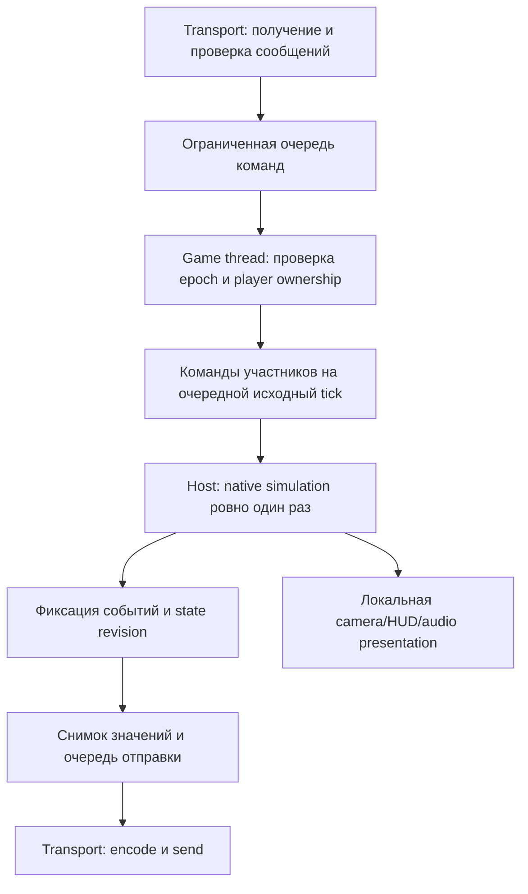

# Предлагаемая архитектура кооператива и критерии M0–M5

> ИСТОРИЧЕСКИЙ ЭСКИЗ. Заменён корректировкой пользователя: 2–8 игроков включая host, LAN/Radmin, предпочтительно ENet; без NAT traversal/публичной инфраструктуры. Подробный протокол сейчас не проектируется. Актуальны [08](../08_NETWORK_ARCHITECTURE.md), [09](../09_POC_PLAN.md), [10](../10_OPUS_HANDOFF.md). Числа/transport/политики ниже не являются действующими требованиями.

Срез: 2026-10-31. Это проект будущей реализации для получателя, обозначенного пользователем «Claude Opus 5.5». Его свойства и доступность здесь не оцениваются. Документ не содержит реализации мода, DLL, хуков или протокола исходной игры.

**INFERRED — всё описанное ниже является предложением инженера.** Имена сообщений, поля, размеры и интерфейсы выбраны для будущего мода; они не извлечены из KEX и не являются якобы восстановленными структурами. **UNKNOWN — жизнеспособность кооператива на установленной сборке**, возможность двух независимых игроков, полнота world snapshot и возможность подавить побочные эффекты клиентской симуляции. VERIFIED применяется лишь к явно указанным статическим source-наблюдениям и опубликованной документации. Игра, сетевые процессы и прототипы не запускались.

Основания для поиска: [сравнение референсов](REFERENCE_COMPARISON_WORLD.md), [REFWORLD_EX2015_WORLD](../evidence/REFWORLD_EX2015_WORLD.json), [REFWORLD_PSEPSX](../evidence/REFWORLD_PSEPSX.json). Ближайшие source-проблемы 2015 — singleton выбор AI target, смешение instigator/Owner с глобальным Player, singleton travel/save и локальные эффекты внутри world events. Это checklist проверки EXE 2022, не доказательство наличия тех же функций/offsets.

## 1. Решение и обязательные развилки

Предлагать host-authoritative listen server: один процесс host исполняет полную игровую симуляцию и кампанию, в том числе персонажей всех участников. Каждый клиент передаёт намерения управления своим персонажем и получает подтверждённое состояние. Host тоже проходит тот же путь команд, с нулевой сетевой задержкой. Игра должна сохранять исходную частоту и порядок обновлений, пока измерения не позволят менять их без нарушения поведения.

Не начинать с lockstep: детерминизм текущего EXE, RNG-потоков, floating point, загрузки и скриптов UNKNOWN. Передача одинаковых inputs всем клиентам сама по себе не синхронизирует мир. Синхронизация полного состояния через копирование памяти также непригодна: адреса, native handles, контейнеры и script references зависят от процесса и жизненного цикла.

Две отдельные трудности определяют стоимость работ:

1. **M0/M1:** представление нескольких controller/puppet, управление ими, ownership, камера, damage, AI targets и уничтожение. Дополнительный actor без собственного controller не означает второго игрока.
2. **M3:** на клиентах необходимо показывать мир без повторного принятия решений AI, damage, pickups и triggers. Если нельзя разграничить simulation и presentation, минимальный DLL-вариант может оказаться непрактичным даже после успешного M0.

Сеть не решает ни одну из этих трудностей. До M0 допустимы только формат документации и небольшие будущие независимые transport experiments; разработку большого replication layer отложить. На текущем этапе не разрешены даже игровые эксперименты M0: требуется отдельный переход к реализации и запуску с разрешением пользователя.

## 2. Роли, состояние и границы потоков

Предлагаемый адаптер движка исполняется только на проверенном game thread в безопасных точках кадра/тика. Отдельная transport-задача декодирует сообщения, проверяет размеры и кладёт простые value objects в ограниченную очередь. Она не разыменовывает native actor pointers, не вызывает фабрику, физику, renderer, скрипты и save API. После unload все ссылки старого level epoch инвалидируются до обработки следующего сообщения.

Схема порядка — проект, её конкретное место в реальном цикле определяется по Evidence:

Для будущего кода полезны отдельные модули `BuildIdentity`, `GameThreadBridge`, `EntityRegistry`, `AuthorityPolicy`, `Replication`, `Transport` и `CoopPersistence`. Это имена предлагаемой архитектуры мода; они не являются фиктивными исходниками движка. Все native selectors и layout знания принадлежат одному build-specific adapter и должны быть подтверждены отдельно от сетевых типов.

| Категория | Кто принимает окончательное решение | Что разрешено клиенту |
|---|---|---|
| Положение/физика персонажа, sector, health, ammo | Host | Передавать inputs; локальная камера и условное предсказание только после доказательства изолируемой физики |
| AI states/targets, RNG outcomes, boss phases | Host | Отображать анимацию/движение по состоянию; не исполнять damage/spawn decisions |
| Projectile spawn/owner/hits, hitscan, radial damage | Host | Предварительные cosmetic effects; затем подтверждение/отмена |
| Pickups, keys, artifacts, quest/dolls/unlocks | Host | Отправлять use/intents; показывать персональный feedback |
| Doors/lifts/floors, switch/trigger consumption, scripts | Host | Визуально интерполировать подтверждённое движение; получать полные state revisions |
| Map travel, restart, ending, save/load | Host | Ready/ack; UI загрузки; запрос/голосование, если это выбрано в правилах |
| Camera, HUD, audio listener, viewmodel, меню | Конкретный локальный клиент | Локальное отображение своего slot; не менять authoritative world |

Имена вроде «положение», «sector», «health» в таблице — семантические поля предлагаемого wire state. Поля и offsets KEX 2022 остаются предметом отдельного исследования.

## 3. Идентичность и версии

При соединении сопоставлять: protocol major/minor, mod build ID, native EXE SHA-256, полный упорядоченный content manifest (KPF и разрешённые моды с SHA-256), game rules revision, save schema и capabilities. Любое несовместимое расхождение до spawn даёт явный отказ. Один только «2022» или имя файла недостаточны. Не подменять требование одинаковой сборки утверждением, что разные билды точно несовместимы: совместимость другой пары builds потребует самостоятельной проверки и профиля.

Предлагаемые идентификаторы:

- `SessionId`: случайный идентификатор нового host-сеанса; отделяет сообщения предыдущего подключения.
- `LevelEpoch`: монотонный номер загрузки/рестарта в пределах session. Та же карта после restart получает новый epoch.
- `PlayerSlot`: 0–3 для текущего сеанса; стабильный `ParticipantId` сохраняет владельца при rejoin. Имя в UI и IP не являются достоверной идентичностью.
- `NetEntityId`: `(LevelEpoch, EntityIndex, Generation)`, все компоненты по 32 бита в первоначальном проекте. Native address хранится только в локальной registry. Generation меняется до повторного использования индекса; при исчерпании счётчика назначается новый epoch/сеанс, wrap не принимается как валидный объект.
- `MapObjectId`: content digest + map name + проверенный исходный record index для placed objects. Это не заменяет NetEntityId и неприменимо к произвольно spawned объектам без происхождения.
- `EventId`: `(LevelEpoch, HostEventSequence)`. Для клиентского запроса — `(ParticipantId, RequestSequence)`; host хранит ограниченный dedup ledger и возвращает тот же результат повтору.

`MapObjectId` зависит от доказанного соответствия map records объектам; до этой проверки он UNKNOWN. Pointer reuse и одинаковые адреса разных процессов не должны попадать в wire protocol.

## 4. Транспорт и предлагаемые сообщения

Сначала LAN/direct IP для M2; интернет NAT traversal, приглашения и relays вводить после стабильной simulation. Предпочтительный кандидат для оценки после M0 — поддерживаемый message-oriented transport с reliable/unreliable режимами и congestion control. Valve GameNetworkingSockets предоставляет необходимые классы средств и не требует Steam для open-source варианта; Steam authentication/signaling/SDR — отдельные услуги, доступность которых для мода UNKNOWN. Нельзя вывести её из наличия `steam_api64.dll`. [Valve README](https://github.com/ValveSoftware/GameNetworkingSockets/blob/master/README.md).

Версию/commit transport dependency выбрать и зафиксировать позднее, после проверки toolchain/ABI/distribution. Сейчас библиотека не скачивалась и не собиралась. ENet или иной транспорт возможен как альтернативный объект отдельного решения; его свойства в этом исследовании не проверялись. Самописная reliable UDP реализация добавит отдельные задачи congestion control, retransmit, message bounds, crypto/authentication, tests; она не даёт преимущества при рисках M0/M3.

При reliable lanes доставка по порядку гарантируется в рамках одного lane, а не между control, events и bulk state. Unreliable delivery может терять, дублировать и переставлять сообщения. Поэтому зависимости baseline/event/spawn должны быть явными. Для plain IP шифрование само по себе не подтверждает личность peer без соответствующей схемы аутентификации. [Valve public API](https://github.com/ValveSoftware/GameNetworkingSockets/blob/master/include/steam/isteamnetworkingsockets.h).

Проект application envelope: `protocolVersion`, `messageKind`, `payloadLength`, `sessionId`, `levelEpoch`, `senderSlot`, `messageSequence`, `hostTick/stateRevision` по типу сообщения. Числовые типы, порядок байтов и bounds задать явно в спецификации; не отправлять raw C++ struct, `size_t`, pointers, compiler enum layout и padding. Reliable packet ACK/retransmission выполняет transport; game-state acknowledgement и request result имеют другое назначение и остаются в приложении.

| Сообщение | Направление и доставка | Содержимое и условия принятия |
|---|---|---|
| `Hello / Accept / Reject` | Client↔host, reliable control | Версии, хеши, capabilities, аутентифицированная session identity/выданный reconnect token; bounded строки и манифест |
| `InputBatch` | Client→host, unreliable, с ограниченным повтором недавних команд | `InputSequence`, intent tick, normalized move/look/buttons, выбранное оружие и отдельные use/fire edge IDs. Host связывает socket с одним slot и проверяет timing/rate/state |
| `PlayerState` | Host→owner/observers, unreliable state | Authoritative transform/velocity/sector/flags, health/ammo, last consumed input sequence, state revision |
| `EntitySpawn / EntityDestroy` | Host→clients, reliable world events | NetEntityId/generation, type/archetype/content key, initial state, owner/source/target IDs и apply revision; destroy оставляет tombstone |
| `WorldSnapshotDelta` | Host→clients, unreliable state | Snapshot ID, acknowledged baseline ID, tick, schema mask и изменившиеся values; объект должен существовать или иметь initial state |
| `WorldEvent` | Host→clients, reliable event lane | EventId, required revision, instigator/target IDs, resolved outcome; без повторного локального damage/trigger исполнения |
| `InteractionRequest / Result` | Client→host и ответ, reliable control либо bounded retry | Request ID, target ID, intent tick; host повторно проверяет близость/LOS/правила и коммитит один результат |
| `BaselineBegin / Chunk / End / Ack` | Host→client, bounded reliable bulk lane | Baseline revision/tick, содержимое и hashes частей, объём/количество entities, event cursor. Ack только после декодирования и применения |
| `SnapshotAck / ResyncRequest` | Client→host, unreliable state с повтором либо reliable control | Последний успешно применённый baseline/snapshot и причина resync; это не transport packet ACK |
| `PrepareLevel / LevelReady / CommitLevel / AbortLevel` | Host↔clients, reliable control | Transition ID, next epoch, map/content/rules, стартовый baseline и общий commit tick |
| `Death / Respawn / ParticipantState` | Host→clients, reliable events | Slot state, entity replacement, правила spectator/respawn, last revision |
| `Ping / TimeSample / Disconnect` | Двусторонне, доставка по назначению | RTT/jitter/time observation, reason code; clock estimate не является доверием client timestamps |

Inputs не должны содержать «нанёс 30 урона», «подобрал артефакт» или окончательную позицию. Host проверяет разрешённый диапазон move/look, количество команд за tick, право на slot, состояние смерти/перехода и применяет не более одного подходящего input каждого участника на native tick. В gap использовать установленную краткую политику удержания movement, но fire/use edge не повторять. После ограниченного окна отсутствия новых команд сбрасывать buttons/move, чтобы потеря connection не оставляла стрельбу и движение бесконечными.

Надёжные события не превращать в неограниченную очередь прошлого: задать byte/message limits, TTL отдельных intents, budget decode/apply per frame, transfer chunk/count caps и timeout. При отставании state lane заменить старые snapshots свежими. При переполнении reliable world history выполнить baseline resync или завершить соединение с причиной. Ошибки входных размеров/NaN/неизвестной версии отклонять до доступа к native adapter.

## 5. Состояние мира, baseline и события

Первые версии передают только семантически известные значения. Динамические объекты: type, NetEntityId, transform, velocity/sector, animation/state, owner/source/target, health/death и необходимые таймеры. Мир: consumed triggers/pickups, doors/lifts/floors phase and motion, breakables, map/boss/script outcomes, shared campaign bits. Полнота этого списка для KEX UNKNOWN: script globals/coroutines, delayed events, spawned temporary objects, RNG contexts, physics caches и object reference fixups могут быть обязательны.

Базовая схема: host фиксирует baseline на согласованной post-tick границе `B`; сериализует values в стабильном порядке, сохраняя mapping всех references к IDs; клиент создаёт shell entities, затем заполняет значения и делает fixups ссылок отдельным проходом. Показ и local interaction включаются после окончания apply. Изменения после `B` host держит в bounded journal и передаёт после baseline. Если journal переполнился до ACK, снимок считается просроченным и строится новый: смесь baseline от tick B со случайно выбранными свежими полями недопустима.

Snapshot delta строится только от baseline, который конкретный клиент подтвердил после применения. Потеря delta не делает следующие обязательным образом неразбираемыми: сервер использует подтверждённую основу; если основа недоступна, клиент запрашивает keyframe. Каждое entity state имеет revision; delta и reliable event содержат причинные зависимости, tombstone закрывает старое поколение. При state-before-spawn можно хранить ограниченный pending record, просить resync или приложить creation state; нельзя писать в несуществующий native pointer.

Не полагаться на «ровно один раз» как свойство всех сообщений. Например, повтор `SwitchUse(request=17)` должен вернуть закэшированный host result; повтор `EventId=202` не должен снова открыть/закрыть переключаемую дверь. У `StateRevision=300` не должно быть возможности отменить более новое `DeathRevision=305`. Для разрушения и приёма поздних packets нужна generation/epoch проверка до entity lookup.

Authority обязана отделять решение от эффекта. Клиенту не следует просто запускать исходную `OnTouch`/`InflictDamage`/script action для воспроизведения результата: такой обработчик может выдать предметы, изменить campaign, создать новый actor или повторно потребить RNG. Требуются проверенные apply-state/presentation paths либо authority guards на всех соответствующих side effects. Доказательство их достаточности — M3 gate.

## 6. Время, интерполяция, задержки и потери

Частота native simulation, relationship между game tick и render frame, pause semantics и RNG updates 2022 пока UNKNOWN. Не указывать 30/60 Hz как найденный факт. Проект сетевых параметров начинается с измерения исходного поведения, затем подбираются send rates независимо от tickrate: как стартовая гипотеза, 20 snapshots/s при commands на каждый native tick с batching. При необходимости это меняется по измерениям и не изменяет deltaTime самой игры.

Удалённые персонажи/actors отображаются по нескольким host snapshots: интерполяция позиции и кратчайшего углового пути в буфере с адаптацией по jitter. Стартовая цель задержки отображения 100 ms — параметр будущего теста, не свойство игры. На elevator/teleport/sector transition flag нельзя смешивать несовместимые состояния через обычный lerp: discontinuity требует snap/reset history. Extrapolation кратко ограничивается (начальная гипотеза 100 ms), после чего объект замирает и connection показывает деградацию. Виртуальное движение не должно само активировать native triggers.

Вначале локальный client player может получать authoritative corrections без полноценного physics prediction; это позволяет доказать сеть с повышенной воспринимаемой задержкой. Prediction и replay вводить только если выделен воспроизводимый movement step для одного player без повторного глобального tick, damage, pickup и RNG side effects. History хранит исходный input и минимальное movement state. По `lastConsumedInput` клиент удаляет подтверждённые команды, восстанавливает authoritative movement и проигрывает оставшиеся; сглаживает только render offset, authoritative collision position корректируется сразу. Если изолировать физику невозможно, этот вариант prediction отвергается: нельзя «replay» целый движок по псевдокоду.

Для оружия начать с host hit validation без rollback. Muzzle/weapon animation допускают local prediction с уникальным shot ID; итоговый projectile/hit/damage — host. Ограниченный lag compensation для hitscan потребует истории target collision shapes и doors, проверенной queries без side effects и политики max rewind. До этих доказательств это отдельная необязательная исследовательская задача, а не обещанная функция M2.

RTT/jitter/loss measuring и ограниченное time offset estimate нужны для scheduling и interpolation, но host остаётся владельцем simulation clock. Не доверять client timestamp для скорости перемещения или произвольного rewind. При pause меню клиент не останавливает host simulation; поведение cooperative pause определяется правилами сеанса и может применяться только host как общий state change.

На уровне транспорта учитывать congestion/backpressure и избегать IP fragmentation; RFC 8085 описывает обе обязанности UDP-приложения. [IETF RFC 8085](https://www.rfc-editor.org/rfc/rfc8085.html). Если будущий транспорт делает fragmentation/reassembly самостоятельно, limits на сообщения и bulk transfer всё равно нужны. Начальный бюджет application state message около 1200 bytes — проектный ориентир с запасом под transport overhead, **не универсальная гарантия MTU**; уточнить под выбранный transport/path. Baselines разбивать на ограниченные chunks, priority для input/control выше bulk. Voice/chat/UPnP не входят в M0–M4 и не должны вытеснять исследование native state.

## 7. Предметы, смерть и игровые правила

Чтобы сохранить кампанию с gates по способностям, разумная первая конфигурация: keys, permanent artifacts/abilities, quest items/dolls и map unlocks — общие; health, ammo, оружие в руках, cooldown, air/poison и death — индивидуальные. Оружие как ownership может выдаваться всей группе по первому достижению для предотвращения softlock, при персональном ammo. Это выбор правил мода, не установленное поведение исходной игры и не требование пользователя; его нужно утвердить до M4. Consumable health/ammo pickups для первого варианта существуют в мире в одном экземпляре и выдаются один раз победившему валидному запросу. Изменение на per-player pickup visibility потребует отдельного ledger `(MapObjectId, ParticipantId)` и проверки save/rejoin.

Race из двух касаний решает host на одном tick по стабильному правилу; второй получает «уже взято», без повторного world action. Локальные звук/flash/HUD направляются получателю, shared acquisition уведомляет всех. Permanent pickup и event consumed коммитятся в shared campaign transaction. Не записывать shared keys одновременно через native inventory каждого процесса без протокола revision: это путь к потере/дублированию progress.

Сначала поддержать простой режим: умерший становится spectator до следующего согласованного checkpoint/перехода; при смерти всей группы host рестартует уровень с зафиксированного checkpoint. Возрождение у живого товарища позднее требует валидной позиции/sector/collision, восстановленного inventory, AI untarget/re-target, очистки damage timers и нового entity generation. Friendly fire выключить как выбранную исходную политику. Она проверяется host для direct/radial damage и source owner chain; отключение только попаданий одного оружия недостаточно.

Оригинальная game-over логика, singleton health checks и boss/script обращения к `Player()` должны быть исследованы отдельно: spectator state не должен случайно запускать общий рестарт при смерти только host. Передача управления камерой spectator — presentation, не временная передача controller ownership чужому actor.

## 8. Переход карты, joining, rejoining и disconnect

Предлагаемая state machine соединения: `Negotiating → Accepted → WaitingForLevel → ApplyingBaseline → Ready → Playing → Reconnecting/Closed`. Host slot и peer connection — разные сущности. Сетевой timeout не равен native death, а disconnect не является валидным use/fire input.

В первом рабочем варианте late join допускается в lobby/waiting и активируется только на следующей level/checkpoint barrier. Это сужает обязательную полноту mid-level snapshot и соответствует разумной ступени M2–M4, но не доказывает функцию из README coop kit. Полный вход во время уровня вводится, только если в M3 доказан snapshot всех необходимых actors/movers/script context/reference dependencies. Если script coroutines непереносимы, честно сохранить ограничение barrier-join.

Переход — host transaction:

1. Получить и проверить exit request от живого игрока, применить выбранное правило «все у выхода/host подтверждает/таймер». Закрыть новые world intents и зафиксировать shared/per-player progress старой карты.
2. Host отправляет `PrepareLevel(transitionId,nextEpoch,map,contentDigest,rules)`, клиенты останавливают применение старых snapshots и выгружают старые registry/history. Нельзя держать pointers в ожидании сетевого ACK через unload.
3. Каждый процесс загружает требуемые данные; host создаёт игроков через доказанный путь, фиксирует baseline новой карты. Клиенты сообщают asset/world readiness, применяют начальное состояние и подтверждают epoch/baseline.
4. Host отправляет `CommitLevel`, затем разрешает новые inputs. Пакеты прошлого epoch отбрасываются независимо от порядка доставки.
5. Slow client: bounded timeout → ожидание spectator/исключение по правилам; загрузочная ошибка → AbortLevel/controlled disconnect, без смешения двух карт в одной session registry.

Rejoin использует participant identity и защищённый host-issued token, а не имя/slot/IP. Старое connection lease инвалидируется до назначения нового; одно место не может одновременно получать inputs с двух соединений. Host возвращает сохранённый player state по выбранной checkpoint policy; refresh token исключает повтор прежнего lease. Место появления: безопасный checkpoint/barrier, не произвольная позиция от клиента.

После disconnect host сбрасывает buttons, приостанавливает/удаляет puppet по явной политике, очищает AI targets и переносит inventory в participant record. Период ожидания rejoin ограничен. Host loss в M2–M4 означает завершение сеанса с возвратом в меню и последним согласованным checkpoint; автоматическая host migration не заявляется. Migration требует переносимого полного world state, election/authentication и отдельного доказательства snapshot, поэтому выходит за обязательные ранние milestones.

## 9. Сохранения кампании

Native save/checkpoint format 2022 и возможность безопасно направить его в отдельный coop profile UNKNOWN. Наблюдение EX2015 `SaveGame` о campaign inventory не устанавливает полноту позднего save. Sidecar добавляет participant/rules/network metadata, но не может автоматически восстановить отсутствующие movers/script contexts. Для начала сохранять только на доказанной campaign checkpoint/barrier.

Предлагаемая coop запись: `schemaVersion`, `transactionId`, `nativeBuildSha256`, content manifest digest, mod/rules revision, campaign/map/checkpoint identity, shared permanent progress, participant persistent inventories/health policy, last committed revision, timestamp как metadata. Не сохранять sockets, native pointers, транспортные sequence IDs или невалидируемые runtime addresses. Если будущая полная сериализация включает RNG state, она требует доказанных отдельных RNG contexts; запись одного неподтверждённого seed недостаточна.

Только host пишет authoritative coop progress. Клиенты получают подтверждение commit и metadata/hash для сверки; передача копии сохранения для локального продолжения — отдельная явная функция, не независимые конкурирующие saves. Для no-loss checkpoint использовать версионированные native/sidecar файлы и manifest commit: записать новые payloads в разрешённом отдельном профиле, проверить hashes/целостность, затем атомарно заменить один manifest pointer на завершённую пару. Одна `rename` не делает два файла атомарной транзакцией. При crash/load несовпадающая пара отвергается, доступен предыдущий complete commit. Конкретные flush/rename primitives, save-path redirect и native loader integration выясняются при реализации, текущие сохранения не трогаются.

## 10. Минимальный DLL-мод и глубокая модификация

| Вопрос | DLL с узкими native adapters | Более глубокое изменение player/world integration |
|---|---|---|
| Потенциальная выгода | Сохраняет штатный executable/data и большую часть native pipeline; меньше заменяемых подсистем | Явно разделяет player contexts, world authority и presentation; удобнее полнота state и fixes singleton assumptions |
| Что необходимо доказать | Вызовы spawn/controller lifecycle; стабильные safe points; правильный ABI/ownership; возможность client proxies/authority guards; save/transition callbacks | Достаточность восстановленной модели, корректность большего числа ABI/layout/virtual calls, управление scripts/serialization и сохранение исходного gameplay |
| Основной риск | Накопление локальных guards и временных global swaps; пропущенный side effect даёт crash/desync, локальную смерть всей группы или повреждённый save | Большой объём изменений и regressions; больше зависимость от конкретной сборки и труднее полнота validation |
| Второй игрок | Только если native controller/puppet можно корректно создать и связать независимо либо ограниченно расширить | Может потребоваться новый layer contexts и маршрутизация существующих функций по нему; это не доказанная возможность |
| Клиентский мир | Успех зависит от способности подавить authoritative decisions без разрушения rendering/animation | Вероятно потребует более явной роли объектов/подсистем; цена и feasibility UNKNOWN |
| Обновление игры | SHA-256 gate и отдельный adapter для каждой проверенной сборки | То же, при большем объёме зависимостей |
| Условие выбора | M0/M1 проходит с обозримыми локальными исправлениями и M3 proxy path достижим | Native M0 достигается, но broad singleton/presentation coupling делает узкую схему неподдерживаемой |

Временный swap глобального `Player()` контекста может быть только отдельной гипотезой PoC: callbacks, deferred events, references, camera и скрипты могут удержать неправильного владельца. Даже успешный кадр с двумя позициями не доказывает безопасность такой схемы на уровне. Если независимая сущность не достигается без фактической замены движка/кампании, нужно вернуть результат feasibility пользователю; обещание «сохранить оригинальный движок» нельзя закрыть портом Raze/2015 под тем же названием.

Дополнительная скриптовая точка расширения через KPF полезна для исследования/малого PoC при отдельном разрешении. Наличие `SpawnActor` или общего script `Player()` в данных не доказывает возможность создать native второй controller и не отменяет проверку M0. Текущий документ не предлагает модифицировать установленный KPF.

## 11. Milestones, зависимости и приёмка

Все игровые запуски, instrumentation, hooks и запись save ниже — **план будущей отдельно разрешённой реализации**. Сейчас выполнены только исследование и подготовка документации. M0 runtime остаётся UNKNOWN, даже при сильных статических находках.

| Этап | Входные зависимости и ограниченный результат | Критерии приёмки / обязательное Evidence | Условие остановки |
|---|---|---|---|
| M0 — доказать вторую player entity | Native build identity, map/load/loop/player lifecycle, owner/controller memory model, безопасная отдельная тестовая копия/профиль. Сначала две сущности в одном процессе без сети и без полноценного UI | После отдельного разрешения: log identity обоих actor/controller; разные addresses/IDs и независимые state values; фабрика/создание не заменяет первого; обе сущности registered/ticked/collidable; damage/death второго не уничтожает/перепривязывает первого; уничтожение и 20 load/unload cycles без dangling refs; сохранены trace/dump/наблюдение и границы проверки | Только visual proxy без реальной player semantics; controller pointer перезаписывается и обход не доказан; неконтролируемое состояние singleton/deferred callback. Сеть не начинается |
| M1 — два локальных независимых игрока | M0; раздельные command streams, owner/viewmodel/HUD/audio camera policy; обработаны критичные singleton readers | Два записанных независимых input trace: разные move/look/fire/use; поочерёдная камера без изменения controller ownership; независимые ammo/health/death; AI получает обе валидные цели по выбранным правилам; traps/pickups/doors работают с корректным instigator; restart/transition и второй spawn/cleanup повторяемы | Неизолируемая physics replay/presentation или game-over считает смерть host общей смертью; ownership неустойчиво |
| M2 — сеть двух процессов | M1, bounded protocol/transport; host full simulation двух участников, клиентская удалённая player representation | Loopback и LAN/direct IP двух процессов; handshake отвергает wrong hashes; remote input → host player; host state → client; disconnect сбрасывает buttons; duplicate/out-of-order запросы не удваивают fire/use; стабильные IDs/epoch; измерены RTT/bandwidth/correction rates. Минимальная карта/сценарий, world sync ещё ограничен явно | Клиент не может показывать puppet без изменения host truth; transport backpressure приводит к зависанию game thread; повреждаются entity lifetimes |
| M3 — мир | M2; authoritative routing AI/weapons/damage/pickups/movers/triggers/scripts; baseline serialization | На выбранном наборе enemy/projectile/pickup/door/lift/breakable/teleport/boss event ровно один commit; state convergence после loss/reorder; destroyed IDs не оживают; baseline resync восстанавливает то же world state. State ledger сравнивается по семантическим полям с tolerance, не raw pointer hash; нет повторного damage/scripts на clients | Snapshot не покрывает важный context, callback скрыто исполняет world effects; mid-level join остаётся отключённым до отдельного gate |
| M4 — совместная кампания | M3; shared/per-player progress rules; transition barrier; проверенный native save/sidecar integration | Полный маршрут кампании с backtracking, gates/артефактами/ключами/боссами/финалом; смерть одного/всех, travel по разным instigators, save/load, disconnect/rejoin на barrier, crash recovery завершённой пары. Нет progression softlocks; обычные saves не затронуты | Непереносимый progress, потеря inventory при rejoin, несовместимый native save; ограничение checkpoint записывается честно |
| M5 — 4 игрока и полировка | M4; slot capacity, budget/LOD/interest policies измерены; UI/diagnostics | Три remote + host, все combinations damage/AI/interaction; 2h soak и repeated transitions/rejoins; деградация 1 slow peer не блокирует остальных; performance и send queue budgets; controls/menu/error reasons/pause. Internet traversal/voice/host migration — отдельные опции, не скрытая обязательность | 4-player budget не выдержан или world/client roles требуют архитектурной переделки; не объявлять поддержку по одному подключению четырёх slots |

Количество cycles/длительность soak в таблице — предлагаемые minimum test budgets, не уже пройденные проверки. Критерии не обещают отсутствие всех ошибок. По завершении каждого этапа сохранять build hash, source/config revision адаптера, scenario steps, raw observations, ожидаемый и фактический результат, известные ограничения и stop/go decision.

M0 рекомендуется разделить на доказуемые подпункты: **M0-A** locate native owner/registry/lifecycle статически; **M0-B** разрешённое создание/регистрация second puppet без замены original; **M0-C** отдельный controller/input/health/weapon state; **M0-D** проверка lifetime, death, map cleanup. Статический M0-A не закрывает весь M0. Если контроллер встроен глобально/inline, сначала измерить стоимость его отделения, не наращивать сеть вокруг одного singleton.

## 12. Набор будущих проверок

| Область | Сценарии и проверяемый эффект |
|---|---|
| Ownership/lifecycle | Slot 0/1 поочерёдно spawn/death/remove; второй не перепривязывает первый; deferred callbacks и target references не ведут в освобождённую память; load/unload invalidates epoch |
| Команды | Независимые записанные traces, повтор/пропуск batch, stuck button recovery, future/past input rejection, команды мёртвого/загружающегося slot |
| Authoritative events | Одновременный pickup и use; повтор request/event; hitscan/radial/projectile; самоуничтожение projectile; boss spawn chain; один исход на всех clients |
| Движение | Разная render частота 30/60/144 FPS при исходной simulation; stairs/door/lift/water/teleport; correction не создаёт ложный trigger; нет per-frame изменения movement speed |
| Сеть | Симулировать RTT 0/50/100/200 ms, jitter 0/20/50 ms, случайные loss 0/1/5/10%, bursts и reorder/duplicates; это испытательные значения, а не обещанные уровни качества. Раздельно профиль graceful degradation на плохом канале |
| Идентичность | Wrong EXE/KPF/mod/rules/schema rejected до player creation; restart той же карты получает новый epoch; stale generation/previous session packets discarded |
| Resync | Потеря baseline chunk/ACK, lagging client, state-before-spawn, journal overflow; либо bounded retry/new baseline, либо reasoned disconnect; без infinite queues |
| Прогресс | Артефакт у remote unlocks gate для группы; simultaneous exits и death; backtracking; checkpoint save/load; rejoin бывшего slot; native/sidecar mismatch; crash до/после manifest commit |
| Четыре игрока | Все participants атакуют/подбирают/активируют; remote death order; один connection медленный, другой исчезает; host save/transition остаётся единственным commit |

Для будущего тестирования логи должны связывать tick, epoch, ParticipantId, NetEntityId, Request/EventId, state revision, queue/packet age и result. Семантический digest состояния — diagnostic, не доказательство детерминизма или cryptographic peer authenticity. Собирать только необходимые значения; engine strings и payload data не исполнять как команды.

Источники сетевых свойств ограничены primary документацией в [NET_PRIMARY_SOURCES](../evidence/NET_PRIMARY_SOURCES.json). Остальное — предложенная инженерная архитектура и план испытаний. До получения native runtime Evidence нет заявления о рабочем кооперативе, подтверждённом tickrate, доступном netcode KEX или завершении M0.
