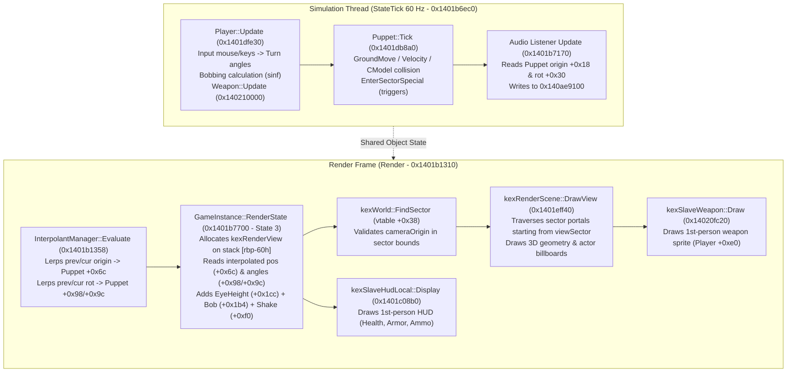

# PowerSlave Exhumed Together — Client Viewpoint & Camera Synchronization Feasibility Audit

**Document ID:** `REPORT-CLIENT-VIEWPOINT-FEASIBILITY`  
**Classification:** Low-Level Engine Architecture & Multiplayer Camera Synchronization Audit  
**Author:** Gemini 3.8 Flash High, Senior KEX Reverse Engineering Researcher / Multiplayer Camera Architecture Analyst  
**Date:** 2026-11-02  
**Target Engine:** PowerSlave Exhumed (2022) (`anubis_Shipping_Steam_x64.exe`)  
**Target Binary SHA-256:** `b8f131037187ca8d0a282527fb6f55a2012241d5b9dac8bf2038baf35b71a76d`  
**Target Base Address:** `0x140000000` (PE Preferred Image Base)  
**Scope:** Technical investigation of transforming Client B into a fully functional client gameplay experience with a first-person camera synchronized to authoritative `P2` simulated on Host A, preserving native first-person rendering, HUD, audio, input, and KEX lifecycle invariants.

---

## 1. Executive Summary & Problem Formulation

### 1.1. Контекст и статус проекта
На предшествующих фазах проекта (*M0, M1.1, DOC-44..54*):
1. **Host-Side Independent Entities (M0 / DOC-27, DOC-41):** Доказано существование независимых контекстов `kexSlavePlayer` и `kexSlavePuppet` на Host A. Host A способен симулировать двух независимых персонажей (`P1` и `P2`).
2. **Network Input Chain (DOC-51):** Доказана передача команд $W/S$ от реального второго процесса `Client B` через ENet UDP на `Host A` с успешным нативным перемещением `P2` на хосте.
3. **Background Host Simulation (DOC-53):** Доказана устойчивая работа нативной симуляции хоста при потере фокуса окна без искусственных оконных сообщений.
4. **Wire Protocol & Snapshot Audit (DOC-54 / Wire Audit):** Подтверждена готовность wire-сообщения `MsgPlayerSnapshot` (Opcode `0x20`, 65 байт на игрока, 154 байта на двух игроков) для передачи авторитетного состояния $P1/P2$.
5. **Visual Proxy Audit:** Выявлена опасность попыток спавна второго полноценного игрока на клиенте (`SpawnActor(0)` крадёт синглтон управления).

В настоящий момент Sol Max работает над `DOC-55` (первый Host $\to$ Client Native Snapshot PoC).  
Однако приём авторитетных координат $P2$ клиентским процессом сам по себе **не даёт** игрового процесса.

### 1.2. Главная архитектурная проблема
В однопользовательском дизайне KEX Engine 2022 игровой процесс жёстко монолитен:
```text
GameInstance (0x140af33a0)
   └── +0x40: Local Player (kexSlavePlayer)
         └── +0xd8: ObjectNode
               └── +0x28: Local Puppet (kexSlavePuppet)
```
Камера, матрица проекции, портальное отсечение секторов (PVS), звуковой слушатель (Audio Listener), анимации оружия первого лица (View Weapon) и элементы HUD читают состояние **исключительно** через синглтон локального игрока `GameInstance->GetPlayer()`.

Когда `Client B` запускается:
- У него **уже есть** собственный локальный `kexSlavePlayer` и нативная кукла `kexSlavePuppet`, созданные движком при загрузке карты.
- Если просто принимать снапшоты $P2$ от хоста, локальная камера `Client B` остаётся привязанной к его локальной кукле на точке спавна.
- Если грубо перезаписать матрицу камеры, рендерер KEX окажется в одном секторе, а локальный игрок, физика, звуки и триггеры — в другом, что вызовет мгновенный рассинхрон геометрии, обрыв PVS и ложные срабатывания локальных триггеров карты.

Цель данного аудита — детально разобрать реальный конвейер камеры KEX 2022 и обосновать минимально инвазивную, безопасную архитектуру отображения мира для `Client B`.

---

## 2. P1 — Реальный конвейер камеры KEX 2022 (Actual Camera Pipeline)

Анализ проведён по дизассемблированным листингам `anubis_Shipping_Steam_x64.exe` (функции `0x1401b1310`, `0x1401b7700`, `0x1401eff40`, `0x1401b6ec0`, `0x1401dfe30`, `0x1401a2580`) с сопоставлением с эталонным архитектурным кодом KEX 3.0 (`renderView.cpp`, `renderScene.cpp`, `playLoop.cpp`).



### 2.1. Ответы на 10 обязательных вопросов P1

#### 1. Где хранится Camera object?
- **VERIFIED STATIC:** В KEX 2022 объект камеры (`kexRenderView`) **не является** персистентным объектом в куче с глобальным указателем.
- При отрисовке активного геймплея (`state == 3`) в `GameInstance::RenderState` (`0x1401b7700`, смещение `+0x265` $\to$ `0x1401b7965`) структура `kexRenderView` размещается **непосредственно на стековом фрейме функции** по адресу `[rbp - 0x60]`.
- Указатель на эту стековую структуру передаётся первым аргументом (`RCX`) в нативную процедуру обхода сцены `kexRenderScene::DrawView` (`0x1401eff40`).
- Персистентные данные, из которых формируется камера, распределены между `kexSlavePuppet` (координаты, интерполянты) и `kexSlavePlayer` (смещения глаз, боббинг, шейк).

#### 2. Как камера связана с `kexSlavePlayer`?
- **VERIFIED STATIC:** В точке `0x1401b79ad` функция `RenderState` загружает дескриптор `ObjectNode` локального игрока из `Player + 0xd8` (`mov rcx, [rbx + 0x118]` — внутри структуры `GameInstance` игрок лежит со смещением `+0x40`, поэтому `0x40 + 0xd8 = 0x118`).
- Напрямую из `kexSlavePlayer` считываются:
  - `Player + 0x1cc` (`float`): базовая высота глаз над полом (`ViewZ` + ступенчатый подъем `StepViewZ`).
  - `Player + 0x1b4` (`float`): динамическое смещение шага/боббинга (`Bob`).
  - `Player + 0xf0` (`int32`): таймер сотрясения камеры (`shakeTime`).
  - `Player + 0xf4`, `Player + 0xf8` (`float`): вектор сотрясения камеры (`shakeVector.x`, `shakeVector.y`).
  - `Player + 0xe0`: встроенный объект оружия первого лица (`kexSlaveWeapon`).

#### 3. Как камера получает позицию из Puppet?
- **VERIFIED STATIC (Критическое открытие):**
  Движок KEX 2022 **не читает** сырые координаты симуляции `Actor + 0x18` (`origin`) при построении матрицы камеры!
  В инструкции `0x1401b79c8` `RenderState` считывает:
  ```asm
  00000001401B79C8: movss xmm0, dword ptr [rsi + 6Ch]  ; Interpolated Origin X
  00000001401B79FB: movss xmm1, dword ptr [rsi + 70h]  ; Interpolated Origin Y
  00000001401B7A05: addss xmm2, dword ptr [rsi + 74h]  ; Interpolated Origin Z + eyeHeight
  ```
  Смещения `+0x6c`, `+0x70`, `+0x74` принадлежат выходному буферу интерполятора `kexInterpolant` (`Actor + 0x50`), который вычисляется в каждом кадре рендера функцией `kexInterpolantManager::Evaluate` (`0x1401b1358`, синглтон `0x14063d360`).
  Если модифицировать только `Actor + 0x18`, рендерер в текущем кадре проигнорирует изменение и отрисует старую интерполированную координату `+0x6c`!

#### 4. Как рассчитывается eye height?
- **VERIFIED STATIC:**
  Результирующая координата высоты камеры $Z_{cam}$ вычисляется в инструкциях `0x1401b79d6`..`0x1401b7a0a`:
  $$Z_{cam} = Z_{interp} + \text{ViewZ} + \text{Bob}$$
  где:
  - $Z_{interp} = \text{Puppet} + \text{0x74}$ (интерполированная позиция куклы по $Z$).
  - $\text{ViewZ} = \text{Player} + \text{0x1cc}$ (в нормальном состоянии стоя $\approx 40.0\dots 48.0$ units; при приседании или смерти падает к 0).
  - $\text{Bob} = \text{Player} + \text{0x1b4}$ (колебания при ходьбе, амплитуда $\pm 2.0\dots 4.0$ units).

#### 5. Как применяются yaw и pitch?
- **VERIFIED STATIC (Критическое открытие):**
  Углы в KEX 2022 хранятся и обрабатываются **строго в радианах (Radians)**!
  - `Puppet + 0x9c` (`float`): интерполированный угол рыскания (Yaw) в радианах, диапазон $[-\pi, +\pi]$ ($[-3.1415926, +3.1415926]$).
  - `Puppet + 0x98` (`float`): интерполированный угол тангажа (Pitch) в радианах, диапазон $[-\pi/2, +\pi/2]$ ($[-1.570796, +1.570796]$).
  - В `RenderState` (`0x1401b7c3f`..`0x1401b7c60`) для углов вызываются функции CRT `sinf` (`0x140455678`) и `cosf` (`0x14045566c`).
  - Формируются два кватерниона вращения:
    $$q_{yaw} = \text{kexQuat}(\text{yaw}, \vec{Up}), \quad q_{pitch} = \text{kexQuat}(\text{pitch}, \vec{Right})$$
    $$q_{rot} = q_{yaw} \times q_{pitch}$$
  - Из кватерниона строится матрица $4 \times 4$ `rotationMatrix` и `modelView`.

#### 6. Как обрабатываются head bob, recoil и camera shake?
- **VERIFIED STATIC:**
  - **Head Bob:** Вычисляется в `Player::Update` (`0x1401dfe30`), модулируется скоростью перемещения куклы через синусоиду `sinf` и записывается в `Player + 0x1b4`. В `RenderState` прибавляется к высоте камеры.
  - **Camera Recoil:** При стрельбе (`kexSlaveWeapon::Fire`) импульс отдачи прибавляется к углу тангажа `pitch` или параметру затухания пружины `turny` в контроллере игрока.
  - **Camera Shake:** Проверяется в `0x1401b7a0f`:
    ```asm
    cmp dword ptr [rbx + 0xF0], 0       ; shakeTime > 0?
    jle no_shake
    cvttss2si eax, [rsi + 0xE8]         ; puppet velocity Z == 0? (on ground)
    test eax, eax
    jne no_shake
    ; shake application:
    addss xmm10, [rbx + 0xF4] * 0.125f  ; yaw jitter
    addss xmm2,  [rbx + 0xF8] * 0.5f    ; Z origin jitter
    ```

#### 7. Когда обновляется камера относительно `Player::Update`?
- **VERIFIED STATIC:**
  - `Player::Update` (`0x1401dfe30`) исполняется в потоке симуляции в рамках `StateTick` (`0x1401b6ec0`) с фиксированной частотой 60 Гц.
  - Построение матрицы камеры и рендеринг происходят в процедуре кадра `GameInstance::Render` (`0x1401b1310`) $\to$ `RenderState` (`0x1401b7700`).
  - Камера обновляется **после** завершения тика симуляции и **после** вызова интерполятора `kexInterpolantManager::Evaluate` (`0x1401b1358`).

#### 8. Где формируются view/projection matrices?
- **VERIFIED STATIC:**
  В теле `GameInstance::RenderState` (`0x1401b7700`) в диапазоне инструкций `0x1401b7a51`..`0x1401b8210`:
  - Проекция вычисляется на основе ширины/высоты экрана (`0x140a414d0`, `0x140a414d4`), FOV (cvar `r_fov`, default 74.0), $Z_{near} = 0.1$, $Z_{far} = 8192.0$.
  - Матрица ModelView смещается по осям, масштабируется на коэффициент аспекта $1.07142$, транслируется на $-\vec{Origin}$ и финально сдвигается на $(0, 0, -32)$ (`transform.SetTranslation(0, 0, -32)`).
  - Результирующая матрица отсечения `clipMatrix = modelView * projectionView` используется для расчета 6 плоскостей видимости (`MakeClipPlanes`).

#### 9. Где реализована first-person weapon rendering?
- **VERIFIED STATIC:**
  Отрисовка оружия первого лица вызывается **внутри** `kexRenderScene::DrawView` (`0x1401eff40`) на шаге `0x1401f078b`..`0x1401f0798`:
  ```asm
  00000001401F078B: call qword ptr [rax+0A8h] ; GameInstance->GetPlayer()
  00000001401F0791: lea  rcx, [rax+0E0h]      ; Player + 0xe0 = kexSlaveWeapon
  00000001401F0798: call 000000014020FC20     ; kexSlaveWeapon::Draw()
  ```
  Метод `kexSlaveWeapon::Draw` (`0x14020fc20`) читает активный слот оружия (0..7), интерполированные пружины качания оружия (`jumpSpring`, `turnSpring`), настраивает ортогональную проекцию и рисует спрайт оружия первого лица.

#### 10. Что происходит при смерти, возрождении и смене карты?
- **VERIFIED STATIC:**
  - **Смерть:** При падении здоровья $\le 0$ взводится флаг `PF_DEAD`. В `Player::Update` высота глаз `ViewZ` (`Player + 0x1cc`) экспоненциально спадает к нулю, заставляя камеру падать на уровень пола. Оружие убирается через `HoldsterWeapon` (`Player + 0xe0`).
  - **Возрождение:** Вызывается `Player::Reset` (`0x1401dfa70`), сбрасывающий `ViewZ` в базовое значение, очищающий инвентарь/оружие и восстанавливающий здоровье. Кукла перемещается на точку возрождения через `LinkSector`.
  - **Смена карты (`StateExit` 0x1401b6670 $\to$ `EnterState` 0x1401b6a00):**
    Уровень выгружается через `Level::Unload` (`0x1401c90e0`), все акторы секторов уничтожаются. Затем `Level::LoadMap` (`0x1401c7b70`) парсит карту, фабрика заново спавнит `kexSlavePuppet` (`SpawnActor(0)`), которая привязывается к постоянному контексту `GameInstance + 0x40`.

---

## 3. P2 — Сравнение Local Player и Authoritative P2

| Аспект симуляции | Host A (Listen Server) | Client B (Remote Node) | Конфликт / Проблема |
|---|---|---|---|
| **P1 контекст** | Локальный игрок хоста (`kexSlavePlayer` в `GI + 0x40`). | Отсутствует на клиенте как Full Player. Отображается (в будущем) как Visual Proxy. | Нет конфликта. |
| **P2 контекст** | Нативный `P2` (`kexSlavePlayer` + `kexSlavePuppet`), управляемый по сети через ENet. **Авторитетен на 100%.** | Локальный игрок клиента (`kexSlavePlayer` в `GI + 0x40`) + локальная кукла. | **Критический:** Клиентский `Player` считает себя локальным хозяином мира! |
| **Физика и коллизии** | Считает истинные столкновения, ступени, гравитацию, платформы через `CModel::MoveActor`. | Если локальный игрок продолжает симулировать `GroundMove`, возникнет **двойная симуляция** и рассинхрон траекторий. | Высокий риск расхождения (Divergence). |
| **Секторные триггеры** | `Puppet::Tick` вызывает `EnterSectorSpecial` (лава, открывание дверей, финиш уровня). | Если кукла клиента наступит на триггер, клиент запустит скрипт карты **локально**, независимо от хоста! | **Недопустимо:** разрушение целостности кампании. |
| **Слушатель звука** | `StateTick` позиционирует слушатель по кукле хоста $P1$. | `StateTick` позиционирует слушатель по локальной кукле клиента. | Если кукла не на авторитетной позиции, звуки будут доноситься не оттуда. |

### Ответы на ключевые вопросы P2:

1. **Можно ли использовать штатного локального Player клиента как визуальное представление P2?**  
   **ДА, И ЭТО ЕДИНСТВЕННЫЙ БЕЗОПАСНЫЙ ПУТЬ.**  
   Вместо опасного создания второй сущности через `SpawnActor(0)` на клиенте (что ломает singleton) штатный локальный `kexSlavePlayer` клиента должен стать **клиентской оболочкой (Shell)** авторитетного $P2$.
2. **Нужно ли синхронизировать весь Puppet transform?**  
   **ДА.** Синхронизировать только камеру нельзя: рендерер KEX требует, чтобы кукла находилась в правильном секторе, иначе PVS culling и Audio Listener разорвутся.
3. **Что произойдет, если локальный Player и камера окажутся в разных секторах?**  
   Произойдёт визуальная катастрофа: рендерер KEX начнёт портальный обход из сектора камеры, но при поиске освещения и отсечении билбордов будет ориентироваться на сектор куклы. Возникнут мерцания геометрии (portal popping), отсечение спрайтов (frustum culling failures) и искажение звука.
4. **Как подавить локальную физику и предотвратить расхождение мира?**  
   На клиенте необходимо нейтрализовать локальный `GroundMove` и `EnterSectorSpecial` (например, обнуляя входные команды перед тиком симуляции куклы или пропуская исполнение физики куклы), подставляя авторитетный трансформ из снапшота хоста.

---

## 4. P3 — Сравнительный анализ трёх архитектур

Подробное техническое сопоставление вынесено в отдельный документ [`ARCHITECTURE_COMPARISON.md`](ARCHITECTURE_COMPARISON.md).

### Сводная матрица вердиктов:

| Критерий | Вариант A: Camera-only Override | Вариант B: Local Prediction & Reconciliation | Вариант C: Non-authoritative Player Shell (Рекомендуемый) |
|---|---|---|---|
| **Суть подхода** | Кукла стоит на спавне; хук `RenderState` переписывает матрицу камеры. | Кукла движется локально; при получении снапшота координаты корректируются. | Кукла клиента пассивно занимает позицию авторитетного $P2$ хоста. |
| **Совместимость с PVS** | **FAIL:** Разрыв между сектором куклы и сектором камеры. | **PASS** (при совпадении прогноза). | **PASS:** Кукла всегда в авторитетном секторе. |
| **Звуковой слушатель** | **FAIL:** Звук слышен из точки спавна куклы. | **PASS.** | **PASS:** Звуковой слушатель следует за авторитетным положением. |
| **Секторные триггеры** | **CRITICAL RISK:** Кукла может упасть в лаву на спавне. | **CRITICAL RISK:** Клиент локально триггерит двери и скрипты карты! | **PASS:** Локальные триггеры подавлены; мир слушает только хост. |
| **Оружие и HUD** | **PARTIAL:** Боббинг и отдача оружия замирают. | **PASS.** | **PASS:** Полная работоспособность HUD и оружия. |
| **Риск Double Simulation** | Отсутствует. | **ВЫСОКИЙ:** Постоянная борьба локального шага с сетевым снапшотом. | **НУЛЕВОЙ:** Физика на клиенте не считает авторитетный шаг. |
| **Сложность для PoC** | Средняя (грязные хуки в стек `RenderState`). | Экстремально высокая (полноценный реплей и предсказание). | **Минимальная и стабильная:** Точечное обновление полей куклы в тике. |

> [!IMPORTANT]
> **Архитектурный вердикт:** Вариант C (**Non-authoritative Client Player Shell**) является единственным решением, полностью соответствующим нативным инвариантам KEX 2022. Локальный игрок клиента сохраняется как контейнер первого лица (камера, HUD, оружие), но его положение в мире строго диктуется снапшотами хоста.

---

## 5. P4 — Углы, время и координатная сетка

### 5.1. Анализ угловых представлений
В ходе реверс-инжиниринга устранены опасные заблуждения касательно углов:
1. **Сетевой пакет (`MsgPlayerSnapshot`):**  
   Передаёт `float yaw` и `float pitch`. Это «сырые» 32-битные числа IEEE 754.
2. **Внутреннее представление KEX 2022:**  
   - Углы хранятся в **радианах** (доказано константами $2\pi = 6.2831855$ по `0x1405358d8` и $\pi = 3.1415927$ по `0x140535894` в коде нормализации `0x1401d4aa0`).
   - Рыскание (Yaw): нормализуется в диапазон $[-\pi, +\pi]$ (от $-3.14159$ до $+3.14159$). $0$ — направление на восток (+X), $\pi/2$ — на север (+Y).
   - Тангаж (Pitch): жестко ограничен (clamped) диапазоном $[-\pi/2, +\pi/2]$ (от $-1.570796$ до $+1.570796$). $-1.57$ — взгляд строго вниз, $+1.57$ — взгляд строго вверх.
3. **Правило передачи Host $\to$ Client:**  
   Хост обязан считывать углы из `P2->Actor()->Yaw()` и `Pitch()` **в радианах**, записывать их в снапшот как радианы, а клиент должен применять их напрямую без лишних конверсий в градусы.

### 5.2. Кратчайшая интерполяция углов (Shortest-Angle Wrap)
При интерполяции угла рыскания на границе $-\pi \leftrightarrow +\pi$ необходимо использовать стандартное правило:
$$\Delta = \text{atan2}(\sin(\text{target} - \text{current}), \cos(\text{target} - \text{current}))$$
Для минимального первого PoC интерполяция не требуется: достаточно непосредственного применения (snapping) каждого принятого снапшота в начале кадра.

---

## 6. P5 — Совместимость с локальным миром (Local World Compatibility)

1. **Идентичность уровня:**
   - Карта обязана совпадать байт-в-байт (`MAP01`).
   - Если клиент загрузит другую карту, индекс сектора `sectorId` из снапшота вызовет фатальный assertion `index < m_dwLength` (`0x1401d3d70`) и немедленный краш процесса.
2. **Смена сектора куклой клиента:**
   - При перемещении куклы клиента под координаты снапшота **категорически запрещено** писать `*(int*)(actor + 0x3c) = snapshot.sectorId`.
   - **Обязательно вызывать нативную функцию:** `kexSlaveActor::LinkSector(puppet, snapshot.sectorId)` (`0x1401d3d70`), которая атомарно перемещает узел `ObjectNode` из старого сектора в новый.
3. **Двери и изменяемая геометрия:**
   - На первом этапе PoC двери и подъемники должны оставаться в исходном состоянии (уровень спавна без активированных секторных моверов).
   - Полноценная репликация состояния моверов — задача этапа World Replication.
4. **Смена карты (Map Transition):**
   - При смене карты клиент переходит в `state 4` $\to$ `state 3`. Все хуки обновления координат должны проверять устойчивое состояние геймплея (`GameInstance::state == 3 && pending == 0`).

---

## 7. P6 — Спецификация минимального Camera PoC

Полные инструкции и план реализации переданы в [`SOL_HANDOFF.md`](SOL_HANDOFF.md).

### 7.1. Суть минимального опыта
1. **Конфигурация:** 1 Host (`anubis.exe`), 1 Client (`anubis.exe`), ENet loopback (или LAN), карта `MAP01` (или проверенная тестовая карта).
2. **Действие:**
   - Клиент $B$ удерживает клавишу $W$.
   - Команды передаются через ENet (DOC-51).
   - Host $A$ перемещает авторитетного $P2$ в фоне (DOC-53).
   - Host $A$ формирует `MsgPlayerSnapshot` и отправляет его клиенту.
   - Client $B$ принимает снапшот и в потоке симуляции обновляет позицию/сектор своего локального `kexSlavePuppet`.
   - Клиентская камера от первого лица отображает мир **из глаз перемещающегося $P2$**.

### 7.2. Критерии приемки (PASS Criteria)
1. Клиентское окно отображает корректный first-person вид с оружием и HUD.
2. При передаче ввода $W$ клиентская камера плавно/пошагово перемещается вперед вслед за $P2$ хоста.
3. Сектор куклы клиента обновляется через `LinkSector` без assertion failure.
4. Нет вызовов функций KEX из сетевого потока Worker.
5. Локальная кукла клиента не активирует двери и триггеры урона самостоятельно.
6. Отсутствуют краши при выходе из обоих процессов (`exit 0`).

---

## 8. Классификация выводов аудита

| Вывод / Утверждение | Статус | Доказательство |
|---|---|---|
| `kexRenderView` создаётся на стеке `RenderState` | **VERIFIED STATIC** | `dumpbin /disasm` функции `0x1401b7700` (`[rbp-60h]`). |
| Рендерер читает интерполированные координаты куклы (`+0x6c`) | **VERIFIED STATIC** | Инструкции `0x1401b79c8`..`0x1401b7a0a`. |
| Углы в KEX хранятся в радианах | **VERIFIED STATIC** | Константы $2\pi$ (`0x1405358d8`) и $\pi$ (`0x140535894`) в `0x1401d4aa0`. |
| Оружие первого лица рисуется из `DrawView` | **VERIFIED STATIC** | `0x1401f078b`: `GetPlayer()` $\to$ `Player+0xe0` $\to$ `0x14020fc20`. |
| HUD рисуется через синглтон `0x140a43e20` | **VERIFIED STATIC** | Vtable `0x14052b1f0` в `0x140a43e20`. |
| Аудио-слушатель обновляется в `StateTick` | **VERIFIED STATIC** | `0x1401b7170`..`0x1401b71fa` пишет в `0x140ae9100`. |
| Смена сектора требует только `LinkSector` (`0x1401d3d70`) | **VERIFIED STATIC** | Анализ `G_FUNC_1401d3d70.json`. |
| Camera-only override безопасен для геймплея | **REFUTED** | Разрушает PVS, Audio Listener и оставляет "призрак" куклы на спавне. |
| Стабильность синхронизации при повороте мыши без prediction | **INFERRED** | Требует runtime-проверки плавности на малых задержках LAN. |
| Поведение сложного AngelScript при принудительном перемещении куклы | **UNKNOWN** | Подлежит проверке в рамках PoC на нетривиальных картах. |
