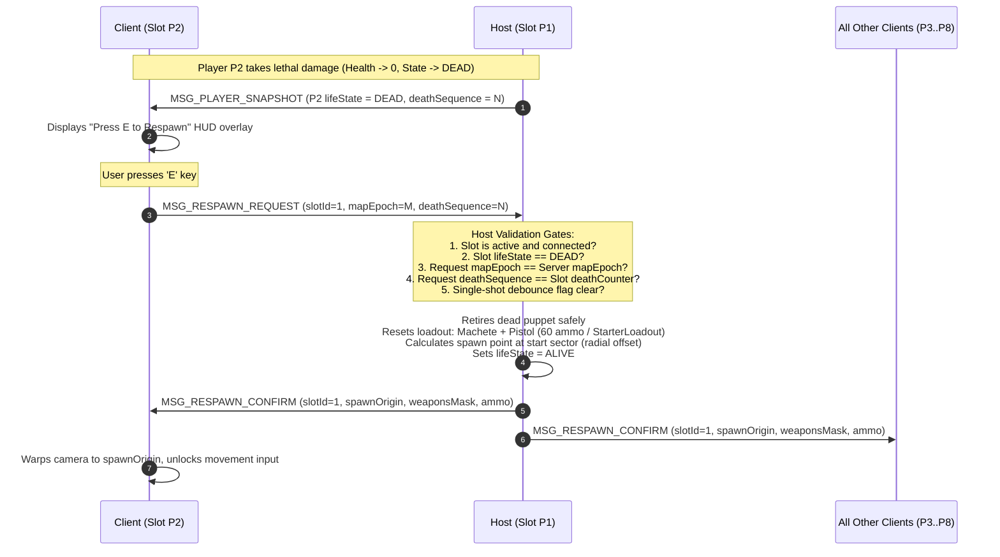
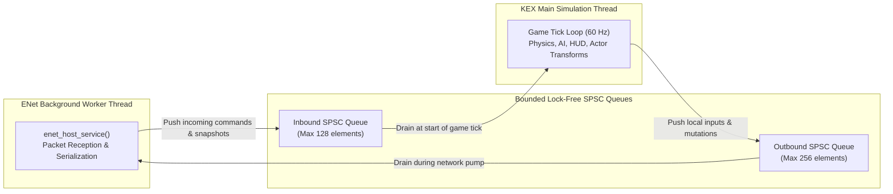

# PowerSlave Exhumed Together — Wire Protocol Specification

**Specification Version:** 1.10  
**Transport:** ENet (Reliable & Unreliable UDP)  
**Byte Order:** Little-Endian  
**Magic Header:** `0x50534558` (`P`, `S`, `E`, `X` in ASCII)

---

## 1. Executive Design Principles

1. **Host-Authoritative Listen Server:** The host simulates the canonical game world (AI, physics collisions, damage, inventory, campaign progression). Remote clients send synthetic inputs and receive authoritative snapshots.
2. **KEX ABI Independence:** The wire protocol has zero dependency on Nightdive KEX Engine internal structs, classes, or pointer layouts. Direct `reinterpret_cast` or `memcpy` of internal memory is strictly prohibited.
3. **Strict Bounds Checking:** All deserialization routines execute boundary checks on buffer length, string limits, enum ranges, and array counts. Malformed or oversized packets are rejected without memory faults.
4. **Channel Segregation:** High-frequency movement and snapshot streams use unsequenced/sequenced unreliable channels where newer packets replace stale ones. Lifecycle events, transitions, and respawns use guaranteed reliable delivery.
5. **Transport Security Boundary:** ENet transport operates over raw UDP and does not provide transport-layer encryption (no DTLS) or cryptographic host-to-host identity proofs. Session integrity and slot protection are enforced at the application protocol layer using 64-bit cryptographically secure random session tokens (`reconnectKey` generated via Windows `BCryptGenRandom`), connection generation counters (`connectionGeneration`), and monotonic sequence filters. Direct LAN and Radmin VPN tunnels provide the necessary encryption perimeter without imposing DTLS handshake latencies.

---

## 2. Channel Allocation

| Channel ID | Name | Reliability Mode | Message Types |
|---|---|---|---|
| **0** | `CHANNEL_RELIABLE_CONTROL` | Reliable Ordered | `HELLO`, `WELCOME`, `REJECT`, `PLAYER_JOIN`, `PLAYER_LEAVE`, `MAP_CHANGE`, `MAP_READY`, `RESPAWN_REQUEST`, `RESPAWN_CONFIRM`, `WORLD_BASELINE`, `INTERACTION_REQUEST`, `WORLD_EVENT_CONFIRM`, `ENTITY_SPAWN`, `ENTITY_DESPAWN` |
| **1** | `CHANNEL_UNRELIABLE_SEQUENCED` | Unreliable Sequenced | `INPUT_COMMAND`, `PLAYER_SNAPSHOT` |
| **2** | `CHANNEL_DIAGNOSTIC` | Unreliable Unsequenced | `PING`, `PONG`, Telemetry |
| **3** | `CHANNEL_WORLD_SNAPSHOT` | Unreliable Unsequenced | `WORLD_SNAPSHOT` (Multi-batch, reassembled via bitmask) |

---

## 3. Packet Envelope & Header

Every UDP message begins with an 11-byte common binary header:

```
+------------------------------------+------------------+---------------+---------------------+
| Field                              | Type             | Size (Bytes)  | Expected Value      |
+------------------------------------+------------------+---------------+---------------------+
| magic                              | uint32_t         | 4             | 0x50534558 ('PSEX') |
| protocolVersion                    | uint16_t         | 2             | 0x0110 (v1.10)      |
| msgType                            | uint8_t          | 1             | 0x01 .. 0x51        |
| sequence                           | uint32_t         | 4             | Monotonic counter   |
+------------------------------------+------------------+---------------+---------------------+
```

---

## 4. Message Payloads Specification

### 4.1 Connection & Handshake Messages

#### `0x01 MSG_HELLO` (Client $\to$ Host)
Dispatched immediately upon establishing the ENet transport connection.
- `clientProtocolVersion` (`uint16_t`): Must match host `0x0110`.
- `clientBuildVersion` (`string`, max 32 chars): Build identifier.
- `joinToken` (`string`, max 64 chars): Optional session password.
- `participantId` (`string`, max 48 chars): Stable client identifier (GUID or hash). Not tied to IP.
- `displayName` (`string`, max 32 chars): Player display name.

#### `0x02 MSG_WELCOME` (Host $\to$ Client)
Dispatched by the host upon successful authentication and slot allocation.
- `protocolVersion` (`uint16_t`): Protocol version.
- `sessionId` (`uint32_t`): Ephemeral session identifier generated at server startup.
- `assignedSlot` (`uint8_t`): Assigned player slot index (`0` for Host/P1, `1..7` for Clients/P2..P8).
- `connectionGeneration` (`uint32_t`): Starts at 1; increments on reconnect to invalidate in-flight commands.
- `mapEpoch` (`uint32_t`): Current level instance generation counter.
- `serverTickRate` (`uint16_t`): Simulation frequency in Hz (default 60).
- `serverSnapshotRate` (`uint16_t`): Snapshot broadcast rate in Hz (default 30).
- `mapName` (`string`, max 32 chars): Current level filename.

#### `0x03 MSG_REJECT` (Host $\to$ Client)
Dispatched when connection cannot be accepted.
- `reasonCode` (`uint8_t`):
  - `1`: Protocol version mismatch.
  - `2`: Server session full (max 8 participants).
  - `3`: Invalid session token.
  - `4`: Banned.
  - `5`: Rate limited.
  - `6`: Malformed payload.
- `reasonMessage` (`string`, max 32 chars): Human-readable rejection reason.

#### `0x04 MSG_PLAYER_JOIN` (Host $\to$ Broadcast)
Notifies existing clients of a new peer or reconnect.
- `slotId` (`uint8_t`): Slot index `0..7`.
- `participantId` (`string`, max 48 chars).
- `displayName` (`string`, max 32 chars).
- `connectionGeneration` (`uint32_t`).

#### `0x05 MSG_PLAYER_LEAVE` (Host $\to$ Broadcast)
Notifies clients that a slot has disconnected.
- `slotId` (`uint8_t`).
- `participantId` (`string`, max 48 chars).
- `reasonCode` (`uint8_t`): `0` = User quit, `1` = Timeout, `2` = Kicked.

---

### 4.2 Gameplay & State Replication Messages

#### `0x10 MSG_INPUT_COMMAND` (Client $\to$ Host)
High-frequency client input transmission (~60 Hz).
- `slotId` (`uint8_t`): Must match client's authenticated slot.
- `connectionGeneration` (`uint32_t`): Stale generations are rejected by the simulation.
- `commandSequence` (`uint32_t`): Monotonically increasing command counter.
- `clientTick` (`uint32_t`): Client simulation tick.
- `pitch` (`float`): Vertical view angle degrees.
- `yaw` (`float`): Horizontal view angle degrees.
- `moveForward` (`float`): Clamped to `[-1.0, 1.0]`.
- `moveRight` (`float`): Clamped to `[-1.0, 1.0]`.
- `buttons` (`uint32_t`): Bitmask (`BUTTON_ATTACK`, `BUTTON_JUMP`, `BUTTON_USE`, etc.).
- `selectedWeapon` (`uint8_t`): Requested weapon index `0..7`.

#### `0x20 MSG_PLAYER_SNAPSHOT` (Host $\to$ Clients)
Periodic authoritative world state broadcast (20..60 Hz).
- `snapshotSequence` (`uint32_t`): Monotonic snapshot counter. Stale snapshots are discarded.
- `serverTick` (`uint32_t`): Host simulation tick.
- `mapEpoch` (`uint32_t`): Current map generation counter.
- `playerCount` (`uint8_t`): Number of active player states encoded (`1..8`).
- Array of `PlayerStateSnapshot`:
  - `slotId` (`uint8_t`)
  - `entityId` (`uint32_t`)
  - `entityGeneration` (`uint32_t`)
  - `posX`, `posY`, `posZ` (`float`)
  - `velX`, `velY`, `velZ` (`float`)
  - `yaw`, `pitch` (`float`)
  - `health` (`int32_t`, default 200, configurable via `StarterLoadout`)
  - `armor` (`int32_t`, default 0)
  - `activeWeapon` (`uint8_t`, index 0..7)
  - `weaponMask` (`uint32_t`): Bitmask of owned weapons (bits 0..7).
  - `ammo` (`uint16_t`): Current ammo for active weapon (default 60 for pistol).
  - `lifeState` (`uint8_t`): `0` = ALIVE, `1` = DYING, `2` = DEAD, `3` = RESPAWNING.
  - `buttons` (`uint32_t`): Currently active actions.
  - `deathSequence` (`uint32_t`): Cumulative death counter for this slot.

#### 4.2.1 Weapon Enumeration & Masks (KEX 2022 KPF Layout)

The wire protocol enumerates weapons strictly matching Nightdive KEX Engine KPF definitions (Slots 0..7):

| Enum Identifier | Index (`uint8_t`) | Weapon Name | Bitmask (`1u << index`) | Description |
|---|---|---|---|---|
| `WEAPON_MACHETE` | `0` | Machete | `0x01` (`0b00000001`) | Starter melee weapon |
| `WEAPON_PISTOL` | `1` | Pistol | `0x02` (`0b00000010`) | Starter firearm (default ammo: 60) |
| `WEAPON_M60` | `2` | M60 Machine Gun | `0x04` (`0b00000100`) | Rapid-fire firearm |
| `WEAPON_BOMBS` | `3` | Bombs / Grenades | `0x08` (`0b00001000`) | Explosive ordnance |
| `WEAPON_FLAMETHROWER`| `4` | Flamethrower | `0x10` (`0b00010000`) | Fire damage stream |
| `WEAPON_COBRA` | `5` | Cobra Staff | `0x20` (`0b00100000`) | Homing venom magic |
| `WEAPON_RING` | `6` | Ring of Ra | `0x40` (`0b01000000`) | High-damage energy sphere |
| `WEAPON_MANACLES` | `7` | Manacles | `0x80` (`0b10000000`) | Ultimate lightning magic |

- `WEAPON_COUNT`: `8`
- `DEFAULT_WEAPON_MASK`: `0x03` (`(1 << WEAPON_MACHETE) | (1 << WEAPON_PISTOL)`)
- `ALL_WEAPONS_MASK`: `0xFF` (`(1 << WEAPON_COUNT) - 1`)

Legacy clients compiled with the older 7-weapon layout or swapped slots transmit protocol version `0x0100` and are automatically rejected during handshake (`0x03 MSG_REJECT` with reason `REJECT_PROTOCOL_MISMATCH`).

#### 4.2.2 Angle Units & Boundary Conversion Rules

1. **Wire Representation:** View orientation (`yaw`, `pitch`) on the wire is formatted in **degrees** (`float` single precision):
   - `yaw`: Horizontal rotation in degrees, normalized to `[-180.0, +180.0)`.
   - `pitch`: Vertical view angle in degrees, clamped to `[-89.0, +89.0]`.
2. **KEX Engine Boundary Conversion:**
   Native KEX 2022 operates in radians internally for camera vectors and physics. The engine replication adapter performs bidirectional conversion at the engine boundary:
   - Inbound (ENet degrees $\to$ KEX radians): $\text{radians} = \text{degrees} \times \left(\frac{\pi}{180.0}\right)$
   - Outbound (KEX radians $\to$ ENet degrees): $\text{degrees} = \text{radians} \times \left(\frac{180.0}{\pi}\right)$
3. **Seam Crossing & Shortest Arc Interpolation:**
   Angle interpolation across the $\pm 180^\circ$ seam is evaluated along the shortest angular arc:
   $$\Delta \theta = (\theta_2 - \theta_1 + 180^\circ) \pmod{360^\circ} - 180^\circ$$
   guaranteeing smooth rotation without $360^\circ$ visual spins.

#### 4.2.3 Configurable Starter Loadout Contract

Starting health, maximum health, and ammo are decoupled from hardcoded assumptions via `struct StarterLoadout`:
- Default starting health: **200 HP** (empirically confirmed in KEX C19).
- Default starting firearm: **Pistol with 60 rounds** (empirically confirmed in KEX C19).
- Custom fixtures / dynamic campaign levels: Can override `StarterLoadout` via `IEngineReplicationAdapter::setStarterLoadout` or `WorldSimulation::setStarterLoadout`.

---

### 4.3 Manual Respawn Protocol Flow

Per project specification (`DOC-16-RESPAWN-DESIGN`):
- Respawn is strictly manual upon pressing **'E'** (`BUTTON_USE`). Automatic respawn is forbidden.
- Weapons reset to standard starting loadout (Machete + Pistol with default 60 rounds, or configured `StarterLoadout`).
- Single-shot edge trigger on client prevents packet flooding.
- Host validates death state, monotonic death sequence, and map epoch.



#### `0x40 MSG_RESPAWN_REQUEST` (Client $\to$ Host)
- `slotId` (`uint8_t`): Requester's slot ID.
- `mapEpoch` (`uint32_t`): Level epoch.
- `deathSequence` (`uint32_t`): Monotonic death counter for this slot.

#### `0x41 MSG_RESPAWN_CONFIRM` (Host $\to$ Broadcast)
- `slotId` (`uint8_t`): Slot ID.
- `mapEpoch` (`uint32_t`): Level epoch.
- `deathSequence` (`uint32_t`): Confirmed death sequence.
- `spawnX`, `spawnY`, `spawnZ` (`float`): Coordinates at start sector.
- `spawnYaw` (`float`): Starting orientation angle.
- `newEntityId` (`uint32_t`): Actor ID.
- `entityGeneration` (`uint32_t`): Incremented generation.
- `defaultWeapons` (`uint32_t`): Starter weapon bitmask (`DEFAULT_WEAPON_MASK` or `StarterLoadout::weaponMask`).
- `defaultAmmo` (`uint16_t`): Baseline ammo (`DEFAULT_PISTOL_AMMO` = 60, or `StarterLoadout::ammo`).

---

### 4.4 Level Transitions & Epoch Management

#### `0x35 MSG_MAP_CHANGE` (Host $\to$ Broadcast)
- `newMapEpoch` (`uint32_t`): Monotonically incremented epoch.
- `mapName` (`string`, max 32 chars): New map name.

#### `0x36 MSG_MAP_READY` (Client $\to$ Host)
- `slotId` (`uint8_t`).
- `mapEpoch` (`uint32_t`): Acknowledged epoch.

---

### 4.5 Latency Diagnostic Messages

#### `0x50 MSG_PING` (Client $\to$ Host / Host $\to$ Client)
- `timestampMs` (`uint64_t`): Milliseconds since epoch.
- `pingSequence` (`uint32_t`).

#### `0x51 MSG_PONG` (Host $\to$ Client / Client $\to$ Host)
- `timestampMs` (`uint64_t`): Echo of sender's timestamp.
- `pingSequence` (`uint32_t`).
- RTT is computed locally: $\Delta t = t_{\text{receive}} - t_{\text{pong}}$.

---

### 4.6 World State Replication Messages

Channel allocation:
- Reliable Events & Baseline (`0x21`, `0x22`, `0x24`, `0x31`, `0x32`): `CHANNEL_RELIABLE_CONTROL` (Channel 0).
- High-Frequency Unreliable Batched Snapshot Stream (`0x23`): `CHANNEL_WORLD_SNAPSHOT` (Channel 3, Unsequenced at ENet layer, reassembled via bitmask at application layer).

#### `0x21 MSG_ENTITY_SPAWN` (Host $\to$ Broadcast / Reliable)
Dispatched when an entity (Enemy, Projectile, Pickup, Door, Switch) is spawned. Fixed payload size: **59 bytes** (+11 bytes header = 70 bytes).
- `mapEpoch` (`uint32_t`): Level epoch.
- `entityId` (`uint32_t`): Stable network entity ID.
- `entityGeneration` (`uint32_t`): Generation counter (incremented upon ID reuse).
- `type` (`uint8_t`): `1` = PLAYER, `2` = ENEMY, `3` = PROJECTILE, `4` = PICKUP, `5` = DOOR, `6` = SWITCH.
- `subType` (`uint16_t`): Sub-classifier (e.g. `EnemySubType`, `PickupSubType`).
- `posX`, `posY`, `posZ` (`float`): World coordinates (12 bytes).
- `velX`, `velY`, `velZ` (`float`): Velocity vector (12 bytes).
- `yaw`, `pitch` (`float`): Orientation (8 bytes).
- `health` (`int32_t`): 4 bytes.
- `stateFlags` (`uint32_t`): 4 bytes.
- `meta` (`uint32_t`): Context-dependent parameter (e.g. projectile damage, door key mask, switch target ID, pickup amount).

#### `0x22 MSG_ENTITY_DESPAWN` (Host $\to$ Broadcast / Reliable)
Dispatched when an entity is destroyed, collected, or transitioned. Fixed payload size: **13 bytes** (+11 bytes header = 24 bytes).
- `mapEpoch` (`uint32_t`): Level epoch.
- `entityId` (`uint32_t`): Entity ID.
- `entityGeneration` (`uint32_t`): Generation matching the spawn.
- `reason` (`uint8_t`): `0` = KILLED, `1` = COLLECTED, `2` = EXPIRED, `3` = MAP_TRANSITION, `4` = DISCONNECTED, `5` = REPLACED.

#### `0x23 MSG_WORLD_SNAPSHOT` (Host $\to$ Clients / Channel 3 Unsequenced)
Batched periodic state stream (20..60 Hz). Enforces dynamic batching calculated from a conservative 1200-byte application budget:
$$\text{MaxEntitiesPerBatch} = \left\lfloor \frac{1200 - (\text{MsgHeader: } 11 + \text{SnapshotHeader: } 16)}{55} \right\rfloor = \left\lfloor \frac{1173}{55} \right\rfloor = 21 \text{ entities}$$
For 128 entities, exactly 7 batches are dispatched per snapshot frame (6 batches of 21 entities = 1182 bytes, 1 batch of 2 entities = 137 bytes). Every packet is strictly $\le 1200$ bytes, fitting safely within the target budget.

> [!NOTE] Path MTU vs Application Budget Clarification
> The 1200-byte limit is an application payload budget target chosen conservatively to fit comfortably below standard Ethernet MTUs (1500 bytes) and common VPN/tunnel encapsulations (PPPoE 1492, Radmin/ZeroTier 1420-1440, WireGuard 1420). It is **not** an absolute guarantee of end-to-end Path MTU (PMTU). On exotic or heavily encapsulated network links where PMTU falls below 1200 bytes, IP fragmentation could still occur at the network layer.

- Snapshot Header (**16 bytes**):
  - `snapshotSequence` (`uint32_t`): Monotonic frame sequence (rollover across `UINT32_MAX` handled via signed RFC 1982 modular distance).
  - `serverTick` (`uint32_t`): Host tick.
  - `mapEpoch` (`uint32_t`): Map generation epoch.
  - `batchIndex` (`uint8_t`): Zero-indexed batch index ($0 \dots \text{totalBatches}-1$).
  - `totalBatches` (`uint8_t`): Total batches in this frame ($1 \dots 64$, verified against 64-bit frame reassembly bitmask).
  - `entityCount` (`uint16_t`): Number of entity records in this packet.
- Array of `EntitySnapshot` (**55 bytes per entity**):
  - `entityId` (`uint32_t`): 4 bytes
  - `generation` (`uint32_t`): 4 bytes (strictly $\ge 1$; generation 0 is strictly forbidden and rejected)
  - `type` (`uint8_t`): 1 byte
  - `subType` (`uint16_t`): 2 bytes
  - `posX`, `posY`, `posZ` (`float`): 12 bytes
  - `velX`, `velY`, `velZ` (`float`): 12 bytes
  - `yaw`, `pitch` (`float`): 8 bytes
  - `health` (`int32_t`): 4 bytes
  - `stateFlags` (`uint32_t`): 4 bytes
  - `meta` (`uint32_t`): 4 bytes
  - Total: $4 + 4 + 1 + 2 + 12 + 12 + 8 + 4 + 4 + 4 = 55$ bytes.

#### `0x24 MSG_WORLD_BASELINE` (Host $\to$ Client / Reliable)
Dispatched upon client authentication or reconnect to synchronize all active world objects and campaign keys. Dynamic batching limits each baseline message to $\le 1200$ bytes ($\le 19$ entities per batch).
- `mapEpoch` (`uint32_t`): Level epoch.
- `serverTick` (`uint32_t`): Server tick.
- `teamKeyMask` (`uint32_t`): Shared campaign key bitmask.
- `mapName` (`string`, max 32 chars).
- `batchIndex` (`uint8_t`).
- `totalBatches` (`uint8_t`).
- `entityCount` (`uint16_t`).
- Array of `MsgEntitySpawn` (59 bytes per entity).

#### `0x31 MSG_INTERACTION_REQUEST` (Client $\to$ Host / Reliable)
Dispatched when client presses 'E' near an interactive object. Fixed payload size: **14 bytes** (+11 bytes header = 25 bytes).
- `mapEpoch` (`uint32_t`): Level epoch.
- `slotId` (`uint8_t`): Requesting player slot.
- `targetEntityId` (`uint32_t`): Entity ID of Door or Switch.
- `targetGeneration` (`uint32_t`): Expected generation of target (ABA protection; rejected if generation mismatch).
- `interactionType` (`uint8_t`): `0` = USE, `1` = TOUCH.

#### `0x32 MSG_WORLD_EVENT_CONFIRM` (Host $\to$ Broadcast / Reliable)
Authoritative confirmation of interactive state changes or combat events. Fixed payload size: **30 bytes** (+11 bytes header = 41 bytes).
- `mapEpoch` (`uint32_t`): Level epoch.
- `eventSequence` (`uint32_t`): Monotonic event ID.
- `eventType` (`uint16_t`): `0x01` = DOOR_STATE_CHANGE, `0x02` = SWITCH_TRIGGERED, `0x03` = PICKUP_COLLECTED, `0x04` = DAMAGE_CONFIRMED.
- `sourceEntityId` (`uint32_t`): Instigator actor ID.
- `targetEntityId` (`uint32_t`): Target actor ID.
- `targetGeneration` (`uint32_t`): Target generation (ABA protection; rejected on client if generation mismatch).
- `eventValue` (`int32_t`): State enum or integer parameter.
- `floatValue` (`float`): Interpolated ratio or health float.

---

## 5. Threading & SPSC Queue Architecture Contract

To guarantee absolute thread safety between the asynchronous ENet worker thread and the synchronous KEX 2022 simulation thread:



1. **Inbound SPSC Queue (ENet Worker $\to$ KEX Simulation):**
   - Transports parsed client input commands, baseline data, and verified RPC events into the game simulation loop.
   - Bounded capacity (128 elements). Oldest/stale inputs are dropped on saturation to prevent latency accumulation.
2. **Outbound SPSC Queue (KEX Simulation $\to$ ENet Worker):**
   - Transports local actor mutations, authoritative state updates, and outbound network packets to the transport thread.
   - Bounded capacity (256 elements).
3. **Strict Prohibition of Cross-Thread Callbacks:**
   Neither thread may directly execute callbacks or access the memory domain of the other thread without going through the bounded lock-free queues. Multi-producer or multi-consumer queues are unnecessary and prohibited, as there is strictly 1 network worker and 1 simulation producer/consumer.

