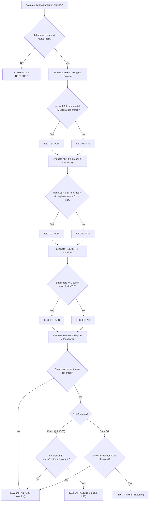

# PowerSlave Exhumed Together — KEX Evidence Gate Hardening (M1.2a Scope)

**Document Version:** 1.00  
**Date:** 2026-11-02  
**Role:** QA Engineer  
**Component:** `tools/multiclient-test-runner/` (`kex_adapter.py`, `test_runner_unit.py`, `test_data/synthetic_kex/`)  
**Scope:** Hardening native engine evidence gate for remote player P2 against false PASS from incomplete, stale, unlinked, or contradictory telemetry logs.  
**Reference Contracts:** [DOC-40](../../docs/40_THREAD_BRIDGE_P0_REMEDIATION.md) (Thread Bridge §4 SPSC Contract), [DOC-41](../../docs/41_M1_NATIVE_BOOTSTRAP.md) (Native Bootstrap ABI), [DOC-43](../../docs/43_M1_DIRECT_QUIT_FINAL.md) (C25 Direct Quit Contract).  

---

## 1. Executive Summary & Boundaries

In Multi-Client QA Phase 2, `kex_adapter.py` provided a basic interface to check contracts `KEX-01` through `KEX-04`. However, an audit revealed that the legacy validator was vulnerable to **false positives**: it could award `PASS` to unlinked motion, single-snapshot isolation claims, cross-thread calls, stale connection generations, and engine exits where background network workers were never cleanly torn down.

As QA Engineer, this task hardened `kex_adapter.py` so that **no native contract can receive a false PASS**.

### Strict Operational Boundaries
- **No changes to native binaries:** Native DLL, KEX hooks, ENet Worker, Thread Bridge, and Wire Protocol v1.10 remain untouched.
- **No game process modification:** Game was neither launched nor modified.
- **Scope limited to test runner:** All changes are strictly inside `tools/multiclient-test-runner/`.
- **Epistemological boundary:** Synthetic PASS tests confirm **only the correctness and rigor of the validation gate**, not the execution of real KEX DLL code. Consistent logs alone do not substitute for native execution proof.
- **Incremental telemetry requirement:** Telemetry requirements for GPT-6.1 Sol Max are kept strictly minimal for M1.2a (one remote player P2).

---

## 2. Identified Vulnerabilities & False PASS Risks

| Vulnerability ID | Contract Affected | Legacy Flaw Description | Hardened Gate Defense |
|---|---|---|---|
| **VULN-01** | `KEX-01` | ActorSpawn for wrong slot (e.g. `P3` when testing `P2`) or invalid actorId (0) was not strictly gated; actor factory type was unverified. | Checks `slot == target_slot`, verifies factory type == 0 (Puppet Actor per C01/DOC-41), and requires non-zero `actorId`. Rejects other slots as `FAIL`. |
| **VULN-02** | `KEX-02` | `MotionTick` triggered `PASS` even if spatial displacement was 0, or had zero correlation to accepted inbound network packets (ambient drift/gravity/mock). | Requires explicit seam correlation: `input_seq > 0` or `net_cmds > 0` or `input_linked == True`, plus non-zero spatial displacement or velocity. |
| **VULN-03** | `KEX-01..04` | Telemetry events from an old `connectionGeneration` (e.g. residual logs from Gen 1 after reconnecting to Gen 2) were accepted. | Enforces generation matching against `expected_generation`. Stale generation markers produce an immediate `FAIL`. |
| **VULN-04** | `KEX-01..04` | Native simulation updates executed on foreign threads (e.g. network worker or render thread) were undetected, violating DOC-40 §4 SPSC rule. | Enforces simulation `TID` matching. Any native mutation executed outside the simulation thread produces `FAIL`. |
| **VULN-05** | `KEX-03` | A single `P1StateCheck` snapshot at t=0 awarded `PASS`, giving false confidence in non-interference without testing across time. | Enforces temporal isolation: requires at least 2 distinct checkpoints (initial baseline + during/after remote player activity) with `hp > 0` and no state corruption. |
| **VULN-06** | `KEX-04` | `EngineShutdown` awarded `PASS` without verifying that the background ENet network worker and Thread Bridge were stopped and joined. | Requires explicit proof of clean network worker shutdown (`WORKER_SHUTDOWN` event or `workerStopped=1` on engine exit). |
| **VULN-07** | `KEX-04` | Inability to distinguish `StateExit` from `Direct Quit` (C25/DOC-43). Direct Quit from in-game pause menu does not call `ActorDestroy`. | Dual-path lifecycle logic: `StateExit` requires `ActorDestroy` for target slot; `Direct Quit` evaluates C25 quiesce invariants (`handleNull=1`, `hooksRestored=1`, `pinned=1`) without requiring `ActorDestroy`. |

---

## 3. Implementation of the Hardened Gate (`kex_adapter.py`)

### 3.1 Dual-Format Ingestion
`kex_adapter.py` now ingests both:
1. **Structured key-value tags:**
   `[KEX-HOOK] <EventName>: slot=<slot> tid=<tid> gen=<gen> ...`
2. **Native JSON Lines:**
   Directly parses `native.jsonl` objects emitted by Sol's diagnostic harness (`independent_spawn`, `movement_checkpoint`, `shutdown_quiesced`, `worker_shutdown`, etc.).

### 3.2 Evaluation Logic per Contract



---

## 4. Synthetic Negative Test Suite & Verification Results

A dedicated suite of synthetic log files was authored in `tools/multiclient-test-runner/test_data/synthetic_kex/`. Each scenario isolates an invalid, stale, or incomplete telemetry condition.

| Test File | Target Scenario | Evaluated Contract | Expected Status | Actual Status | Hardened Reason / Detail |
|---|---|:---:|:---:|:---:|---|
| `01_actorspawn_wrong_slot.log` | Spawn recorded for P3, evaluating P2 | `KEX-01` | **FAIL** | **FAIL** | `ActorSpawn recorded for incorrect slot: observed [P3] != target [P2]` |
| `02_motiontick_unlinked_network_input.log` | Motion tick with `inputSeq=0`, `netCmds=0`, `unlinked=1` | `KEX-02` | **FAIL** | **FAIL** | `MotionTick recorded for P2, but missing correlation to accepted network input` |
| `03_stale_connection_generation.log` | Events tagged `gen=1`, expected `gen=2` | `KEX-01` | **FAIL** | **FAIL** | `ActorSpawn belongs to stale connection generation: gen 1 != expected 2` |
| `04_wrong_thread_execution.log` | Simulation updates executed on worker TID 44120 != sim TID 37472 | `KEX-01` | **FAIL** | **FAIL** | `ActorSpawn executed on foreign thread: TID 44120 != simulation TID 37472` |
| `05_p1_single_snapshot.log` | Only 1 P1 isolation check present | `KEX-03` | **FAIL** | **FAIL** | `Insufficient P1 isolation evidence: only 1 snapshot observed` |
| `06_engine_shutdown_missing_worker_shutdown.log` | `EngineShutdown` clean=1, but no network worker shutdown | `KEX-04` | **FAIL** | **FAIL** | `missing evidence of correct network worker shutdown (ENet worker / Thread Bridge teardown)` |
| `07_valid_state_exit_pass.log` | Complete compliant StateExit log | `KEX-01..04` | **PASS** | **PASS** | All 4 contracts confirmed with actor destruction & worker teardown |
| `08_valid_direct_quit_c25_pass.log` | Compliant Direct Quit under C25 (no ActorDestroy) | `KEX-01..04` | **PASS** | **PASS** | Confirmed under C25/DOC-43: hooks restored, handle nulled, module pinned, worker stopped |
| `09_legacy_incomplete_log.log` | Legacy 4-line log that used to give false PASS | `KEX-02..04` | **FAIL** | **FAIL** | Rejects unlinked motion, single snapshot, and missing worker shutdown |

### Unit Test Execution Output
Running `python tools/multiclient-test-runner/test_runner_unit.py`:
```
.......................
----------------------------------------------------------------------
Ran 23 tests in 0.017s

OK
```
All 23 unit tests (including all 6 negative gates, legacy log rejection, JSONL parser, and dual-exit scenarios) executed and passed with 100% determinism.

---

## 5. Minimal Native Telemetry Contract for Sol Max (M1.2a)

To allow GPT-6.1 Sol Max to integrate M1.2a without premature overhead, the telemetry contract is kept strictly minimal and focused on **remote player P2**.

### 5.1 Transport Options
Sol Max may emit telemetry to `stdout` or write to a designated file (`--kex-telemetry-file <path>`). The adapter accepts either:
1. `[KEX-HOOK]` formatted text tags (case-insensitive).
2. JSON Lines objects (identical to M1.1 `native.jsonl`).

### 5.2 Required Telemetry Markers

#### 1. Universal Envelope Fields
Every event must provide or inherit:
- `slot`: Player slot (`"P2"` for remote puppet, `"P1"` for host player, `"HOST"` for platform).
- `gen`: Active `connectionGeneration` integer (starting at 1, incremented upon reconnect).
- `tid`: OS thread ID of the emitting thread (must match KEX simulation thread for world mutations).

#### 2. KEX-01: Actor Instantiation
- **Marker:** `[KEX-HOOK] ActorSpawn: slot=P2 actorId=<id> type=0 gen=<N> tid=<sim_tid>`
- **Requirements:** `type=0` (Puppet Actor); `actorId` non-zero; executed on simulation TID.

#### 3. KEX-02: Physics Displacement & Network Input Seam
- **Marker:** `[KEX-HOOK] MotionTick: slot=P2 pos=(<x>,<y>,<z>) vel=<v> inputSeq=<seq> netCmds=<n> gen=<N> tid=<sim_tid>`
- **Requirements:** Must link spatial movement to accepted inbound network commands (`inputSeq > 0` or `netCmds > 0`); must show non-zero velocity or spatial displacement across ticks; executed on simulation TID.

#### 4. KEX-03: P1 Host State Isolation & Non-Interference
- **Marker:** `[KEX-HOOK] P1StateCheck: tick=<t> slot0_hp=200 slot0_status=ALIVE gen=<N> tid=<sim_tid>`
- **Requirements:** Must be emitted **at least twice** (at baseline before P2 motion, and during/after P2 motion) to verify absence of memory corruption over time. Health must remain unchanged (200), status ALIVE.

#### 5. KEX-04: Lifecycle Teardown
Sol must provide shutdown markers corresponding to the exit path taken:
- **Path A: StateExit (Title / Map Exit):**
  - `[KEX-HOOK] ActorDestroy: slot=P2 actorId=<id> gen=<N> tid=<sim_tid>`
  - `[KEX-HOOK] WorkerShutdown: clean=1 tid=<worker_tid>`
  - `[KEX-HOOK] EngineShutdown: clean=1 code=0 workerStopped=1 tid=<sim_tid>`
- **Path B: Direct Quit (In-game Pause Menu Quit to Desktop per C25/DOC-43):**
  *(ActorDestroy is not called by engine; C25 quiesce proof is required instead)*
  - `[KEX-HOOK] DirectQuitQuiesced: handleNull=1 hooksRestored=1 pinned=1 gen=<N> tid=<sim_tid>`
  - `[KEX-HOOK] WorkerShutdown: clean=1 tid=<worker_tid>`
  - `[KEX-HOOK] EngineShutdown: clean=1 code=0 workerStopped=1 tid=<sim_tid>`

---

## 6. Stop Condition & Handoff

- `kex_adapter.py` is fully hardened against false positives.
- Negative test suite and synthetic test logs are checked in and verified.
- Minimal telemetry specification is finalized for Sol Max.
- **In compliance with instructions, work is now halted. No runner features were expanded beyond the assigned scope.**
