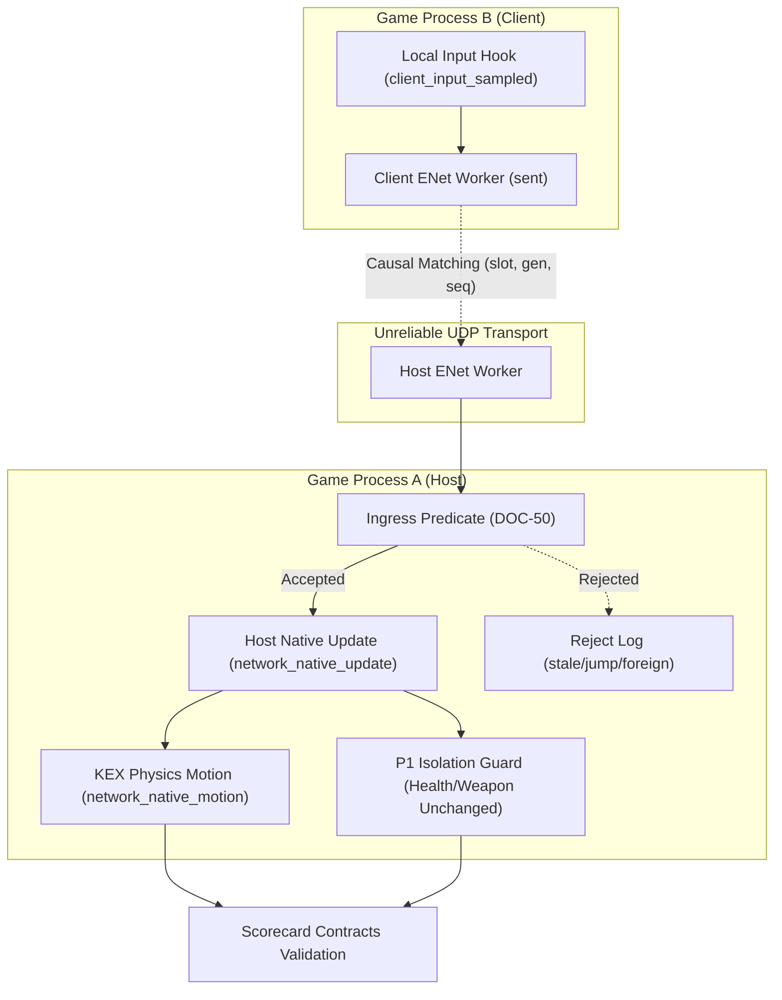

# PowerSlave Exhumed Together — Dual-Instance Acceptance QA System

**Document Version:** 1.0.0  
**Target Milestone:** Native Second-Instance Game Process B Client Readiness & Verification  
**Role:** Senior QA Automation Engineer & Network Integration Validation Engineer  
**Status:** COMPLETE & VERIFIED  

---

## 1. Executive Summary & Purpose

The purpose of this acceptance QA system is to establish a rigorous, automated verification gate for the milestone: **Connecting a second real PowerSlave Exhumed (2022) instance (Game Process B) to the KEX host (Game Process A)**.

During milestone M1.2a, network input dispatch was proven using a headless prototype client (`native_client.cpp` / `m12a_test_client.exe`). The next major step requires running two genuine, unmodified game executables (`anubis_Shipping_Steam_x64.exe`) on a single PC, capturing input from the client's local keyboard, transmitting it via ENet UDP packets, and driving native P2 movement on the host.

This QA framework enforces **absolute factual precision**:
- It rejects false positives: headless runners, mock clients, and `client_control.txt` scripts are strictly flagged as `INCONCLUSIVE`.
- It distinguishes between:
  1. Capturing input from a genuine game process.
  2. Driving native P2 movement on the host.
  3. Observing P2 on the client screen (requires world replication — future milestone).
  4. Full co-op gameplay (future milestone).
  
Proof of point 2 **is never treated as proof of points 3 or 4**.

---

## 2. Environmental Pre-Check & Qualified Constraints

Before running or validating dual instances, `precheck_environment.py` verifies all host and client prerequisites. In accordance with strict static analysis facts, previous speculative claims have been qualified as follows:

| Topic | Qualified QA Classification | Technical Rationale |
| :--- | :--- | :--- |
| **Win32 Mutex** | `NEGATIVE STATIC EVIDENCE` | PE analysis confirms `CreateMutexA/W` is not imported. However, this does **not** prove the absence of single-instance logic: games can use Named Pipes, Shared Memory, or Win32 Window Class enumeration (`FindWindowA/W`). |
| **Steam Concurrent Execution** | `UNKNOWN / RUNTIME PENDING` | While `steam_api64.dll` exports standard entry points, running two instances under the same Steam account on a single Windows OS is unverified without live execution. |
| **`steam_appid.txt`** | `VERIFIED RULE` | `steam_appid.txt` must be present in the **current working directory (CWD)** of each process at launch time, not merely inside profile folders. |
| **`-userpath` Isolation** | `QUALIFIED ISOLATION` | Command-line switch `-userpath` successfully redirects configuration and saves, but does **not** isolate Vulkan GPU pipeline caches (`%LOCALAPPDATA%`) or Windows Registry settings. Dedicated environment variable redirection (`USERPROFILE`, `LOCALAPPDATA`) is required. |
| **Unreliable Release Packets** | `VERIFIED RISK` | A single key-release packet sent over unreliable ENet UDP can be dropped by the network. A client DLL sending only one release packet causes a "sticky walk". Continuous neutral packets or host-side timeout fallback is mandatory. |
| **Simulation Cadence** | `VARIABLE CADENCE` | KEX `Player::Update` execution frequency depends on engine tick delta and frame rate, and is not locked to a static 60 Hz network packet rate. |

---

## 3. Ten Core Acceptance Contracts

The correlation engine (`log_correlation.py`) evaluates 10 explicit contracts across the host and client journals:



### Contract 1: `PROC_ISOLATION`
- **Rule:** Host and Client must execute in distinct Win32 processes (`PID_Host != PID_Client`).
- **Verdicts:** `PASS` if PIDs are disjoint; `FAIL` if PIDs intersect; `INCONCLUSIVE` if PID metadata is absent.

### Contract 2: `BUILD_INTEGRITY`
- **Rule:** Executable binary hash in `dll_prepared` must match the known PowerSlave Exhumed 2022 Steam binary (`b8f131037187ca8d0a282527fb6f55a2012241d5b9dac8bf2038baf35b71a76d`).
- **Verdicts:** `PASS` if SHA-256 matches; `FAIL` if hash mismatch; `INCONCLUSIVE` if event absent.

### Contract 3: `SESSION_LIFECYCLE`
- **Rule:** Handshake must bind client to Slot 1 (P2) and valid generation $\ge 1$.
- **Verdicts:** `PASS` on Slot 1 binding; `FAIL` on unexpected slot assignment; `INCONCLUSIVE` on incomplete handshake.

### Contract 4: `INPUT_CORRELATION` (Causal Sequence Monotonicity & DOC-50 Ingress)
- **Rule:** Host must accept client input sequences in monotonic order keyed on `(slot, generation, input_seq)`.
- **Ingress Predicate Rules (per DOC-50):**
  - First packet sequence $\le 10800$.
  - Forward jump $\le 1800$.
  - Slot must equal 1.
  - Generation must match active session generation.
- **Verdicts:**
  - `FAIL` if duplicate sequences accepted, slot $\ne 1$ accepted, stale generation accepted, sequence jump $> 1800$ accepted, or non-monotonic sequence accepted.
  - `PASS` if client commands causally match host accepted records and all invalid packets are rejected.
  - `INCONCLUSIVE` if 0 commands accepted.

### Contract 5: `INPUT_MECHANICS` (Sticky Walk Prevention)
- **Rule:** Validates the complete cycle of movement: `Hold W -> Release W -> Neutral stream / Timeout recovery`.
- **Verdicts:**
  - `FAIL` if client releases forward motion but host P2 continues moving without timeout recovery (sticky walk).
  - `PASS` if hold is followed by clean release and host neutral state.

### Contract 6: `CAUSAL_P2_MOVEMENT` (Uncommanded Motion Gate)
- **Rule:** P2 displacement must be causally driven by client forward/motion input.
- **Verdicts:**
  - `FAIL` if P2 displacement $> 5.0$ units occurs when no forward command was sent or accepted (uncommanded motion).
  - `PASS` if forward input produces native displacement $> 10.0$ units, or neutral input keeps P2 stationary ($\le 1.0$ unit).
  - `INCONCLUSIVE` if motion cannot be causally mapped to commands.

### Contract 7: `P1_ISOLATION`
- **Rule:** Host P1 actor memory (health, active weapon, inventory) must remain strictly unmodified during P2 native simulation updates (`unchanged == true`).
- **Verdicts:** `PASS` if 0 mutations; `FAIL` if P1 health or weapon alters during P2 tick.

### Contract 8: `THREAD_AFFINITY`
- **Rule:** All native KEX API calls for P2 must execute strictly on the primary simulation thread (`observed_tid`).
- **Verdicts:** `PASS` if all updates match attested simulation TID; `FAIL` if foreign thread execution is observed (`foreign_calls > 0`).

### Contract 9: `CLEAN_SHUTDOWN`
- **Rule:** Host and client processes must quiesce, join network worker threads, and release native resources without leaking sockets or lingering threads.
- **Verdicts:** `PASS` if orderly teardown events present (`shutdown_quiesced`, `native_final_exit`); `FAIL` if `worker_joined == false` or `worker_alive_at_exit == true`; `INCONCLUSIVE` if process ends abruptly.

### Contract 10: `REAL_CLIENT_VERIFICATION` (Anti-False-PASS Gate)
- **Rule:** Requires evidence that the client stream was produced by a genuine game process (`client_dll_prepared`, `client_input_sampled`, `headless == false`).
- **Verdicts:**
  - `PASS` if genuine game process telemetry verified.
  - `INCONCLUSIVE` if headless prototype detected (`headless: true` or `client_control.txt` references).

---

## 4. Acceptance Test Scenarios Matrix

The test suite validates 14 reference scenarios, negative ingress filter tests, and historical evidence:

| Scenario Name | Description | Expected Verdict | Primary Contract Checked |
| :--- | :--- | :---: | :--- |
| `scenario_01_valid_hold_release_neutral` | Full Hold W $\to$ Release $\to$ Neutral stream on dual real game instances. | **PASS** | Full integration chain |
| `scenario_02_uncommanded_movement` | P2 moves 20 units on host while client sends only neutral input. | **FAIL** | `CAUSAL_P2_MOVEMENT` |
| `scenario_03_undelivered_commands` | Client sends commands, but network drops all; host accepts 0 packets. | **INCONCLUSIVE** | `INPUT_CORRELATION` |
| `scenario_04_dropped_release_sticky_walk` | Release packet dropped; client sends no neutral stream; host has no timeout. | **FAIL** | `INPUT_MECHANICS` |
| `scenario_05_dropped_release_neutral_recovery` | Release packet dropped; client sends continuous neutral stream; host recovers. | **PASS** | `INPUT_MECHANICS` |
| `scenario_06_duplicate_sequence` | Duplicate sequence sent; host ingress filter rejects it (`rejected_stale`). | **PASS** | `INPUT_CORRELATION` |
| `scenario_07_stale_generation` | Packet with generation 0 sent; host ingress filter rejects it (`rejected_generation`). | **PASS** | `INPUT_CORRELATION` |
| `scenario_08_wrong_slot` | Packet claiming slot 99 sent; host ingress filter rejects it (`rejected_foreign`). | **PASS** | `INPUT_CORRELATION` |
| `scenario_09_pathological_uint32_max` | Sequence 4294967295 sent; host ingress filter rejects forward jump per DOC-50. | **PASS** | `INPUT_CORRELATION` |
| `scenario_10_thread_affinity_violation` | Host executes native P2 update on background worker thread (TID 20999). | **FAIL** | `THREAD_AFFINITY` |
| `scenario_11_p1_state_mutation` | P1 health drops from 200 to 150 during P2 native simulation update. | **FAIL** | `P1_ISOLATION` |
| `scenario_12_lingering_worker_on_exit` | Process shuts down while ENet worker thread remains running (`worker_joined: false`). | **FAIL** | `CLEAN_SHUTDOWN` |
| `scenario_13_missing_telemetry_or_manifest` | Host log lacks `dll_prepared` build manifest record. | **INCONCLUSIVE** | `BUILD_INTEGRITY` |
| `scenario_14_unconfirmed_shutdown_order` | Host ends abruptly without `shutdown_quiesced` or `native_final_exit`. | **INCONCLUSIVE** | `CLEAN_SHUTDOWN` |
| *Negative Test N1* | Rogue host accepts duplicate sequence. | **FAIL** | `INPUT_CORRELATION` |
| *Negative Test N2* | Rogue host accepts unauthorized slot 99. | **FAIL** | `INPUT_CORRELATION` |
| *Negative Test N3* | Rogue host accepts illegal forward sequence jump ($> 1800$). | **FAIL** | `INPUT_CORRELATION` |
| *Historical Evidence: M12A_NATIVE_01* | Host and client logs from M1.2a test client (`native_client.cpp`). | **INCONCLUSIVE** | `REAL_CLIENT_VERIFICATION` |

---

## 5. Verification Command & Reproducibility

The complete acceptance suite can be executed with a single command from the project root:

```powershell
python PowerSlave_Exhumed_Together_mod/tools/native-second-instance-readiness/run_offline_qa.py
```

### Execution Output & Exit Codes:
- **Exit Code 0:** All environment pre-checks passed, all 14 reference scenarios matched expectations, negative filter tests passed, and historical evidence verified.
- **Exit Code 1:** Any assertion mismatch or unexpected verdict.
- **Artifact Output:** Full machine-readable audit trail is automatically saved to:  
  `tools/native-second-instance-readiness/QA_VALIDATION_RESULTS.json`.
