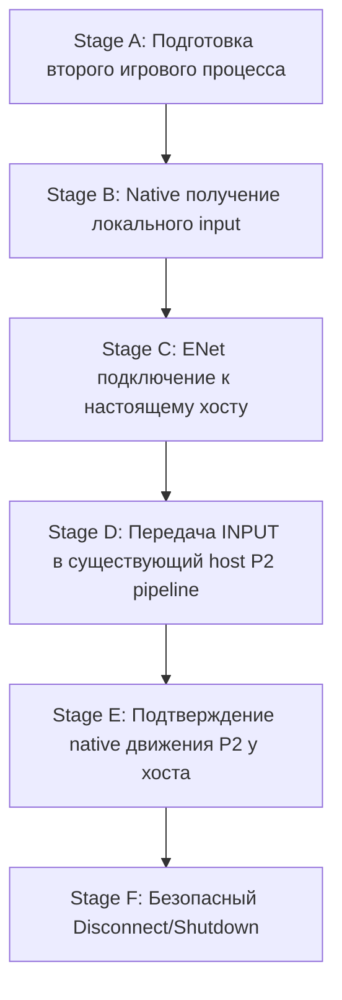

# PowerSlave Exhumed Together — Handoff Plan for GPT-6.1 Sol Max
## Native Second-Instance Client Integration (Phase 1)

**Дата:** 2 ноября 2026 г.  
**Для кого:** GPT-6.1 Sol Max  
**От кого:** Senior C++ / KEX Integration Researcher & QA Infrastructure Engineer  
**Статус:** READY FOR IMPLEMENTATION (Начинать строго после завершения и приёмки P2-5)  
**Область:** Первый запуск двух настоящих экземпляров KEX 2022 (Host A + Client B), захват клавиатурного ввода в окне Client B и нативное перемещение P2 в мире Host A.

---

## 1. Концепция и границы реализации (Scope Boundaries)

### Что входит в задачу:
1. Запуск Game Process B (Client) с изолированным профилем `-userpath` и `steam_appid.txt`.
2. Загрузка в Process B клиентской DLL (`pse_native_client.dll`), реализующей захват локального клавиатурного ввода `primary()` (`0x140af33e0`).
3. Подключение клиентской DLL к запущенному Game Process A (Host) по протоколу ENet v1.10.
4. Отправка команд `MsgInputCommand` (Hold W, Release, Neutral) по ENet на хост.
5. Приём команд хостом через существующую инфраструктуру M1.2a/M1.2b и физическое перемещение native Puppet P2 на экране хоста.
6. Чистое и безопасное завершение обоих процессов без утечек ресурсов и крашей.

### Что СТРОГО ИСКЛЮЧЕНО из первого прототипа:
- **Репликация мира (World Replication)**: клиент НЕ получает снапшоты мира и НЕ отрисовывает P1 на своём экране.
- **Оружие, инвентарь и стрельба**: только базовый seam движения forward/backward.
- **Враги, триггеры, двери, переходы уровней и сохранения кампании**.
- **Интерфейс (HUD), чат, голосовая связь**.
- **Число игроков более 2** (строго 2 игрока: Host P1 + Remote Client P2).

---

## 2. Поэтапный план реализации (Stages A — F)



---

### Stage A: Подготовка второго игрового процесса

* **Цель:** Обеспечить воспроизводимый запуск Game Process B в независимом каталоге без конфликтов со Steam, хостом и пользовательскими сохранениями.
* **Затрагиваемые файлы:**
  - `tools/native-second-instance-readiness/precheck_environment.py` (запуск проверки).
  - `experiments/m1/profiles/client/` (создание рабочего каталога профиля).
  - `experiments/m1/profiles/client/steam_appid.txt` (содержимое: `1678430\n`).
* **Необходимые интерфейсы и параметры запуска:**
  ```cmd
  anubis_Shipping_Steam_x64.exe -basepath experiments/m0/game -userpath experiments/m1/profiles/client -window -width 960 -height 540 -skipmovies -stdout
  ```
  Переменные окружения:
  ```powershell
  $env:APPDATA = "experiments/m1/profiles/client/roaming"
  $env:LOCALAPPDATA = "experiments/m1/profiles/client/local"
  $env:TEMP = "experiments/m1/profiles/client/temp"
  $env:TMP = "experiments/m1/profiles/client/temp"
  $env:USERPROFILE = "experiments/m1/profiles/client/user"
  $env:DISABLE_VK_LAYER_VALVE_steam_fossilize_1 = "1"
  $env:DISABLE_VK_LAYER_VALVE_steam_overlay_1 = "1"
  ```
* **Thread Ownership:** Главный поток процесса (Primary Thread).
* **Зависимости:** Успешный вердикт `precheck_environment.py`.
* **Основные риски:**
  - Steam попытается перезапустить процесс, если в CWD отсутствует `steam_appid.txt`.
  - Попытка записи в общие файлы конфигурации при опущенном `-userpath`.
* **Критерии PASS:**
  - Game Process B успешно запускается в оконном режиме 960x540.
  - Файлы `kexengine.cfg`, `stdout.txt`, `stderr.txt` создаются строго внутри `profiles/client/Nightdive Studios/Powerslave EX/`.
  - Защищённые сохранения в `C:\Users\vadso\Saved Games\` не затронуты.
* **Минимальный способ тестирования:** Запуск процесса B в приостановленном состоянии или с проверкой путей логов без инъекции DLL.

---

### Stage B: Native получение локального input

* **Цель:** Перехват реального клавиатурного ввода локального игрока в Client Process B и упаковка в структуру `BridgeInputCommand`.
* **Затрагиваемые файлы:**
  - `experiments/m1/native_client/src/client_adapter.cpp` (новый клиентский адаптер).
  - `experiments/m1/native_client/src/client_adapter.hpp`.
* **Необходимые hooks и интерфейсы:**
  - Hook на `Player::Update` (`RVA 0x1dfe30`, Preferred VA `0x1401dfe30`).
  - Указатель на локального игрока: `primary()` (`0x140af33e0`).
* **Входные и выходные данные:**
  - **Вход:** Состояние полей `primary()` после вызова `original_Update`:
    - `uint32_t buttons = *reinterpret_cast<uint32_t*>(primary() + 0x00)`
    - `uint32_t held_forward = *reinterpret_cast<uint32_t*>(primary() + 0x0c)` (Button 2)
    - `uint32_t held_back = *reinterpret_cast<uint32_t*>(primary() + 0x10)` (Button 3)
    - `float yaw = *reinterpret_cast<float*>(g.p1.actor + 0x38)`
  - **Выход:** Заполнение `BridgeInputCommand`:
    - `moveForward = (held_forward > 0) ? 1.0f : (held_back > 0) ? -1.0f : 0.0f`
    - `buttons = (moveForward > 0.0f) ? 4u : (moveForward < 0.0f) ? 8u : 0u`
    - `yaw = yaw`, `pitch = 0.0f`
* **Thread Ownership:**
  - **Строго Primary Simulation TID!** Чтение памяти KEX происходит синхронно в `hookUpdate` после оригинального вызова.
  - Вызов `bridge.pushOutbound(std::move(inputCommand))` передаёт владение сообщением в lock-free очередь.
* **Зависимости:** Игра должна находиться в состоянии активного геймплея (`gameplay() == true`, state 3).
* **Основные риски:**
  - Попытка чтения `primary()` до входа в игровой уровень (на этапе меню или загрузки) $\rightarrow$ Access Violation. Защита: проверка `gameplay()` и валидности указателей.
  - Двойное считывание за один тик симуляции $\rightarrow$ защита через `g.localThisTick == 1 && g.p1Tick != g.ticks`.
* **Критерии PASS:**
  - Нажатие 'W' в окне клиента генерирует записи в клиентском журнале: `held_forward > 0`, `moveForward = 1.0f`.
  - Отпускание 'W' генерирует ровно один пакет отпускания `held_forward == 0`, `moveForward = 0.0f`.
* **Минимальный способ тестирования:** Запуск клиента автономно (без сети) с выводом считанных кнопок в `client_native.jsonl`.

---

### Stage C: ENet подключение к настоящему хосту

* **Цель:** Установление сетевого соединения между Client DLL и Host DLL с успешным обменом `MsgHello` $\rightarrow$ `MsgWelcome`.
* **Затрагиваемые файлы:**
  - `experiments/m1/native_client/src/client_session.cpp`.
  - `tools/enet-prototype/src/enet_worker.cpp` (используется существующий `ENetWorkerMode::CLIENT`).
* **Необходимые hooks и интерфейсы:**
  - `ENetWorker::startClient(config)` с параметрами:
    - `hostAddress = "127.0.0.1"` (или LAN IP)
    - `hostPort = 28745`
    - `joinToken = "M12A_Loopback"`
    - `participantId = "native_p2_client"`
  - Обработка `BridgeSessionEvent::Type::CLIENT_JOINED` на simulation thread.
* **Входные и выходные данные:**
  - **Вход:** Сетевые пакеты от хоста (`MsgWelcome`).
  - **Выход:** Присвоенный `assignedSlot` (ожидается `1` = P2), `connectionGeneration` (ожидается `1`), `reconnectKey`.
  - Отправка `BridgeMapReady` после получения фиктивного `ControlDomain` (или готовности уровня).
* **Thread Ownership:**
  - Вызовы ENet сокетов: **Worker Thread**.
  - Передача событий сессии: через `pushInbound` на **Simulation Thread**.
* **Зависимости:** Хост (Process A) должен быть запущен и находиться в режиме `network_started` на порту 28745.
* **Основные риски:**
  - Отклонение подключения из-за несовпадения `joinToken` или версии протокола (должна быть строго `0x0110`).
  - Зависание при подключении, если хост не отвечает $\rightarrow$ таймаут ENet (5000 мс).
* **Критерии PASS:**
  - В логе клиента фиксируется: `event: "welcome", slot: 1, generation: 1`.
  - В логе хоста фиксируется: `event: "network_session", type: CLIENT_JOINED, slot: 1, generation: 1`.
* **Минимальный способ тестирования:** Подключение клиента к хосту в состоянии покоя (без передачи команд движения).

---

### Stage D: Передача INPUT в существующий host P2 pipeline

* **Цель:** Потоковая передача команд ввода с частотой 60 Hz из Client Process B в почтовый ящик хоста.
* **Затрагиваемые файлы:**
  - `experiments/m1/native_client/src/client_session.cpp` (pumping команд).
  - `experiments/m1/network_input/src/network_input.cpp` (на стороне хоста, код НЕ модифицируется).
* **Необходимые hooks и интерфейсы:**
  - `ThreadBridge::pushOutbound` на клиенте.
  - `ENetWorker::threadLoopOutbound` (сериализация `MsgInputCommand` на `CHANNEL_UNRELIABLE_SEQUENCED`).
  - Хост: `Session::consume` $\rightarrow$ валидация `validateInputSequence` $\rightarrow$ обновление `g.appliedButtons`.
* **Входные и выходные данные:**
  - Пакет `MsgInputCommand`:
    - `slotId = 1`, `connectionGeneration = 1`
    - `commandSequence = ++seq` (монотонно возрастающая)
    - `moveForward = 1.0f` (при удержании 'W')
* **Thread Ownership:**
  - Клиент Simulation TID: формирует команду и кладёт в `outbox`.
  - Клиент Worker TID: отправляет UDP датаграмму.
  - Хост Worker TID: принимает датаграмму, кладёт в `inbound`.
  - Хост Simulation TID: дренирует `inbound`, применяет к `Player P2`.
* **Зависимости:** Завершённая фаза handshake (Stage C).
* **Основные риски:**
  - Нарушение монотонности sequence при скачках времени $\rightarrow$ использование монотонного счётчика на клиенте.
  - Потери пакетов на loopback $\rightarrow$ минимальны, но тайм-аут 6 тиков на хосте должен удерживать P2 при кратковременном джиттере.
* **Критерии PASS:**
  - В журнале хоста фиксируются события `network_input_accepted` с `slot: 1, generation: 1, native_buttons: 4`.
  - Число отклонённых пакетов (`network_input_rejected`) равно 0.
* **Минимальный способ тестирования:** Проверка через `tools/native-second-instance-readiness/log_correlation.py`.

---

### Stage E: Подтверждение native движения P2 у хоста

* **Цель:** Убедиться, что команды от реального игрового процесса B вызывают реальное физическое смещение Puppet Actor P2 в координатах хоста.
* **Затрагиваемые файлы:**
  - `experiments/m1/native_bootstrap/src/bootstrap.cpp` (код хоста, фиксирует `network_native_motion`).
  - `tools/native-second-instance-readiness/log_correlation.py`.
* **Необходимые hooks и интерфейсы:**
  - Хост: `hookUpdate` (`RVA 0x1dfe30`) применяет команды к `player()`.
  - Хост: `hookPuppetTick` (`RVA 0x1db8a0`) совершает шаг физики.
* **Входные и выходные данные:**
  - Координаты `p2_actor` до и после перемещения:
    `position(g.p2.actor)` $\rightarrow$ изменение $X, Y$.
* **Thread Ownership:** Строго Simulation Thread хоста.
* **Зависимости:** Успешный Stage D.
* **Основные риски:**
  - P2 упирается в P1 или стену (collision blocking) $\rightarrow$ спавнить P2 на открытом пространстве или отходить P1 назад перед подачей команды.
  - Влияние P2 на состояние P1 $\rightarrow$ проверяется компаратором `p1_before == p1_after`.
* **Критерии PASS:**
  - Зафиксировано непрерывное смещение: `total_p2_displacement > 50.0` units на хосте.
  - Нарушений изоляции P1: `p1_state_violations == 0`.
  - При отпускании клавиши на клиенте смещение P2 на хосте плавно затухает до 0 (native coasting).
* **Минимальный способ тестирования:** Тестовая 3-секундная пробежка вперёд с валидацией через `log_correlation.py`.

---

### Stage F: Безопасный Disconnect / Shutdown

* **Цель:** Корректное завершение клиентской сессии и закрытие обоих процессов без зависаний рабочих потоков и крашей.
* **Затрагиваемые файлы:**
  - Клиентский адаптер: обработка `hookStateExit` (`0x1401b6670`) и `hookShutdown` (`0x1400fcc20`).
  - Хост: автоматическая реакция на `CLIENT_LEFT`.
* **Необходимые hooks и интерфейсы:**
  - Клиент: `ENetWorker::stop()` с ожиданием `join()` фонового потока.
  - Хост: переход в режим `network_neutral("disconnect")`, P2 остаётся в мире в нейтральном состоянии без разрушения Actor (согласно контракту M1.2a).
  - Закрытие окон через `WM_CLOSE` (проверенный путь DOC-48).
* **Входные и выходные данные:**
  - Клиент отправляет пакет отключения `LEAVE_USER_QUIT`.
  - Код завершения обоих процессов: `exit(0)`.
* **Thread Ownership:** Primary Simulation Thread координирует остановку и дожидается Worker Thread.
* **Зависимости:** Завершение игрового сценария.
* **Основные риски:**
  - Дедлок при `join()`, если worker завис в ожидании сокета $\rightarrow$ в `ENetWorker` предусмотрен таймаут 250 мс.
  - Завершение процесса Windows до закрытия сокета $\rightarrow$ исключено строгим порядком вызовов.
* **Критерии PASS:**
  - Оба процесса завершаются с кодом `exit_code: 0`.
  - В Windows Task Manager остаётся ровно 0 процессов `anubis_Shipping_Steam_x64.exe`.
  - Все сетевые UDP сокеты освобождены операционной системой.
* **Минимальный способ тестирования:** Запуск `precheck_environment.py` после завершения тестов (должен выдать `active_procs: []` и `port available: True`).

---

## 3. Критерии приёмки этапа (Acceptance Criteria)

Интеграция считается успешно завершённой, когда выполнены следующие условия:
1. Запущены 2 реальных независимых процесса `anubis_Shipping_Steam_x64.exe` на одной машине (или на двух ПК в LAN).
2. Окно Client B принимает физический ввод с клавиатуры ('W' / 'S').
3. Client DLL транслирует этот ввод в ENet-пакеты `MsgInputCommand` с частотой ~60 Hz.
4. Host A принимает эти пакеты, проверяет их подлинность и применяет к нативному Actor P2.
5. На экране Host A наблюдается реальное перемещение персонажа P2 в пространстве.
6. Отпускание клавиши на клиенте останавливает P2 на хосте без залипаний.
7. Локальный игрок P1 на хосте полностью сохраняет независимость (здоровье, оружие, инвентарь, управление).
8. Закрытие окон приводит к чистому `exit(0)` без крашей.
9. Скрипт `log_correlation.py` подтверждает соответствие отправленных и принятых команд с вердиктом `PASS`.

---

## 4. Условия немедленной остановки (Stop Conditions)

Немедленно прервать выполнение и зафиксировать инцидент при наступлении любого из событий:
1. **Попытка модификации оригинальной игры:** изменение файлов в `S:\Games\SteamLibrary\` или в оригинальных сохранениях `Saved Games`.
2. **Access Violation / Crash в KEX:** появление диалогового окна сбоя или ненулевой код завершения процесса.
3. **Нарушение потокового контракта:** вызов KEX-функций из ENet Worker потока или захват ввода вне Primary Simulation Thread.
4. **Утечка P1 State:** несовпадение контрольных снимков `p1_before != p1_after` на хосте.
5. **Сетевой шторм или зависание:** задержка drain очередей > 250 мс или дедлок при завершении.

---

## 5. Классификация фактов и инженерных предположений

| Утверждение | Статус | Основание |
|---|---|---|
| KEX 2022 не импортирует `CreateMutexA/W` | **CODE-VERIFIED** | Анализ PE импорта: функции отсутствуют. **Ограничение:** не исключает иных Win32 single-instance IPC (Shared Memory, Named Pipes, Window Class search), статус параллельного запуска — **RUNTIME PENDING**. |
| `steam_appid.txt` предотвращает перезапуск процесса через Steam | **VERIFIED** | Документация Valve Steamworks, проверено в M0/M1. **Ограничение:** файл обязан находиться строго в CWD запускаемого процесса. |
| Сбой `SteamAPI_Init` в KEX безопасен и не крашит игру | **CODE-VERIFIED** | Статический листинг `FUN_14018ed40` (`kexSocialManager::Init`). **Ограничение:** поведение фонового Steam Client IPC при двух процессах под одним аккаунтом остаётся **UNKNOWN**. |
| Захват кнопок возможен через post-hook на `Player::Update` | **VERIFIED** | Runtime Evidence M1.1 (`bootstrap.cpp:174-178`, held counters). |
| `ENetWorker` уже поддерживает клиентский режим и `BridgeInputCommand` | **CODE-VERIFIED** | Исходники `enet_worker.cpp:78-85`, `:440-449`. |
| Одиночный Release-пакет не гарантирует доставку по unreliable ENet | **VERIFIED (DOC-49)** | Потеря пакета приводит к sticky walk; клиент обязан продолжать отправку Neutral либо полагаться на 6-тиковый тайм-аут хоста. |
| `Player::Update` не гарантирует стабильные 60 Hz сетевой отправки | **INFERRED** | Частота вызовов зависит от рендера/VSync; необходим scheduler на рациональной сетке 60 Hz (DOC-49). |
| `-userpath` полностью изолирует все файловые операции | **INFERRED (Ограничено)** | Изолирует сейвы и cfg; GPU кэши и реестр требуют изоляции через переменные окружения. |
| Динамический клиентский UDP-порт предотвращает все сетевые конфликты | **INFERRED (Ограничено)** | Устраняет конфликт `bind()`, но не защищает от локальных политик брандмауэра или фильтрации UDP loopback. |
| Поведение аналогового ввода мыши при передаче по сети | **UNKNOWN** | Требует runtime-проверки в KEX (в Phase 1 исключено, только цифровой W/S). |
| Поведение окна Host при потере фокуса Windows | **INFERRED** | Ожидается фоновый тик KEX при `cl_engineNoSleep 1`, требует проверки в KEX runtime. |

---

**Инструкция для Sol Max:**  
После завершения работы над P2-5 приступай к реализации строго по этапам A $\rightarrow$ F. Не начинай реализацию сетевой репликации мира или боевой системы до полной приёмки Stage E и F.
