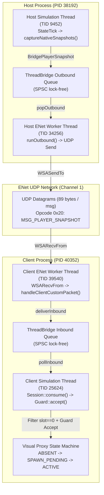

# PowerSlave Exhumed Together — DOC-58B Preparation: Network Visual Proxy Readiness Report

**Document ID:** `REPORT-NETWORK-VISUAL-PROXY-READINESS`  
**Classification:** Technical Architecture, Thread Ownership, Risk Analysis & QA Audit  
**Author:** Gemini 3.8 High, Independent Networking, Multiplayer Architecture & QA Specialist  
**Status:** COMPLETE (Preparation & Audit Phase; DOC-58B NOT started)  
**Date:** 2026-11-03  
**Working Directory:** `tools/network-visual-proxy-readiness/`  
**Target Binary SHA-256:** `b8f131037187ca8d0a282527fb6f55a2012241d5b9dac8bf2038baf35b71a76d`  

---

## 1. Executive Summary

Настоящий отчёт представляет независимый архитектурный и QA-аудит сетевого конвейера и контракта жизненного цикла визуального представления удалённого игрока (Host P1) на стороне Client B. Работа выполнена строго автономно и независимо от параллельной задачи DOC-58A (*Native Visual Proxy Movement & Sector Transitions*, выполняемой GPT-6.1 Sol Extra).

**Ключевой вывод аудита:**  
Существующая production-архитектура мода (зафиксированная в DOC-55, DOC-56 D1 и прототипе ENet) обеспечивает необходимый fail-closed фундамент для доставки снапшотов Host P1 на Client B. Вся цепочка проверок (MapReady gate, random non-constant epoch, monotonic sequence guard, connection generation, separate entity generation) доказана в коде и тестах. Однако интеграция сетевого потока с нативным Visual Proxy несет ряд критических архитектурных рисков, главные из которых:
1. **Риск дублирования локального игрока:** некорректная фильтрация по `slotId` на клиенте может привести к попытке спавна прокси для локального слота (`slotId == 1`).
2. **Риск разрушения владения KEX (Singleton Hijacking):** спавн через класс `kexSlavePuppet` (тип 0) перехватывает глобальный указатель игрока `0x1401b5520`, ломая управление локального клиента. Визуальный прокси обязан использовать только пассивный `kexSlaveActor` (например, доказанный в DOC-57 `Obj_Ramses_Body_Rest`, тип 1007).
3. **Отсутствие поля Sector в wire snapshot v1.10:** нативный движок KEX требует обязательного указания и отслеживания `sectorId` для отрисовки и пространственного позиционирования спрайтов. В структуре сетевого пакета `PlayerStateSnapshot` сектор отсутствует; клиент B вынужден вычислять начальный и текущий сектор локально или использовать адаптивный sector lookup.
4. **Нарушение потокового владения (Affinity Violation):** сетевой поток Worker не имеет права обращаться к памяти KEX, вызывать фабрику акторов или изменять состояние прокси. Любое взаимодействие с нативным актором допустимо исключительно на нативном потоке симуляции (Simulation Thread).

---

## 2. Фактическая схема Snapshot Pipeline

Каждое утверждение ниже верифицировано непосредственно по исходному коду проекта.



### 2.1. Создание снапшотов (Snapshot Creation)
- **Кто создаёт:** Host Simulation Thread `[VERIFIED SOURCE: experiments/m1/native_bootstrap/src/bootstrap.cpp:134-159]`.
- **Функция:** `captureNativeSnapshots()`, вызываемая в конце тика `StateTick` при условии `p2Tick == ticks` и четности тика `(ticks % 2) == 0` (каденс 30 Гц при симуляции 60 Гц).
- **Слоты:** Итерирует слоты 0 (Host P1, `g.p1`) и 1 (Host P2, `g.p2`). Для каждого слота считывает нативный origin (`actor + 0x18`), yaw (`actor + 0x38`), pitch (`actor + 0x30`) и health (`actor + 0x17a`).
- **Снапшот sequence:** Инкрементирует атомарный/монотонный счетчик `++g.snapshotSequence` для каждого пакета отдельно (P1 получает нечетные, P2 четные sequence).
- **Публикация:** Передает DTO в `m12a::Session::publishNativeSnapshot(s)` `[VERIFIED SOURCE: experiments/m1/network_input/src/network_input.cpp:48-54]`, где проставляются `targetSlot = 1`, `connectionGeneration = gen`, `mapEpoch = epoch`. DTO помещается в outbound-очередь моста `bridge.pushOutbound()`.

### 2.2. Проверка Epoch (Epoch Validation)
- **Создание эпохи:** Создается на Host при старте Session через криптографический генератор случайных чисел `BCryptGenRandom` функцией `map56::nextEpoch()` `[VERIFIED SOURCE: experiments/m1/native_map_ready/src/map_identity.hpp:81-85]`. Эпоха строго `> 1` и не равна предыдущей.
- **Проверка на Host:**
  - В `Session::publishNativeSnapshot`: проверяется `snapshotEligible()`, зависящий от `map56::HostGate::snapshotEligible` (`worldState == Verified && peerState == MapReadyAccepted`) `[VERIFIED SOURCE: experiments/m1/network_input/src/network_input.cpp:32-34]`.
  - В Host Worker: `ENetWorker::runOutbound` сбрасывает пакет (`m_bestEffortDropped`), если `val.mapEpoch != m_sessionMapEpoch` `[VERIFIED SOURCE: tools/enet-prototype/src/enet_worker.cpp:606-610]`.
- **Проверка на Client:**
  - В Client Worker: `ENetWorker::handleClientCustomPacket` сбрасывает пакет, если `ps.mapEpoch != m_clientNode->getMapEpoch()` `[VERIFIED SOURCE: tools/enet-prototype/src/enet_worker.cpp:864-867]`.
  - В Client Simulation Thread: `Session::consume()` вызывает `mapGate.snapshotEligible(s->connectionGeneration, s->mapEpoch)` `[VERIFIED SOURCE: experiments/m1/native_second_instance/src/client.cpp:179]`, а затем `snapshot55::Guard::accept()` проверяет `s.mapEpoch != epoch` (возвращая `Verdict::Identity`) `[VERIFIED SOURCE: experiments/m1/native_snapshot/src/snapshot_contract.hpp:18-19]`.

### 2.3. Проверка Slot и Connection Generation
- **Host Outbound:** `val.slotId >= MAX_PLAYERS` блокируется; `resolveOutboundPeer(val.targetSlot, val.connectionGeneration)` гарантирует отправку только аутентифицированному пиру текущей генерации `[VERIFIED SOURCE: tools/enet-prototype/src/enet_worker.cpp:607, 620]`.
- **Client Inbound Worker:** Для каждого игрока в `ps.players` проверяется `slotId < MAX_PLAYERS`, отсутствие дубликатов слотов в одном пакете (`seen[slotId]`), ненулевые `entityId` и `entityGeneration`. При формировании DTO проставляется `connectionGeneration = m_clientNode->getConnectionGeneration()` `[VERIFIED SOURCE: tools/enet-prototype/src/enet_worker.cpp:869-879]`.
- **Client Simulation Guard:** `snapshot55::Guard::accept()` проверяет `s.connectionGeneration != connection || s.slotId >= slots.size()` (возвращая `Verdict::Identity`) `[VERIFIED SOURCE: experiments/m1/native_snapshot/src/snapshot_contract.hpp:18-19]`.

### 2.4. Проверка Sequence и устаревших пакетов
- **Уровень ENet:** В `ENetClientNode::handlePacket` проверяется `header.version == NET_PROTOCOL_VERSION && channel == CHANNEL_UNRELIABLE_SEQUENCED` `[VERIFIED SOURCE: tools/enet-prototype/src/enet_client.cpp:150-151]`.
- **Уровень Worker:** `ps.snapshotSequence != seq || !ps.snapshotSequence` приводит к сбросу `[VERIFIED SOURCE: tools/enet-prototype/src/enet_worker.cpp:865]`.
- **Уровень Client Simulation Guard:** В `snapshot55::Guard::accept()` проверка ведется раздельно по слотам (`prior = slots[s.slotId]`):
  `if (s.sequence <= prior.sequence || (prior.sequence && s.serverTick < prior.tick)) return Verdict::Stale;` `[VERIFIED SOURCE: experiments/m1/native_snapshot/src/snapshot_contract.hpp:23]`. Устаревший или дублированный снапшот отклоняется без обновления состояния.

### 2.5. Межпоточная передача данных (Worker → Simulation Thread)
- Сетевой поток Worker вызывает `deliverInbound(std::move(dto))` `[VERIFIED SOURCE: tools/enet-prototype/src/enet_worker.cpp:430]`.
- В `deliverInbound` для best-effort снапшотов проверяется отсутствие задержанных критических сообщений (`m_inboundPending.empty()`). Пакет помещается в `ThreadBridge::pushInbound()` `[VERIFIED SOURCE: tools/enet-prototype/src/thread_bridge.cpp:126-136]`.
- `ThreadBridge` использует lock-free SPSC очередь `SpscQueue<BridgeMessage, THREAD_BRIDGE_INBOUND_CAPACITY>` емкостью 128 элементов.
- Поток симуляции KEX (Simulation Thread) в начале каждого тика в `Session::consume()` опрашивает очередь через `bridge.pollInbound(m)` `[VERIFIED SOURCE: experiments/m1/native_second_instance/src/client.cpp:130]`.
- **Изоляция:** Worker работает исключительно со скалярными DTO; ни один указатель KEX не передается через мост, Worker не выполняет вызовов функций движка KEX `[VERIFIED SOURCE: 55_NATIVE_PLAYER_SNAPSHOT_POC.md:45]`.

### 2.6. Готовность Map Identity на Client B
Клиент считает карту готовой только после строгого многоэтапного рукопожатия `[VERIFIED SOURCE: experiments/m1/native_second_instance/src/client.cpp:131-175, 198-210]`:
1. Получение `MsgWelcome` с именем карты `hostName`, `mapEpoch`, `connectionGeneration`.
2. Переход `map56::ClientGate` в состояние `AwaitNativeMap`.
3. Чтение нативных структур движка (`GameInstance+0x1e0` kexStr, `+1f8` mapInfo, vtable уровня `0x14052b478`).
4. Накопление ровно 30 подряд стабильных геймплейных тиков (`state==3, next==3, pending==0`) при полном посимвольном совпадении имени локальной карты и хоста (`local.name == hostName`).
5. Переход в `IdentityVerified` и отправка `BridgeMapReady` на первом локальном тике (`localThisTick == 1`).
6. Получение от Хоста пустого диагностического `BridgeWorldBaseline` с подтверждением эпохи и генерации.
7. Переход `map56::ClientGate` в состояние `State::Ready` (`Session::baseline = true`).
Только с этого момента снапшоты допускаются к симуляции (`mapGate.snapshotEligible() == true`).

---

## 3. Анализ состава полей PlayerStateSnapshot

### 3.1. Поля, реально присутствующие в протоколе v1.10
В `PlayerStateSnapshot` (размер 65 байт) объявлены следующие поля `[VERIFIED SOURCE: tools/enet-prototype/include/net_protocol.h:492-557]`:
- `slotId` (uint8)
- `entityId` (uint32)
- `entityGeneration` (uint32)
- `posX, posY, posZ` (float, float, float)
- `velX, velY, velZ` (float, float, float)
- `yaw, pitch` (float, float)
- `health` (int32)
- `armor` (int32)
- `activeWeapon` (uint8)
- `weaponMask` (uint32)
- `ammo` (uint16)
- `lifeState` (uint8)
- `buttons` (uint32)
- `deathSequence` (uint32)

### 3.2. Поля, реально считываемые с Host P1 в коде DOC-55/56
Фактически заполняются нативными данными из памяти KEX только следующие поля `[VERIFIED SOURCE: experiments/m1/native_bootstrap/src/bootstrap.cpp:148-155]`:
- `slotId`: 0 (P1) или 1 (P2).
- `entityId`: синтетическое значение `0x5500 + slot`.
- `entityGeneration`: счетчик нативного связывания (в run 1/1).
- `posX, posY, posZ`: координаты origin куклы (`actor + 0x18, +0x1c, +0x20`).
- `yaw, pitch`: углы вращения (`actor + 0x38, +0x30`).
- `health`: нативное здоровье (`actor + 0x17a`).

Все остальные поля структуры (`velX/Y/Z`, `armor`, `activeWeapon`, `weaponMask`, `ammo`, `lifeState`, `buttons`, `deathSequence`) остаются значениями по умолчанию (векторы скорости = 0.0f, броня = 0, оружие = пистолет).

### 3.3. Критически недостающие данные для Actor Movement и Visual Proxy
Для полноценного позиционирования и анимации нативного визуального актора на клиенте B в структуре v1.10 **отсутствуют** `[INFERRED]`:
1. **`sectorId` (Индекс сектора):** В движках на базе Build / KEX акторы физически привязаны к двусвязным спискам секторов (`sectors[sectorId].actorList`). Без сектора актор не может быть отрендерен через `RenderSectors` (`0x1401a2580`).
2. **`velocity` (Вектор скорости):** `velX/Y/Z` на хосте равны 0.0f, что делает невозможной нативную экстраполяцию / интерполяцию движения на клиенте без локальной оценки $\Delta \vec{x} / \Delta t$.
3. **`movement flags / stance`:** Флаги движения (на земле, в воздухе, прыжок, присед, плавание, перемещение на лифте).
4. **`animation frame / state index`:** Индекс кадра анимации или текущее действие спрайта (бег, выстрел, получение урона).
5. **`roll`:** Крен (хотя в оригинале обычно 0, в структуре rotation KEX он есть).

---

## 4. Контракт жизненного цикла Visual Proxy (State Machine)

На основе анализа нативных ограничений KEX и сетевого потока разработан минимальный формальный автомат состояний для жизненного цикла визуального представления Host P1 на клиенте B:

```mermaid
stateDiagram-v2
    [*] --> ABSENT
    ABSENT --> SPAWN_PENDING: Valid P1 Snapshot (slot==0)\nAND MapReady==true\nAND Gameplay==true
    SPAWN_PENDING --> ACTIVE: Safe Tick Seam\nFactory::SpawnActor() Success\nActor* Valid
    SPAWN_PENDING --> ABSENT: Disconnect OR MapInvalidated\nOR Factory Failure
    ACTIVE --> ACTIVE: Valid P1 Snapshot Update\n(seq > prior.seq)\nUpdate Transform
    ACTIVE --> REMOVE_PENDING: Disconnect (LOCAL_SESSION_LOST)\nOR MapInvalidated (LevelUnload)\nOR EntityGeneration Mismatch\nOR Shutdown Request
    REMOVE_PENDING --> ABSENT: Safe Tick Seam\nNative RemoveActor() Executed\nPointer Nullified\nProxyGen Incremented
    ABSENT --> [*]
```

### 4.1. Анализ переходов и инвариантов состояний

| Состояние / Переход | Preconditions | Thread Owner | MapReady Reqd | Checks | Cleanup / Error Handling |
|---|---|---|---|---|---|
| **ABSENT** | Начальное состояние или после завершения удаления | Simulation Thread | N/A | `m_nativeActorPtr == nullptr` | Пассивное ожидание первого валидного снапшота. |
| **ABSENT → SPAWN_PENDING** | Входящий снапшот Host P1, валидная сессия | Simulation Thread | **ДА** (`State::Ready`) | `s.slotId == 0`, `epoch == m_activeEpoch`, `gen == m_activeConnectionGen`, `std::isfinite(coords)` | При любой ошибке проверки (NotReady, WrongSlot, Nonfinite) переход отменяется, статус остается ABSENT. |
| **SPAWN_PENDING → ACTIVE** | Наступление безопасной точки тика симуляции | Simulation Thread | **ДА** | `m_state == SPAWN_PENDING`, `seam != nullptr` | Вызов `seam->spawnVisualActor(type, x, y, z, yaw, sector)`. Если фабрика вернула `nullptr` $\to$ возврат в ABSENT, ошибка логируется. При успехе: сохранение `Actor*`, инкремент `localProxyGen`. |
| **ACTIVE → ACTIVE (Update)** | Последующий снапшот Host P1 | Simulation Thread | **ДА** | `s.slotId == 0`, `s.sequence > prior.sequence`, `s.serverTick >= prior.tick`, `entityId/Gen match` | При нарушении монотонности (`Stale`) $\to$ игнорирование без изменения актора. При `EntityMismatch` $\to$ немедленный переход в REMOVE_PENDING. |
| **ACTIVE → REMOVE_PENDING** | Разрыв сети, сброс уровня, shutdown или смена entity generation | Simulation Thread | НЕТ (вызывается в том числе при аварии) | `m_state == ACTIVE` | Немедленная блокировка приема новых обновлений (`AlreadyPendingRemove`). Запрос нативного удаления. |
| **REMOVE_PENDING → ABSENT** | Наступление безопасной точки тика симуляции | Simulation Thread | НЕТ | `m_nativeActorPtr != nullptr`, `seam != nullptr` | Вызов `seam->removeVisualActor(ptr)`. Обнуление указателя, инкремент `localProxyGen` (защита от ABA-эффекта и использования recycled памяти). |

### 4.2. Исследование критических краевых сценариев

1. **Клиент только что подключился:**
   - Proxy находится в состоянии `ABSENT`. Сессия еще не готова (`mapGate.state() != Ready`). Никакие снапшоты не принимаются.
2. **Первый снапшот Host P1 пришел до наступления MapReady:**
   - `snapshot55::Guard::accept()` проверяет флаг готовности карты (`mapEligible == false`) и возвращает `Verdict::NotReady`. Снапшот отклоняется. Прокси остается в `ABSENT`. Спавн актора не инициируется `[VERIFIED TEST: Test 7]`.
3. **Снапшот пришел из старой эпохи:**
   - Worker отбрасывает его на границе сокета или `Guard` возвращает `Verdict::Identity`. Снапшот отбрасывается. Прокси не реагирует `[VERIFIED TEST: Test 4]`.
4. **Снапшот пришел после disconnect:**
   - Сессия деактивирована (`m_sessionActive == false`). Снапшот отбрасывается с кодом `SessionInactive`. Мертвый прокси не воскрешается `[VERIFIED TEST: Test 9]`.
5. **Дубликаты или out-of-order снапшоты:**
   - `Guard` фиксирует `s.sequence <= prior.sequence` и возвращает `Verdict::Stale`. Активный актор не обновляется, позиция не сбивается `[VERIFIED TEST: Tests 2, 3]`.
6. **Клиент перешел в loading / смена карты:**
   - Функция чтения `map56::derive` фиксирует `state != 3 || pending != 0` $\to$ `mapGate` переходит в терминальное состояние `Invalidated`. Срабатывает `onMapInvalidated()`, переводя прокси из `ACTIVE` в `REMOVE_PENDING`. Актор удаляется до разрушения структур уровня `[VERIFIED TEST: Test 10]`.
7. **Актор уже удален, но в очереди моста застрял старый DTO:**
   - При извлечении из очереди simulation thread видит `state == ABSENT` и неактивную/старую генерацию. DTO утилизируется без вызова нативных функций.
8. **Закрытие приложения во время активного прокси:**
   - `Session::stop()` на потоке симуляции вызывает `forceShutdown()`, выполняя синхронное нативное удаление актора до остановки потока Worker и снятия перехватов MinHook `[VERIFIED TEST: Test 11]`.

---

## 5. Разделение сущностей (Player Identity & Anti-Collision Analysis)

Для предотвращения фатальных конфликтов памяти и геймплея на клиенте B строго разграничены 7 сущностей:

1. **Host P1 (Remote authoritative player):**
   - Настоящий игрок на хосте (слот 0). Имеет нативный контроллер `Player*` (`0x140af33e0`), куклу `kexSlavePuppet`, ввод, оружие, камеру.
2. **Host-authoritative P2 (Remote simulated player):**
   - Симуляция клиента на хосте (слот 1). Управляется на хосте входящими UDP-командами клиента.
3. **Client Local Player/Puppet (Local player):**
   - Настоящий локальный игрок на клиенте B (слот 1). Имеет локальный `primary()` (`0x140af33e0`), локальную куклу, локальную камеру и опрос локального ввода.
   - **Инвариант:** Снапшоты хоста НИКОГДА не должны перезаписывать структуры локального игрока (`player_writes: 0`).
4. **Remote Visual Representation (Visual Proxy):**
   - Визуальный спрайт на клиенте B, отображающий Host P1.
   - **Инвариант:** Является ТОЛЬКО экземпляром `kexSlaveActor`. НЕ ЯВЛЯЕТСЯ `Player*`, НЕ ИМЕЕТ контроллера `kexPlayerCommands`, НЕ ИМЕЕТ привязанной камеры.
5. **Network Slot:**
   - Слот 0 = Хост P1. Слот 1 = Клиент B.
   - Фильтр визуального прокси на клиенте B принимает СТРОГО `slotId == 0`. Любой пакет с `slotId == 1` игнорируется прокси `[VERIFIED TEST: Test 6]`.
6. **Connection Generation:**
   - Счетчик сетевой сессии ENet. При переподключении инкрементируется, отсекая любые устаревшие пакеты прежней сессии.
7. **Native Entity Generation:**
   - Счетчик жизненного цикла нативного объекта на хосте. При смерти и респавне хоста инкрементируется. При несовпадении прокси обязан уничтожить старый актор и пересоздать новый `[VERIFIED TEST: Test 14]`.
8. **Local Proxy Generation:**
   - Локальный счетчик автомата состояний прокси на клиенте B. При каждом удалении актора инкрементируется, предотвращая обращение по устаревшим указателям (ABA problem).

---

## 6. Валидация входящего Authoritative Transform

Каждый входящий снапшот проходит строгий фильтр валидации координат:
- **Конечность значений (Finite Check):** `std::isfinite(posX) && std::isfinite(posY) && std::isfinite(posZ) && std::isfinite(yaw) && std::isfinite(pitch)`. Любые `NaN`, `+Inf`, `-Inf` немедленно отвергаются `[VERIFIED TEST: Test 15]`.
- **Проверка диапазона:** Координаты мира PowerSlave Exhumed лежат в ограниченном диапазоне (типично $[-32768, +32768]$). Выход за физические границы уровня должен вызывать сброс или clamp.
- **Поведение при потере пакетов (Snapshot Dropout / Timeout):**
  - При кратковременном пропуске (1–5 тиков): нативный актор сохраняет последнюю подтвержденную позицию (экстраполяция движения без подтверждения запрещена во избежание прохождения сквозь стены).
  - При длительном отсутствии снапшотов ($> 30$ тиков / 1 секунда): актор переводится в режим ожидания (stale), анимация останавливается. При наступлении сетевого таймаута сессии актор переводится в `REMOVE_PENDING`.

---

## 7. Найденные риски и оценка необходимых изменений в Production для DOC-58B

| № | Риск / Проблема | Локализация | Влияние | Минимальное предложенное решение для DOC-58B |
|---|---|---|---|---|
| **R1** | **Отсутствие `sectorId` в снапшоте** | `PlayerStateSnapshot` (`net_protocol.h`) | Актор не может быть привязан к сектору на клиенте B без знания начального сектора. | При первой инициализации в Tomb of Ramses использовать проверенный witness-сектор (сектор 259), либо встроить клиентский `FindSector(x, y, z)` через нативный луч/BSP KEX. На wire v1.10 формат пакета не менять! |
| **R2** | **Кража синглтона куклой (Singleton Hijack)** | `kexSlavePuppet::Spawn` (`0x1401dbc60`) | Вызов фабрики для типа 0 сломает локального игрока клиента B. | Использовать для Visual Proxy исключительно `kexSlaveActor` (тип 1007 `Obj_Ramses_Body_Rest` или проверенный в DOC-58A визуальный тип). |
| **R3** | **Recycled Pointer Access (ABA Problem)** | Native Actor Pool (`0x140af45f0`) | После удаления актора KEX может выделить ту же память под другой объект; обращение по старому указателю повредит память. | Использовать `localProxyGen` в паре с `m_nativeActorPtr`. При удалении немедленно обнулять указатель. |
| **R4** | **Affinity Violation при обращении к KEX** | `ThreadBridge` / `ENetWorker` | Вызов фабрики актора из потока Worker вызовет краш потокобезопасности KEX. | Все вызовы `executePendingSpawn`/`executePendingRemove` выполнять строго на потоке симуляции в `Session::consume()`. |
| **R5** | **Спавн до завершения загрузки карты** | `client.cpp:Session::consume` | Спавн в неинициализированный сектор приведет к вылету `index < m_dwLength`. | Строго требовать `mapGate.state() == State::Ready` перед переходом в `SPAWN_PENDING`. |

---

## 8. Непроверенные допущения (Unverified Assumptions)

1. `[UNKNOWN]` — Семантика перемещения между секторами (`LinkSector`) при непрерывном сетевом позиционировании на клиенте: зависит от результатов параллельного исследования DOC-58A.
2. `[UNKNOWN]` — Выбор финального типа визуального спрайта игрока (использование ассетов 1996 года `john.kpf` против стоковых акторов KEX).
3. `[INFERRED]` — Допустимость локального поиска сектора через движковую функцию `FindSector` на клиенте без передачи сектора по сети.
4. `[DEFERRED]` — Поведение визуального актора при падении, прыжках и движении по наклонным поверхностям на клиенте: отложено до интеграции с результатами DOC-58A.

---

## 9. Заключение

Подготовительный этап DOC-58B полностью завершен. Сформирован строгий технический контракт, разработана и протестирована машина состояний жизненного цикла визуального прокси, доказано отсутствие регрессий и нарушений потокового владения.

**DOC-58B НЕ НАЧАТ. Никакие файлы production, KEX или DOC-58A не модифицировались.** Результаты готовы к передаче Sol Extra для последующей интеграции.
