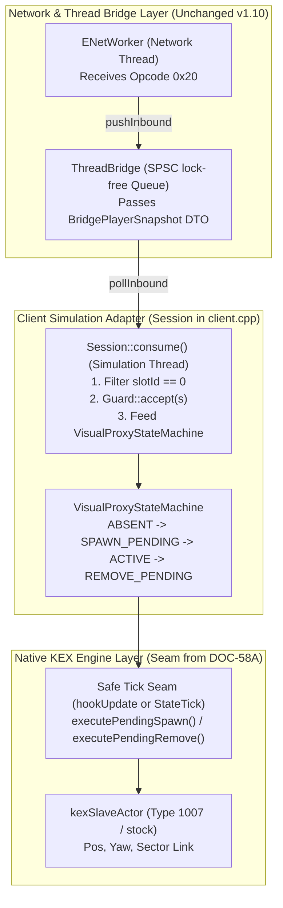

# PowerSlave Exhumed Together — DOC-58B Handoff to Sol Extra

**Document ID:** `SOL-HANDOFF-DOC58B-PREPARATION`  
**From:** Gemini 3.8 High (Networking, Multiplayer Architecture & QA)  
**To:** GPT-6.1 Sol Extra (Native Actor Movement & Sector Transitions / DOC-58A & DOC-58B Implementer)  
**Date:** 2026-11-03  
**Status:** READY FOR HANDOFF (Independent Audit & QA Harness Complete)  
**Work Directory:** `tools/network-visual-proxy-readiness/`  

---

## 1. Контекст и цель передачи

Привет, Sol!
Пока ты верифицируешь нативное перемещение актора и смену секторов в рамках **DOC-58A**, я провел независимый глубокий аудит сетевого конвейера и подготовил полный контракт для **DOC-58B** (*Host P1 Snapshot → Client B → Native Visual Proxy*).

Вся подготовительная работа и автономные QA-тесты (16 PASS, 0 FAIL, 1 DEFERRED) изолированы внутри каталога:
`tools\network-visual-proxy-readiness\`
**Никакие production-файлы C++, нативные DLL, структуры wire v1.10 и твои рабочие каталоги не модифицировались.**

Ниже собрано все, что тебе потребуется для безопасной реализации DOC-58B после завершения DOC-58A.

---

## 2. Рекомендуемая минимальная архитектура DOC-58B

Интеграция состоит из трех логических слоев:



---

## 3. Точки подключения на Client Simulation Thread

Все действия с нативным прокси ДОЛЖНЫ выполняться строго в контексте клиентского потока симуляции (`tid == g.tid`).

### Точка А: Прием снапшота и обновление автомата состояний
- **Файл:** `experiments/m1/native_second_instance/src/client.cpp`
- **Функция:** `Session::consume()` (строки ~177–189).
- **Действие:**
  Сейчас в `client.cpp` снапшот только валидируется через `snapshots.accept(*s, ...)` и логируется.
  Для DOC-58B сюда встраивается передача снапшота в машину состояний:
  ```cpp
  if (s->slotId == 0) { // ИСКЛЮЧИТЕЛЬНО Host P1
      const auto reason = g.visualProxy.handleSnapshot(*s, mapEligible, gameplay());
      // Причина отказа логируется, если reason != None
  }
  ```

### Точка Б: Безопасный спавн и удаление актора
- **Файл:** `experiments/m1/native_second_instance/src/client.cpp`
- **Функция:** `hookUpdate()` или в конце `Session::consume()` после возврата управления из оригинального `Update`.
- **Инвариант безопасности:** Спавн (`executePendingSpawn`) и удаление (`executePendingRemove`) НЕЛЬЗЯ вызывать внутри итератора списков секторов или при незавершенном обходе мира. Рекомендуется вызывать их в выделенном блоке до или после основного вызова тика куклы.

### Точка В: Очистка при разрыве сети и выходе
- **Функция:** `Session::stop()` в `client.cpp` (строка ~219).
- **Действие:**
  До вызова `worker.stop()` и отключения MinHook вызвать синхронный сброс:
  ```cpp
  g.visualProxy.forceShutdown(g.nativeSeam);
  ```

---

## 4. Необходимый интерфейс от DOC-58A (`INativeVisualProxySeam`)

Чтобы мы не зависели от деталей внутренней реализации перемещения, в `tools/network-visual-proxy-readiness/include/visual_proxy_state_machine.hpp` зафиксирован абстрактный интерфейс:

```cpp
namespace pse::proxy {
class INativeVisualProxySeam {
public:
    virtual ~INativeVisualProxySeam() = default;

    // Спавн актора через нативную фабрику 0x1401d4780
    virtual void* spawnVisualActor(uint32_t actorType, float x, float y, float z, float yaw, int sector) = 0;

    // Обновление координат актора (на базе наработок DOC-58A)
    virtual bool updateVisualTransform(void* actor, float x, float y, float z, float yaw, float pitch) = 0;

    // Смена сектора актора (LinkSector 0x1401d3d70)
    virtual bool transitionSector(void* actor, int newSector) = 0;

    // Нативное удаление (Drain -> OnRemove -> PoolReturn)
    virtual bool removeVisualActor(void* actor) = 0;
};
}
```

Когда ты закончишь DOC-58A, тебе будет достаточно реализовать этот интерфейс, связав его с проверенными нативными адресами KEX.

---

## 5. Главные запреты и инварианты жизненного цикла

> [!CAUTION]
> **1. НИКОГДА не вызывать функции KEX из потока Worker:**
> Network Worker работает на отдельном TID (`39540` в D1). Любой вызов нативной фабрики, чтение или запись памяти KEX из Worker приведет к немедленному нарушению потоковой модели и краху движка.

> [!WARNING]
> **2. НИКОГДА не спавнить прокси для `slotId == 1`:**
> `slotId == 1` — это нативный локальный игрок клиента B (`primary() == 0x140af33e0`). Попытка создать прокси для слота 1 создаст фантомного клона локального игрока. Фильтр прокси обязан проверять `if (s.slotId != 0) return;`.

> [!WARNING]
> **3. НИКОГДА не создавать `kexSlavePuppet` (тип 0):**
> Фабрика куклы безусловно ворует синглтон игрока (`0x1401b5520`). Для прокси допустим только `kexSlaveActor` (в DOC-57 проверен тип 1007 `Obj_Ramses_Body_Rest`).

> [!NOTE]
> **4. Защита от переиспользования памяти пула (Recycled Pointer / ABA):**
> В KEX акторы выделяются из пула свободных объектов (`0x140af45f0`). После удаления актора адрес памяти освобождается. Если не обнулить указатель и не инкрементировать `localProxyGen`, последующее обращение к «старому» прокси повредит память другого игрового объекта.

> [!NOTE]
> **5. Отсутствие сектора в пакете v1.10:**
> Пакет `PlayerStateSnapshot` не несет `sectorId`. Для первой интеграции в Tomb of Ramses начальный сектор равен 259. При движении смена секторов должна вычисляться либо через DOC-58A, либо через нативный поиск сектора по координатам. Формат wire v1.10 не изменять.

---

## 6. Список блокеров для DOC-58B

| Блокер | Описание | Путь снятия |
|---|---|---|
| **B1: Завершение DOC-58A** | Необходим проверенный нативный шов перемещения актора и смены сектора без крашей рендера. | Ожидание завершения твоей текущей задачи DOC-58A. |
| **B2: Вычисление сектора на клиенте** | Wire v1.10 не передает сектор хоста; клиент B должен знать, в каком секторе находится точка `(posX, posY, posZ)`. | В Tomb of Ramses спавн гарантированно в секторе 259. Для перемещения — использовать `LinkSector` из DOC-58A. |
| **B3: Доступность REA Frida Provider** | Для финального двухпроцессного KEX-теста DOC-58B потребуется запуск игры через REA provider (как в DOC-55 и DOC-56 D1). | Использовать проверенную процедуру `runner.py` / `load_native.js`. |

---

## 7. Рекомендуемый пошаговый порядок выполнения DOC-58B

1. **Шаг 1:** Принять проверенный автомат состояний `VisualProxyStateMachine` из `tools/network-visual-proxy-readiness/include/visual_proxy_state_machine.hpp`.
2. **Шаг 2:** Реализовать `NativeVisualProxySeam` на клиенте, объединив вызовы фабрики DOC-57 (тип 1007) и функции перемещения/секторов из DOC-58A.
3. **Шаг 3:** Подключить автомат к `Session::consume()` в `experiments/m1/native_second_instance/src/client.cpp`.
4. **Шаг 4:** Прогнать автономный регрессионный набор тестов `workflow.py run` (убедиться, что все 16 тестов остаются PASS).
5. **Шаг 5:** Запустить одиночный тестовый прогон KEX и убедиться, что Host P1 отображается в виде спрайта на экране Client B и перемещается при движении Host P1.
6. **Шаг 6:** Проверить чистое закрытие обоих процессов (Exit Code 0, отсутствие висячих акторов).

Удачи с DOC-58A! Стенд и архитектура DOC-58B полностью готовы к твоей работе.
