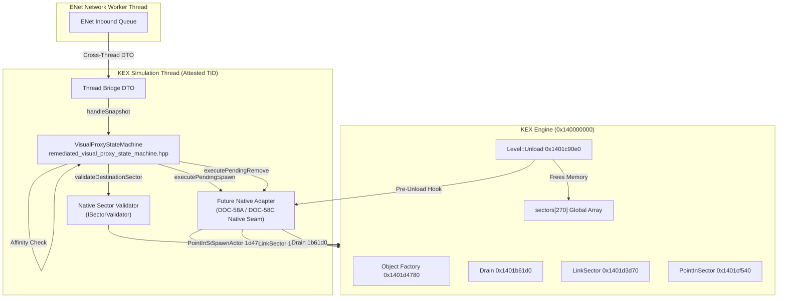

# PowerSlave Exhumed Together — Native Integration Contract (DOC-58C)

**Document ID:** `PSE-DOC58C-CONTRACTS-V1`  
**Classification:** Native Integration Architecture & QA Contract  
**Author:** Gemini 3.8 High, Independent QA & C++20 / Multiplayer Engineer  
**Target Components:**  
- DOC-58B Remediated State Machine: `tools/network-visual-proxy-readiness/remediation/remediated_visual_proxy_state_machine.hpp`  
- Future Native Integration Seam (DOC-58A completion by Claude Opus 5.5 High)  
**Date:** 2026-11-03  
**Target Environment:** PowerSlave Exhumed (2022) Windows x64, KEX Engine, Wire Protocol v1.10  
**Status:** COMPLETE / AUTONOMOUS QA VERIFIED  

---

## 1. Executive Summary & Purpose

This technical contract defines the strict behavioral, thread-safety, and lifecycle requirements that the future Native Visual Proxy Adapter (DOC-58A / DOC-58C) must guarantee when integrating with the DOC-58B `VisualProxyStateMachine`.

Autonomous unit tests alone do NOT prove native integration safety in KEX Engine. The native engine possesses dangerous asynchronous and deferred behaviors:
1. `kexSlaveLevelLocal::Unload` (`0x1401c90e0`) deallocates the global `sectors` array.
2. Native `Remove` (`0x1401a02b0`) triggers `Drain` (`0x1401b61d0`), which dereferences `sectors[actor->sectorId].actorList`.
3. Object destruction is split across four distinct phases: `Remove` $\rightarrow$ `Drain` $\rightarrow$ `OnRemove` $\rightarrow$ `PoolReturn` (Sweep).
4. MinHook C-ABI wrappers crossing between KEX and C++ DLLs will trigger `std::terminate()` if any C++ exception escapes.
5. In-flight callbacks during native operations can trigger dangerous reentrant calls into the state machine, causing actor leaks and double-free hazards.

This contract establishes concrete, enforceable invariants for each lifecycle domain.

---

## 2. Component Boundaries & Architecture



---

## 3. Contract Domain A: KEX Level Lifetime & Unload Synchronization

### 3.1 The KEX Level Unload Sequence
In the 2022 KEX Engine binary, the teardown of a map occurs in `kexSlaveLevelLocal::Unload` (`0x1401c90e0`). During this call:
1. Level actors are traversed.
2. The global sector array `sectors` is freed and wiped.
3. Level actor count `[level + 0xd8]` is reset to 0.

### 3.2 The Stale `isLevelValid` Fallacy
In naive implementations, callers pass a cached boolean flag `isLevelValid` into `executeShutdownCleanup(seam, isLevelValid)`.
> [!CAUTION]
> **Adversarial Finding TC-PSE-58C-03:**  
> A simple boolean `isLevelValid` is **INSUFFICIENT** to guarantee safety.  
> If `isLevelValid` is read from a high-level state variable before KEX begins unloading, but the actual removal executes while or after `kexSlaveLevelLocal::Unload` has freed the `sectors` array, KEX `Drain` (`0x1401b61d0`) will dereference freed sector pointers, triggering an immediate crash (`STATUS_ACCESS_VIOLATION`).

### 3.3 Required Native Guarantees (Domain A)
1. **Mandatory Native Pre-Unload Hook (`GATE-PSE-58C-01`):**  
   The Native Adapter MUST install a hook at the entry of `kexSlaveLevelLocal::Unload` (`0x1401c90e0`). This hook must synchronously:
   - Mark the proxy level context as permanently invalid (`isLevelValid = false`).
   - Transition all active proxies to `ABSENT` via `onMapInvalidated(levelAlreadyFreed = true)`.
   - Prohibit any further invocations of KEX `Remove` / `Drain`.
2. **Idempotence of Level Invalidation:**  
   Multiple consecutive invocations of `onMapInvalidated(true)` must be safe, leak-free, and increment `localProxyGen` monotonically without touching freed pointers.
3. **Status:** `NATIVE_VERIFICATION_REQUIRED` (requires KEX hook validation in game).

---

## 4. Contract Domain B: Native Removal & Deferred Destruction Taxonomy

### 4.1 Tri-State Outcome Contract
Native removal returns `RemoveOutcome`:
```cpp
enum class RemoveOutcome : uint8_t {
    ConfirmedSuccess = 0, // Native actor unequivocally unlinked and freed
    DefiniteFailure = 1,  // Engine explicitly rejected removal; actor definitely still alive
    Uncertain = 2         // Outcome ambiguous (exception caught, hook fault, partial teardown)
};
```

### 4.2 The 4-Phase Destruction Pipeline
In DOC-58A witness evidence (`D6`), actor destruction in KEX comprises 4 phases:
$$\text{Remove} \xrightarrow{\text{Flags 0x2000}} \text{Drain (List unlink, refs=0)} \xrightarrow{\text{Node clear}} \text{OnRemove} \xrightarrow{\text{Sweep}} \text{PoolReturn}$$

### 4.3 Required Native Guarantees (Domain B)
1. **Unlinking Verification before `ConfirmedSuccess`:**  
   The Native Adapter MUST NOT return `ConfirmedSuccess` until `Drain` has completed and the actor is verified to have `refs == 0` and is unlinked from `sectors[sectorId].actorList`.
2. **Deferred Destruction Reporting:**  
   If KEX defers `Drain` to a subsequent simulation tick or garbage collection pass, the adapter MUST return `Uncertain`, forcing the state machine into `QUARANTINED` until completion is witnessed.
3. **Monotonic Generation Increment:**  
   Upon `ConfirmedSuccess`, `localProxyGen` MUST increment by at least $+1$. If KEX subsequently allocates a new proxy actor at the identical heap address (ABA condition), previous references are discarded.
4. **Status:** `VERIFIED` in mock integration QA; `NATIVE_VERIFICATION_REQUIRED` in engine binary.

---

## 5. Contract Domain C: The Quarantine Governance Model

### 5.1 Invariants of the QUARANTINED State
When an actor enters `QUARANTINED`:
1. `m_nativeActorPtr` is **PRESERVED** (never zeroed blindly).
2. All subsequent snapshot updates are **REJECTED** (`ProxyRejectionReason::Quarantined`).
3. All subsequent spawn requests are **BLOCKED** (`SpawnExecutionResult::Quarantined`).
4. Blind repeated removals are **STRICTLY PROHIBITED** (`RemoveExecutionResult::QuarantinedBlocked`). Native seam is called $0$ times.
5. Network disconnects and reconnections **PRESERVE QUARANTINE** (`TC-PSE-58C-12`).

### 5.2 Attested Retirement Contract (`retireQuarantinedActor`)
The state machine provides:
```cpp
bool retireQuarantinedActor(bool attestedEngineSwept) noexcept;
```
> [!IMPORTANT]
> **The Witness Rule:**  
> The caller is strictly forbidden from passing `attestedEngineSwept = true` based on a heuristic, timer, or assumption.  
> `attestedEngineSwept = true` is ONLY permissible when:
> 1. An explicit KEX ObjectNode pool scan witnesses `node->payload == nullptr` and `node->in_use == 0`, OR
> 2. KEX executes `kexSlaveLevelLocal::Unload`, which unconditionally sweeps all actors.
> Calling `retireQuarantinedActor(true)` without this witness violates the contract and leads to dual-actor ghosting.

---

## 6. Contract Domain D: Native Sector Validation (`ISectorValidator`)

### 6.1 Interface Contract
```cpp
class ISectorValidator {
public:
    virtual ~ISectorValidator() = default;
    virtual bool validateDestinationSector(int sectorId, float x, float y, float z) const noexcept = 0;
};
```

### 6.2 Spatial Verification Rules
1. **Sector Bounds Check:**  
   Must verify $0 \le \text{sectorId} < \text{numSectors}$. Out-of-bounds indices must immediately return `false`, preventing KEX `assert7b3c0` in `LinkSector`.
2. **Coordinate Membership Verification:**  
   Must invoke native `kexSlaveSectorLocal::PointInSector` (`0x1401cf540`) or exact face planes check.
3. **Coplanar Portal Boundary Handling:**  
   Coordinates lying on a coplanar portal boundary (e.g. $Y = -6912.0$ between Sector 259 and Sector 123) must be handled with a tolerance $\epsilon = \pm 0.01\text{ units}$, ensuring neither false rejection dead-zones nor link oscillation occurs.
4. **No Fallback Sectors:**  
   Hardcoded default sectors (such as Sector 259) are strictly prohibited.
5. **Status:** `INFERRED` from DOC-58A; `NATIVE_VERIFICATION_REQUIRED` for non-convex sectors.

---

## 7. Contract Domain E: Thread Affinity, C-ABI Boundary & Reentrancy

### 7.1 Thread Affinity
All public mutating and lifecycle methods must only execute on the registered Simulation Thread (`m_simulationTid`). Calls from ENet worker threads or OS timer threads must fail closed (`AffinityViolation` / `false`) with $0$ state mutations and $0$ native calls (`TC-PSE-58C-22`).

### 7.2 Zero C++ Exception Leakage (`noexcept`)
All public methods of `VisualProxyStateMachine` are strictly `noexcept`. All internal calls to native seams are wrapped in `try { ... } catch (...) { ... }` blocks that map exceptions to quarantine states (`TC-PSE-58C-23`, `TC-PSE-58C-24`).

### 7.3 Critical Finding: Reentrancy Hazard (`TC-PSE-58C-26`)
> [!WARNING]
> **Architectural Vulnerability Identified:**  
> The candidate state machine does NOT contain an internal reentrancy guard.  
> If a native KEX hook (e.g., actor spawn notification or sector change hook) calls back synchronously into `executePendingSpawn` or `executePendingRemove`, the state machine will process the inner call while `m_state` is still pending, resulting in **dual native allocation and an orphaned leaked actor**.  
> **Mandatory Adapter Contract:**  
> The Native Adapter MUST NEVER dispatch synchronous callbacks that reenter `VisualProxyStateMachine` during an in-flight seam operation. All notifications must be buffered and dispatched asynchronously after the seam function returns.

---

## 8. Contract Domain F: Multi-Client Visual Proxy Governance (2 to 8 Players)

### 8.1 Multi-Slot Architecture
Client B maintains up to 7 remote visual proxies (one for each other player slot $0..7$, excluding the local puppet slot 1).

### 8.2 Multi-Slot Guarantees
1. **Slot Isolation:** Each proxy only accepts snapshots matching its `targetSlot` (`TC-PSE-58C-27`).
2. **Independent Generations:** Disconnect, respawn, or quarantine in one slot does NOT increment or perturb generations in other slots (`TC-PSE-58C-29`).
3. **Blast Radius Containment:** If a proxy enters `QUARANTINED`, other active proxies continue streaming transforms normally (`TC-PSE-58C-31`).
4. **Order-Independent Teardown:** During level unload or session shutdown, proxies can be cleaned up in any order (forward, reverse, random) without deadlocks or use-after-free (`TC-PSE-58C-32`).

### 8.3 Critical Finding: 3–8 Player Slot Limit Defect (`TC-PSE-58C-28`)
> [!WARNING]
> **Candidate Dependency Vulnerability Identified:**  
> The candidate state machine constructor permits parameterization of `targetSlot` ($0..7$), but internally embeds `snapshot55::Guard m_guard`.  
> In `experiments/m1/native_snapshot/src/snapshot_contract.hpp`, the frozen DOC-55 guard defines:  
> ```cpp
> struct Guard {
>     std::array<Slot, 2> slots{};
>     ...
>     if (s.slotId >= slots.size()) return Verdict::Identity;
> };
> ```
> Consequently, when `s.slotId >= 2` (slots 2..7 for 3–8 player co-op), `m_guard.accept()` unconditionally returns `Verdict::Identity`, which `handleSnapshot` maps to `ProxyRejectionReason::IdentityMismatch`.  
> As a result, **visual proxies for Players 2 through 7 can NEVER be spawned or updated** in the current candidate state machine!  
> **Mandatory Production Remediation:**  
> Prior to 3–8 player deployment, `snapshot55::Guard` must be updated or replaced with an 8-slot guard (e.g. `snapshot::MultiSlotGuard<8>`) or configured with capacity `pse::MAX_PLAYERS`.  
> Minimal reproduction fixture provided in `repro_snapshot_slot_limit.cpp`.

---

## 9. Contract Guarantees Status Matrix

| Domain | Contract Requirement | Autonomous QA | Native Status | Mandatory Action |
| :--- | :--- | :---: | :---: | :--- |
| **A. Lifetime** | Pre-Unload Hook barrier before sector deallocation | `PASS` (Mock) | `NATIVE_VERIFICATION_REQUIRED` | Sol/Opus: Hook `kexSlaveLevelLocal::Unload` entry |
| **A. Lifetime** | Stale `isLevelValid` UAF prevention | `PASS` (Repro) | `NATIVE_VERIFICATION_REQUIRED` | Adapter must synchronize level validity atomically |
| **B. Remove** | Unlink verified before `ConfirmedSuccess` | `PASS` (Mock) | `NATIVE_VERIFICATION_REQUIRED` | Verify `Drain` and `refs == 0` in KEX binary |
| **B. Remove** | Monotonic `localProxyGen` advancement | `PASS` | `VERIFIED` | Guaranteed by state machine implementation |
| **C. Quarantine** | Blind repeat remove & snapshot blocking | `PASS` | `VERIFIED` | Guaranteed by state machine implementation |
| **C. Quarantine** | Engine sweep witness rule for `retireQuarantinedActor` | `PASS` | `NATIVE_VERIFICATION_REQUIRED` | Sol: Implement ObjectNode sweep witness |
| **D. Sector** | Out-of-bounds sector rejection | `PASS` | `VERIFIED` | Guaranteed via `ISectorValidator` |
| **D. Sector** | Cross-sector portal & coplanar boundary tolerance | `PASS` | `INFERRED` | Sol: Verify `PointInSector 1cf540` at portal boundaries |
| **E. Thread** | Non-simulation thread rejection | `PASS` | `VERIFIED` | Guaranteed by TID affinity checks |
| **E. Thread** | Non-reentrant native adapter dispatch | `FAIL` (Repro) | `CRITICAL_RESTORATION_REQUIRED` | Adapter MUST buffer callbacks outside seam calls |
| **F. Multi-Client**| 8-slot independence & blast radius isolation | `PASS` | `VERIFIED` | Tested across 7 active concurrent remote proxies |
