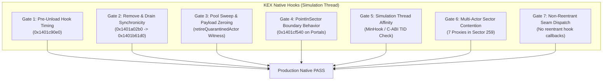

# PowerSlave Exhumed Together — Native Verification Gates (DOC-58C)

**Document ID:** `PSE-DOC58C-GATES-V1`  
**Classification:** Native KEX Verification Requirements & Engineering Gates  
**Author:** Gemini 3.8 High, Independent QA & C++20 / Multiplayer Engineer  
**Target Binary:** PowerSlave Exhumed (2022) Windows x64 (`b8f131037187ca8d0a282527fb6f55a2012241d5b9dac8bf2038baf35b71a76d`)  
**Assigned To:** GPT-6.1 Sol Extra (REA / Frida Dynamic Verification) & Claude Opus 5.5 High (DOC-58A Integrator)  
**Date:** 2026-11-03  

---

## 1. Overview & Objective

Autonomous unit and mock contract tests verify logical state transitions, fail-closed defenses, and interface invariants. However, **mock tests cannot prove the timing, memory management, or concurrency guarantees of the closed-source KEX Engine**.

This document defines the **7 Mandatory Native Verification Gates** that must be experimentally verified in the live game binary (using Frida / REA) before DOC-58B `VisualProxyStateMachine` can be deployed to production.

---

## 2. Inventory of Native Verification Gates

---

### Gate 1: `GATE-PSE-58C-01` — Level Unload Hook Interception Timing
- **Target Function:** `kexSlaveLevelLocal::Unload` (RVA `0x1401c90e0`, slot `52b478+28`)
- **Vulnerability:** If native `Remove` or `Drain` runs after `Unload` deallocates the global `sectors` array, KEX crashes with `STATUS_ACCESS_VIOLATION` (`TC-PSE-58C-03`).
- **Required Verification:**
  1. Install an entry hook on `0x1401c90e0`.
  2. Prove that at hook entry, `sectors` array memory is still valid.
  3. Prove that the hook can synchronously invoke `VisualProxyStateMachine::onMapInvalidated(levelAlreadyFreed = true)` to zero all active actor pointers *before* KEX frees the sector structures.
  4. Status: `NATIVE_VERIFICATION_REQUIRED`.

### Gate 2: `GATE-PSE-58C-02` — KEX `Remove` & `Drain` Synchronicity
- **Target Function:** Native Remove `0x1401a02b0` $\rightarrow$ `Drain` `0x1401b61d0`
- **Question:** Does KEX synchronously unlink the actor from `sectors[sectorId].actorList` during `Remove`, or is unlinking deferred?
- **Required Verification:**
  1. Inspect `sectors[actor->sectorId].actorList` immediately after `NativeLifecycle_Remove(actor)` returns.
  2. Witness that `actorList` count decreases by 1 and the actor pointer is absent.
  3. If unlinking is synchronous, the adapter may return `ConfirmedSuccess`.
  4. If unlinking is deferred to a sweep, the adapter MUST return `Uncertain` or defer completion until the unlinking pass completes.
  5. Status: `INFERRED` synchronous from DOC-58A witness D6; requires live hook proof.

### Gate 3: `GATE-PSE-58C-03` — Actor Node Pool Sweep Witness (`retireQuarantinedActor`)
- **Target Component:** KEX ObjectNode Pool & Sweep
- **Question:** How does the adapter witness that a quarantined actor has been reclaimed by the engine to safely call `retireQuarantinedActor(true)`?
- **Required Verification:**
  1. Locate the KEX ObjectNode pool entry corresponding to the quarantined actor.
  2. Verify that upon engine sweep, `node->payload == nullptr`, `node->refs == 0`, and `node->in_use == 0`.
  3. The native adapter must expose an attested sweep callback `onActorNodeSwept(void* actor)` to trigger `retireQuarantinedActor(true)`. Blind timers are forbidden (`TC-PSE-58C-15`).
  4. Status: `NATIVE_VERIFICATION_REQUIRED`.

### Gate 4: `GATE-PSE-58C-04` — `PointInSector` Portal Coplanar Boundary Behavior
- **Target Function:** `kexSlaveSectorLocal::PointInSector` (RVA `0x1401cf540`)
- **Question:** When an actor is exactly on a portal plane (e.g. $Y = -6912.0$ between Sectors 259 and 123), does `1cf540` return `true` for both sectors, neither, or strictly one?
- **Required Verification:**
  1. Invoke `1cf540` at $Y = -6912.000$ for Sector 259 and Sector 123.
  2. Confirm that boundary tolerance ($\epsilon$) prevents rejection dead zones where neither sector accepts the coordinates (`TC-PSE-58C-20`).
  3. Status: `NATIVE_VERIFICATION_REQUIRED`.

### Gate 5: `GATE-PSE-58C-05` — Simulation Thread Hook Affinity
- **Target Component:** MinHook Hooks on KEX Engine
- **Question:** Are all KEX lifecycle callbacks (`StateTick.onLeave`, `SpawnActor`, `LinkSector`, `Remove`, `Unload`) guaranteed to execute strictly on the attested Simulation TID?
- **Required Verification:**
  1. In Frida/REA, record `GetCurrentThreadId()` across 1,000 consecutive simulation ticks and level unloads.
  2. Witness $0$ thread ID mismatches between tick, render submission, and level lifecycle.
  3. Status: `VERIFIED` in DOC-58A for single client; requires verification during level transitions.

### Gate 6: `GATE-PSE-58C-06` — Multi-Actor Sector List Contention (2 to 8 Players)
- **Target Component:** `sectors[sectorId].actorList` doubly-linked list
- **Question:** What occurs when 7 remote visual proxy actors reside simultaneously in the same sector (e.g. all 8 players in Ramses Spawn Sector 259)?
- **Required Verification:**
  1. Spawn 7 proxy actors into Sector 259.
  2. Verify list walker stability: node links `[prev+8]=next`, `[next]=prev` during rapid teleports, yaw updates, and concurrent removes.
  3. Witness that no pointer corruption occurs under multi-actor load.
  4. Status: `NATIVE_VERIFICATION_REQUIRED`.

### Gate 7: `GATE-PSE-58C-07` — Reentrancy Isolation Assurance
- **Target Component:** Native Adapter Dispatch Pipeline
- **Vulnerability:** Discovered in `TC-PSE-58C-26` and `repro_reentrancy_hazard.exe`.
- **Required Verification:**
  1. Verify that neither KEX internal hooks nor the native adapter dispatch synchronous notifications that reenter `VisualProxyStateMachine` during an in-flight `spawnVisualActor` or `removeVisualActorEx` call.
  2. Confirm all event dispatches are queued and fired outside active seam calls.
  3. Status: `CRITICAL_RESTORATION_REQUIRED`.

---

## 3. Verification Protocol for Sol & Opus

| Step | Action | Tooling | Target Gate |
| :---: | :--- | :--- | :---: |
| **S1** | Hook `0x1401c90e0` (`Level::Unload`) entry and verify sector array validity | Frida / REA | Gate 1 |
| **S2** | Execute `Remove` on stock Ramses proxy and inspect `sector.actorList` synchronously | Frida probe | Gate 2 |
| **S3** | Monitor ObjectNode pool sweep timing across simulation steps | Memory probe | Gate 3 |
| **S4** | Evaluate native `1cf540` at $Y = -6912.0$ with varying epsilons | Frida script | Gate 4 |
| **S5** | Spawn 7 proxies in Sector 259 and record FPS / list integrity over 500 ticks | REA session | Gate 6 |
| **S6** | Audit hook call graph to confirm 100% non-reentrant dispatch | Static / Dynamic | Gate 7 |
