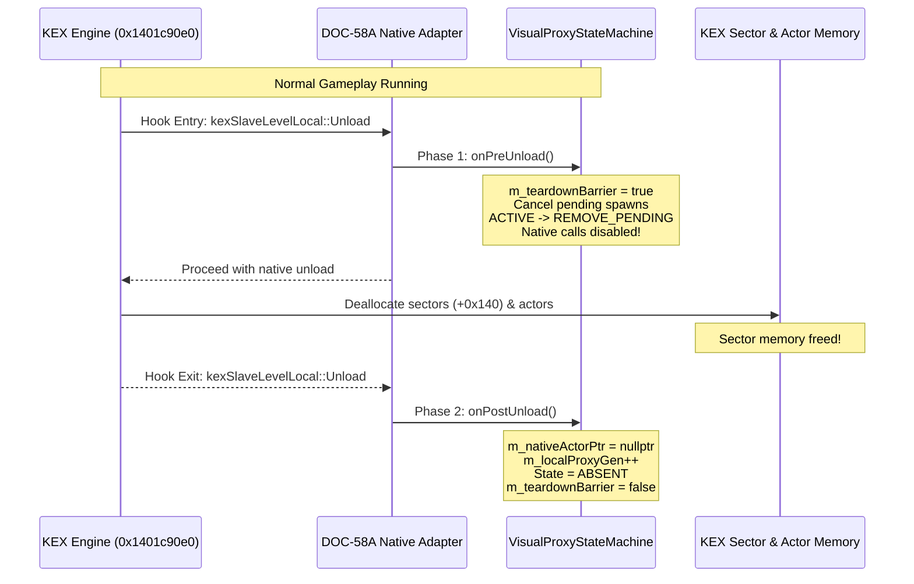

# PowerSlave Exhumed Together — KEX Level Lifetime Contract Review & Native Teardown Gate

**Document ID:** `PSE-DOC-58D-KEX-LIFETIME-REVIEW`  
**Date:** 2026-11-03  
**Target Function:** `kexSlaveLevelLocal::Unload` (`0x1401c90e0`)  
**Target EXE SHA-256:** `b8f131037187ca8d0a282527fb6f55a2012241d5b9dac8bf2038baf35b71a76d`  
**Status:** `NATIVE_VERIFICATION_REQUIRED`  
**Assigned Roles:** GPT-6.1 Sol Extra (REA / Frida Dynamic Tracing), Claude Opus 5.5 High (DOC-58A Native Adapter)

---

## 1. Problem Statement & The `TC-PSE-58C-03` UAF Hazard

In multiplayer co-op sessions, map transitions and level unloads represent the most catastrophic failure domain.
In DOC-58C, scenario `TC-PSE-58C-03` demonstrated an adversarial race condition:
If a native adapter relies on a boolean flag `isLevelValid`, and that flag remains `true` (or is evaluated prior to sector deallocation but acted upon after sector deallocation), calling the native `Remove` seam (`kexActor::Destroy` / `RemoveVisualActor`) accesses deallocated sector arrays (`kexWldSectorLocal`), triggering a critical **Use-After-Free (UAF) / Access Violation (`0xC0000005`)**.

### TOCTOU Vulnerability of Boolean Flags
A single boolean `bool isLevelValid` is inherently vulnerable to Time-Of-Check to Time-Of-Use (TOCTOU) races:
1. Adapter checks `isLevelValid == true`.
2. KEX engine enters `kexSlaveLevelLocal::Unload` and frees sector memory at offset `+0x140`.
3. Adapter invokes `executeShutdownCleanup(&seam, isLevelValid)`.
4. State machine calls `seam->removeVisualActorEx(ptr)`.
5. Native hook attempts to unlink the actor from its sector list.
6. **Fatal Crash:** Sector pointer is a dangling pointer to deallocated heap.

---

## 2. DOC-58D Two-Phase Teardown Architectural Contract

To eliminate the TOCTOU window and guarantee memory safety across all possible level transition timings, DOC-58D introduces a formal **Two-Phase Teardown Contract** into [`hardened_visual_proxy_state_machine.hpp`](file:///S:/_Vibe_Coding/PowerSlave_Exhumed_Together/PowerSlave_Exhumed_Together_mod/tools/network-visual-proxy-readiness/doc58d-hardening/hardened_visual_proxy_state_machine.hpp):



### Phase 1: Pre-Unload Teardown Barrier (`onPreUnload()`)
- **Hook Point:** Entry of `kexSlaveLevelLocal::Unload` (`0x1401c90e0`), **strictly before** any sector memory is freed.
- **State Machine Actions:**
  ```cpp
  void onPreUnload() noexcept {
      if (!isSimulationThread()) return;
      m_teardownBarrier = true;
      if (m_state == VisualProxyState::SPAWN_PENDING) {
          m_state = VisualProxyState::ABSENT;
      } else if (m_state == VisualProxyState::ACTIVE) {
          m_state = VisualProxyState::REMOVE_PENDING;
      }
  }
  ```
- **Invariants Enforced:**
  - `m_teardownBarrier == true` causes all incoming snapshots to be rejected with `ProxyRejectionReason::LevelUnloading`.
  - `executePendingSpawn` immediately rejects with `SpawnExecutionResult::LevelUnloading`.
  - `executePendingRemove` and `executeShutdownCleanup` detect `m_teardownBarrier == true`, skip calling native `seam->removeVisualActorEx()`, and return `RemoveExecutionResult::LevelInvalidSkipped`.
  - No native pointer dereferences can occur after Phase 1 triggers.

### Phase 2: Post-Unload Reset (`onPostUnload()`)
- **Hook Point:** Exit of `kexSlaveLevelLocal::Unload` (`0x1401c90e0`), after all KEX engine teardown is complete.
- **State Machine Actions:**
  ```cpp
  void onPostUnload() noexcept {
      if (!isSimulationThread()) return;
      m_nativeActorPtr = nullptr;
      m_state = VisualProxyState::ABSENT;
      m_quarantineReason = QuarantineReason::None;
      m_teardownBarrier = false;
      m_localProxyGen++;
      m_guard.resetAll();
  }
  ```
- **Invariants Enforced:**
  - Native actor pointer is guaranteed `nullptr`.
  - Generation is incremented to prevent ABA pointer reuse.
  - MultiSlotGuard is completely cleared.
  - State machine returns to a pristine `ABSENT` state ready for the next level load.

---

## 3. Why Autonomous QA Cannot Certify Native Safety

Autonomous mock environments test the logic flow of the state machine, but they **cannot verify the physical memory layout and hook timing of the closed-source KEX engine binary**. Specifically:

1. **Physical Hook Target:**
   Is `0x1401c90e0` truly the sole entry point for level unload in all game modes (e.g. death, level transition, main menu exit, host disconnect)?
2. **Internal Sector Free Sequencing:**
   Does `kexSlaveLevelLocal::Unload` invoke intermediate virtual callbacks or destructor chains before deallocating `+0x140`?
3. **Actor Memory Reclamation Timing:**
   Does the KEX engine automatically sweep the actor pool as part of `Unload`, or do dangling visual proxy pointers persist across the transition?

Therefore, **DOC-58D strictly maintains `TC-PSE-58C-03` as `NATIVE_VERIFICATION_REQUIRED`**. It is NOT marked as PASS.

---

## 4. Native Verification Gate Specification (`GATE-PSE-58C-01`)

**Assigned Engineer:** GPT-6.1 Sol Extra (REA / Frida Dynamic Tracing)  
**Target Binary:** `PowerSlaveExhumed.exe` (SHA-256: `b8f131037187ca8d0a282527fb6f55a2012241d5b9dac8bf2038baf35b71a76d`)

### Dynamic Instrumentation Protocol (Frida Script)
1. **Attach to Process:** Hook `kexSlaveLevelLocal::Unload` at `0x1401c90e0`.
2. **OnEnter Verification:**
   - Read sector array pointer at `rcx + 0x140`.
   - Verify `IsBadReadPtr` / page protection: sectors must be valid readable memory.
   - Trace proxy state: `onPreUnload()` must execute here.
3. **Internal Memory Watchpoint:**
   - Place a hardware breakpoint or memory access trace on the sector array table.
   - Record exact instruction offset where sector memory is freed or zeroed.
4. **OnLeave Verification:**
   - Verify `onPostUnload()` executes here.
   - Verify that between OnEnter and OnLeave, **zero calls** were dispatched to `kexActor::Destroy` or `removeVisualActorEx` for any remote proxy.
5. **Gate Sign-off Criteria:**
   - 10 consecutive map transitions (e.g. Tomb of Ramses $\rightarrow$ Karnak $\rightarrow$ Sanctuary) without access violations.
   - Clean shutdown without dangling actor references.
