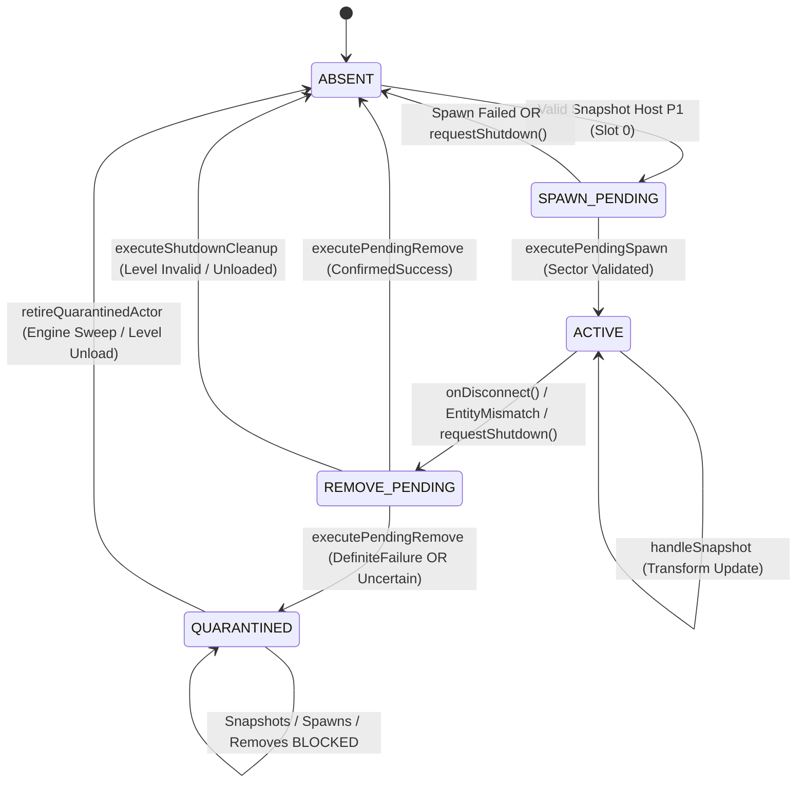
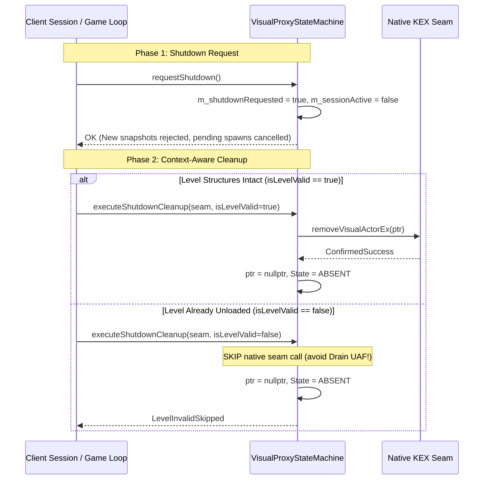

# PowerSlave Exhumed Together — Visual Proxy State Machine Technical Contract (Remediated)

**Document ID:** `PSE-DOC58B-CONTRACT-REMEDIATED-V1`  
**Author:** Gemini 3.8 High, Independent QA & Multiplayer Networking Specialist  
**Target Component:** Client B Native Visual Proxy Lifecycle (`VisualProxyStateMachine`)  
**Status:** CANDIDATE READY FOR REVIEW (`NATIVE INTEGRATION DEFERRED`)  
**Date:** 2026-11-03  
**Working Directory:** `tools/network-visual-proxy-readiness/remediation/`  
**Reference Implementations:**  
- Baseline: `tools/network-visual-proxy-readiness/include/visual_proxy_state_machine.hpp`  
- Candidate: `tools/network-visual-proxy-readiness/remediation/remediated_visual_proxy_state_machine.hpp`  

---

## 1. Executive Summary & Purpose

The **Visual Proxy State Machine** governs the Client B lifecycle of the native actor representing the remote Host P1. In the PowerSlave Exhumed Together split-instance architecture, Client B operates a local puppet (Slot 1) while receiving replicated `BridgePlayerSnapshot` DTOs for Host P1 (Slot 0).

The baseline implementation exhibited critical vulnerabilities discovered during adversarial QA:
1. **ADV-02 Defect:** When `removeVisualActor()` returned `false`, the baseline state machine immediately nullified `m_nativeActorPtr` and transitioned to `ABSENT`, losing track of a live native actor (orphan leak).
2. **ADV-11 Fallacy:** Assuming Host P1 is always in Sector 259 caused actors to be linked into `sectors[259].actorList` while their physical coordinates were in Sector 176, resulting in phantom invisible sprites and portal traversal asserts.
3. **Shutdown UAF Hazard:** Calling native `Remove` during `Session::stop()` after `kexSlaveLevelLocal::Unload` freed the sector array caused `Drain` (`0x1401b61d0`) to dereference freed memory (`STATUS_ACCESS_VIOLATION`).
4. **Exception Leakage:** Calling `assertSimulationThread()` threw `std::runtime_error`, which across unhandled C-ABI / MinHook hook boundaries triggered `std::terminate()`.

This contract establishes a hardened, fail-closed, `noexcept`-safe state machine incorporating an explicit **Quarantine Model**, a **Tri-State Removal Taxonomy**, and a **Sector Validation Interface**.

---

## 2. State Space & Definitions



### State Enum: `VisualProxyState : uint8_t`

| State | Value | Description | Invariants |
| :--- | :---: | :--- | :--- |
| `ABSENT` | `0` | No visual proxy actor exists on Client B. | `m_nativeActorPtr == nullptr`. No transforms applied. |
| `SPAWN_PENDING` | `1` | A valid Host P1 snapshot has been accepted, awaiting safe simulation tick spawn. | Actor not yet created in KEX. Transforms buffered in `m_pendingTransform`. |
| `ACTIVE` | `2` | Native actor is alive and linked in KEX level structures. | `m_nativeActorPtr != nullptr`. Transforms stream via `updateVisualTransform`. |
| `REMOVE_PENDING` | `3` | Teardown requested (disconnect, map invalidation, entity respawn, shutdown). | `m_nativeActorPtr != nullptr`. Snapshot updates rejected. |
| `QUARANTINED` | `4` | Native removal failed or returned ambiguous status. | `m_nativeActorPtr != nullptr` (preserved for diagnostics/sweep). Updates, spawns, and blind removes blocked. |

---

## 3. Tri-State Native Removal Taxonomy

The boolean `removeVisualActor() == false` is ambiguous in native KEX: it does not distinguish whether the engine refused to remove an actor that is still alive, or whether the removal failed due to an exception or state mismatch.

The remediated contract introduces `RemoveOutcome`:

```cpp
enum class RemoveOutcome : uint8_t {
    ConfirmedSuccess = 0, // Native actor unequivocally unlinked and freed
    DefiniteFailure = 1,  // Engine explicitly rejected removal; actor definitely still alive
    Uncertain = 2         // Outcome ambiguous (exception caught, hook fault, partial teardown)
};
```

### Removal Transition Matrix

| Current State | Native Seam Outcome | Resulting State | `m_nativeActorPtr` | Local Generation | Action Taken |
| :--- | :--- | :--- | :--- | :--- | :--- |
| `REMOVE_PENDING` | `ConfirmedSuccess` | `ABSENT` | Set to `nullptr` | Incremented (`+1`) | Clean retirement confirmed. |
| `REMOVE_PENDING` | `DefiniteFailure` | `QUARANTINED` | **PRESERVED** | Unchanged | Actor placed in quarantine (`QuarantineReason::RemoveDefiniteFailure`). |
| `REMOVE_PENDING` | `Uncertain` | `QUARANTINED` | **PRESERVED** | Unchanged | Actor placed in quarantine (`QuarantineReason::RemoveUncertain`). |
| `REMOVE_PENDING` | Exception Caught | `QUARANTINED` | **PRESERVED** | Unchanged | Isolate exception (`QuarantineReason::NativeExceptionCaught`). |
| `QUARANTINED` | Any call to remove | `QUARANTINED` | **PRESERVED** | Unchanged | **BLOCKED** (`QuarantinedBlocked`). Blind repeated calls forbidden. |

---

## 4. The Quarantine Model

When an actor enters `QUARANTINED`:

1. **Ownership Preservation:** `m_nativeActorPtr` is NOT zeroed. Retaining the pointer allows native diagnostics and avoids orphaning objects in KEX sector lists.
2. **Snapshot Immunity:** `handleSnapshot()` returns `ProxyRejectionReason::Quarantined`. No positional or rotational updates are dispatched to the compromised actor.
3. **Duplicate Prevention:** `executePendingSpawn()` returns `SpawnExecutionResult::Quarantined`. This prevents Client B from spawning a second actor while the first is still allocated in KEX memory.
4. **No Blind Removal Loops:** `executePendingRemove()` immediately returns `RemoveExecutionResult::QuarantinedBlocked` without calling the native seam. Repeated blind calls to a failing native function can cause heap corruption or double-free.
5. **Attested Retirement:** The quarantine state can ONLY be cleared when:
   - The engine unloads the entire level (`onMapInvalidated(levelAlreadyFreed = true)` or `executeShutdownCleanup(seam, isLevelValid = false)`), in which case `kexSlaveLevelLocal::Unload` reclaims all actors.
   - An explicit attested sweep reports completion via `retireQuarantinedActor(attestedEngineSwept = true)`.

---

## 5. Sector Validation Contract (`ISectorValidator`)

Blindly accepting a default sector (such as `sector259`) causes severe spatial desynchronization when Host P1 moves before Client B spawns the proxy.

### Interface Definition

```cpp
class ISectorValidator {
public:
    virtual ~ISectorValidator() = default;

    // Returns true iff destinationSector exists in the currently loaded level
    // and the position (x, y, z) is verified to reside within that sector.
    virtual bool validateDestinationSector(int sectorId, float x, float y, float z) const noexcept = 0;
};
```

### Spawn Rules
1. `executePendingSpawn()` requires a valid `const ISectorValidator*`. If `validator == nullptr`, spawn is rejected with `SpawnExecutionResult::SectorValidatorMissing`.
2. If `validator->validateDestinationSector(sectorId, x, y, z) == false`, spawn is rejected with `SpawnExecutionResult::SectorValidationFailed`.
3. The state machine remains in `SPAWN_PENDING` until a valid sector matching the coordinates is supplied (or until shutdown/disconnect).
4. No coordinate clamping or hardcoded fallback sectors are permitted.

---

## 6. Safe Shutdown & Level Unload Contract

### The KEX Level Unload Race
In KEX Engine, calling `Remove` (`0x1401a02b0`) triggers `Drain` (`0x1401b61d0`), which navigates `sectors[actor->sectorId].actorList`. During `StateExit` (level transition or menu return), KEX calls `kexSlaveLevelLocal::Unload` (`0x1401c90e0`), freeing the sector array. Calling `Remove` after `Unload` dereferences freed memory, causing an immediate crash.

### Remediated Two-Phase Shutdown



---

## 7. Thread Affinity & `noexcept` ABI Boundaries

### Principles
1. **Zero Uncaught Exceptions:** MinHook hooks into KEX are C-ABI functions. An unhandled C++ exception causes immediate `std::terminate()`. Every public method of `VisualProxyStateMachine` is strictly marked `noexcept`.
2. **Fail-Closed Affinity:** If a method is invoked from any thread other than the registered Simulation Thread (`m_simulationTid`), it must return an explicit error enum (`AffinityViolation`) or `false`, without throwing.
3. **Internal Seam Isolation:** While native seams should be `noexcept`, external mock seams or rogue hooks could throw. All native seam invocations inside the state machine are wrapped in `try { ... } catch (...) { ... }` blocks that map exceptions to quarantine states or error results.

---

## 8. State Machine Interface Summary

```cpp
namespace pse::proxy::remediated {

class VisualProxyStateMachine {
public:
    explicit VisualProxyStateMachine(uint8_t targetSlot = pse::HOST_SLOT_ID) noexcept;

    void registerSimulationThread() noexcept;
    bool isSimulationThread() const noexcept;

    bool configureSession(uint32_t epoch, uint32_t connectionGen) noexcept;
    bool resetSession() noexcept;

    ProxyRejectionReason handleSnapshot(const pse::BridgePlayerSnapshot& s,
                                         bool mapReady,
                                         bool isGameplay,
                                         INativeVisualProxySeamRemediated* seam = nullptr) noexcept;

    SpawnExecutionResult executePendingSpawn(INativeVisualProxySeamRemediated* seam,
                                             const ISectorValidator* validator,
                                             uint32_t actorType,
                                             int destinationSector) noexcept;

    RemoveExecutionResult executePendingRemove(INativeVisualProxySeamRemediated* seam) noexcept;

    bool requestShutdown() noexcept;
    RemoveExecutionResult executeShutdownCleanup(INativeVisualProxySeamRemediated* seam, bool isLevelValid) noexcept;

    void onDisconnect() noexcept;
    void onMapInvalidated(bool levelAlreadyFreed = false) noexcept;
    bool retireQuarantinedActor(bool attestedEngineSwept) noexcept;

    // Observers
    VisualProxyState state() const noexcept;
    QuarantineReason quarantineReason() const noexcept;
    void* activeActor() const noexcept;
    uint32_t localProxyGeneration() const noexcept;
    uint32_t activeEntityId() const noexcept;
    uint32_t activeEntityGeneration() const noexcept;
    const ProxyTransform& currentTransform() const noexcept;
    uint32_t spawnCount() const noexcept;
    uint32_t removeCount() const noexcept;
    bool isSessionActive() const noexcept;
    bool isShutdownRequested() const noexcept;
};

} // namespace pse::proxy::remediated
```
