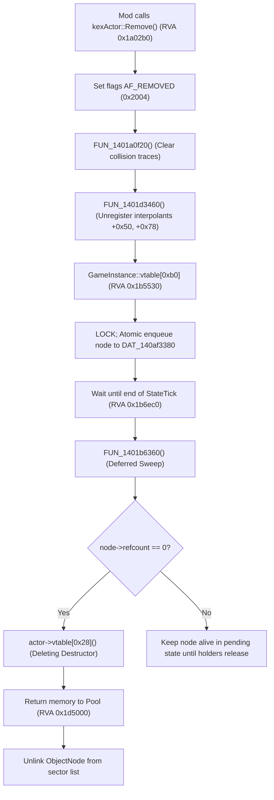

# PowerSlave Exhumed Together — Visual Player Proxy Critical Feasibility Audit

**Document ID:** `REPORT-VISUAL-PLAYER-PROXY-AUDIT`  
**Classification:** Critical Reverse Engineering & Native Lifecycle Feasibility Audit  
**Author:** Gemini 3.8 Flash High, Senior KEX Reverse Engineering Analyst / Native C++ Actor Lifecycle Researcher  
**Target Engine:** PowerSlave Exhumed (2022) (`anubis_Shipping_Steam_x64.exe`)  
**Target Binary SHA-256:** `b8f131037187ca8d0a282527fb6f55a2012241d5b9dac8bf2038baf35b71a76d`  
**Target Base Address:** `0x140000000` (Preferred Image Base)  
**Scope:** Strict read-only audit of native actor factory, scene rendering traversal, transform/sector contracts, actor removal/deferred destruction, third-person sprite assets, and isolation risks for the future Visual Player Proxy.

---

## 1. Независимый критический аудит утверждений DOC-54

В рамках текущего исследования проведена сплошная верификация всех утверждений DOC-54 непосредственно по машинному коду, ассемблерным листингам и сохранённым декомпилированным данным Ghidra 12.2.

Ни одно утверждение DOC-54 не принималось на веру. Результаты классифицированы по пяти статусам:

| Утверждение DOC-54 | Фактический статус | Обоснование и доказательства |
|---|---|---|
| Фабрика акторов RVA `0x1d4780` (`SpawnActor`) | **VERIFIED STATIC** | Совпадает: `FUN_1401d4780`. Сигнатура: Win64 `RCX=this, EDX=type, R8=pos, XMM3=yaw, [RSP+0x28]=sector`. Проверено в `G_FUNC_1401d4780.json`. |
| Размер `kexSlavePuppet` = `0x1e0` (480 байт) | **VERIFIED STATIC** | Совпадает: аллокатор `FUN_1401db790` выделяет ровно `0x1e0` байт; AngelScript регистрация `RegisterObjectType` (`E014_SCRIPT_REGISTRATION_MAP.json`) подтверждает `0x1e0`. |
| Базовый размер `kexSlaveActor` = `0x1b8` (440 байт) | **VERIFIED STATIC** | Совпадает: регистрация `RegisterObjectType("kexSlaveActor", 0x1b8, ...)` в `E014`. |
| Кандидат Spawn куклы RVA `0x1dbc60` | **VERIFIED STATIC** | Совпадает: виртуальный метод `kexSlavePuppet::Spawn` (`vtable + 0x38` $\to$ `0x1401dbc60`). Вызывает базовый Spawn `0x1401a02f0`, крадёт синглтон игрока `0x1401b5520`, привязывает `node` к `Player+0xd8`. |
| `LinkSector` RVA `0x1d3d70` | **VERIFIED STATIC** | Совпадает: `FUN_1401d3d70`. Сигнатура: `void LinkSector(kexSlaveActor* actor, int sectorId)`. |
| Смещение Origin `Actor + 0x18` | **VERIFIED STATIC** | Совпадает: `kVec3` по смещению `+0x18`. Подтверждено `FUN_140194aa0` (`LEA RAX, [RCX+0x18]`), фабрикой `0x1401d4780` и рендерером `0x1401a2580`. |
| Смещение Yaw `Actor + 0x38` | **VERIFIED STATIC** | Совпадает: `float yaw` по смещению `+0x38` внутри структуры вращения `slaveRotation_s` (`+0x30`). Подтверждено `0x1401d4780` и `0x1401a2580`. |
| Смещение Actor Flags `Actor + 0x16c` | **VERIFIED STATIC** | Подтверждено: битовые флаги `+0x16c` проверяются в `InflictDamage` (`0x20`), `Tick` (`0x80000000`), `Render` (`0x1000000` = `AF_HIDDEN`). |
| **Последовательность DOC-54: `UnlinkSector -> SetSector -> LinkSector`** | **REFUTED** | **ОШИБКА DOC-54.** Функция `FUN_1401d3d70` (`LinkSector`) **сама** проверяет `if (*(int*)(actor + 0x3c) != newSectorId)` и выполняет исключение узла из двусвязного списка старого сектора и включение в новый. Если предварительно вызвать `SetSector`, `LinkSector` не обнаружит смены сектора и пропустит перемещение узла! Ручной вызов отдельного `UnlinkSector` приведёт к разрушению указателей списка! |
| Ссылка на рендерер `kexRenderScene::DrawSprite` | **REFUTED (Имя) / VERIFIED STATIC (Механизм)** | Класса `kexRenderScene` и функции `DrawSprite` в бинарнике 2022 года нет в RTTI/символах (это названия из устаревшего референса 2015 года). Фактический рендерер спрайтов сцены реализован в `FUN_1401a2580` (`RenderSectors`), который вызывает `FUN_1401a34c0` (`DrawActorBillboard`) и пакетирует вершины через `FUN_140055fb0` (`kexBatchedVertices::AddQuad`). |
| Использование пакета `john.kpf` из мода 2015 года | **INFERRED / UNVERIFIED REDISTRIBUTION** | Файл `mods/john.kpf` физически найден в референсах, формат KEX anim/sprite совместим с 2022. Однако права на распространение не подтверждены лицензией (GPL относится к исходникам, спрайты рипнуты из DOS-версии 1996 года). Для первого PoC использование внешних ассетов избыточно и рискованно. |
| Сборщик отложенного удаления RVA `0x1b6360` (`deferred sweep`) | **VERIFIED STATIC** | Совпадает: `FUN_1401b6360` вызывается в конце каждого тика геймплея (`StateTick` `0x1401b6ec0`). Обходит список узлов, проверяет `refcount == 0` по `node + 0x40`, вызывает виртуальный деструктор `vtable + 0x28` и освобождает память в пул. |

---

## 2. P1 — Независимый аудит Native Actor Factory (`0x1401d4780`)

### 2.1. Фактическая сигнатура и ABI фабрики
- **Адрес:** VA `0x1401d4780`, RVA `0x1d4780`, File Offset `0x1d3b80`.
- **Calling Convention:** Windows x64 `__fastcall` / `thiscall`:
  ```cpp
  kexSlaveActor* __fastcall kexSlaveObjectFactoryLocal::SpawnActor(
      kexSlaveObjectFactoryLocal* this, // RCX: указатель на фабрику акторов
      int actorType,                     // EDX: тип актора (enum actorTypes)
      const kVec3* pos,                  // R8:  мировые координаты появления
      float yaw,                         // XMM3: начальный угол рыскания (градусы)
      int sectorId                       // [RSP+0x28]: индекс начального сектора
  );
  ```

### 2.2. Порядок инициализации, аллокации и связывания полей
1. **Поиск определения типа (`ActorDef`):**
   - Фабрика вызывает `FUN_1401bb140(DAT_140af3350, &actorType)`. `DAT_140af3350` — хеш-таблица определений акторов, загруженных из `defs/actors/*.txt`.
   - Если тип найден, получается указатель `ActorDef*` (`lVar15`).
   - По строке `ActorDef.classname` через RTTI-хешер `FUN_1400becf0()` находится дескриптор класса `pRTTI`.
   - Если тип не найден в таблице:
     - При `actorType == 0`: принудительный поиск RTTI `"kexSlavePuppet"`.
     - При `actorType == 25 || actorType == 126`: принудительный поиск RTTI `"kexSlaveFireballSpawner"`.
     - Для всех остальных незарегистрированных типов: fallback на RTTI `kexSlaveActor` (`&PTR_FUN_140a432d8`).
2. **Аллокация памяти:**
   - Фабрика проверяет пул свободных объектов данного типа (`lVar14 = iVar7 * 0x20 + DAT_140af45f0`).
   - Если в пуле есть готовый объект: атомарно извлекает его из пула.
   - Если пул пуст: вызывает нативный RTTI-конструктор `(*pRTTI->pfnAlloc)()`.
     - Для `kexSlavePuppet`: аллокатор `0x1401db790` выделяет `0x1e0` байт.
     - Для `kexSlaveActor`: аллокатор выделяет `0x1b8` байт.
   - Проверяет assertions: `InstanceOf<kexSlaveObject>()` и `InstanceOf<kexSlaveActor>()`.
3. **Инициализация базовых полей актора:**
   - Записывает `actor + 0x170 = ActorDef*`.
   - Записывает `*(kVec3*)(actor + 0x18) = *pos`.
   - Нормализует `yaw` в диапазон $[-180^\circ \dots +180^\circ]$ и записывает в `*(float*)(actor + 0x38)`.
   - Обнуляет `pitch` и `roll` по `actor + 0x30`.
4. **Связывание с сектором мира (`LinkSector` RVA `0x1d3d70`):**
   - Вызывает `FUN_1401d3d70(actor, sectorId)`.
   - Проверяет валидность сектора: `sectorId < DAT_140a45970`. При выходе за границу — фатальный assertion `index < m_dwLength`.
   - Проверяет `actor + 0x10` (`ObjectNode*`).
   - Так как объект новый, узел ещё равен `NULL`: фабрика вызывает `FUN_1401d5820()` для аллокации `ObjectNode` из глобального пула узлов.
   - Помещает `node` в двусвязный кольцевой список сектора `sectors[sectorId].actorList` (`sector + 0x78`).
   - Записывает в узел: `node->callback = FUN_1401d3230` (функция тика актора), `node->payload = actor` (`node + 0x28`).
   - Записывает обратную ссылку: `actor + 0x10 = node`, `actor + 0x3c = sectorId`.
5. **Вызов виртуального `Spawn()` (`vtable + 0x38`):**
   - Для `kexSlavePuppet` (`0x1401dbc60`): вызывает базовый `kexSlaveActor::Spawn`, затем **безусловно захватывает синглтон игрока**.
   - Для `kexSlaveActor` (`0x1401a02f0`): регистрирует интерполянты позиции (`actor + 0x50`) и вращения (`actor + 0x78`) в глобальном массиве `DAT_14063d368`, устанавливает bounding box, сбрасывает рёбра ссылок, запрашивает высоты пола и потолка сектора.

### 2.3. Существование готового actor type для визуального прокси
**КРИТИЧЕСКИЙ ВЫВОД:** В штатных ресурсах игры (`PowerslaveEX.kpf`) **отсутствует** выделенный actor type для удалённого сетевого игрока.
- Единственный актор игрока `Obj_Player` (`AT_PLAYER = 0`) жёстко привязан к классу `kexSlavePuppet`.
- Попытка спавна `AT_PLAYER` на клиенте через штатную фабрику приведёт к немедленному краху локального управления: кукла украдёт синглтон `GameInstance + 0x40`.
- Другие существующие в `defs/actors/misc.txt` типы на базе `kexSlaveActor`:
  - `Obj_Debris`: радиус 12, высота 12, анимация `objects/debris`, флаг `moveable 1`.
  - `Obj_Ramses_Body_Rest`: радиус 16, высота 32, анимация `misc/ramses_body_rest`, `fullbright 1`.
  - `Obj_Ramses`: радиус 16, высота 32, анимация `misc/ramses_spawn`, полупрозрачность `transparency 224`.
- **Ограничение:** Создание совершенно нового имени актора без модификации `defs/actors/*.txt` невозможно через фабрику по имени, но возможно создание пассивного экземпляра класса `kexSlaveActor` через подмену типа или непосредственное создание объекта с последующей ручной привязкой визуальных параметров.

---

## 3. P2 — Сравнительный анализ: Full Player vs Passive Actor vs Альтернативы

### Матрица архитектурных вариантов на клиенте

| Критерий | Вариант A: Full Player + Puppet | Вариант B: Passive `kexSlaveActor` | Вариант C: Transient Sprite Entity |
|---|---|---|---|
| **Нативные Seams** | `SpawnActor(0)`, `kexSlavePuppet::Spawn` (`0x1dbc60`), `Player::Update` (`0x1dfe30`). | `SpawnActor(N)`, `kexSlaveActor::Spawn` (`0x1a02f0`), `LinkSector` (`0x1d3d70`). | `kexBatchedVertices::AddQuad` (`0x55fb0`) напрямую из хука рендера. |
| **Обязательные зависимости** | `kexSlavePlayer` (408 байт), `ObjectNode`, атомарный `AddRef/DecRef`, синглтон `GetPlayer`. | `kexSlaveActor` (440 байт), собственный `ObjectNode`, привязка к сектору. | Никаких игровых сущностей. Прямой доступ к матрице камеры и GPU-буферу. |
| **ABI риски** | **КРИТИЧЕСКИЕ:** Требует обхода singleton theft в `0x1dbc60`, изоляции хуков контроллера. | **НИЗКИЕ:** Стандартный C++ контракт фабрики и базового актора. | **ВЫСОКИЕ:** Зависимость от недокументированных структур рендер-контекста. |
| **Ownership риски** | **КРИТИЧЕСКИЕ:** Циклические ссылки `Node <-> Puppet <-> Player`. При дисконнекте висячий `Player`. | **НИЗКИЕ:** Владение исключительно через узел `ObjectNode` в секторе. | **НУЛЕВЫЕ:** Нет аллокаций в памяти движка. |
| **Double-Update риски** | **КРИТИЧЕСКИЕ:** `Puppet::Tick` исполняет `GroundMove`, коллизии, звуки шагов. | **НУЛЕВЫЕ:** При сброшенном флаге `moveable` физика в `0x19f2d0` пропускается полностью. | **НУЛЕВЫЕ:** Нет тика симуляции. |
| **Секторные триггеры** | **КРИТИЧЕСКИЙ ДЕФЕКТ:** `Puppet::Tick` запускает `EnterSectorSpecial` (лава, урон, скрипты!). | **ИЗОЛИРОВАН:** `kexSlaveActor::Tick` не вызывает секторных триггеров. | **ИЗОЛИРОВАН:** Не взаимодействует с секторами. |
| **Совместимость рендера** | Требует изменения логики `0x1401a2580` (рендерер пропускает puppet локального игрока). | **ПОЛНАЯ:** Рендерер автоматически обходит видимые секторы и рисует все `kexSlaveActor`. | Требует отдельного прохода отрисовки после мира. |
| **Lifetime риски** | Высокий риск краша при смене уровня (`StateExit`) из-за незарегистрированного второго игрока. | **БЕЗОПАСНЫЙ:** Автоматически выгружается штатным `Level::Unload` (`0x1c90e0`). | Нет времени жизни. |

### Оценка альтернативы (Вариант C)
Прямой рендеринг спрайта мимо графа сцены (`kexBatchedVertices::AddQuad`) привлекателен отсутствием сущности в игровом мире, но имеет критические недостатки:
1. Теряется секторное отсечение видимости (PVS) и портальный окклюжн.
2. Невозможно автоматически рассчитать освещённость и палитру сектора, в котором находится удалённый игрок.
3. Риск рассинхронизации Z-буфера со стенами и геометрией мира.

> [!IMPORTANT]
> **Вердикт:** Единственным безопасным и совместимым с движком путём является **Вариант B — Пассивный `kexSlaveActor`**, создаваемый без связывания с `kexSlavePlayer` и с отключёнными флагами физического взаимодействия.

---

## 4. P3 — Безопасное отображение спрайта и визуальные ресурсы

### 4.1. Анализ конвейера рендеринга спрайтов в KEX 2022
1. **Точка входа рендера сцены:** `GameInstance::RenderState` (`0x1401b7700`) при `state == 3` (геймплей) вызывает `FUN_1401076b0` и `FUN_1401a2580` (`RenderSectors`).
2. **Обход графа сцены:**
   - Движок определяет список видимых секторов на основе портальной видимости камеры (`FUN_140070920`).
   - Для каждого видимого сектора обходится двусвязный список акторов `sector->actorList` (`lVar14 = *(longlong*)(sector + 0x78) + 8`).
   - Из узла извлекается актор: `puVar23 = node->payload` (`node + 0x28`).
   - Проверяется принадлежность классу: `actor->InstanceOf<kexSlaveActor>()` (`0x140a432e0`).
   - **Фильтр локального игрока:** `if (actor != localPlayerPuppet)` (строка 543 декомпилятора). Кукла локального игрока первого лица отсекается от рендера в третьем лице.
   - **Проверка невидимости:** проверяется бит 24 флагов актора `actor + 0x16c` (`0x1000000` = `AF_HIDDEN`). Если флаг установлен, актор не рисуется.
3. **Отрисовка билборда:**
   - Вызывается `FUN_1401a34c0(renderContext, pass, actor->yaw, &actor->origin, scale, &color)`.
   - Вычисляется поворот относительно активной камеры через `sinf` и `cosf`.
   - Генерируются 4 вершины квада и передаются в `kexBatchedVertices::AddQuad` (`0x140055fb0`).
4. **Выбор кадра и угла анимации:**
   - Указатель на структуру анимации хранится в `actor + 0x108`.
   - Индекс текущего кадра хранится в `*(short*)(actor + 0x178)`.
   - Смена анимации выполняется штатным методом `kexSlaveActor::ChangeAnim(const char* animName)` (RVA `0x1a1240`).

### 4.2. Анализ пакета `john.kpf` (2015 Co-Op Edition)
- **Наличие:** Файл физически присутствует в `PowerSlave_EX_-_CO-OP_Edition/mods/john.kpf` (156 436 байт).
- **Содержимое:**
  - `sprites/player/john.png` (155 010 байт): атлас 40 кадров $1024 \times 315$ px.
  - `sprites/player/john_anim.txt` (17 079 байт): анимации `john_idle`, `john_walk`, `john_shoot`, `john_death`.
  - `sprites/player/john_sprite.txt` (1 694 байта): разметка 40 спрайтовых прямоугольников.
- **Совместимость формата:** **100% VERIFIED STATIC.** Синтаксис `rotation_N`, `rotation_NE`, `rotation_E`, `sprites { { "path", id, x, y, flip } }` в KEX 2022 абсолютно идентичен формату KEX 2015.
- **Статус лицензии и распространения:** **НЕОПРЕДЕЛЁННЫЙ (UNKNOWN).** Спрайты являются собственностью Lobotomy Software / Playmates Interactive (1996), рипнуты Dunkelschwamm. На них не распространяется лицензия GPL v2 движка Kaiser. Включение их в дистрибутив без отдельного правового анализа несёт лицензионный риск.
- **Рекомендация для первого PoC:**
  **НЕ ИСПОЛЬЗОВАТЬ `john.kpf`.** Первый нативный эксперимент обязан использовать **существующий штатный видимый объект KEX** (например, `Obj_Ramses_Body_Rest` или `Obj_Debris`), уже запакованный в оригинальный `PowerslaveEX.kpf`. Это гарантирует нулевую зависимость от внешних файлов.

---

## 5. P4 — Секторы, пространственные связи и трансформ

### 5.1. Анализ полей трансформа
- `Actor + 0x18`: `kVec3 origin` (3 $\times$ `float`: $X, Y, Z$). Координаты в пространстве KEX.
- `Actor + 0x30`: `slaveRotation_s` (3 $\times$ `float`: pitch, roll, yaw).
- `Actor + 0x38`: `float yaw` (угол рыскания в градусах).
- `Actor + 0x3c`: `int sectorIndex` (индекс текущего сектора).
- `Actor + 0x44`, `Actor + 0x48`: индексы узлов в spatial partition tree (area links).

### 5.2. Контракт перемещения и смена сектора
В машинной инструкции `FUN_1401d3d70` (`LinkSector`) доказан следующий алгоритм:
```c
void FUN_1401d3d70(kexSlaveActor* actor, int newSectorId)
{
    if (newSectorId >= DAT_140a45970) {
        AssertionFailure("index < m_dwLength", "array.h", 0x4b5);
    }
    ObjectNode* node = actor->node; // actor + 0x10
    Sector* newSector = &sectors[newSectorId]; // newSectorId * 0x88 + DAT_140a45968
    
    if (node == NULL) {
        // Первый спавн: аллокация узла и вставка в список сектора
        node = AllocateObjectNode();
        InsertIntoDoublyLinkedList(&newSector->actorList, node);
        node->callback = FUN_1401d3230;
        node->payload = actor;
        actor->node = node;
        actor->sectorIndex = newSectorId;
        return;
    }
    
    // Перемещение между секторами:
    if (actor->sectorIndex != newSectorId) {
        // АТОМАРНОЕ ИСКЛЮЧЕНИЕ ИЗ СТАРОГО СПИСКА:
        node->prev->next = node->next;
        node->next->prev = node->prev;
        
        // АТОМАРНАЯ ВСТАВКА В НОВЫЙ СПИСОК:
        InsertIntoDoublyLinkedList(&newSector->actorList, node);
    }
    actor->sectorIndex = newSectorId;
}
```

### 5.3. Критические правила перемещения прокси
1. **Запрет раздельного Unlink:** Не существует безопасной отдельной функции `UnlinkSector()`. Единственный штатный путь смены сектора — прямой вызов `LinkSector(actor, newSectorId)`.
2. **Запрет ручной записи `actor->sectorIndex`:** Если записать `*(int*)(actor + 0x3c) = newSectorId` до вызова `LinkSector`, проверка `if (actor->sectorIndex != newSectorId)` станет ложной, и актор навсегда останется в списке старого сектора.
3. **Обновление интерполянтов:** При телепортации или резком перемещении прокси необходимо обновить координаты в структуре интерполянта `actor + 0x50`, иначе рендерер будет интерполировать положение из точки предыдущего кадра.
4. **Безопасная политика для первого PoC:**
   В первом нативном эксперименте прокси должен быть **неподвижным в пределах одного сектора** (сектор спавна локального игрока). Это полностью исключает риски смены сектора до подтверждения стабильности жизненного цикла.

---

## 6. P5 — Нативное удаление (Removal) и время жизни (Lifetime)

### 6.1. Полная цепочка удаления актора


### 6.2. Ответы на вопросы жизненного цикла
1. **Какая функция инициирует удаление?** Нативная виртуальная функция `kexActor::Remove()` (`0x1401a02b0`).
2. **Когда актор перестаёт быть видимым?** Немедленно после вызова `Remove()` (устанавливается бит флагов, который сбрасывает видимость в `0x1401a2580`).
3. **Когда он исключается из списков секторов?** Физическое расцепление связей выполняется сборщиком `FUN_1401b6360` в конце текущего тика симуляции.
4. **Кто владеет `ObjectNode`?** Движок через глобальный пул узлов. Мод **никогда** не должен вызывать `free()` или `delete` для `ObjectNode` или `kexSlaveActor`.
5. **Можно ли вызывать `Remove()` внутри `StateTick`?** ДА. Функция специально разработана для вызова из тика: она лишь помечает объект и ставит узел в очередь отложенного удаления.
6. **Можно ли вызывать `Remove()` из потока рендера или сети?** **КАТЕГОРИЧЕСКИ НЕТ.** Вызов разрешён исключительно из потока симуляции (`StateTick` TID).
7. **Поведение при смене карты (`StateExit` RVA `0x1b6670`):**
   При выгрузке уровня функция `FUN_1401c90e0` (`Level::Unload`) обходит все секторы и принудительно удаляет все узлы. Если прокси зарегистрирован штатно, он будет выгружен движком автоматически. Однако для чистоты архитектуры мод обязан деспавнить прокси до вызова `StateExit`.

---

## 7. P6 — Риски для Singleplayer и клиентского мира

| Игровой аспект | Риск влияния прокси | Нативный механизм | Доказанный способ защиты | Статус |
|---|---|---|---|---|
| **Секторные триггеры** | Активация лавы, дверей, скриптов | Вызов `EnterSectorSpecial` в `Puppet::Tick` | Использовать `kexSlaveActor` (не содержит вызова секторных триггеров) | **VERIFIED STATIC** |
| **Получение урона** | Урон от взрывов, лавы, выстрелов | `InflictDamage` (`0x1401a1370`) | Сбросить бит 5 (`0x20` = `AF_SHOOTABLE`) в `actor + 0x16c`. Функция сразу выходит | **VERIFIED STATIC** |
| **Коллизии с врагами** | Застревание врагов в прокси | Трассировка лучей и капсул `0x1401a4990` | Сбросить бит 0 (`0x1` = `AF_SOLID`) в `actor + 0x16c` | **VERIFIED STATIC** |
| **Блокировка игрока** | Локальный игрок натыкается на прокси | Трассировка движения игрока | Сбросить `AF_SOLID`. Физика игрока игнорирует не-солидные объекты | **VERIFIED STATIC** |
| **Атака со стороны AI** | Монстры переключаются на прокси | Поиск цели `0x140195580` / `0x1401971e0` | AI ищет цель только через синглтон `Player()`. Прокси не связан с Player | **VERIFIED STATIC** |
| **Звуковые эффекты** | Звуки шагов, стонов, боли | `Puppet::Tick`, `Puppet::Damage` | Пассивный актор не имеет звуков шагов; при отсутствии урона нет звуков боли | **VERIFIED STATIC** |
| **Глобальная статистика** | Искажение счётчиков убийств/секретов | `Player::Update`, триггеры предметов | Прокси не подбирает предметы и не наносит урон, статистика не затрагивается | **VERIFIED STATIC** |
| **Локальная камера** | Смещение взгляда или захват слушателя | Вычисление слушателя в `StateTick` | Камера читает только `GameInstance->GetPlayer()->GetActor()`. Прокси изолирован | **VERIFIED STATIC** |
| **Утечка `ObjectNode`** | Накопление неосвобождённых узлов | `FUN_1401b5530` / `FUN_1401b6360` | Не увеличивать `refcount` узла вручную; удалять через `kexActor::Remove()` | **VERIFIED STATIC** |

---

## 8. Открытые вопросы (Open Questions)

1. **Вопрос 1 (Стабильность при смене уровня):**
   *Формулировка:* Если клиентский прокси не деспавнится модом до начала загрузки новой карты (`state 4`), вызовет ли `Level::Unload` (`0x1c90e0`) исключение при очистке узла, если он удерживается локальной таблицей мода?
   *Требуемое доказательство:* Наблюдение счетчиков узлов при выходе в меню через Frida/C++ probe.
2. **Вопрос 2 (Выбор кадра анимации при сетевом угле):**
   *Формулировка:* Как точно вычисляется 8-направленный угол спрайта в `FUN_1401a34c0` относительно направления взгляда камеры? Достаточно ли передавать сетевой `yaw`, или требуется явный пересчёт относительного азимута?
   *Требуемое доказательство:* Статический разбор математического блока в `0x1401a34c0` или изолированный runtime-тест.
3. **Вопрос 3 (Механизм монтирования `mods/*.kpf`):**
   *Формулировка:* Сканирует ли функция `FUN_1400b6790` папку `mods/` автоматически при старте игры, или требует специального аргумента командной строки?
   *Требуемое доказательство:* Проверка xrefs к строке `'mods/'` в загрузчике пакетов.

---

## 9. Рекомендация по минимальному первому PoC

Подробный пошаговый план проведения минимального нативного эксперимента передан в [`SOL_HANDOFF.md`](SOL_HANDOFF.md).

### Краткая суть PoC:
1. **Никакой сети и ENet на первом этапе.**
2. **Одна изолированная копия игры.**
3. В устойчивом геймплее (`state == 3`) создать **один штатный пассивный объект** (`kexSlaveActor`) в секторе спавна игрока.
4. Убедиться, что объект отображается на экране как спрайт, не крадёт управление, не блокирует локального игрока и не провоцирует AI.
5. Корректно удалить объект через штатный вызов `kexActor::Remove()` (`0x1401a02b0`).
6. Дождаться штатной очистки в `deferred sweep` (`0x1401b6360`).
7. Завершить процесс через штатный Quit (`exit 0`).
8. **Критерий успеха:** `Create -> Visible -> Stable (120 ticks) -> Remove -> Clean Exit`.
